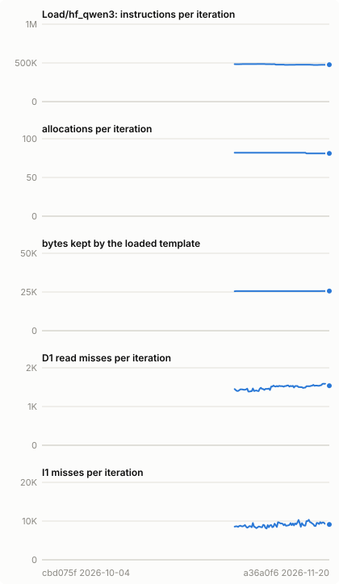

# Benchmark trend

Instruction and allocation counts per iteration on master, one record per commit (242 so far, latest [f9b62e9](https://github.com/jinja2cpp/Jinja2Cpp/commit/f9b62e90999d9c05f9ec8f2deca47c488c020efd) on 2026-11-17). Written by the `trend` job of `.github/workflows/benchmark.yml` with `bench/trend.py`; the data is `history.jsonl`.

Memory is the bytes a loaded template keeps for `Load/*` and the peak heap use of one render for `Render/*`; vs first compares with the first record that has it.

| Benchmark | Instructions | vs previous | vs first | Allocations | vs previous | vs first | Memory | vs previous | vs first |
|---|---:|---:|---:|---:|---:|---:|---:|---:|---:|
| [Load/chat_llama](#loadchat_llama) | 334,164 | 0% |  | 54 | 0% |  | 18,472 | 0% | -52.73% |
| [Render/chat_llama](#renderchat_llama) | 290,297 | -0.02% |  | 224 | 0% |  | 11,592 | 0% | -19.28% |
| [Load/chat_mistral](#loadchat_mistral) | 383,117 | 0% |  | 51 | 0% |  | 20,896 | 0% | -53.20% |
| [Render/chat_mistral](#renderchat_mistral) | 491,584 | -0.01% |  | 401 | 0% |  | 10,040 | 0% | -23.99% |
| [Load/chat_qwen](#loadchat_qwen) | 259,972 | 0% |  | 43 | 0% |  | 14,424 | 0% | -47.22% |
| [Render/chat_qwen](#renderchat_qwen) | 271,556 | 0% |  | 211 | 0% |  | 8,280 | 0% | -2.63% |
| [Load/config_file](#loadconfig_file) | 93,481 | 0% |  | 24 | 0% |  | 5,472 | 0% | -48.18% |
| [Render/config_file](#renderconfig_file) | 1,267,657 | +0.03% |  | 908 | 0% |  | 25,624 | 0% | +7.63% |
| [Load/dict_ops](#loaddict_ops) | 31,578 | 0% | -78.63% | 8 | 0% | -93.89% | 2,184 | 0% | -48.68% |
| [Render/dict_ops](#renderdict_ops) | 290,683 | 0% | -57.92% | 112 | 0% | -75.11% | 24,408 | 0% | -29.65% |
| [Load/expressions](#loadexpressions) | 43,520 | 0% | -78.89% | 15 | 0% | -89.73% | 2,736 | 0% | -55.41% |
| [Render/expressions](#renderexpressions) | 414,276 | 0% | -54.28% | 3 | 0% | -90.00% | 2,440 | 0% | -31.15% |
| [Load/filters](#loadfilters) | 66,752 | 0% | -75.68% | 26 | 0% | -88.60% | 3,856 | 0% | -66.22% |
| [Render/filters](#renderfilters) | 26,371 | 0% | -70.26% | 23 | 0% | -68.92% | 752 | 0% | -84.69% |
| [Load/for_filter_if](#loadfor_filter_if) | 28,363 | 0% | -79.05% | 6 | 0% | -95.12% | 1,912 | 0% | -44.55% |
| [Render/for_filter_if](#renderfor_filter_if) | 267,263 | 0% | -69.12% | 4 | 0% | -98.23% | 16,560 | 0% | +354.95% |
| [Load/for_loop_vars](#loadfor_loop_vars) | 38,170 | 0% | -78.87% | 9 | 0% | -94.27% | 2,376 | 0% | -47.43% |
| [Render/for_loop_vars](#renderfor_loop_vars) | 170,653 | 0% | -84.09% | 2 | 0% | -99.62% | 1,568 | 0% | -43.35% |
| [Load/for_range](#loadfor_range) | 12,368 | 0% | -78.18% | 6 | 0% | -89.29% | 1,096 | 0% | -45.20% |
| [Render/for_range](#renderfor_range) | 37,060 | 0% | -59.81% | 3 | 0% | -88.89% | 408 | 0% | -73.02% |
| [Load/hf_deepseek_v31](#loadhf_deepseek_v31) | 382,218 | 0% |  | 54 | 0% |  | 21,984 | 0% | +0.77% |
| [Render/hf_deepseek_v31](#renderhf_deepseek_v31) | 89,959 | 0% |  | 42 | 0% |  | 2,456 | 0% | -0.97% |
| [Load/hf_gpt_oss](#loadhf_gpt_oss) | 1,518,512 | 0% |  | 282 | 0% |  | 74,744 | 0% | +0.70% |
| [Render/hf_gpt_oss](#renderhf_gpt_oss) | 167,373 | -0.01% |  | 153 | 0% |  | 5,736 | 0% | +16.21% |
| [Load/hf_mistral_small](#loadhf_mistral_small) | 588,352 | 0% |  | 87 | 0% |  | 33,056 | 0% | +0.36% |
| [Render/hf_mistral_small](#renderhf_mistral_small) | 138,912 | -0.01% |  | 97 | 0% |  | 6,096 | 0% | -0.65% |
| [Load/hf_qwen3](#loadhf_qwen3) | 474,344 | 0% |  | 81 | 0% |  | 25,568 | 0% | +0.35% |
| [Render/hf_qwen3](#renderhf_qwen3) | 116,560 | -0.01% |  | 99 | 0% |  | 3,224 | 0% | -0.74% |
| [Load/html_autoescape](#loadhtml_autoescape) | 187,982 | 0% |  | 42 | 0% |  | 12,680 | 0% | -48.62% |
| [Render/html_autoescape](#renderhtml_autoescape) | 1,195,376 | +0.02% |  | 674 | 0% |  | 46,016 | +0.03% | +13.95% |
| [Load/inheritance](#loadinheritance) | 21,152 | 0% | -81.46% | 6 | 0% | -94.39% | 1,352 | 0% | -52.92% |
| [Render/inheritance](#renderinheritance) | 134,484 | +0.02% | -82.02% | 35 | 0% | -94.37% | 8,040 | +0.40% | +33.64% |
| [Load/int_arith](#loadint_arith) | 64,305 | 0% |  | 19 | 0% |  | 3,880 | 0% | +0.62% |
| [Render/int_arith](#renderint_arith) | 825,479 | 0% |  | 12 | 0% |  | 3,272 | 0% | -0.49% |
| [Module/keep](#modulekeep) | 6,888 | +0.15% |  | 6 | 0% |  |  |  |  |
| [Module/keep_written](#modulekeep_written) | 28,927 | +0.03% |  | 10 | 0% |  |  |  |  |
| [Load/large_static](#loadlarge_static) | 146,465 | 0% | -83.47% | 13 | 0% | -97.05% | 43,128 | 0% | -19.21% |
| [Render/large_static](#renderlarge_static) | 20,334 | 0% | -72.94% | 1 | 0% | -94.44% | 36,552 | 0% | -1.83% |
| [RenderSink/large_static](#rendersinklarge_static) | 12,625 | 0% |  | 0 |  |  | 0 |  |  |
| [RenderTo/large_static](#rendertolarge_static) | 19,897 | 0% |  | 0 |  |  | 0 |  |  |
| [Load/macros](#loadmacros) | 53,983 | 0% | -76.32% | 25 | 0% | -86.56% | 4,424 | 0% | -28.83% |
| [Render/macros](#rendermacros) | 642,445 | 0% | -74.93% | 308 | 0% | -88.71% | 20,576 | 0% | +39.78% |
| [Load/many_tags](#loadmany_tags) | 8,723,925 | 0% | -80.25% | 950 | 0% | -97.23% | 438,120 | 0% | -58.48% |
| [Render/many_tags](#rendermany_tags) | 731,840 | 0% | -64.87% | 2 | 0% | -90.48% | 5,648 | 0% | -10.52% |
| [Load/mitsuhiko_table](#loadmitsuhiko_table) | 44,307 | 0% | -81.35% | 18 | 0% | -90.22% | 3,368 | 0% | -44.46% |
| [Render/mitsuhiko_table](#rendermitsuhiko_table) | 5,068,149 | 0% | -58.98% | 33 | 0% | -99.19% | 381,536 | 0% | +9.95% |
| [RenderSink/mitsuhiko_table](#rendersinkmitsuhiko_table) | 4,998,050 | 0% |  | 32 | 0% |  | 37,064 | 0% | +28.59% |
| [RenderTo/mitsuhiko_table](#rendertomitsuhiko_table) | 5,067,655 | 0% |  | 32 | 0% |  | 37,064 | 0% | +28.59% |
| [Load/mitsuhiko_table_wide](#loadmitsuhiko_table_wide) | 52,047 | 0% |  | 34 | 0% |  | 5,696 | 0% | -31.07% |
| [Render/mitsuhiko_table_wide](#rendermitsuhiko_table_wide) | 5,414,084 | 0% |  | 33 | 0% |  | 1,414,928 | 0% | +2.46% |
| [RenderSink/mitsuhiko_table_wide](#rendersinkmitsuhiko_table_wide) | 5,240,081 | 0% |  | 32 | 0% |  | 37,064 | 0% | +28.59% |
| [RenderTo/mitsuhiko_table_wide](#rendertomitsuhiko_table_wide) | 5,413,583 | 0% |  | 32 | 0% |  | 37,064 | 0% | +28.59% |
| [Load/plain_text](#loadplain_text) | 2,923 | 0% | -69.79% | 3 | 0% | -83.33% | 680 | 0% | -39.29% |
| [Render/plain_text](#renderplain_text) | 965 | 0% | -85.80% | 1 | 0% | -91.67% | 40 | 0% | -94.44% |
| [RenderSink/plain_text](#rendersinkplain_text) | 671 | 0% |  | 0 |  |  | 0 |  |  |
| [RenderTo/plain_text](#rendertoplain_text) | 766 | 0% |  | 0 |  |  | 0 |  |  |
| [Load/prompt_budget](#loadprompt_budget) | 33,762 | 0% |  | 17 | 0% |  | 2,232 | 0% | +0.36% |
| [Render/prompt_budget](#renderprompt_budget) | 1,319,631 | 0% |  | 76 | 0% |  | 36,416 | 0% | 0% |
| [Load/strings](#loadstrings) | 68,387 | 0% | -76.57% | 29 | 0% | -87.05% | 4,352 | 0% | -51.86% |
| [Render/strings](#renderstrings) | 581,394 | 0% | -72.28% | 344 | 0% | -83.73% | 9,088 | 0% | -49.31% |
| [Load/substitute](#loadsubstitute) | 6,625 | 0% | -77.81% | 5 | 0% | -86.49% | 840 | 0% | -44.74% |
| [Render/substitute](#rendersubstitute) | 1,644 | 0% | -81.35% | 1 | 0% | -91.67% | 40 | 0% | -94.44% |
| [RenderSink/substitute](#rendersinksubstitute) | 1,356 | 0% |  | 0 |  |  | 0 |  |  |
| [RenderTo/substitute](#rendertosubstitute) | 1,449 | 0% |  | 0 |  |  | 0 |  |  |

## Cache misses

Misses per iteration in callgrind's cache model (`count.py --cache-sim`: 32 KB 8-way L1, 8 MB 16-way last level, no prefetcher); reported, not gated.

| Benchmark | D1 read misses | vs previous | D1 write misses | vs previous | LL data read misses | vs previous | I1 misses | vs previous |
|---|---:|---:|---:|---:|---:|---:|---:|---:|
| Load/chat_llama | 731 | 0% | 759 | 0% | 0 |  | 7,965 | +4.84% |
| Render/chat_llama | 1,195 | 0% | 515 | 0% | 0 |  | 4,249 | +6.33% |
| Load/chat_mistral | 1,099 | 0% | 1,089 | 0% | 0 |  | 9,046 | +4.75% |
| Render/chat_mistral | 2,034 | 0% | 625 | 0% | 0 |  | 10,385 | -0.65% |
| Load/chat_qwen | 547 | 0% | 637 | 0% | 0 |  | 4,951 | +10.27% |
| Render/chat_qwen | 1,066 | 0% | 429 | 0% | 0 |  | 3,464 | +3.53% |
| Load/config_file | 215 | 0% | 186 | 0% | 0 |  | 2,790 | +5.36% |
| Render/config_file | 6,613 | +5.42% | 1,681 | -3.83% | 0 |  | 42,443 | -1.43% |
| Load/dict_ops | 41 | 0% | 21 | 0% | 0 |  | 1,322 | -0.23% |
| Render/dict_ops | 666 | 0% | 422 | 0% | 0 |  | 835 | +0.48% |
| Load/expressions | 18 | 0% | 19 | 0% | 0 |  | 1,313 | +2.90% |
| Render/expressions | 12 | 0% | 5 | 0% | 0 |  | 282 | -6.62% |
| Load/filters | 95 | 0% | 42 | 0% | 0 |  | 1,892 | -2.82% |
| Render/filters | 19 | 0% | 2 | 0% | 0 |  | 756 | +1.34% |
| Load/for_filter_if | 27 | 0% | 10 | 0% | 0 |  | 1,066 | +2.11% |
| Render/for_filter_if | 1,708 | 0% | 103 | 0% | 0 |  | 136 | -8.11% |
| Load/for_loop_vars | 29 | 0% | 19 | 0% | 0 |  | 1,106 | +0.91% |
| Render/for_loop_vars | 12 | 0% | 1 | 0% | 0 |  | 96 | -32.39% |
| Load/for_range | 3 | 0% | 5 | 0% | 0 |  | 736 | +1.80% |
| Render/for_range | 7 | 0% | 1 | 0% | 0 |  | 121 | -9.70% |
| Load/hf_deepseek_v31 | 1,015 | 0% | 991 | 0% | 0 |  | 6,752 | +7.91% |
| Render/hf_deepseek_v31 | 363 | 0% | 92 | 0% | 0 |  | 1,466 | -1.54% |
| Load/hf_gpt_oss | 4,638 | 0% | 3,375 | 0% | 0 |  | 23,863 | +9.64% |
| Render/hf_gpt_oss | 1,233 | 0% | 394 | 0% | 0 |  | 4,798 | -0.17% |
| Load/hf_mistral_small | 1,853 | 0% | 1,635 | 0% | 0 |  | 11,791 | +6.99% |
| Render/hf_mistral_small | 956 | 0% | 289 | 0% | 0 |  | 3,649 | -2.09% |
| Load/hf_qwen3 | 1,542 | 0% | 1,341 | 0% | 0 |  | 9,536 | +9.16% |
| Render/hf_qwen3 | 695 | 0% | 219 | 0% | 0 |  | 2,678 | +1.52% |
| Load/html_autoescape | 503 | 0% | 537 | 0% | 0 |  | 4,254 | +5.35% |
| Render/html_autoescape | 4,889 | +8.24% | 1,378 | +12.03% | 0 |  | 37,326 | -3.26% |
| Load/inheritance | 1 | 0% | 3 | 0% | 0 |  | 683 | +2.09% |
| Render/inheritance | 607 | +0.83% | 113 | +3.67% | 0 |  | 958 | -2.54% |
| Load/int_arith | 85 | 0% | 61 | 0% | 0 |  | 2,090 | +6.74% |
| Render/int_arith | 13 | 0% | 7 | 0% | 0 |  | 732 | -4.19% |
| Module/keep | 1 | 0% | 3 | +50.00% | 0 |  | 418 | +10.58% |
| Module/keep_written | 1,139 | +0.18% | 564 | -0.53% | 0 |  | 696 | -5.82% |
| Load/large_static | 1,914 | 0% | 901 | 0% | 0 |  | 215 | -20.66% |
| Render/large_static | 704 | 0% | 569 | 0% | 0 |  | 4 | -66.67% |
| RenderSink/large_static | 1 | 0% | 0 |  | 0 |  | 1 | -50.00% |
| RenderTo/large_static | 680 | 0% | 571 | 0% | 0 |  | 4 | 0% |
| Load/macros | 77 | 0% | 57 | 0% | 0 |  | 1,716 | +2.20% |
| Render/macros | 749 | 0% | 225 | 0% | 0 |  | 583 | -19.48% |
| Load/many_tags | 27,730 | 0% | 22,583 | 0% | 0 |  | 250,015 | +1.44% |
| Render/many_tags | 6,127 | 0% | 791 | 0% | 0 |  | 92 | -14.81% |
| Load/mitsuhiko_table | 39 | 0% | 47 | 0% | 0 |  | 837 | +3.59% |
| Render/mitsuhiko_table | 10,011 | 0% | 6,300 | 0% | 0 |  | 300 | -9.09% |
| RenderSink/mitsuhiko_table | 9,979 | 0% | 1,220 | 0% | 0 |  | 234 | -9.65% |
| RenderTo/mitsuhiko_table | 10,040 | 0% | 6,310 | 0% | 0 |  | 259 | -14.52% |
| Load/mitsuhiko_table_wide | 97 | 0% | 100 | 0% | 0 |  | 970 | -0.61% |
| Render/mitsuhiko_table_wide | 10,258 | 0% | 22,699 | 0% | 0 |  | 304 | -1.30% |
| RenderSink/mitsuhiko_table_wide | 10,061 | 0% | 1,310 | 0% | 0 |  | 221 | -10.16% |
| RenderTo/mitsuhiko_table_wide | 10,244 | 0% | 22,720 | 0% | 0 |  | 277 | -3.82% |
| Load/plain_text | 0 |  | 1 | 0% | 0 |  | 10 | +400.00% |
| Render/plain_text | 1 | 0% | 1 | 0% | 0 |  | 6 | 0% |
| RenderSink/plain_text | 1 | 0% | 0 |  | 0 |  | 4 | -20.00% |
| RenderTo/plain_text | 1 | 0% | 0 |  | 0 |  | 5 | -16.67% |
| Load/prompt_budget | 67 | 0% | 39 | 0% | 0 |  | 1,403 | +0.72% |
| Render/prompt_budget | 4,822 | 0% | 545 | 0% | 0 |  | 1,063 | +22.32% |
| Load/strings | 131 | 0% | 104 | 0% | 0 |  | 2,781 | +2.66% |
| Render/strings | 411 | 0% | 479 | 0% | 0 |  | 2,326 | +47.40% |
| Load/substitute | 1 | 0% | 3 | 0% | 0 |  | 139 | -5.44% |
| Render/substitute | 1 | 0% | 1 | 0% | 0 |  | 4 | -20.00% |
| RenderSink/substitute | 0 |  | 0 |  | 0 |  | 2 | -33.33% |
| RenderTo/substitute | 1 | 0% | 0 |  | 0 |  | 3 | -25.00% |

## Charts

### Load/chat_llama

### Render/chat_llama

### Load/chat_mistral

### Render/chat_mistral

### Load/chat_qwen

### Render/chat_qwen

### Load/config_file

### Render/config_file

### Load/dict_ops

### Render/dict_ops

### Load/expressions

### Render/expressions

### Load/filters

### Render/filters

### Load/for_filter_if

### Render/for_filter_if

### Load/for_loop_vars

### Render/for_loop_vars

### Load/for_range

### Render/for_range

### Load/hf_deepseek_v31

### Render/hf_deepseek_v31

### Load/hf_gpt_oss

### Render/hf_gpt_oss

### Load/hf_mistral_small

### Render/hf_mistral_small

### Load/hf_qwen3

### Render/hf_qwen3

### Load/html_autoescape

### Render/html_autoescape

### Load/inheritance

### Render/inheritance

### Load/int_arith

### Render/int_arith

### Module/keep

### Module/keep_written

### Load/large_static

### Render/large_static

### RenderSink/large_static

### RenderTo/large_static

### Load/macros

### Render/macros

### Load/many_tags

### Render/many_tags

### Load/mitsuhiko_table

### Render/mitsuhiko_table

### RenderSink/mitsuhiko_table

### RenderTo/mitsuhiko_table

### Load/mitsuhiko_table_wide

### Render/mitsuhiko_table_wide

### RenderSink/mitsuhiko_table_wide

### RenderTo/mitsuhiko_table_wide

### Load/plain_text

### Render/plain_text

### RenderSink/plain_text

### RenderTo/plain_text

### Load/prompt_budget

### Render/prompt_budget

### Load/strings

### Render/strings

### Load/substitute

### Render/substitute

### RenderSink/substitute

### RenderTo/substitute

