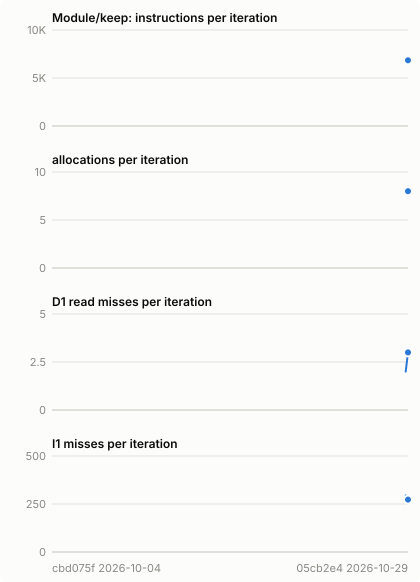
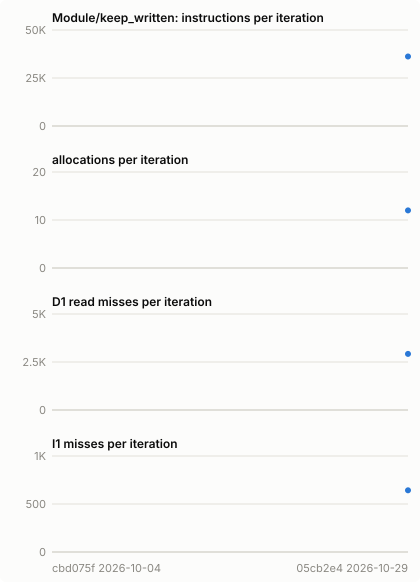

# Benchmark trend

Instruction and allocation counts per iteration on master, one record per commit (161 so far, latest [4a69475](https://github.com/jinja2cpp/Jinja2Cpp/commit/4a694753a4bd2b608128423c871c7848a50359ef) on 2026-10-30). Written by the `trend` job of `.github/workflows/benchmark.yml` with `bench/trend.py`; the data is `history.jsonl`.

Memory is the bytes a loaded template keeps for `Load/*` and the peak heap use of one render for `Render/*`; vs first compares with the first record that has it.

| Benchmark | Instructions | vs previous | vs first | Allocations | vs previous | vs first | Memory | vs previous | vs first |
|---|---:|---:|---:|---:|---:|---:|---:|---:|---:|
| [Load/chat_llama](#loadchat_llama) | 344,345 | 0% |  | 55 | 0% |  | 18,240 | 0% | -53.33% |
| [Render/chat_llama](#renderchat_llama) | 310,241 | +0.05% |  | 251 | 0% |  | 11,712 | 0% | -18.44% |
| [Load/chat_mistral](#loadchat_mistral) | 391,941 | 0% |  | 52 | 0% |  | 20,680 | 0% | -53.68% |
| [Render/chat_mistral](#renderchat_mistral) | 515,150 | +0.01% |  | 424 | 0% |  | 10,064 | 0% | -23.80% |
| [Load/chat_qwen](#loadchat_qwen) | 266,655 | 0% |  | 44 | 0% |  | 14,400 | 0% | -47.31% |
| [Render/chat_qwen](#renderchat_qwen) | 295,078 | -0.01% |  | 238 | 0% |  | 8,304 | 0% | -2.35% |
| [Load/config_file](#loadconfig_file) | 98,590 | 0% |  | 25 | 0% |  | 5,432 | 0% | -48.56% |
| [Render/config_file](#renderconfig_file) | 1,266,643 | 0% |  | 908 | 0% |  | 23,992 | 0% | +0.77% |
| [Load/dict_ops](#loaddict_ops) | 33,098 | 0% | -77.60% | 9 | 0% | -93.13% | 2,176 | 0% | -48.87% |
| [Render/dict_ops](#renderdict_ops) | 297,397 | 0% | -56.95% | 112 | 0% | -75.11% | 24,408 | 0% | -29.65% |
| [Load/expressions](#loadexpressions) | 45,303 | 0% | -78.02% | 16 | 0% | -89.04% | 2,728 | 0% | -55.54% |
| [Render/expressions](#renderexpressions) | 424,668 | 0% | -53.13% | 3 | 0% | -90.00% | 2,440 | 0% | -31.15% |
| [Load/filters](#loadfilters) | 71,796 | 0% | -73.84% | 27 | 0% | -88.16% | 3,720 | 0% | -67.41% |
| [Render/filters](#renderfilters) | 30,413 | 0% | -65.70% | 26 | 0% | -64.86% | 1,080 | 0% | -78.01% |
| [Load/for_filter_if](#loadfor_filter_if) | 29,853 | 0% | -77.95% | 7 | 0% | -94.31% | 1,904 | 0% | -44.78% |
| [Render/for_filter_if](#renderfor_filter_if) | 274,095 | -0.07% | -68.33% | 4 | 0% | -98.23% | 16,560 | 0% | +354.95% |
| [Load/for_loop_vars](#loadfor_loop_vars) | 40,213 | 0% | -77.74% | 10 | 0% | -93.63% | 2,368 | 0% | -47.61% |
| [Render/for_loop_vars](#renderfor_loop_vars) | 192,696 | 0% | -82.04% | 2 | 0% | -99.62% | 1,568 | 0% | -43.35% |
| [Load/for_range](#loadfor_range) | 13,573 | 0% | -76.05% | 7 | 0% | -87.50% | 1,088 | 0% | -45.60% |
| [Render/for_range](#renderfor_range) | 38,790 | 0% | -57.93% | 3 | 0% | -88.89% | 408 | 0% | -73.02% |
| [Load/html_autoescape](#loadhtml_autoescape) | 193,950 | 0% |  | 43 | 0% |  | 12,592 | 0% | -48.98% |
| [Render/html_autoescape](#renderhtml_autoescape) | 1,221,582 | -0.01% |  | 674 | 0% |  | 45,168 | 0% | +11.85% |
| [Load/inheritance](#loadinheritance) | 22,746 | 0% | -80.07% | 7 | 0% | -93.46% | 1,328 | 0% | -53.76% |
| [Render/inheritance](#renderinheritance) | 136,638 | -0.04% | -81.73% | 35 | 0% | -94.37% | 7,320 | 0% | +21.68% |
| [Load/int_arith](#loadint_arith) | 65,837 | 0% |  | 20 | 0% |  | 3,840 | 0% | -0.41% |
| [Render/int_arith](#renderint_arith) | 825,351 | 0% |  | 12 | 0% |  | 3,272 | 0% | -0.49% |
| [Module/keep](#modulekeep) | 6,835 | +0.19% |  | 7 | 0% |  |  |  |  |
| [Module/keep_written](#modulekeep_written) | 36,204 | +0.04% |  | 11 | 0% |  |  |  |  |
| [Load/large_static](#loadlarge_static) | 155,038 | 0% | -82.50% | 14 | 0% | -96.82% | 43,120 | 0% | -19.23% |
| [Render/large_static](#renderlarge_static) | 20,888 | 0% | -72.20% | 1 | 0% | -94.44% | 36,552 | 0% | -1.83% |
| [RenderSink/large_static](#rendersinklarge_static) | 12,690 | 0% |  | 0 |  |  | 0 |  |  |
| [RenderTo/large_static](#rendertolarge_static) | 20,267 | 0% |  | 0 |  |  | 0 |  |  |
| [Load/macros](#loadmacros) | 55,720 | 0% | -75.56% | 27 | 0% | -85.48% | 4,344 | 0% | -30.12% |
| [Render/macros](#rendermacros) | 650,104 | -0.02% | -74.64% | 308 | 0% | -88.71% | 20,496 | 0% | +39.24% |
| [Load/many_tags](#loadmany_tags) | 9,043,070 | 0% | -79.52% | 951 | 0% | -97.22% | 431,120 | 0% | -59.14% |
| [Render/many_tags](#rendermany_tags) | 724,905 | 0% | -65.20% | 2 | 0% | -90.48% | 5,648 | 0% | -10.52% |
| [Load/mitsuhiko_table](#loadmitsuhiko_table) | 46,495 | 0% | -80.43% | 19 | 0% | -89.67% | 3,360 | 0% | -44.59% |
| [Render/mitsuhiko_table](#rendermitsuhiko_table) | 5,223,439 | -0.02% | -57.73% | 33 | 0% | -99.19% | 381,536 | 0% | +9.95% |
| [RenderSink/mitsuhiko_table](#rendersinkmitsuhiko_table) | 5,150,740 | -0.02% |  | 32 | 0% |  | 37,064 | 0% | +28.59% |
| [RenderTo/mitsuhiko_table](#rendertomitsuhiko_table) | 5,223,009 | -0.02% |  | 32 | 0% |  | 37,064 | 0% | +28.59% |
| [Load/mitsuhiko_table_wide](#loadmitsuhiko_table_wide) | 55,059 | 0% |  | 35 | 0% |  | 5,688 | 0% | -31.17% |
| [Render/mitsuhiko_table_wide](#rendermitsuhiko_table_wide) | 5,569,157 | -0.02% |  | 33 | 0% |  | 1,414,928 | 0% | +2.46% |
| [RenderSink/mitsuhiko_table_wide](#rendersinkmitsuhiko_table_wide) | 5,392,459 | -0.02% |  | 32 | 0% |  | 37,064 | 0% | +28.59% |
| [RenderTo/mitsuhiko_table_wide](#rendertomitsuhiko_table_wide) | 5,568,721 | -0.02% |  | 32 | 0% |  | 37,064 | 0% | +28.59% |
| [Load/plain_text](#loadplain_text) | 3,692 | 0% | -61.84% | 4 | 0% | -77.78% | 672 | 0% | -40.00% |
| [Render/plain_text](#renderplain_text) | 1,021 | 0% | -84.97% | 1 | 0% | -91.67% | 40 | 0% | -94.44% |
| [RenderSink/plain_text](#rendersinkplain_text) | 721 | 0% |  | 0 |  |  | 0 |  |  |
| [RenderTo/plain_text](#rendertoplain_text) | 822 | 0% |  | 0 |  |  | 0 |  |  |
| [Load/strings](#loadstrings) | 71,789 | 0% | -75.40% | 30 | 0% | -86.61% | 4,248 | 0% | -53.01% |
| [Render/strings](#renderstrings) | 582,015 | 0% | -72.25% | 344 | 0% | -83.73% | 9,088 | 0% | -49.31% |
| [Load/substitute](#loadsubstitute) | 7,715 | 0% | -74.16% | 6 | 0% | -83.78% | 832 | 0% | -45.26% |
| [Render/substitute](#rendersubstitute) | 2,237 | 0% | -74.62% | 1 | 0% | -91.67% | 40 | 0% | -94.44% |
| [RenderSink/substitute](#rendersinksubstitute) | 1,940 | 0% |  | 0 |  |  | 0 |  |  |
| [RenderTo/substitute](#rendertosubstitute) | 2,042 | 0% |  | 0 |  |  | 0 |  |  |

## Cache misses

Misses per iteration in callgrind's cache model (`count.py --cache-sim`: 32 KB 8-way L1, 8 MB 16-way last level, no prefetcher); reported, not gated.

| Benchmark | D1 read misses | vs previous | D1 write misses | vs previous | LL data read misses | vs previous | I1 misses | vs previous |
|---|---:|---:|---:|---:|---:|---:|---:|---:|
| Load/chat_llama | 738 | +0.27% | 730 | -0.54% | 0 |  | 7,552 | -3.83% |
| Render/chat_llama | 1,128 | +0.36% | 458 | -1.51% | 0 |  | 3,605 | -5.50% |
| Load/chat_mistral | 1,072 | -0.09% | 983 | -0.81% | 0 |  | 8,324 | -3.37% |
| Render/chat_mistral | 1,908 | -0.57% | 546 | -1.09% | 0 |  | 9,184 | -0.07% |
| Load/chat_qwen | 495 | +1.64% | 595 | -0.83% | 0 |  | 4,483 | -4.68% |
| Render/chat_qwen | 1,158 | +3.21% | 399 | -2.44% | 0 |  | 3,198 | -2.53% |
| Load/config_file | 182 | -1.09% | 165 | +4.43% | 0 |  | 2,974 | -4.34% |
| Render/config_file | 6,202 | -3.90% | 1,485 | +1.85% | 0 |  | 40,353 | +1.35% |
| Load/dict_ops | 33 | +6.45% | 15 | -6.25% | 0 |  | 1,302 | -0.91% |
| Render/dict_ops | 749 | -1.32% | 421 | 0% | 0 |  | 827 | -5.49% |
| Load/expressions | 39 | -4.88% | 18 | -25.00% | 0 |  | 1,326 | +2.87% |
| Render/expressions | 5 | -54.55% | 2 | -50.00% | 0 |  | 315 | +2.61% |
| Load/filters | 128 | +3.23% | 66 | 0% | 0 |  | 2,041 | -7.19% |
| Render/filters | 16 | -5.88% | 3 | +50.00% | 0 |  | 752 | +0.67% |
| Load/for_filter_if | 20 | +33.33% | 8 | +60.00% | 0 |  | 1,063 | -1.57% |
| Render/for_filter_if | 1,742 | 0% | 95 | +5.56% | 0 |  | 168 | -0.59% |
| Load/for_loop_vars | 23 | -8.00% | 12 | -29.41% | 0 |  | 1,048 | -3.41% |
| Render/for_loop_vars | 9 | -43.75% | 1 | -50.00% | 0 |  | 178 | +20.27% |
| Load/for_range | 5 | 0% | 5 | 0% | 0 |  | 734 | -2.65% |
| Render/for_range | 1 | 0% | 1 | 0% | 0 |  | 133 | +14.66% |
| Load/html_autoescape | 443 | -7.13% | 514 | +0.19% | 0 |  | 4,029 | -4.48% |
| Render/html_autoescape | 4,887 | +5.28% | 1,681 | +0.60% | 0 |  | 35,268 | +1.36% |
| Load/inheritance | 9 | -18.18% | 3 | -25.00% | 0 |  | 643 | -6.13% |
| Render/inheritance | 612 | -0.81% | 105 | +0.96% | 0 |  | 885 | -0.90% |
| Load/int_arith | 107 | +4.90% | 88 | -8.33% | 0 |  | 2,101 | +2.59% |
| Render/int_arith | 15 | -11.76% | 4 | +33.33% | 0 |  | 721 | -4.63% |
| Module/keep | 2 | -66.67% | 2 | 0% | 0 |  | 366 | +1.10% |
| Module/keep_written | 2,932 | -0.07% | 557 | 0% | 0 |  | 678 | 0% |
| Load/large_static | 1,948 | +0.05% | 910 | 0% | 0 |  | 274 | -8.05% |
| Render/large_static | 709 | 0% | 570 | 0% | 0 |  | 2 | -83.33% |
| RenderSink/large_static | 0 |  | 0 |  | 0 |  | 2 | +100.00% |
| RenderTo/large_static | 687 | 0% | 570 | 0% | 0 |  | 2 | -33.33% |
| Load/macros | 84 | 0% | 77 | +8.45% | 0 |  | 1,625 | -1.34% |
| Render/macros | 767 | -0.65% | 257 | 0% | 0 |  | 2,286 | +54.46% |
| Load/many_tags | 28,971 | -2.78% | 22,208 | -0.39% | 0 |  | 258,837 | -3.01% |
| Render/many_tags | 6,119 | 0% | 867 | -0.69% | 0 |  | 110 | 0% |
| Load/mitsuhiko_table | 34 | -12.82% | 52 | -1.89% | 0 |  | 841 | -0.83% |
| Render/mitsuhiko_table | 10,082 | +0.12% | 6,375 | +0.08% | 0 |  | 345 | +5.50% |
| RenderSink/mitsuhiko_table | 9,959 | +0.15% | 1,226 | +0.33% | 0 |  | 276 | +16.46% |
| RenderTo/mitsuhiko_table | 10,027 | +0.08% | 6,310 | +0.06% | 0 |  | 313 | +6.10% |
| Load/mitsuhiko_table_wide | 75 | -3.85% | 94 | +5.62% | 0 |  | 920 | -6.50% |
| Render/mitsuhiko_table_wide | 10,225 | +0.37% | 22,698 | +0.04% | 0 |  | 365 | +10.61% |
| RenderSink/mitsuhiko_table_wide | 10,040 | +0.24% | 1,309 | +1.71% | 0 |  | 285 | +15.38% |
| RenderTo/mitsuhiko_table_wide | 10,238 | +0.46% | 22,687 | 0% | 0 |  | 332 | +12.93% |
| Load/plain_text | 0 |  | 2 | 0% | 0 |  | 15 | +7.14% |
| Render/plain_text | 0 |  | 0 |  | 0 |  | 5 | 0% |
| RenderSink/plain_text | 0 |  | 0 |  | 0 |  | 4 | 0% |
| RenderTo/plain_text | 0 |  | 0 |  | 0 |  | 5 | 0% |
| Load/strings | 152 | -1.94% | 85 | -3.41% | 0 |  | 2,795 | -2.20% |
| Render/strings | 446 | 0% | 473 | -1.25% | 0 |  | 1,495 | +0.81% |
| Load/substitute | 2 | 0% | 3 | -25.00% | 0 |  | 188 | +8.05% |
| Render/substitute | 0 |  | 0 |  | 0 |  | 2 | -33.33% |
| RenderSink/substitute | 0 |  | 0 |  | 0 |  | 2 | 0% |
| RenderTo/substitute | 0 |  | 0 |  | 0 |  | 2 | -33.33% |

## Charts

### Load/chat_llama

### Render/chat_llama

### Load/chat_mistral

### Render/chat_mistral

### Load/chat_qwen

### Render/chat_qwen

### Load/config_file

### Render/config_file

### Load/dict_ops

### Render/dict_ops

### Load/expressions

### Render/expressions

### Load/filters

### Render/filters

### Load/for_filter_if

### Render/for_filter_if

### Load/for_loop_vars

### Render/for_loop_vars

### Load/for_range

### Render/for_range

### Load/html_autoescape

### Render/html_autoescape

### Load/inheritance

### Render/inheritance

### Load/int_arith

### Render/int_arith

### Module/keep

### Module/keep_written

### Load/large_static

### Render/large_static

### RenderSink/large_static

### RenderTo/large_static

### Load/macros

### Render/macros

### Load/many_tags

### Render/many_tags

### Load/mitsuhiko_table

### Render/mitsuhiko_table

### RenderSink/mitsuhiko_table

### RenderTo/mitsuhiko_table

### Load/mitsuhiko_table_wide

### Render/mitsuhiko_table_wide

### RenderSink/mitsuhiko_table_wide

### RenderTo/mitsuhiko_table_wide

### Load/plain_text

### Render/plain_text

### RenderSink/plain_text

### RenderTo/plain_text

### Load/strings

### Render/strings

### Load/substitute

### Render/substitute

### RenderSink/substitute

### RenderTo/substitute

