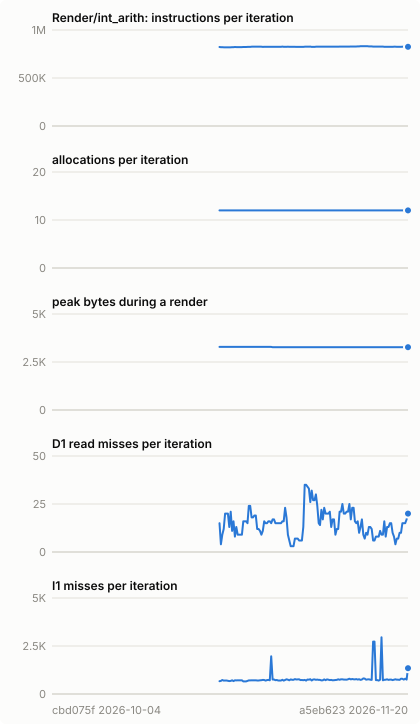

# Benchmark trend

Instruction and allocation counts per iteration on master, one record per commit (258 so far, latest [dec5d2b](https://github.com/jinja2cpp/Jinja2Cpp/commit/dec5d2bbe635e57da57c965c545510124a7a649f) on 2026-11-21). Written by the `trend` job of `.github/workflows/benchmark.yml` with `bench/trend.py`; the data is `history.jsonl`.

Memory is the bytes a loaded template keeps for `Load/*` and the peak heap use of one render for `Render/*`; vs first compares with the first record that has it.

| Benchmark | Instructions | vs previous | vs first | Allocations | vs previous | vs first | Memory | vs previous | vs first |
|---|---:|---:|---:|---:|---:|---:|---:|---:|---:|
| [Load/chat_llama](#loadchat_llama) | 336,580 | +0.12% |  | 54 | 0% |  | 18,536 | +0.09% | -52.57% |
| [Render/chat_llama](#renderchat_llama) | 291,559 | +0.29% |  | 224 | 0% |  | 11,608 | +0.14% | -19.16% |
| [Load/chat_mistral](#loadchat_mistral) | 384,970 | +0.01% |  | 51 | 0% |  | 20,976 | 0% | -53.02% |
| [Render/chat_mistral](#renderchat_mistral) | 492,020 | +0.15% |  | 392 | 0% |  | 9,752 | -0.33% | -26.17% |
| [Load/chat_qwen](#loadchat_qwen) | 261,949 | +0.04% |  | 43 | 0% |  | 14,472 | 0% | -47.04% |
| [Render/chat_qwen](#renderchat_qwen) | 273,326 | +0.12% |  | 211 | 0% |  | 8,280 | 0% | -2.63% |
| [Load/config_file](#loadconfig_file) | 94,181 | +0.31% |  | 24 | 0% |  | 5,520 | 0% | -47.73% |
| [Render/config_file](#renderconfig_file) | 1,279,052 | +0.11% |  | 908 | 0% |  | 25,928 | 0% | +8.90% |
| [Load/dict_ops](#loaddict_ops) | 31,891 | +0.21% | -78.42% | 8 | 0% | -93.89% | 2,216 | 0% | -47.93% |
| [Render/dict_ops](#renderdict_ops) | 290,603 | -0.16% | -57.94% | 112 | 0% | -75.11% | 24,408 | 0% | -29.65% |
| [Load/expressions](#loadexpressions) | 43,776 | -0.03% | -78.76% | 15 | 0% | -89.73% | 2,752 | 0% | -55.15% |
| [Render/expressions](#renderexpressions) | 414,402 | 0% | -54.27% | 3 | 0% | -90.00% | 2,440 | 0% | -31.15% |
| [Load/filters](#loadfilters) | 66,945 | +0.04% | -75.61% | 26 | 0% | -88.60% | 3,856 | 0% | -66.22% |
| [Render/filters](#renderfilters) | 26,521 | +0.01% | -70.09% | 23 | 0% | -68.92% | 752 | 0% | -84.69% |
| [Load/for_filter_if](#loadfor_filter_if) | 28,529 | +0.06% | -78.93% | 6 | 0% | -95.12% | 1,928 | 0% | -44.08% |
| [Render/for_filter_if](#renderfor_filter_if) | 266,155 | -0.38% | -69.25% | 4 | 0% | -98.23% | 16,560 | 0% | +354.95% |
| [Load/for_loop_vars](#loadfor_loop_vars) | 38,173 | -0.35% | -78.87% | 9 | 0% | -94.27% | 2,392 | 0% | -47.08% |
| [Render/for_loop_vars](#renderfor_loop_vars) | 170,802 | 0% | -84.08% | 2 | 0% | -99.62% | 1,568 | 0% | -43.35% |
| [Load/for_range](#loadfor_range) | 12,493 | 0% | -77.96% | 6 | 0% | -89.29% | 1,128 | 0% | -43.60% |
| [Render/for_range](#renderfor_range) | 37,184 | +0.01% | -59.67% | 3 | 0% | -88.89% | 408 | 0% | -73.02% |
| [Load/hf_deepseek_v31](#loadhf_deepseek_v31) | 384,079 | +0.09% |  | 54 | 0% |  | 22,032 | 0% | +0.99% |
| [Render/hf_deepseek_v31](#renderhf_deepseek_v31) | 90,637 | +0.01% |  | 42 | 0% |  | 2,456 | 0% | -0.97% |
| [Load/hf_gpt_oss](#loadhf_gpt_oss) | 1,525,941 | -0.05% |  | 282 | 0% |  | 75,016 | +0.02% | +1.07% |
| [Render/hf_gpt_oss](#renderhf_gpt_oss) | 169,260 | +0.13% |  | 153 | 0% |  | 5,984 | +0.27% | +21.23% |
| [Load/hf_mistral_small](#loadhf_mistral_small) | 591,348 | -0.04% |  | 87 | 0% |  | 33,136 | 0% | +0.61% |
| [Render/hf_mistral_small](#renderhf_mistral_small) | 140,362 | +0.61% |  | 97 | 0% |  | 6,096 | 0% | -0.65% |
| [Load/hf_qwen3](#loadhf_qwen3) | 477,651 | +0.22% |  | 81 | 0% |  | 25,648 | +0.06% | +0.66% |
| [Render/hf_qwen3](#renderhf_qwen3) | 117,538 | +0.17% |  | 99 | 0% |  | 3,224 | 0% | -0.74% |
| [Load/html_autoescape](#loadhtml_autoescape) | 188,984 | +0.22% |  | 42 | 0% |  | 12,728 | 0% | -48.43% |
| [Render/html_autoescape](#renderhtml_autoescape) | 1,197,167 | -0.01% |  | 674 | 0% |  | 46,224 | 0% | +14.46% |
| [Load/inheritance](#loadinheritance) | 21,300 | 0% | -81.34% | 6 | 0% | -94.39% | 1,368 | 0% | -52.37% |
| [Render/inheritance](#renderinheritance) | 136,535 | -0.09% | -81.74% | 35 | 0% | -94.37% | 8,136 | 0% | +35.24% |
| [Load/int_arith](#loadint_arith) | 64,690 | +0.09% |  | 19 | 0% |  | 3,896 | 0% | +1.04% |
| [Render/int_arith](#renderint_arith) | 824,741 | -0.09% |  | 12 | 0% |  | 3,272 | 0% | -0.49% |
| [Module/keep](#modulekeep) | 6,990 | +0.59% |  | 6 | 0% |  |  |  |  |
| [Module/keep_written](#modulekeep_written) | 28,989 | -0.08% |  | 10 | 0% |  |  |  |  |
| [Load/large_static](#loadlarge_static) | 146,958 | 0% | -83.41% | 13 | 0% | -97.05% | 43,128 | 0% | -19.21% |
| [Render/large_static](#renderlarge_static) | 20,343 | 0% | -72.93% | 1 | 0% | -94.44% | 36,552 | 0% | -1.83% |
| [RenderSink/large_static](#rendersinklarge_static) | 12,632 | +0.01% |  | 0 |  |  | 0 |  |  |
| [RenderTo/large_static](#rendertolarge_static) | 19,846 | -0.30% |  | 0 |  |  | 0 |  |  |
| [Load/macros](#loadmacros) | 54,293 | +0.54% | -76.18% | 25 | 0% | -86.56% | 4,472 | 0% | -28.06% |
| [Render/macros](#rendermacros) | 647,389 | +0.45% | -74.74% | 308 | 0% | -88.71% | 20,608 | 0% | +40.00% |
| [Load/many_tags](#loadmany_tags) | 8,758,481 | +0.07% | -80.17% | 950 | 0% | -97.23% | 438,136 | 0% | -58.48% |
| [Render/many_tags](#rendermany_tags) | 730,658 | -0.25% | -64.92% | 2 | 0% | -90.48% | 5,648 | 0% | -10.52% |
| [Load/mitsuhiko_table](#loadmitsuhiko_table) | 44,630 | -0.03% | -81.21% | 18 | 0% | -90.22% | 3,416 | 0% | -43.67% |
| [Render/mitsuhiko_table](#rendermitsuhiko_table) | 5,105,190 | +0.03% | -58.68% | 33 | 0% | -99.19% | 381,536 | 0% | +9.95% |
| [RenderSink/mitsuhiko_table](#rendersinkmitsuhiko_table) | 5,035,285 | +0.04% |  | 32 | 0% |  | 37,064 | 0% | +28.59% |
| [RenderTo/mitsuhiko_table](#rendertomitsuhiko_table) | 5,104,646 | +0.03% |  | 32 | 0% |  | 37,064 | 0% | +28.59% |
| [Load/mitsuhiko_table_wide](#loadmitsuhiko_table_wide) | 52,115 | -0.51% |  | 34 | 0% |  | 5,744 | 0% | -30.49% |
| [Render/mitsuhiko_table_wide](#rendermitsuhiko_table_wide) | 5,451,424 | +0.04% |  | 33 | 0% |  | 1,414,928 | 0% | +2.46% |
| [RenderSink/mitsuhiko_table_wide](#rendersinkmitsuhiko_table_wide) | 5,277,329 | +0.04% |  | 32 | 0% |  | 37,064 | 0% | +28.59% |
| [RenderTo/mitsuhiko_table_wide](#rendertomitsuhiko_table_wide) | 5,450,818 | +0.04% |  | 32 | 0% |  | 37,064 | 0% | +28.59% |
| [Nested/new_template](#nestednew_template) | 452,525 | +0.13% |  | 323 | 0% |  |  |  |  |
| [Load/plain_text](#loadplain_text) | 2,932 | 0% | -69.70% | 3 | 0% | -83.33% | 680 | 0% | -39.29% |
| [Render/plain_text](#renderplain_text) | 973 | +0.10% | -85.68% | 1 | 0% | -91.67% | 40 | 0% | -94.44% |
| [RenderSink/plain_text](#rendersinkplain_text) | 678 | +0.15% |  | 0 |  |  | 0 |  |  |
| [RenderTo/plain_text](#rendertoplain_text) | 774 | +0.13% |  | 0 |  |  | 0 |  |  |
| [Load/prompt_budget](#loadprompt_budget) | 34,256 | +0.26% |  | 17 | 0% |  | 2,248 | 0% | +1.08% |
| [Render/prompt_budget](#renderprompt_budget) | 1,321,776 | -0.02% |  | 76 | 0% |  | 36,416 | 0% | 0% |
| [Nested/shared_globals](#nestedshared_globals) | 160,687 | +0.37% |  | 160 | 0% |  |  |  |  |
| [Load/strings](#loadstrings) | 68,802 | +0.23% | -76.43% | 29 | 0% | -87.05% | 4,384 | 0% | -51.50% |
| [Render/strings](#renderstrings) | 580,551 | -0.07% | -72.32% | 344 | 0% | -83.73% | 9,088 | 0% | -49.31% |
| [Load/substitute](#loadsubstitute) | 6,654 | 0% | -77.71% | 5 | 0% | -86.49% | 840 | 0% | -44.74% |
| [Render/substitute](#rendersubstitute) | 1,654 | +0.06% | -81.23% | 1 | 0% | -91.67% | 40 | 0% | -94.44% |
| [RenderSink/substitute](#rendersinksubstitute) | 1,363 | +0.07% |  | 0 |  |  | 0 |  |  |
| [RenderTo/substitute](#rendertosubstitute) | 1,459 | +0.07% |  | 0 |  |  | 0 |  |  |

## Cache misses

Misses per iteration in callgrind's cache model (`count.py --cache-sim`: 32 KB 8-way L1, 8 MB 16-way last level, no prefetcher); reported, not gated.

| Benchmark | D1 read misses | vs previous | D1 write misses | vs previous | LL data read misses | vs previous | I1 misses | vs previous |
|---|---:|---:|---:|---:|---:|---:|---:|---:|
| Load/chat_llama | 754 | +4.29% | 767 | +1.72% | 0 |  | 8,226 | +4.58% |
| Render/chat_llama | 1,214 | -6.25% | 562 | +2.55% | 0 |  | 4,266 | +0.57% |
| Load/chat_mistral | 1,134 | +3.75% | 1,114 | +1.74% | 0 |  | 9,203 | +4.91% |
| Render/chat_mistral | 2,085 | -1.04% | 673 | +0.15% | 0 |  | 10,445 | +0.50% |
| Load/chat_qwen | 533 | -0.74% | 658 | +3.46% | 0 |  | 5,067 | +7.90% |
| Render/chat_qwen | 1,124 | +0.63% | 441 | +2.32% | 0 |  | 3,690 | +7.21% |
| Load/config_file | 199 | -1.97% | 187 | -2.09% | 0 |  | 2,890 | +6.21% |
| Render/config_file | 6,761 | -8.06% | 1,961 | +7.57% | 0 |  | 42,864 | -3.68% |
| Load/dict_ops | 28 | -15.15% | 20 | -20.00% | 0 |  | 1,409 | +3.83% |
| Render/dict_ops | 690 | -1.99% | 422 | +0.72% | 0 |  | 845 | +0.72% |
| Load/expressions | 25 | +56.25% | 26 | +73.33% | 0 |  | 1,355 | +3.04% |
| Render/expressions | 15 | +150.00% | 4 | +300.00% | 0 |  | 313 | +3.64% |
| Load/filters | 90 | -10.89% | 54 | +45.95% | 0 |  | 1,775 | +15.79% |
| Render/filters | 22 | +69.23% | 4 | 0% | 0 |  | 742 | -4.26% |
| Load/for_filter_if | 18 | -25.00% | 6 | -60.00% | 0 |  | 1,069 | +3.89% |
| Render/for_filter_if | 1,720 | +0.12% | 86 | -1.15% | 0 |  | 187 | +14.72% |
| Load/for_loop_vars | 38 | +65.22% | 16 | -11.11% | 0 |  | 1,105 | +2.98% |
| Render/for_loop_vars | 6 | -66.67% | 1 | -50.00% | 0 |  | 138 | +20.00% |
| Load/for_range | 2 | 0% | 3 | 0% | 0 |  | 768 | 0% |
| Render/for_range | 2 | -77.78% | 1 | 0% | 0 |  | 156 | +10.64% |
| Load/hf_deepseek_v31 | 959 | -4.86% | 978 | -2.78% | 0 |  | 7,296 | +7.91% |
| Render/hf_deepseek_v31 | 387 | +4.59% | 92 | +12.20% | 0 |  | 1,544 | +10.76% |
| Load/hf_gpt_oss | 4,753 | +1.80% | 3,421 | +1.03% | 0 |  | 23,369 | +1.79% |
| Render/hf_gpt_oss | 1,307 | -0.91% | 419 | +3.46% | 0 |  | 4,955 | +2.23% |
| Load/hf_mistral_small | 1,904 | +0.95% | 1,650 | +0.61% | 0 |  | 12,057 | +5.31% |
| Render/hf_mistral_small | 1,021 | +3.55% | 324 | -3.86% | 0 |  | 3,819 | +1.68% |
| Load/hf_qwen3 | 1,515 | -0.85% | 1,311 | -1.87% | 0 |  | 9,518 | +5.45% |
| Render/hf_qwen3 | 702 | +1.59% | 230 | -4.56% | 0 |  | 2,721 | +2.64% |
| Load/html_autoescape | 485 | -8.32% | 543 | -0.55% | 0 |  | 4,311 | +11.34% |
| Render/html_autoescape | 4,860 | +8.29% | 1,552 | +11.17% | 0 |  | 36,590 | -2.31% |
| Load/inheritance | 5 | +150.00% | 4 | +100.00% | 0 |  | 706 | +1.73% |
| Render/inheritance | 616 | +0.82% | 121 | +6.14% | 0 |  | 1,054 | +1.25% |
| Load/int_arith | 71 | +4.41% | 64 | +16.36% | 0 |  | 2,081 | +1.86% |
| Render/int_arith | 40 | +122.22% | 23 | +109.09% | 0 |  | 786 | +2.34% |
| Module/keep | 2 | +100.00% | 2 | -33.33% | 0 |  | 414 | -0.72% |
| Module/keep_written | 1,145 | +0.26% | 557 | -1.24% | 0 |  | 723 | -3.73% |
| Load/large_static | 1,917 | +0.05% | 910 | 0% | 0 |  | 308 | +23.69% |
| Render/large_static | 700 | 0% | 570 | +0.35% | 0 |  | 5 | +25.00% |
| RenderSink/large_static | 2 | +100.00% | 0 |  | 0 |  | 2 | 0% |
| RenderTo/large_static | 679 | -0.15% | 581 | +2.11% | 0 |  | 5 | +66.67% |
| Load/macros | 78 | +2.63% | 69 | 0% | 0 |  | 1,774 | +2.96% |
| Render/macros | 764 | -5.45% | 266 | +3.50% | 0 |  | 862 | +36.61% |
| Load/many_tags | 28,031 | -0.11% | 22,615 | +0.03% | 0 |  | 246,080 | +5.56% |
| Render/many_tags | 6,134 | +0.66% | 786 | -0.88% | 0 |  | 115 | +10.58% |
| Load/mitsuhiko_table | 33 | +6.45% | 45 | +2.27% | 0 |  | 899 | +2.16% |
| Render/mitsuhiko_table | 10,069 | -0.25% | 6,344 | +1.55% | 0 |  | 340 | +20.14% |
| RenderSink/mitsuhiko_table | 9,978 | -0.70% | 1,199 | +0.93% | 0 |  | 278 | +23.01% |
| RenderTo/mitsuhiko_table | 10,059 | -0.45% | 6,284 | +0.58% | 0 |  | 298 | +19.20% |
| Load/mitsuhiko_table_wide | 75 | -5.06% | 91 | -4.21% | 0 |  | 992 | -5.43% |
| Render/mitsuhiko_table_wide | 10,203 | -0.57% | 22,600 | -0.50% | 0 |  | 342 | +16.33% |
| RenderSink/mitsuhiko_table_wide | 10,035 | -0.57% | 1,265 | -0.32% | 0 |  | 283 | +48.95% |
| RenderTo/mitsuhiko_table_wide | 10,176 | -0.87% | 22,677 | +0.11% | 0 |  | 322 | +24.32% |
| Nested/new_template | 2,255 | -1.44% | 1,577 | -7.13% | 0 |  | 24,768 | +1.03% |
| Load/plain_text | 0 |  | 1 | 0% | 0 |  | 26 | +766.67% |
| Render/plain_text | 1 | 0% | 0 |  | 0 |  | 7 | 0% |
| RenderSink/plain_text | 1 | 0% | 0 |  | 0 |  | 5 | 0% |
| RenderTo/plain_text | 1 | -50.00% | 0 |  | 0 |  | 7 | 0% |
| Load/prompt_budget | 68 | -6.85% | 41 | -33.87% | 0 |  | 1,458 | +4.07% |
| Render/prompt_budget | 4,798 | +0.19% | 548 | -1.08% | 0 |  | 1,065 | -5.75% |
| Nested/shared_globals | 261 | +1.95% | 141 | +23.68% | 0 |  | 9,264 | -1.09% |
| Load/strings | 149 | +22.13% | 84 | -27.59% | 0 |  | 2,860 | +2.51% |
| Render/strings | 435 | +3.08% | 482 | -1.23% | 0 |  | 2,327 | +47.84% |
| Load/substitute | 1 | 0% | 2 | 0% | 0 |  | 144 | +60.00% |
| Render/substitute | 1 | 0% | 0 |  | 0 |  | 3 | 0% |
| RenderSink/substitute | 1 | 0% | 0 |  | 0 |  | 3 | 0% |
| RenderTo/substitute | 2 | +100.00% | 0 |  | 0 |  | 3 | 0% |

## Charts

### Load/chat_llama

### Render/chat_llama

### Load/chat_mistral

### Render/chat_mistral

### Load/chat_qwen

### Render/chat_qwen

### Load/config_file

### Render/config_file

### Load/dict_ops

### Render/dict_ops

### Load/expressions

### Render/expressions

### Load/filters

### Render/filters

### Load/for_filter_if

### Render/for_filter_if

### Load/for_loop_vars

### Render/for_loop_vars

### Load/for_range

### Render/for_range

### Load/hf_deepseek_v31

### Render/hf_deepseek_v31

### Load/hf_gpt_oss

### Render/hf_gpt_oss

### Load/hf_mistral_small

### Render/hf_mistral_small

### Load/hf_qwen3

### Render/hf_qwen3

### Load/html_autoescape

### Render/html_autoescape

### Load/inheritance

### Render/inheritance

### Load/int_arith

### Render/int_arith

### Module/keep

### Module/keep_written

### Load/large_static

### Render/large_static

### RenderSink/large_static

### RenderTo/large_static

### Load/macros

### Render/macros

### Load/many_tags

### Render/many_tags

### Load/mitsuhiko_table

### Render/mitsuhiko_table

### RenderSink/mitsuhiko_table

### RenderTo/mitsuhiko_table

### Load/mitsuhiko_table_wide

### Render/mitsuhiko_table_wide

### RenderSink/mitsuhiko_table_wide

### RenderTo/mitsuhiko_table_wide

### Nested/new_template

### Load/plain_text

### Render/plain_text

### RenderSink/plain_text

### RenderTo/plain_text

### Load/prompt_budget

### Render/prompt_budget

### Nested/shared_globals

### Load/strings

### Render/strings

### Load/substitute

### Render/substitute

### RenderSink/substitute

### RenderTo/substitute

