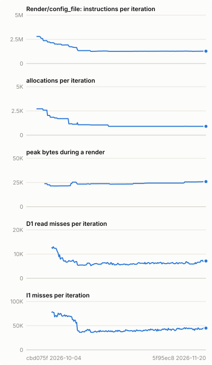
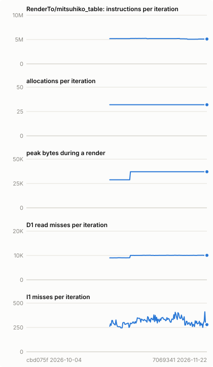

# Benchmark trend

Instruction and allocation counts per iteration on master, one record per commit (252 so far, latest [46dabdd](https://github.com/jinja2cpp/Jinja2Cpp/commit/46dabdd4a6b2546bf4bf4ded705cda05193a36b2) on 2026-11-20). Written by the `trend` job of `.github/workflows/benchmark.yml` with `bench/trend.py`; the data is `history.jsonl`.

Memory is the bytes a loaded template keeps for `Load/*` and the peak heap use of one render for `Render/*`; vs first compares with the first record that has it.

| Benchmark | Instructions | vs previous | vs first | Allocations | vs previous | vs first | Memory | vs previous | vs first |
|---|---:|---:|---:|---:|---:|---:|---:|---:|---:|
| [Load/chat_llama](#loadchat_llama) | 336,334 | +0.42% |  | 54 | 0% |  | 18,520 | 0% | -52.61% |
| [Render/chat_llama](#renderchat_llama) | 290,787 | +0.22% |  | 224 | 0% |  | 11,592 | 0% | -19.28% |
| [Load/chat_mistral](#loadchat_mistral) | 385,334 | +0.31% |  | 51 | 0% |  | 20,976 | 0% | -53.02% |
| [Render/chat_mistral](#renderchat_mistral) | 491,021 | +0.05% |  | 392 | 0% |  | 9,784 | 0% | -25.92% |
| [Load/chat_qwen](#loadchat_qwen) | 262,094 | +0.42% |  | 43 | 0% |  | 14,472 | 0% | -47.04% |
| [Render/chat_qwen](#renderchat_qwen) | 272,967 | +0.21% |  | 211 | 0% |  | 8,280 | 0% | -2.63% |
| [Load/config_file](#loadconfig_file) | 94,102 | +0.04% |  | 24 | 0% |  | 5,520 | 0% | -47.73% |
| [Render/config_file](#renderconfig_file) | 1,275,863 | +0.05% |  | 908 | 0% |  | 25,928 | +0.19% | +8.90% |
| [Load/dict_ops](#loaddict_ops) | 31,874 | +0.18% | -78.43% | 8 | 0% | -93.89% | 2,216 | 0% | -47.93% |
| [Render/dict_ops](#renderdict_ops) | 291,172 | +0.20% | -57.85% | 112 | 0% | -75.11% | 24,408 | 0% | -29.65% |
| [Load/expressions](#loadexpressions) | 43,812 | +0.29% | -78.75% | 15 | 0% | -89.73% | 2,752 | 0% | -55.15% |
| [Render/expressions](#renderexpressions) | 414,399 | 0% | -54.27% | 3 | 0% | -90.00% | 2,440 | 0% | -31.15% |
| [Load/filters](#loadfilters) | 66,926 | -0.57% | -75.61% | 26 | 0% | -88.60% | 3,856 | 0% | -66.22% |
| [Render/filters](#renderfilters) | 26,519 | +0.07% | -70.09% | 23 | 0% | -68.92% | 752 | 0% | -84.69% |
| [Load/for_filter_if](#loadfor_filter_if) | 28,597 | +0.17% | -78.88% | 6 | 0% | -95.12% | 1,928 | 0% | -44.08% |
| [Render/for_filter_if](#renderfor_filter_if) | 267,157 | 0% | -69.13% | 4 | 0% | -98.23% | 16,560 | 0% | +354.95% |
| [Load/for_loop_vars](#loadfor_loop_vars) | 38,403 | +0.16% | -78.74% | 9 | 0% | -94.27% | 2,392 | 0% | -47.08% |
| [Render/for_loop_vars](#renderfor_loop_vars) | 170,796 | +0.01% | -84.08% | 2 | 0% | -99.62% | 1,568 | 0% | -43.35% |
| [Load/for_range](#loadfor_range) | 12,495 | +0.11% | -77.96% | 6 | 0% | -89.29% | 1,128 | 0% | -43.60% |
| [Render/for_range](#renderfor_range) | 37,181 | +0.03% | -59.68% | 3 | 0% | -88.89% | 408 | 0% | -73.02% |
| [Load/hf_deepseek_v31](#loadhf_deepseek_v31) | 383,901 | +0.23% |  | 54 | 0% |  | 22,032 | 0% | +0.99% |
| [Render/hf_deepseek_v31](#renderhf_deepseek_v31) | 90,363 | +0.07% |  | 42 | 0% |  | 2,456 | 0% | -0.97% |
| [Load/hf_gpt_oss](#loadhf_gpt_oss) | 1,527,714 | +0.36% |  | 282 | 0% |  | 75,000 | 0% | +1.05% |
| [Render/hf_gpt_oss](#renderhf_gpt_oss) | 168,924 | +0.15% |  | 153 | 0% |  | 5,936 | 0% | +20.26% |
| [Load/hf_mistral_small](#loadhf_mistral_small) | 591,826 | +0.14% |  | 87 | 0% |  | 33,136 | 0% | +0.61% |
| [Render/hf_mistral_small](#renderhf_mistral_small) | 139,376 | +0.01% |  | 97 | 0% |  | 6,096 | 0% | -0.65% |
| [Load/hf_qwen3](#loadhf_qwen3) | 477,099 | +0.31% |  | 81 | 0% |  | 25,632 | 0% | +0.60% |
| [Render/hf_qwen3](#renderhf_qwen3) | 117,232 | +0.19% |  | 99 | 0% |  | 3,224 | 0% | -0.74% |
| [Load/html_autoescape](#loadhtml_autoescape) | 189,040 | +0.20% |  | 42 | 0% |  | 12,728 | 0% | -48.43% |
| [Render/html_autoescape](#renderhtml_autoescape) | 1,197,249 | 0% |  | 674 | 0% |  | 46,224 | +0.10% | +14.46% |
| [Load/inheritance](#loadinheritance) | 21,303 | +0.04% | -81.33% | 6 | 0% | -94.39% | 1,368 | 0% | -52.37% |
| [Render/inheritance](#renderinheritance) | 136,359 | +0.27% | -81.77% | 35 | 0% | -94.37% | 8,136 | 0% | +35.24% |
| [Load/int_arith](#loadint_arith) | 64,713 | +0.19% |  | 19 | 0% |  | 3,896 | 0% | +1.04% |
| [Render/int_arith](#renderint_arith) | 826,046 | +0.09% |  | 12 | 0% |  | 3,272 | 0% | -0.49% |
| [Module/keep](#modulekeep) | 6,942 | 0% |  | 6 | 0% |  |  |  |  |
| [Module/keep_written](#modulekeep_written) | 29,004 | 0% |  | 10 | 0% |  |  |  |  |
| [Load/large_static](#loadlarge_static) | 146,858 | +0.14% | -83.42% | 13 | 0% | -97.05% | 43,128 | 0% | -19.21% |
| [Render/large_static](#renderlarge_static) | 20,342 | +0.05% | -72.93% | 1 | 0% | -94.44% | 36,552 | 0% | -1.83% |
| [RenderSink/large_static](#rendersinklarge_static) | 12,631 | +0.08% |  | 0 |  |  | 0 |  |  |
| [RenderTo/large_static](#rendertolarge_static) | 19,905 | +0.05% |  | 0 |  |  | 0 |  |  |
| [Load/macros](#loadmacros) | 54,064 | +0.14% | -76.28% | 25 | 0% | -86.56% | 4,472 | 0% | -28.06% |
| [Render/macros](#rendermacros) | 645,302 | 0% | -74.82% | 308 | 0% | -88.71% | 20,608 | 0% | +40.00% |
| [Load/many_tags](#loadmany_tags) | 8,762,455 | -0.09% | -80.16% | 950 | 0% | -97.23% | 438,120 | 0% | -58.48% |
| [Render/many_tags](#rendermany_tags) | 732,455 | 0% | -64.84% | 2 | 0% | -90.48% | 5,648 | 0% | -10.52% |
| [Load/mitsuhiko_table](#loadmitsuhiko_table) | 44,677 | +0.19% | -81.19% | 18 | 0% | -90.22% | 3,416 | 0% | -43.67% |
| [Render/mitsuhiko_table](#rendermitsuhiko_table) | 5,103,526 | 0% | -58.70% | 33 | 0% | -99.19% | 381,536 | 0% | +9.95% |
| [RenderSink/mitsuhiko_table](#rendersinkmitsuhiko_table) | 5,033,313 | 0% |  | 32 | 0% |  | 37,064 | 0% | +28.59% |
| [RenderTo/mitsuhiko_table](#rendertomitsuhiko_table) | 5,103,003 | 0% |  | 32 | 0% |  | 37,064 | 0% | +28.59% |
| [Load/mitsuhiko_table_wide](#loadmitsuhiko_table_wide) | 52,416 | +0.16% |  | 34 | 0% |  | 5,744 | 0% | -30.49% |
| [Render/mitsuhiko_table_wide](#rendermitsuhiko_table_wide) | 5,449,155 | 0% |  | 33 | 0% |  | 1,414,928 | 0% | +2.46% |
| [RenderSink/mitsuhiko_table_wide](#rendersinkmitsuhiko_table_wide) | 5,275,082 | 0% |  | 32 | 0% |  | 37,064 | 0% | +28.59% |
| [RenderTo/mitsuhiko_table_wide](#rendertomitsuhiko_table_wide) | 5,448,572 | 0% |  | 32 | 0% |  | 37,064 | 0% | +28.59% |
| [Nested/new_template](#nestednew_template) | 451,863 | +0.07% |  | 323 | 0% |  |  |  |  |
| [Load/plain_text](#loadplain_text) | 2,932 | 0% | -69.70% | 3 | 0% | -83.33% | 680 | 0% | -39.29% |
| [Render/plain_text](#renderplain_text) | 972 | +1.04% | -85.69% | 1 | 0% | -91.67% | 40 | 0% | -94.44% |
| [RenderSink/plain_text](#rendersinkplain_text) | 677 | +1.50% |  | 0 |  |  | 0 |  |  |
| [RenderTo/plain_text](#rendertoplain_text) | 773 | +1.31% |  | 0 |  |  | 0 |  |  |
| [Load/prompt_budget](#loadprompt_budget) | 34,205 | +0.21% |  | 17 | 0% |  | 2,248 | 0% | +1.08% |
| [Render/prompt_budget](#renderprompt_budget) | 1,322,032 | +0.02% |  | 76 | 0% |  | 36,416 | 0% | 0% |
| [Nested/shared_globals](#nestedshared_globals) | 159,914 | +0.07% |  | 160 | 0% |  |  |  |  |
| [Load/strings](#loadstrings) | 68,722 | -0.15% | -76.45% | 29 | 0% | -87.05% | 4,384 | 0% | -51.50% |
| [Render/strings](#renderstrings) | 581,229 | 0% | -72.29% | 344 | 0% | -83.73% | 9,088 | 0% | -49.31% |
| [Load/substitute](#loadsubstitute) | 6,650 | +0.12% | -77.73% | 5 | 0% | -86.49% | 840 | 0% | -44.74% |
| [Render/substitute](#rendersubstitute) | 1,653 | +0.61% | -81.24% | 1 | 0% | -91.67% | 40 | 0% | -94.44% |
| [RenderSink/substitute](#rendersinksubstitute) | 1,362 | +0.74% |  | 0 |  |  | 0 |  |  |
| [RenderTo/substitute](#rendertosubstitute) | 1,458 | +0.69% |  | 0 |  |  | 0 |  |  |

## Cache misses

Misses per iteration in callgrind's cache model (`count.py --cache-sim`: 32 KB 8-way L1, 8 MB 16-way last level, no prefetcher); reported, not gated.

| Benchmark | D1 read misses | vs previous | D1 write misses | vs previous | LL data read misses | vs previous | I1 misses | vs previous |
|---|---:|---:|---:|---:|---:|---:|---:|---:|
| Load/chat_llama | 747 | -0.13% | 759 | +0.26% | 0 |  | 8,034 | +0.48% |
| Render/chat_llama | 1,191 | +2.14% | 542 | +0.56% | 0 |  | 4,289 | +0.70% |
| Load/chat_mistral | 1,106 | -2.56% | 1,089 | -0.46% | 0 |  | 9,037 | -3.22% |
| Render/chat_mistral | 2,139 | +0.90% | 687 | +1.93% | 0 |  | 10,881 | +0.36% |
| Load/chat_qwen | 543 | -1.99% | 647 | 0% | 0 |  | 4,965 | +1.24% |
| Render/chat_qwen | 1,139 | +3.36% | 430 | +1.65% | 0 |  | 3,502 | -4.24% |
| Load/config_file | 195 | +0.52% | 194 | +0.52% | 0 |  | 2,808 | -1.75% |
| Render/config_file | 7,226 | +3.07% | 1,738 | -0.29% | 0 |  | 45,549 | -1.19% |
| Load/dict_ops | 36 | -5.26% | 27 | +8.00% | 0 |  | 1,378 | -2.20% |
| Render/dict_ops | 687 | +0.59% | 420 | 0% | 0 |  | 850 | +1.07% |
| Load/expressions | 17 | -26.09% | 14 | -22.22% | 0 |  | 1,281 | -3.61% |
| Render/expressions | 3 | 0% | 0 | -100.00% | 0 |  | 312 | +9.47% |
| Load/filters | 92 | -9.80% | 39 | -4.88% | 0 |  | 1,641 | -15.50% |
| Render/filters | 12 | +100.00% | 5 | +66.67% | 0 |  | 738 | -2.51% |
| Load/for_filter_if | 24 | -27.27% | 15 | -21.05% | 0 |  | 1,041 | -7.88% |
| Render/for_filter_if | 1,722 | +0.17% | 83 | +3.75% | 0 |  | 139 | +5.30% |
| Load/for_loop_vars | 28 | -12.50% | 22 | -15.38% | 0 |  | 1,113 | -1.94% |
| Render/for_loop_vars | 9 | +125.00% | 1 | 0% | 0 |  | 124 | +39.33% |
| Load/for_range | 1 | -50.00% | 3 | 0% | 0 |  | 755 | -1.69% |
| Render/for_range | 8 | -20.00% | 1 |  | 0 |  | 110 | -34.13% |
| Load/hf_deepseek_v31 | 1,004 | +1.01% | 997 | +0.10% | 0 |  | 6,974 | -4.45% |
| Render/hf_deepseek_v31 | 379 | +1.88% | 91 | -4.21% | 0 |  | 1,577 | +1.55% |
| Load/hf_gpt_oss | 4,706 | -0.49% | 3,385 | -0.24% | 0 |  | 24,020 | -0.12% |
| Render/hf_gpt_oss | 1,337 | +2.45% | 407 | +1.24% | 0 |  | 4,838 | -4.59% |
| Load/hf_mistral_small | 1,910 | -0.21% | 1,648 | +0.06% | 0 |  | 11,828 | -4.37% |
| Render/hf_mistral_small | 974 | +0.41% | 334 | -0.60% | 0 |  | 3,802 | -1.76% |
| Load/hf_qwen3 | 1,537 | -1.73% | 1,342 | -0.52% | 0 |  | 9,373 | -1.22% |
| Render/hf_qwen3 | 707 | +1.87% | 241 | +2.99% | 0 |  | 2,667 | -3.75% |
| Load/html_autoescape | 539 | +0.75% | 547 | +1.11% | 0 |  | 4,139 | -0.55% |
| Render/html_autoescape | 4,058 | -12.47% | 1,243 | -10.32% | 0 |  | 38,308 | +2.07% |
| Load/inheritance | 1 | 0% | 3 | 0% | 0 |  | 678 | -5.44% |
| Render/inheritance | 613 | -0.97% | 122 | +5.17% | 0 |  | 1,021 | -2.39% |
| Load/int_arith | 69 | -8.00% | 59 | -9.23% | 0 |  | 1,987 | -3.07% |
| Render/int_arith | 15 | +50.00% | 13 | +116.67% | 0 |  | 793 | -0.25% |
| Module/keep | 2 | +100.00% | 2 | 0% | 0 |  | 430 | +0.94% |
| Module/keep_written | 1,142 | -0.17% | 566 | +0.53% | 0 |  | 737 | -0.94% |
| Load/large_static | 1,916 | -0.05% | 911 | +0.11% | 0 |  | 248 | -3.88% |
| Render/large_static | 700 | -0.14% | 568 | -0.18% | 0 |  | 3 | -40.00% |
| RenderSink/large_static | 1 | -50.00% | 0 |  | 0 |  | 4 | +33.33% |
| RenderTo/large_static | 680 | -0.15% | 569 | -0.18% | 0 |  | 2 | -50.00% |
| Load/macros | 65 | -1.52% | 64 | +4.92% | 0 |  | 1,732 | -1.25% |
| Render/macros | 794 | +1.93% | 257 | +2.80% | 0 |  | 1,668 | +23.74% |
| Load/many_tags | 28,491 | +1.42% | 22,690 | +0.32% | 0 |  | 250,223 | +3.01% |
| Render/many_tags | 6,101 | -0.02% | 790 | +0.13% | 0 |  | 1,897 | +1480.83% |
| Load/mitsuhiko_table | 32 | +14.29% | 42 | +2.44% | 0 |  | 861 | -11.78% |
| Render/mitsuhiko_table | 10,033 | -0.18% | 6,248 | +0.05% | 0 |  | 340 | +4.62% |
| RenderSink/mitsuhiko_table | 10,031 | -0.12% | 1,191 | -0.42% | 0 |  | 278 | +9.02% |
| RenderTo/mitsuhiko_table | 10,086 | -0.07% | 6,246 | -0.05% | 0 |  | 314 | +6.44% |
| Load/mitsuhiko_table_wide | 72 | -7.69% | 90 | -4.26% | 0 |  | 1,053 | +8.78% |
| Render/mitsuhiko_table_wide | 10,192 | -0.17% | 22,705 | -0.03% | 0 |  | 339 | -5.04% |
| RenderSink/mitsuhiko_table_wide | 10,036 | -0.01% | 1,272 | -0.93% | 0 |  | 270 | -3.57% |
| RenderTo/mitsuhiko_table_wide | 10,205 | +0.03% | 22,661 | 0% | 0 |  | 308 | -6.95% |
| Nested/new_template | 2,161 | +7.62% | 1,585 | +2.06% | 0 |  | 24,467 | -1.98% |
| Load/plain_text | 0 |  | 1 | 0% | 0 |  | 2 | -93.94% |
| Render/plain_text | 1 | 0% | 0 |  | 0 |  | 6 | -14.29% |
| RenderSink/plain_text | 1 | 0% | 0 |  | 0 |  | 5 | +25.00% |
| RenderTo/plain_text | 2 | +100.00% | 0 |  | 0 |  | 5 | -16.67% |
| Load/prompt_budget | 78 | +11.43% | 66 | +10.00% | 0 |  | 1,447 | +4.63% |
| Render/prompt_budget | 4,793 | +0.15% | 553 | +0.36% | 0 |  | 966 | +6.98% |
| Nested/shared_globals | 168 | -11.58% | 95 | -3.06% | 0 |  | 9,527 | +4.36% |
| Load/strings | 129 | +1.57% | 113 | +2.73% | 0 |  | 2,813 | -1.37% |
| Render/strings | 421 | +1.20% | 488 | +2.52% | 0 |  | 1,602 | -1.66% |
| Load/substitute | 1 | 0% | 2 | 0% | 0 |  | 153 | +8.51% |
| Render/substitute | 1 | 0% | 0 |  | 0 |  | 3 | -25.00% |
| RenderSink/substitute | 1 | 0% | 0 |  | 0 |  | 4 | +33.33% |
| RenderTo/substitute | 1 | 0% | 0 |  | 0 |  | 2 | -33.33% |

## Charts

### Load/chat_llama

### Render/chat_llama

### Load/chat_mistral

### Render/chat_mistral

### Load/chat_qwen

### Render/chat_qwen

### Load/config_file

### Render/config_file

### Load/dict_ops

### Render/dict_ops

### Load/expressions

### Render/expressions

### Load/filters

### Render/filters

### Load/for_filter_if

### Render/for_filter_if

### Load/for_loop_vars

### Render/for_loop_vars

### Load/for_range

### Render/for_range

### Load/hf_deepseek_v31

### Render/hf_deepseek_v31

### Load/hf_gpt_oss

### Render/hf_gpt_oss

### Load/hf_mistral_small

### Render/hf_mistral_small

### Load/hf_qwen3

### Render/hf_qwen3

### Load/html_autoescape

### Render/html_autoescape

### Load/inheritance

### Render/inheritance

### Load/int_arith

### Render/int_arith

### Module/keep

### Module/keep_written

### Load/large_static

### Render/large_static

### RenderSink/large_static

### RenderTo/large_static

### Load/macros

### Render/macros

### Load/many_tags

### Render/many_tags

### Load/mitsuhiko_table

### Render/mitsuhiko_table

### RenderSink/mitsuhiko_table

### RenderTo/mitsuhiko_table

### Load/mitsuhiko_table_wide

### Render/mitsuhiko_table_wide

### RenderSink/mitsuhiko_table_wide

### RenderTo/mitsuhiko_table_wide

### Nested/new_template

### Load/plain_text

### Render/plain_text

### RenderSink/plain_text

### RenderTo/plain_text

### Load/prompt_budget

### Render/prompt_budget

### Nested/shared_globals

### Load/strings

### Render/strings

### Load/substitute

### Render/substitute

### RenderSink/substitute

### RenderTo/substitute

