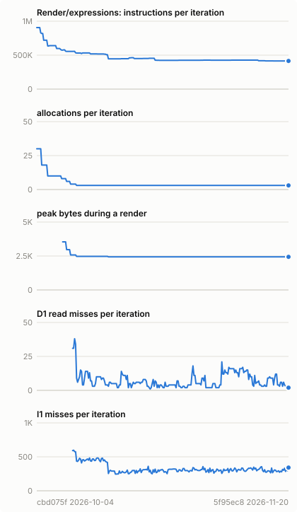

# Benchmark trend

Instruction and allocation counts per iteration on master, one record per commit (246 so far, latest [8976918](https://github.com/jinja2cpp/Jinja2Cpp/commit/8976918c65000047e1b4a2a7566d2b1962cafe95) on 2026-11-18). Written by the `trend` job of `.github/workflows/benchmark.yml` with `bench/trend.py`; the data is `history.jsonl`.

Memory is the bytes a loaded template keeps for `Load/*` and the peak heap use of one render for `Render/*`; vs first compares with the first record that has it.

| Benchmark | Instructions | vs previous | vs first | Allocations | vs previous | vs first | Memory | vs previous | vs first |
|---|---:|---:|---:|---:|---:|---:|---:|---:|---:|
| [Load/chat_llama](#loadchat_llama) | 334,987 | +0.20% |  | 54 | 0% |  | 18,536 | +0.35% | -52.57% |
| [Render/chat_llama](#renderchat_llama) | 289,734 | +0.01% |  | 224 | 0% |  | 11,608 | 0% | -19.16% |
| [Load/chat_mistral](#loadchat_mistral) | 383,943 | +0.14% |  | 51 | 0% |  | 20,976 | +0.38% | -53.02% |
| [Render/chat_mistral](#renderchat_mistral) | 491,688 | +0.03% |  | 401 | 0% |  | 10,024 | 0% | -24.11% |
| [Load/chat_qwen](#loadchat_qwen) | 260,787 | +0.21% |  | 43 | 0% |  | 14,472 | +0.33% | -47.04% |
| [Render/chat_qwen](#renderchat_qwen) | 271,470 | +0.02% |  | 211 | 0% |  | 8,280 | 0% | -2.63% |
| [Load/config_file](#loadconfig_file) | 93,922 | +0.26% |  | 24 | 0% |  | 5,520 | +0.88% | -47.73% |
| [Render/config_file](#renderconfig_file) | 1,267,450 | +0.11% |  | 908 | 0% |  | 25,704 | 0% | +7.96% |
| [Load/dict_ops](#loaddict_ops) | 31,759 | +0.50% | -78.51% | 8 | 0% | -93.89% | 2,216 | +1.47% | -47.93% |
| [Render/dict_ops](#renderdict_ops) | 290,329 | -0.12% | -57.97% | 112 | 0% | -75.11% | 24,408 | 0% | -29.65% |
| [Load/expressions](#loadexpressions) | 43,618 | +0.21% | -78.84% | 15 | 0% | -89.73% | 2,752 | +0.58% | -55.15% |
| [Render/expressions](#renderexpressions) | 414,317 | +0.01% | -54.28% | 3 | 0% | -90.00% | 2,440 | 0% | -31.15% |
| [Load/filters](#loadfilters) | 66,774 | +0.01% | -75.67% | 26 | 0% | -88.60% | 3,856 | 0% | -66.22% |
| [Render/filters](#renderfilters) | 26,363 | 0% | -70.27% | 23 | 0% | -68.92% | 752 | 0% | -84.69% |
| [Load/for_filter_if](#loadfor_filter_if) | 28,520 | +0.33% | -78.93% | 6 | 0% | -95.12% | 1,928 | +0.84% | -44.08% |
| [Render/for_filter_if](#renderfor_filter_if) | 267,121 | -0.05% | -69.14% | 4 | 0% | -98.23% | 16,560 | 0% | +354.95% |
| [Load/for_loop_vars](#loadfor_loop_vars) | 38,344 | +0.25% | -78.78% | 9 | 0% | -94.27% | 2,392 | +0.67% | -47.08% |
| [Render/for_loop_vars](#renderfor_loop_vars) | 170,748 | +0.06% | -84.08% | 2 | 0% | -99.62% | 1,568 | 0% | -43.35% |
| [Load/for_range](#loadfor_range) | 12,467 | +0.74% | -78.01% | 6 | 0% | -89.29% | 1,128 | +2.92% | -43.60% |
| [Render/for_range](#renderfor_range) | 37,101 | +0.10% | -59.76% | 3 | 0% | -88.89% | 408 | 0% | -73.02% |
| [Load/hf_deepseek_v31](#loadhf_deepseek_v31) | 383,144 | +0.20% |  | 54 | 0% |  | 22,032 | +0.22% | +0.99% |
| [Render/hf_deepseek_v31](#renderhf_deepseek_v31) | 90,001 | +0.04% |  | 42 | 0% |  | 2,456 | 0% | -0.97% |
| [Load/hf_gpt_oss](#loadhf_gpt_oss) | 1,522,470 | +0.08% |  | 282 | 0% |  | 75,048 | +0.17% | +1.11% |
| [Render/hf_gpt_oss](#renderhf_gpt_oss) | 167,884 | +0.04% |  | 153 | 0% |  | 5,784 | 0% | +17.18% |
| [Load/hf_mistral_small](#loadhf_mistral_small) | 589,659 | +0.19% |  | 87 | 0% |  | 33,136 | +0.24% | +0.61% |
| [Render/hf_mistral_small](#renderhf_mistral_small) | 139,095 | +0.01% |  | 97 | 0% |  | 6,112 | 0% | -0.39% |
| [Load/hf_qwen3](#loadhf_qwen3) | 475,766 | +0.19% |  | 81 | 0% |  | 25,632 | +0.25% | +0.60% |
| [Render/hf_qwen3](#renderhf_qwen3) | 116,610 | +0.02% |  | 99 | 0% |  | 3,224 | 0% | -0.74% |
| [Load/html_autoescape](#loadhtml_autoescape) | 188,380 | 0% |  | 42 | 0% |  | 12,728 | +0.38% | -48.43% |
| [Render/html_autoescape](#renderhtml_autoescape) | 1,195,502 | +0.02% |  | 674 | 0% |  | 46,064 | 0% | +14.06% |
| [Load/inheritance](#loadinheritance) | 21,283 | +0.59% | -81.35% | 6 | 0% | -94.39% | 1,368 | +1.18% | -52.37% |
| [Render/inheritance](#renderinheritance) | 134,803 | +0.10% | -81.97% | 35 | 0% | -94.37% | 8,072 | 0% | +34.18% |
| [Load/int_arith](#loadint_arith) | 64,464 | +0.14% |  | 19 | 0% |  | 3,896 | +0.41% | +1.04% |
| [Render/int_arith](#renderint_arith) | 825,578 | +0.01% |  | 12 | 0% |  | 3,272 | 0% | -0.49% |
| [Module/keep](#modulekeep) | 6,888 | +0.03% |  | 6 | 0% |  |  |  |  |
| [Module/keep_written](#modulekeep_written) | 28,950 | +0.01% |  | 10 | 0% |  |  |  |  |
| [Load/large_static](#loadlarge_static) | 146,522 | +0.03% | -83.46% | 13 | 0% | -97.05% | 43,128 | 0% | -19.21% |
| [Render/large_static](#renderlarge_static) | 20,248 | 0% | -73.05% | 1 | 0% | -94.44% | 36,552 | 0% | -1.83% |
| [RenderSink/large_static](#rendersinklarge_static) | 12,616 | 0% |  | 0 |  |  | 0 |  |  |
| [RenderTo/large_static](#rendertolarge_static) | 19,889 | 0% |  | 0 |  |  | 0 |  |  |
| [Load/macros](#loadmacros) | 53,911 | +0.14% | -76.35% | 25 | 0% | -86.56% | 4,472 | +0.36% | -28.06% |
| [Render/macros](#rendermacros) | 642,575 | -0.07% | -74.93% | 308 | 0% | -88.71% | 20,576 | 0% | +39.78% |
| [Load/many_tags](#loadmany_tags) | 8,744,032 | +0.08% | -80.20% | 950 | 0% | -97.23% | 438,120 | 0% | -58.48% |
| [Render/many_tags](#rendermany_tags) | 732,438 | 0% | -64.84% | 2 | 0% | -90.48% | 5,648 | 0% | -10.52% |
| [Load/mitsuhiko_table](#loadmitsuhiko_table) | 44,541 | +0.51% | -81.25% | 18 | 0% | -90.22% | 3,416 | +1.43% | -43.67% |
| [Render/mitsuhiko_table](#rendermitsuhiko_table) | 5,073,299 | +0.12% | -58.94% | 33 | 0% | -99.19% | 381,536 | 0% | +9.95% |
| [RenderSink/mitsuhiko_table](#rendersinkmitsuhiko_table) | 5,003,138 | +0.12% |  | 32 | 0% |  | 37,064 | 0% | +28.59% |
| [RenderTo/mitsuhiko_table](#rendertomitsuhiko_table) | 5,072,835 | +0.12% |  | 32 | 0% |  | 37,064 | 0% | +28.59% |
| [Load/mitsuhiko_table_wide](#loadmitsuhiko_table_wide) | 52,276 | +0.43% |  | 34 | 0% |  | 5,744 | +0.84% | -30.49% |
| [Render/mitsuhiko_table_wide](#rendermitsuhiko_table_wide) | 5,419,116 | +0.11% |  | 33 | 0% |  | 1,414,928 | 0% | +2.46% |
| [RenderSink/mitsuhiko_table_wide](#rendersinkmitsuhiko_table_wide) | 5,245,079 | +0.11% |  | 32 | 0% |  | 37,064 | 0% | +28.59% |
| [RenderTo/mitsuhiko_table_wide](#rendertomitsuhiko_table_wide) | 5,418,581 | +0.11% |  | 32 | 0% |  | 37,064 | 0% | +28.59% |
| [Load/plain_text](#loadplain_text) | 2,930 | 0% | -69.72% | 3 | 0% | -83.33% | 680 | 0% | -39.29% |
| [Render/plain_text](#renderplain_text) | 957 | 0% | -85.91% | 1 | 0% | -91.67% | 40 | 0% | -94.44% |
| [RenderSink/plain_text](#rendersinkplain_text) | 662 | 0% |  | 0 |  |  | 0 |  |  |
| [RenderTo/plain_text](#rendertoplain_text) | 758 | 0% |  | 0 |  |  | 0 |  |  |
| [Load/prompt_budget](#loadprompt_budget) | 34,046 | +0.73% |  | 17 | 0% |  | 2,248 | +0.72% | +1.08% |
| [Render/prompt_budget](#renderprompt_budget) | 1,319,645 | 0% |  | 76 | 0% |  | 36,416 | 0% | 0% |
| [Load/strings](#loadstrings) | 68,527 | +0.13% | -76.52% | 29 | 0% | -87.05% | 4,384 | +0.74% | -51.50% |
| [Render/strings](#renderstrings) | 581,405 | 0% | -72.28% | 344 | 0% | -83.73% | 9,088 | 0% | -49.31% |
| [Load/substitute](#loadsubstitute) | 6,634 | +0.03% | -77.78% | 5 | 0% | -86.49% | 840 | 0% | -44.74% |
| [Render/substitute](#rendersubstitute) | 1,636 | 0% | -81.44% | 1 | 0% | -91.67% | 40 | 0% | -94.44% |
| [RenderSink/substitute](#rendersinksubstitute) | 1,347 | 0% |  | 0 |  |  | 0 |  |  |
| [RenderTo/substitute](#rendertosubstitute) | 1,441 | 0% |  | 0 |  |  | 0 |  |  |

## Cache misses

Misses per iteration in callgrind's cache model (`count.py --cache-sim`: 32 KB 8-way L1, 8 MB 16-way last level, no prefetcher); reported, not gated.

| Benchmark | D1 read misses | vs previous | D1 write misses | vs previous | LL data read misses | vs previous | I1 misses | vs previous |
|---|---:|---:|---:|---:|---:|---:|---:|---:|
| Load/chat_llama | 749 | +0.94% | 762 | +0.40% | 0 |  | 7,675 | -4.31% |
| Render/chat_llama | 1,192 | -0.50% | 532 | +1.14% | 0 |  | 4,155 | -1.09% |
| Load/chat_mistral | 1,097 | -1.08% | 1,092 | +0.55% | 0 |  | 8,744 | -7.46% |
| Render/chat_mistral | 1,986 | -2.22% | 656 | +2.18% | 0 |  | 10,144 | -3.79% |
| Load/chat_qwen | 551 | +0.36% | 654 | +1.08% | 0 |  | 4,832 | -3.96% |
| Render/chat_qwen | 1,102 | +3.86% | 434 | +2.84% | 0 |  | 3,421 | -4.65% |
| Load/config_file | 221 | +1.38% | 194 | +0.52% | 0 |  | 2,795 | +1.64% |
| Render/config_file | 6,679 | +1.20% | 1,752 | 0% | 0 |  | 42,936 | +1.85% |
| Load/dict_ops | 41 | 0% | 23 | 0% | 0 |  | 1,366 | -0.15% |
| Render/dict_ops | 670 | +0.60% | 420 | +0.48% | 0 |  | 825 | +1.35% |
| Load/expressions | 17 | -5.56% | 17 | -5.56% | 0 |  | 1,351 | 0% |
| Render/expressions | 6 | +100.00% | 3 | +200.00% | 0 |  | 289 | +5.86% |
| Load/filters | 92 | +22.67% | 42 | +5.00% | 0 |  | 1,671 | -0.71% |
| Render/filters | 9 | -35.71% | 3 | -40.00% | 0 |  | 719 | -2.57% |
| Load/for_filter_if | 26 | 0% | 12 | 0% | 0 |  | 1,080 | -1.46% |
| Render/for_filter_if | 1,709 | -0.06% | 96 | -1.03% | 0 |  | 98 | -20.97% |
| Load/for_loop_vars | 26 | -21.21% | 16 | -15.79% | 0 |  | 1,153 | -1.20% |
| Render/for_loop_vars | 14 | +40.00% | 5 | +66.67% | 0 |  | 127 | +49.41% |
| Load/for_range | 1 | 0% | 4 | 0% | 0 |  | 755 | +2.03% |
| Render/for_range | 6 | 0% | 2 | 0% | 0 |  | 111 | -5.93% |
| Load/hf_deepseek_v31 | 1,006 | -0.30% | 995 | +0.61% | 0 |  | 6,731 | -5.97% |
| Render/hf_deepseek_v31 | 373 | 0% | 89 | -2.20% | 0 |  | 1,445 | -2.56% |
| Load/hf_gpt_oss | 4,705 | +0.99% | 3,368 | -0.36% | 0 |  | 23,358 | -5.74% |
| Render/hf_gpt_oss | 1,255 | +0.32% | 409 | 0% | 0 |  | 4,656 | -1.48% |
| Load/hf_mistral_small | 1,841 | -0.27% | 1,641 | +0.37% | 0 |  | 11,367 | -6.00% |
| Render/hf_mistral_small | 946 | -0.11% | 300 | 0% | 0 |  | 3,784 | +0.67% |
| Load/hf_qwen3 | 1,553 | +0.52% | 1,350 | +0.75% | 0 |  | 9,419 | -3.18% |
| Render/hf_qwen3 | 701 | +0.14% | 219 | +0.46% | 0 |  | 2,632 | -1.68% |
| Load/html_autoescape | 511 | +0.20% | 530 | +0.95% | 0 |  | 4,257 | +0.78% |
| Render/html_autoescape | 4,673 | -7.83% | 1,271 | -23.20% | 0 |  | 36,740 | -1.46% |
| Load/inheritance | 1 | 0% | 3 | 0% | 0 |  | 686 | -1.44% |
| Render/inheritance | 604 | +0.67% | 111 | -2.63% | 0 |  | 975 | -0.20% |
| Load/int_arith | 83 | +2.47% | 57 | +5.56% | 0 |  | 2,064 | -0.39% |
| Render/int_arith | 8 | -20.00% | 5 | 0% | 0 |  | 747 | +3.03% |
| Module/keep | 2 | 0% | 3 | 0% | 0 |  | 400 | -0.25% |
| Module/keep_written | 1,146 | 0% | 563 | -0.18% | 0 |  | 742 | +2.77% |
| Load/large_static | 1,920 | 0% | 902 | 0% | 0 |  | 270 | -0.37% |
| Render/large_static | 703 | -0.28% | 580 | 0% | 0 |  | 3 | -25.00% |
| RenderSink/large_static | 1 | 0% | 0 |  | 0 |  | 3 | +200.00% |
| RenderTo/large_static | 680 | 0% | 568 | 0% | 0 |  | 2 | -50.00% |
| Load/macros | 77 | 0% | 57 | +3.64% | 0 |  | 1,769 | +1.49% |
| Render/macros | 759 | -1.17% | 247 | +8.33% | 0 |  | 1,002 | -34.81% |
| Load/many_tags | 28,075 | +0.10% | 22,664 | 0% | 0 |  | 240,076 | -8.89% |
| Render/many_tags | 6,123 | -0.03% | 792 | +0.51% | 0 |  | 53 | -69.01% |
| Load/mitsuhiko_table | 38 | 0% | 52 | +4.00% | 0 |  | 881 | -0.90% |
| Render/mitsuhiko_table | 10,019 | +0.15% | 6,267 | -0.46% | 0 |  | 336 | +15.07% |
| RenderSink/mitsuhiko_table | 9,973 | -0.17% | 1,205 | -1.39% | 0 |  | 281 | +27.15% |
| RenderTo/mitsuhiko_table | 10,035 | -0.04% | 6,266 | -0.73% | 0 |  | 318 | +22.78% |
| Load/mitsuhiko_table_wide | 91 | +1.11% | 100 | -0.99% | 0 |  | 1,014 | +5.19% |
| Render/mitsuhiko_table_wide | 10,233 | -0.11% | 22,696 | +0.01% | 0 |  | 328 | +4.79% |
| RenderSink/mitsuhiko_table_wide | 10,051 | +0.04% | 1,306 | -0.53% | 0 |  | 270 | +12.50% |
| RenderTo/mitsuhiko_table_wide | 10,250 | -0.08% | 22,730 | -0.01% | 0 |  | 310 | +11.51% |
| Load/plain_text | 0 |  | 1 | 0% | 0 |  | 11 | +10.00% |
| Render/plain_text | 1 | 0% | 1 | 0% | 0 |  | 5 | -28.57% |
| RenderSink/plain_text | 1 | 0% | 0 |  | 0 |  | 4 | -20.00% |
| RenderTo/plain_text | 1 | 0% | 0 |  | 0 |  | 4 | -33.33% |
| Load/prompt_budget | 77 | +20.31% | 66 | +73.68% | 0 |  | 1,428 | +1.35% |
| Render/prompt_budget | 4,821 | 0% | 538 | 0% | 0 |  | 879 | -0.34% |
| Load/strings | 133 | 0% | 110 | +7.84% | 0 |  | 2,794 | -1.10% |
| Render/strings | 412 | -3.29% | 488 | +2.09% | 0 |  | 1,552 | +1.84% |
| Load/substitute | 1 | 0% | 3 | 0% | 0 |  | 119 | -19.59% |
| Render/substitute | 1 | -50.00% | 1 | 0% | 0 |  | 3 | 0% |
| RenderSink/substitute | 1 | 0% | 0 |  | 0 |  | 3 | +200.00% |
| RenderTo/substitute | 1 | -50.00% | 0 |  | 0 |  | 2 | 0% |

## Charts

### Load/chat_llama

### Render/chat_llama

### Load/chat_mistral

### Render/chat_mistral

### Load/chat_qwen

### Render/chat_qwen

### Load/config_file

### Render/config_file

### Load/dict_ops

### Render/dict_ops

### Load/expressions

### Render/expressions

### Load/filters

### Render/filters

### Load/for_filter_if

### Render/for_filter_if

### Load/for_loop_vars

### Render/for_loop_vars

### Load/for_range

### Render/for_range

### Load/hf_deepseek_v31

### Render/hf_deepseek_v31

### Load/hf_gpt_oss

### Render/hf_gpt_oss

### Load/hf_mistral_small

### Render/hf_mistral_small

### Load/hf_qwen3

### Render/hf_qwen3

### Load/html_autoescape

### Render/html_autoescape

### Load/inheritance

### Render/inheritance

### Load/int_arith

### Render/int_arith

### Module/keep

### Module/keep_written

### Load/large_static

### Render/large_static

### RenderSink/large_static

### RenderTo/large_static

### Load/macros

### Render/macros

### Load/many_tags

### Render/many_tags

### Load/mitsuhiko_table

### Render/mitsuhiko_table

### RenderSink/mitsuhiko_table

### RenderTo/mitsuhiko_table

### Load/mitsuhiko_table_wide

### Render/mitsuhiko_table_wide

### RenderSink/mitsuhiko_table_wide

### RenderTo/mitsuhiko_table_wide

### Load/plain_text

### Render/plain_text

### RenderSink/plain_text

### RenderTo/plain_text

### Load/prompt_budget

### Render/prompt_budget

### Load/strings

### Render/strings

### Load/substitute

### Render/substitute

### RenderSink/substitute

### RenderTo/substitute

