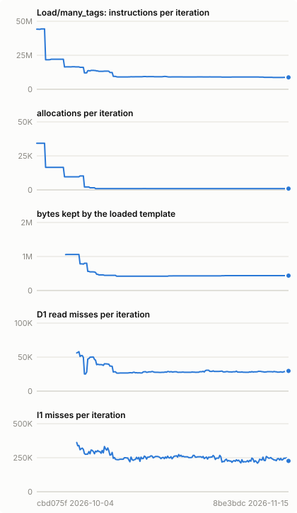

# Benchmark trend

Instruction and allocation counts per iteration on master, one record per commit (230 so far, latest [03ecb5b](https://github.com/jinja2cpp/Jinja2Cpp/commit/03ecb5b147771ef4758f9f60d0d9ab0a2f2b21fd) on 2026-11-15). Written by the `trend` job of `.github/workflows/benchmark.yml` with `bench/trend.py`; the data is `history.jsonl`.

Memory is the bytes a loaded template keeps for `Load/*` and the peak heap use of one render for `Render/*`; vs first compares with the first record that has it.

| Benchmark | Instructions | vs previous | vs first | Allocations | vs previous | vs first | Memory | vs previous | vs first |
|---|---:|---:|---:|---:|---:|---:|---:|---:|---:|
| [Load/chat_llama](#loadchat_llama) | 335,871 | -0.03% |  | 55 | 0% |  | 18,480 | 0% | -52.71% |
| [Render/chat_llama](#renderchat_llama) | 291,150 | +0.08% |  | 225 | 0% |  | 11,616 | 0% | -19.11% |
| [Load/chat_mistral](#loadchat_mistral) | 385,948 | -0.07% |  | 52 | 0% |  | 20,904 | 0% | -53.18% |
| [Render/chat_mistral](#renderchat_mistral) | 493,077 | -0.06% |  | 402 | 0% |  | 9,984 | +0.32% | -24.41% |
| [Load/chat_qwen](#loadchat_qwen) | 261,762 | -0.03% |  | 44 | 0% |  | 14,432 | 0% | -47.19% |
| [Render/chat_qwen](#renderchat_qwen) | 272,891 | +0.02% |  | 212 | 0% |  | 8,304 | 0% | -2.35% |
| [Load/config_file](#loadconfig_file) | 94,836 | -0.08% |  | 25 | 0% |  | 5,480 | 0% | -48.11% |
| [Render/config_file](#renderconfig_file) | 1,275,246 | +0.02% |  | 908 | 0% |  | 25,640 | 0% | +7.69% |
| [Load/dict_ops](#loaddict_ops) | 32,457 | -0.22% | -78.04% | 9 | 0% | -93.13% | 2,192 | 0% | -48.50% |
| [Render/dict_ops](#renderdict_ops) | 291,052 | -0.04% | -57.87% | 112 | 0% | -75.11% | 24,408 | 0% | -29.65% |
| [Load/expressions](#loadexpressions) | 44,439 | -0.11% | -78.44% | 16 | 0% | -89.04% | 2,744 | 0% | -55.28% |
| [Render/expressions](#renderexpressions) | 417,442 | -0.01% | -53.93% | 3 | 0% | -90.00% | 2,440 | 0% | -31.15% |
| [Load/filters](#loadfilters) | 67,542 | 0% | -75.39% | 27 | 0% | -88.16% | 3,864 | 0% | -66.15% |
| [Render/filters](#renderfilters) | 26,902 | 0% | -69.66% | 23 | 0% | -68.92% | 752 | 0% | -84.69% |
| [Load/for_filter_if](#loadfor_filter_if) | 29,297 | -0.16% | -78.36% | 7 | 0% | -94.31% | 1,920 | 0% | -44.32% |
| [Render/for_filter_if](#renderfor_filter_if) | 268,729 | -0.03% | -68.95% | 4 | 0% | -98.23% | 16,560 | 0% | +354.95% |
| [Load/for_loop_vars](#loadfor_loop_vars) | 39,123 | -0.12% | -78.34% | 10 | 0% | -93.63% | 2,384 | 0% | -47.26% |
| [Render/for_loop_vars](#renderfor_loop_vars) | 172,219 | 0% | -83.95% | 2 | 0% | -99.62% | 1,568 | 0% | -43.35% |
| [Load/for_range](#loadfor_range) | 13,355 | -0.10% | -76.44% | 7 | 0% | -87.50% | 1,104 | 0% | -44.80% |
| [Render/for_range](#renderfor_range) | 37,379 | -0.12% | -59.46% | 3 | 0% | -88.89% | 408 | 0% | -73.02% |
| [Load/hf_deepseek_v31](#loadhf_deepseek_v31) | 384,028 | -0.05% |  | 55 | 0% |  | 21,992 | 0% | +0.81% |
| [Render/hf_deepseek_v31](#renderhf_deepseek_v31) | 91,570 | -0.06% |  | 43 | 0% |  | 2,480 | 0% | 0% |
| [Load/hf_gpt_oss](#loadhf_gpt_oss) | 1,523,033 | -0.02% |  | 283 | 0% |  | 74,784 | 0% | +0.75% |
| [Render/hf_gpt_oss](#renderhf_gpt_oss) | 168,954 | +0.28% |  | 155 | 0% |  | 5,704 | 0% | +15.56% |
| [Load/hf_mistral_small](#loadhf_mistral_small) | 592,342 | -0.03% |  | 88 | 0% |  | 33,064 | 0% | +0.39% |
| [Render/hf_mistral_small](#renderhf_mistral_small) | 140,816 | +0.01% |  | 99 | 0% |  | 6,136 | +0.26% | 0% |
| [Load/hf_qwen3](#loadhf_qwen3) | 476,889 | -0.03% |  | 82 | 0% |  | 25,576 | 0% | +0.38% |
| [Render/hf_qwen3](#renderhf_qwen3) | 118,081 | -0.24% |  | 100 | 0% |  | 3,248 | 0% | 0% |
| [Load/html_autoescape](#loadhtml_autoescape) | 189,904 | -0.08% |  | 43 | 0% |  | 12,688 | 0% | -48.59% |
| [Render/html_autoescape](#renderhtml_autoescape) | 1,199,395 | 0% |  | 674 | 0% |  | 46,032 | 0% | +13.99% |
| [Load/inheritance](#loadinheritance) | 21,966 | -0.05% | -80.75% | 7 | 0% | -93.46% | 1,360 | 0% | -52.65% |
| [Render/inheritance](#renderinheritance) | 136,883 | -0.06% | -81.70% | 35 | 0% | -94.37% | 7,960 | 0% | +32.31% |
| [Load/int_arith](#loadint_arith) | 65,380 | -0.08% |  | 20 | 0% |  | 3,888 | 0% | +0.83% |
| [Render/int_arith](#renderint_arith) | 829,175 | -0.01% |  | 12 | 0% |  | 3,272 | 0% | -0.49% |
| [Module/keep](#modulekeep) | 7,141 | 0% |  | 7 | 0% |  |  |  |  |
| [Module/keep_written](#modulekeep_written) | 29,269 | -0.04% |  | 11 | 0% |  |  |  |  |
| [Load/large_static](#loadlarge_static) | 148,000 | 0% | -83.30% | 14 | 0% | -96.82% | 43,136 | 0% | -19.20% |
| [Render/large_static](#renderlarge_static) | 20,691 | 0% | -72.46% | 1 | 0% | -94.44% | 36,552 | 0% | -1.83% |
| [RenderSink/large_static](#rendersinklarge_static) | 12,680 | 0% |  | 0 |  |  | 0 |  |  |
| [RenderTo/large_static](#rendertolarge_static) | 20,254 | 0% |  | 0 |  |  | 0 |  |  |
| [Load/macros](#loadmacros) | 54,802 | -0.09% | -75.96% | 26 | 0% | -86.02% | 4,432 | 0% | -28.70% |
| [Render/macros](#rendermacros) | 643,825 | 0% | -74.88% | 308 | 0% | -88.71% | 20,576 | 0% | +39.78% |
| [Load/many_tags](#loadmany_tags) | 8,764,438 | -0.01% | -80.16% | 951 | 0% | -97.22% | 438,128 | 0% | -58.48% |
| [Render/many_tags](#rendermany_tags) | 732,541 | 0% | -64.83% | 2 | 0% | -90.48% | 5,648 | 0% | -10.52% |
| [Load/mitsuhiko_table](#loadmitsuhiko_table) | 45,290 | -0.18% | -80.94% | 19 | 0% | -89.67% | 3,376 | 0% | -44.33% |
| [Render/mitsuhiko_table](#rendermitsuhiko_table) | 5,158,719 | 0% | -58.25% | 33 | 0% | -99.19% | 381,536 | 0% | +9.95% |
| [RenderSink/mitsuhiko_table](#rendersinkmitsuhiko_table) | 5,085,907 | 0% |  | 32 | 0% |  | 37,064 | 0% | +28.59% |
| [RenderTo/mitsuhiko_table](#rendertomitsuhiko_table) | 5,158,225 | 0% |  | 32 | 0% |  | 37,064 | 0% | +28.59% |
| [Load/mitsuhiko_table_wide](#loadmitsuhiko_table_wide) | 52,978 | -0.15% |  | 35 | 0% |  | 5,704 | 0% | -30.98% |
| [Render/mitsuhiko_table_wide](#rendermitsuhiko_table_wide) | 5,504,979 | 0% |  | 33 | 0% |  | 1,414,928 | 0% | +2.46% |
| [RenderSink/mitsuhiko_table_wide](#rendersinkmitsuhiko_table_wide) | 5,328,030 | 0% |  | 32 | 0% |  | 37,064 | 0% | +28.59% |
| [RenderTo/mitsuhiko_table_wide](#rendertomitsuhiko_table_wide) | 5,504,302 | 0% |  | 32 | 0% |  | 37,064 | 0% | +28.59% |
| [Load/plain_text](#loadplain_text) | 3,760 | +0.08% | -61.14% | 4 | 0% | -77.78% | 688 | 0% | -38.57% |
| [Render/plain_text](#renderplain_text) | 1,012 | 0% | -85.10% | 1 | 0% | -91.67% | 40 | 0% | -94.44% |
| [RenderSink/plain_text](#rendersinkplain_text) | 713 | 0% |  | 0 |  |  | 0 |  |  |
| [RenderTo/plain_text](#rendertoplain_text) | 813 | 0% |  | 0 |  |  | 0 |  |  |
| [Load/prompt_budget](#loadprompt_budget) | 34,634 | -0.04% |  | 18 | 0% |  | 2,240 | 0% | +0.72% |
| [Render/prompt_budget](#renderprompt_budget) | 1,319,982 | +0.01% |  | 76 | 0% |  | 36,416 | 0% | 0% |
| [Load/strings](#loadstrings) | 69,355 | -0.10% | -76.24% | 30 | 0% | -86.61% | 4,360 | 0% | -51.77% |
| [Render/strings](#renderstrings) | 581,540 | 0% | -72.27% | 344 | 0% | -83.73% | 9,088 | 0% | -49.31% |
| [Load/substitute](#loadsubstitute) | 7,540 | +0.04% | -74.75% | 6 | 0% | -83.78% | 848 | 0% | -44.21% |
| [Render/substitute](#rendersubstitute) | 2,179 | 0% | -75.28% | 1 | 0% | -91.67% | 40 | 0% | -94.44% |
| [RenderSink/substitute](#rendersinksubstitute) | 1,884 | 0% |  | 0 |  |  | 0 |  |  |
| [RenderTo/substitute](#rendertosubstitute) | 1,984 | 0% |  | 0 |  |  | 0 |  |  |

## Cache misses

Misses per iteration in callgrind's cache model (`count.py --cache-sim`: 32 KB 8-way L1, 8 MB 16-way last level, no prefetcher); reported, not gated.

| Benchmark | D1 read misses | vs previous | D1 write misses | vs previous | LL data read misses | vs previous | I1 misses | vs previous |
|---|---:|---:|---:|---:|---:|---:|---:|---:|
| Load/chat_llama | 725 | -4.73% | 751 | -1.44% | 0 |  | 7,679 | -5.80% |
| Render/chat_llama | 1,201 | +1.01% | 539 | +1.32% | 0 |  | 3,972 | -1.10% |
| Load/chat_mistral | 1,093 | -2.06% | 1,076 | -1.01% | 0 |  | 8,780 | -1.56% |
| Render/chat_mistral | 1,972 | +0.36% | 600 | -2.44% | 0 |  | 10,764 | +5.04% |
| Load/chat_qwen | 558 | -2.62% | 631 | -0.16% | 0 |  | 4,640 | -5.21% |
| Render/chat_qwen | 1,080 | -1.28% | 409 | -0.97% | 0 |  | 3,518 | +4.14% |
| Load/config_file | 218 | -2.24% | 185 | -0.54% | 0 |  | 2,793 | -1.76% |
| Render/config_file | 6,157 | -5.42% | 1,760 | -2.22% | 0 |  | 45,139 | +3.11% |
| Load/dict_ops | 53 | +3.92% | 27 | -3.57% | 0 |  | 1,395 | +1.45% |
| Render/dict_ops | 696 | -0.14% | 427 | -0.23% | 0 |  | 844 | -1.63% |
| Load/expressions | 33 | +3.12% | 24 | +4.35% | 0 |  | 1,329 | -2.28% |
| Render/expressions | 4 | +33.33% | 1 | 0% | 0 |  | 310 | +10.32% |
| Load/filters | 108 | +0.93% | 50 | +11.11% | 0 |  | 1,664 | -9.42% |
| Render/filters | 11 | -45.00% | 0 | -100.00% | 0 |  | 768 | -2.04% |
| Load/for_filter_if | 26 | -7.14% | 14 | +16.67% | 0 |  | 1,095 | 0% |
| Render/for_filter_if | 1,719 | -0.92% | 94 | -33.33% | 0 |  | 180 | -12.20% |
| Load/for_loop_vars | 43 | -4.44% | 19 | -5.00% | 0 |  | 1,136 | -4.62% |
| Render/for_loop_vars | 4 | -42.86% | 1 |  | 0 |  | 105 | -41.01% |
| Load/for_range | 4 | -42.86% | 4 | +33.33% | 0 |  | 796 | +1.92% |
| Render/for_range | 1 | -50.00% | 0 |  | 0 |  | 159 | +15.22% |
| Load/hf_deepseek_v31 | 1,017 | -2.77% | 975 | -0.61% | 0 |  | 6,624 | -5.63% |
| Render/hf_deepseek_v31 | 353 | -5.11% | 87 | -1.14% | 0 |  | 1,485 | +2.20% |
| Load/hf_gpt_oss | 4,672 | -1.35% | 3,369 | -0.56% | 0 |  | 22,799 | -5.96% |
| Render/hf_gpt_oss | 1,286 | +1.26% | 419 | -0.95% | 0 |  | 4,697 | -1.70% |
| Load/hf_mistral_small | 1,891 | -1.51% | 1,646 | -0.30% | 0 |  | 11,302 | -2.62% |
| Render/hf_mistral_small | 965 | 0% | 307 | +2.33% | 0 |  | 3,810 | +2.25% |
| Load/hf_qwen3 | 1,479 | -1.33% | 1,336 | -0.67% | 0 |  | 9,041 | -4.52% |
| Render/hf_qwen3 | 695 | -1.14% | 213 | -5.33% | 0 |  | 2,633 | -2.19% |
| Load/html_autoescape | 486 | -4.33% | 540 | +0.19% | 0 |  | 3,908 | -7.24% |
| Render/html_autoescape | 4,758 | -20.05% | 1,612 | +2.68% | 0 |  | 36,131 | -4.05% |
| Load/inheritance | 8 | +100.00% | 5 | +66.67% | 0 |  | 726 | -1.89% |
| Render/inheritance | 604 | +0.83% | 118 | +8.26% | 0 |  | 968 | -0.31% |
| Load/int_arith | 73 | -12.05% | 51 | -21.54% | 0 |  | 2,065 | +0.54% |
| Render/int_arith | 12 | -7.69% | 5 | +25.00% | 0 |  | 732 | -1.74% |
| Module/keep | 1 | 0% | 2 | -33.33% | 0 |  | 381 | -13.61% |
| Module/keep_written | 1,135 | -0.09% | 562 | +0.18% | 0 |  | 730 | 0% |
| Load/large_static | 1,928 | -0.05% | 905 | 0% | 0 |  | 307 | +0.66% |
| Render/large_static | 710 | +0.28% | 574 | -0.17% | 0 |  | 5 | 0% |
| RenderSink/large_static | 1 | 0% | 0 |  | 0 |  | 2 | -33.33% |
| RenderTo/large_static | 686 | +0.15% | 577 | +0.17% | 0 |  | 4 | 0% |
| Load/macros | 82 | -2.38% | 70 | +2.94% | 0 |  | 1,720 | -2.16% |
| Render/macros | 771 | +0.26% | 233 | +1.75% | 0 |  | 650 | -31.65% |
| Load/many_tags | 28,707 | -3.22% | 22,583 | -0.46% | 0 |  | 237,210 | -1.37% |
| Render/many_tags | 6,120 | -0.13% | 752 | +0.27% | 0 |  | 102 | -17.07% |
| Load/mitsuhiko_table | 46 | +21.05% | 49 | +2.08% | 0 |  | 914 | -0.65% |
| Render/mitsuhiko_table | 10,030 | +0.09% | 6,282 | -0.16% | 0 |  | 387 | +9.63% |
| RenderSink/mitsuhiko_table | 9,984 | +0.17% | 1,212 | -0.49% | 0 |  | 329 | +7.87% |
| RenderTo/mitsuhiko_table | 10,043 | +0.17% | 6,291 | -0.08% | 0 |  | 360 | +8.43% |
| Load/mitsuhiko_table_wide | 80 | -3.61% | 77 | +2.67% | 0 |  | 947 | -4.82% |
| Render/mitsuhiko_table_wide | 10,209 | -0.30% | 22,666 | +0.05% | 0 |  | 384 | +10.03% |
| RenderSink/mitsuhiko_table_wide | 10,035 | -0.18% | 1,202 | -0.50% | 0 |  | 319 | +6.69% |
| RenderTo/mitsuhiko_table_wide | 10,219 | -0.42% | 22,597 | +0.03% | 0 |  | 365 | +10.94% |
| Load/plain_text | 0 |  | 2 | 0% | 0 |  | 24 | +50.00% |
| Render/plain_text | 1 | 0% | 0 |  | 0 |  | 6 | -14.29% |
| RenderSink/plain_text | 1 | 0% | 0 |  | 0 |  | 5 | 0% |
| RenderTo/plain_text | 1 | 0% | 0 |  | 0 |  | 5 | -16.67% |
| Load/prompt_budget | 86 | +1.18% | 45 | +7.14% | 0 |  | 1,438 | +0.91% |
| Render/prompt_budget | 4,816 | -0.06% | 554 | -0.89% | 0 |  | 1,060 | -0.09% |
| Load/strings | 133 | -6.34% | 110 | +0.92% | 0 |  | 2,795 | -1.62% |
| Render/strings | 406 | -2.17% | 474 | 0% | 0 |  | 1,578 | +0.77% |
| Load/substitute | 2 | 0% | 3 | 0% | 0 |  | 171 | -8.06% |
| Render/substitute | 2 | +100.00% | 0 |  | 0 |  | 4 | 0% |
| RenderSink/substitute | 1 |  | 0 |  | 0 |  | 2 | -33.33% |
| RenderTo/substitute | 1 | 0% | 0 |  | 0 |  | 3 | 0% |

## Charts

### Load/chat_llama

### Render/chat_llama

### Load/chat_mistral

### Render/chat_mistral

### Load/chat_qwen

### Render/chat_qwen

### Load/config_file

### Render/config_file

### Load/dict_ops

### Render/dict_ops

### Load/expressions

### Render/expressions

### Load/filters

### Render/filters

### Load/for_filter_if

### Render/for_filter_if

### Load/for_loop_vars

### Render/for_loop_vars

### Load/for_range

### Render/for_range

### Load/hf_deepseek_v31

### Render/hf_deepseek_v31

### Load/hf_gpt_oss

### Render/hf_gpt_oss

### Load/hf_mistral_small

### Render/hf_mistral_small

### Load/hf_qwen3

### Render/hf_qwen3

### Load/html_autoescape

### Render/html_autoescape

### Load/inheritance

### Render/inheritance

### Load/int_arith

### Render/int_arith

### Module/keep

### Module/keep_written

### Load/large_static

### Render/large_static

### RenderSink/large_static

### RenderTo/large_static

### Load/macros

### Render/macros

### Load/many_tags

### Render/many_tags

### Load/mitsuhiko_table

### Render/mitsuhiko_table

### RenderSink/mitsuhiko_table

### RenderTo/mitsuhiko_table

### Load/mitsuhiko_table_wide

### Render/mitsuhiko_table_wide

### RenderSink/mitsuhiko_table_wide

### RenderTo/mitsuhiko_table_wide

### Load/plain_text

### Render/plain_text

### RenderSink/plain_text

### RenderTo/plain_text

### Load/prompt_budget

### Render/prompt_budget

### Load/strings

### Render/strings

### Load/substitute

### Render/substitute

### RenderSink/substitute

### RenderTo/substitute

