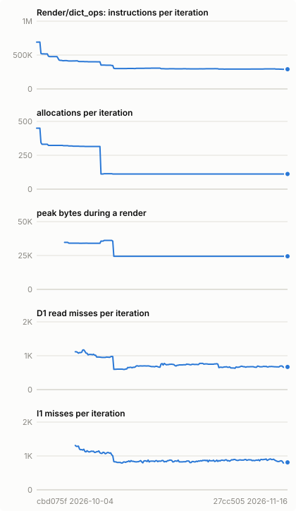

# Benchmark trend

Instruction and allocation counts per iteration on master, one record per commit (269 so far, latest [a21d867](https://github.com/jinja2cpp/Jinja2Cpp/commit/a21d867f7a359b3cced71a7cf41f6ffafbe01280) on 2026-11-26). Written by the `trend` job of `.github/workflows/benchmark.yml` with `bench/trend.py`; the data is `history.jsonl`.

Memory is the bytes a loaded template keeps for `Load/*` and the peak heap use of one render for `Render/*`; vs first compares with the first record that has it.

| Benchmark | Instructions | vs previous | vs first | Allocations | vs previous | vs first | Memory | vs previous | vs first |
|---|---:|---:|---:|---:|---:|---:|---:|---:|---:|
| [Load/big_int_radix](#loadbig_int_radix) | 43,266 | 0% |  | 14 | 0% |  | 2,688 | 0% | 0% |
| [Render/big_int_radix](#renderbig_int_radix) | 146,579,080 | -52.46% |  | 123 | -24.54% |  | 1,540,760 | 0% | -39.13% |
| [Load/chat_llama](#loadchat_llama) | 337,434 | 0% |  | 54 | 0% |  | 18,536 | 0% | -52.57% |
| [Render/chat_llama](#renderchat_llama) | 291,580 | +0.06% |  | 224 | 0% |  | 11,608 | 0% | -19.16% |
| [Load/chat_mistral](#loadchat_mistral) | 385,899 | 0% |  | 51 | 0% |  | 20,976 | 0% | -53.02% |
| [Render/chat_mistral](#renderchat_mistral) | 492,222 | +0.02% |  | 392 | 0% |  | 9,752 | 0% | -26.17% |
| [Load/chat_qwen](#loadchat_qwen) | 262,663 | 0% |  | 43 | 0% |  | 14,472 | 0% | -47.04% |
| [Render/chat_qwen](#renderchat_qwen) | 273,409 | +0.11% |  | 211 | 0% |  | 8,280 | 0% | -2.63% |
| [Load/config_file](#loadconfig_file) | 94,403 | 0% |  | 24 | 0% |  | 5,520 | 0% | -47.73% |
| [Render/config_file](#renderconfig_file) | 1,249,561 | +0.11% |  | 882 | 0% |  | 25,960 | 0% | +9.04% |
| [Load/dict_ops](#loaddict_ops) | 31,968 | 0% | -78.37% | 8 | 0% | -93.89% | 2,216 | 0% | -47.93% |
| [Render/dict_ops](#renderdict_ops) | 289,145 | +0.03% | -58.15% | 112 | 0% | -75.11% | 24,408 | 0% | -29.65% |
| [Load/expressions](#loadexpressions) | 44,175 | 0% | -78.57% | 15 | 0% | -89.73% | 2,752 | 0% | -55.15% |
| [Render/expressions](#renderexpressions) | 414,625 | 0% | -54.24% | 3 | 0% | -90.00% | 2,440 | 0% | -31.15% |
| [Load/filters](#loadfilters) | 67,517 | 0% | -75.40% | 26 | 0% | -88.60% | 3,856 | 0% | -66.22% |
| [Render/filters](#renderfilters) | 24,925 | 0% | -71.89% | 22 | 0% | -70.27% | 752 | 0% | -84.69% |
| [Load/for_filter_if](#loadfor_filter_if) | 28,571 | 0% | -78.90% | 6 | 0% | -95.12% | 1,928 | 0% | -44.08% |
| [Render/for_filter_if](#renderfor_filter_if) | 267,134 | +0.36% | -69.13% | 4 | 0% | -98.23% | 16,560 | 0% | +354.95% |
| [Load/for_loop_vars](#loadfor_loop_vars) | 38,233 | 0% | -78.84% | 9 | 0% | -94.27% | 2,392 | 0% | -47.08% |
| [Render/for_loop_vars](#renderfor_loop_vars) | 170,825 | 0% | -84.08% | 2 | 0% | -99.62% | 1,568 | 0% | -43.35% |
| [Load/for_range](#loadfor_range) | 12,526 | 0% | -77.90% | 6 | 0% | -89.29% | 1,128 | 0% | -43.60% |
| [Render/for_range](#renderfor_range) | 37,207 | 0% | -59.65% | 3 | 0% | -88.89% | 408 | 0% | -73.02% |
| [Load/hf_deepseek_v31](#loadhf_deepseek_v31) | 384,912 | 0% |  | 54 | 0% |  | 22,032 | 0% | +0.99% |
| [Render/hf_deepseek_v31](#renderhf_deepseek_v31) | 90,715 | +0.01% |  | 42 | 0% |  | 2,456 | 0% | -0.97% |
| [Load/hf_gpt_oss](#loadhf_gpt_oss) | 1,528,373 | 0% |  | 282 | 0% |  | 75,016 | 0% | +1.07% |
| [Render/hf_gpt_oss](#renderhf_gpt_oss) | 169,576 | +0.08% |  | 153 | 0% |  | 5,984 | 0% | +21.23% |
| [Load/hf_mistral_small](#loadhf_mistral_small) | 592,693 | 0% |  | 87 | 0% |  | 33,136 | 0% | +0.61% |
| [Render/hf_mistral_small](#renderhf_mistral_small) | 140,358 | +0.01% |  | 97 | 0% |  | 6,096 | 0% | -0.65% |
| [Load/hf_qwen3](#loadhf_qwen3) | 478,869 | 0% |  | 81 | 0% |  | 25,648 | 0% | +0.66% |
| [Render/hf_qwen3](#renderhf_qwen3) | 117,618 | +0.14% |  | 99 | 0% |  | 3,224 | 0% | -0.74% |
| [Load/html_autoescape](#loadhtml_autoescape) | 189,392 | 0% |  | 42 | 0% |  | 12,728 | 0% | -48.43% |
| [Render/html_autoescape](#renderhtml_autoescape) | 1,198,750 | +0.12% |  | 674 | 0% |  | 46,256 | 0% | +14.54% |
| [Load/inheritance](#loadinheritance) | 21,312 | 0% | -81.32% | 6 | 0% | -94.39% | 1,368 | 0% | -52.37% |
| [Render/inheritance](#renderinheritance) | 137,122 | +0.21% | -81.66% | 35 | 0% | -94.37% | 8,168 | 0% | +35.77% |
| [Load/int_arith](#loadint_arith) | 65,188 | 0% |  | 19 | 0% |  | 3,896 | 0% | +1.04% |
| [Render/int_arith](#renderint_arith) | 825,464 | +0.15% |  | 12 | 0% |  | 3,272 | 0% | -0.49% |
| [Module/keep](#modulekeep) | 7,163 | 0% |  | 6 | 0% |  |  |  |  |
| [Module/keep_written](#modulekeep_written) | 29,158 | 0% |  | 10 | 0% |  |  |  |  |
| [Load/large_static](#loadlarge_static) | 147,158 | 0% | -83.39% | 13 | 0% | -97.05% | 43,128 | 0% | -19.21% |
| [Render/large_static](#renderlarge_static) | 20,342 | 0% | -72.93% | 1 | 0% | -94.44% | 36,552 | 0% | -1.83% |
| [RenderSink/large_static](#rendersinklarge_static) | 12,631 | 0% |  | 0 |  |  | 0 |  |  |
| [RenderTo/large_static](#rendertolarge_static) | 19,845 | 0% |  | 0 |  |  | 0 |  |  |
| [Load/macros](#loadmacros) | 54,385 | 0% | -76.14% | 25 | 0% | -86.56% | 4,472 | 0% | -28.06% |
| [Render/macros](#rendermacros) | 648,014 | +0.09% | -74.72% | 308 | 0% | -88.71% | 20,608 | 0% | +40.00% |
| [Load/many_tags](#loadmany_tags) | 8,785,186 | 0% | -80.11% | 950 | 0% | -97.23% | 438,136 | 0% | -58.48% |
| [Render/many_tags](#rendermany_tags) | 732,457 | +0.25% | -64.84% | 2 | 0% | -90.48% | 5,648 | 0% | -10.52% |
| [Load/mitsuhiko_table](#loadmitsuhiko_table) | 44,693 | 0% | -81.19% | 18 | 0% | -90.22% | 3,416 | 0% | -43.67% |
| [Render/mitsuhiko_table](#rendermitsuhiko_table) | 5,129,298 | 0% | -58.49% | 33 | 0% | -99.19% | 381,536 | 0% | +9.95% |
| [RenderSink/mitsuhiko_table](#rendersinkmitsuhiko_table) | 5,059,393 | 0% |  | 32 | 0% |  | 37,064 | 0% | +28.59% |
| [RenderTo/mitsuhiko_table](#rendertomitsuhiko_table) | 5,128,754 | 0% |  | 32 | 0% |  | 37,064 | 0% | +28.59% |
| [Load/mitsuhiko_table_wide](#loadmitsuhiko_table_wide) | 52,178 | 0% |  | 34 | 0% |  | 5,744 | 0% | -30.49% |
| [Render/mitsuhiko_table_wide](#rendermitsuhiko_table_wide) | 5,475,532 | 0% |  | 33 | 0% |  | 1,414,928 | 0% | +2.46% |
| [RenderSink/mitsuhiko_table_wide](#rendersinkmitsuhiko_table_wide) | 5,301,437 | 0% |  | 32 | 0% |  | 37,064 | 0% | +28.59% |
| [RenderTo/mitsuhiko_table_wide](#rendertomitsuhiko_table_wide) | 5,474,926 | 0% |  | 32 | 0% |  | 37,064 | 0% | +28.59% |
| [Nested/new_template](#nestednew_template) | 452,673 | -0.01% |  | 323 | 0% |  |  |  |  |
| [Load/plain_text](#loadplain_text) | 2,932 | 0% | -69.70% | 3 | 0% | -83.33% | 680 | 0% | -39.29% |
| [Render/plain_text](#renderplain_text) | 972 | 0% | -85.69% | 1 | 0% | -91.67% | 40 | 0% | -94.44% |
| [RenderSink/plain_text](#rendersinkplain_text) | 677 | 0% |  | 0 |  |  | 0 |  |  |
| [RenderTo/plain_text](#rendertoplain_text) | 773 | 0% |  | 0 |  |  | 0 |  |  |
| [Load/prompt_budget](#loadprompt_budget) | 34,335 | 0% |  | 17 | 0% |  | 2,248 | 0% | +1.08% |
| [Render/prompt_budget](#renderprompt_budget) | 1,325,090 | +0.01% |  | 76 | 0% |  | 36,640 | 0% | +0.62% |
| [Nested/shared_globals](#nestedshared_globals) | 160,517 | -0.02% |  | 160 | 0% |  |  |  |  |
| [Load/strings](#loadstrings) | 69,105 | +0.02% | -76.32% | 29 | 0% | -87.05% | 4,384 | 0% | -51.50% |
| [Render/strings](#renderstrings) | 581,117 | +0.04% | -72.29% | 344 | 0% | -83.73% | 9,088 | 0% | -49.31% |
| [Load/substitute](#loadsubstitute) | 6,662 | 0% | -77.69% | 5 | 0% | -86.49% | 840 | 0% | -44.74% |
| [Render/substitute](#rendersubstitute) | 1,653 | 0% | -81.24% | 1 | 0% | -91.67% | 40 | 0% | -94.44% |
| [RenderSink/substitute](#rendersinksubstitute) | 1,362 | 0% |  | 0 |  |  | 0 |  |  |
| [RenderTo/substitute](#rendertosubstitute) | 1,458 | 0% |  | 0 |  |  | 0 |  |  |

## Cache misses

Misses per iteration in callgrind's cache model (`count.py --cache-sim`: 32 KB 8-way L1, 8 MB 16-way last level, no prefetcher); reported, not gated.

| Benchmark | D1 read misses | vs previous | D1 write misses | vs previous | LL data read misses | vs previous | I1 misses | vs previous |
|---|---:|---:|---:|---:|---:|---:|---:|---:|
| Load/big_int_radix | 103 | -4.63% | 61 | +3.39% | 0 |  | 2,017 | +1.00% |
| Render/big_int_radix | 364,223 | -53.00% | 350,996 | -31.88% | 0 |  | 3,610 | -16.86% |
| Load/chat_llama | 795 | -2.93% | 782 | -0.26% | 0 |  | 7,580 | -4.74% |
| Render/chat_llama | 1,168 | -1.18% | 554 | +1.09% | 0 |  | 4,359 | -1.18% |
| Load/chat_mistral | 1,094 | -0.27% | 1,099 | 0% | 0 |  | 8,660 | -4.18% |
| Render/chat_mistral | 1,993 | +0.15% | 643 | -0.62% | 0 |  | 10,815 | +2.88% |
| Load/chat_qwen | 547 | -0.55% | 644 | -0.92% | 0 |  | 4,641 | -4.13% |
| Render/chat_qwen | 1,048 | -0.19% | 415 | +0.24% | 0 |  | 3,657 | -3.33% |
| Load/config_file | 209 | -0.48% | 199 | +2.58% | 0 |  | 2,811 | +1.55% |
| Render/config_file | 7,201 | -2.41% | 1,905 | 0% | 0 |  | 44,615 | +1.53% |
| Load/dict_ops | 41 | -2.38% | 22 | -12.00% | 0 |  | 1,385 | -0.50% |
| Render/dict_ops | 690 | -0.72% | 423 | +0.24% | 0 |  | 770 | +1.45% |
| Load/expressions | 42 | +10.53% | 31 | 0% | 0 |  | 1,273 | -4.50% |
| Render/expressions | 3 | 0% | 0 |  | 0 |  | 340 | +6.58% |
| Load/filters | 93 | -6.06% | 51 | -7.27% | 0 |  | 1,636 | -7.78% |
| Render/filters | 16 | -33.33% | 3 | -50.00% | 0 |  | 702 | +1.30% |
| Load/for_filter_if | 22 | -18.52% | 8 | -20.00% | 0 |  | 1,055 | -1.40% |
| Render/for_filter_if | 1,719 | 0% | 86 | -1.15% | 0 |  | 179 | +7.19% |
| Load/for_loop_vars | 48 | -5.88% | 19 | 0% | 0 |  | 1,087 | -1.63% |
| Render/for_loop_vars | 8 | -11.11% | 1 |  | 0 |  | 102 | +20.00% |
| Load/for_range | 11 | +22.22% | 5 | 0% | 0 |  | 757 | +2.57% |
| Render/for_range | 2 | 0% | 1 | 0% | 0 |  | 159 | -7.56% |
| Load/hf_deepseek_v31 | 983 | +0.72% | 966 | -0.72% | 0 |  | 6,170 | -4.71% |
| Render/hf_deepseek_v31 | 386 | +0.78% | 88 | +2.33% | 0 |  | 1,536 | +1.45% |
| Load/hf_gpt_oss | 4,692 | -0.38% | 3,395 | -0.24% | 0 |  | 22,422 | -2.80% |
| Render/hf_gpt_oss | 1,304 | -0.53% | 422 | +0.48% | 0 |  | 5,054 | +2.97% |
| Load/hf_mistral_small | 1,876 | -0.53% | 1,637 | -1.15% | 0 |  | 11,373 | -4.01% |
| Render/hf_mistral_small | 1,003 | 0% | 315 | 0% | 0 |  | 3,990 | +6.51% |
| Load/hf_qwen3 | 1,503 | -0.33% | 1,301 | -0.31% | 0 |  | 9,158 | -2.40% |
| Render/hf_qwen3 | 683 | -1.87% | 231 | +1.76% | 0 |  | 2,802 | +3.74% |
| Load/html_autoescape | 495 | -1.20% | 540 | -0.74% | 0 |  | 4,166 | +1.78% |
| Render/html_autoescape | 4,524 | -3.77% | 1,584 | +0.70% | 0 |  | 35,369 | -5.89% |
| Load/inheritance | 9 | +12.50% | 5 | 0% | 0 |  | 699 | -2.37% |
| Render/inheritance | 599 | 0% | 117 | 0% | 0 |  | 1,029 | -2.00% |
| Load/int_arith | 89 | -9.18% | 78 | -1.27% | 0 |  | 2,097 | -0.76% |
| Render/int_arith | 34 | +17.24% | 17 | +21.43% | 0 |  | 762 | -0.26% |
| Module/keep | 2 | 0% | 2 | 0% | 0 |  | 456 | -1.72% |
| Module/keep_written | 1,147 | 0% | 579 | 0% | 0 |  | 714 | -4.93% |
| Load/large_static | 1,917 | -0.05% | 909 | -0.11% | 0 |  | 256 | -2.66% |
| Render/large_static | 699 | 0% | 571 | 0% | 0 |  | 4 | -20.00% |
| RenderSink/large_static | 2 | 0% | 0 |  | 0 |  | 2 | 0% |
| RenderTo/large_static | 678 | 0% | 582 | 0% | 0 |  | 3 | -40.00% |
| Load/macros | 78 | -3.70% | 57 | -10.94% | 0 |  | 1,739 | +0.58% |
| Render/macros | 759 | +0.13% | 268 | 0% | 0 |  | 1,284 | -1.38% |
| Load/many_tags | 28,083 | -0.06% | 22,562 | -0.10% | 0 |  | 237,139 | -2.39% |
| Render/many_tags | 6,090 | -0.20% | 791 | -0.13% | 0 |  | 134 | +14.53% |
| Load/mitsuhiko_table | 44 | +7.32% | 47 | -2.08% | 0 |  | 905 | +2.61% |
| Render/mitsuhiko_table | 10,040 | -0.09% | 6,336 | +0.02% | 0 |  | 337 | +13.85% |
| RenderSink/mitsuhiko_table | 9,951 | -0.14% | 1,202 | -0.08% | 0 |  | 262 | +20.74% |
| RenderTo/mitsuhiko_table | 10,040 | -0.11% | 6,287 | -0.02% | 0 |  | 302 | +11.85% |
| Load/mitsuhiko_table_wide | 69 | -20.69% | 73 | -13.10% | 0 |  | 1,085 | -5.65% |
| Render/mitsuhiko_table_wide | 10,324 | -0.01% | 22,598 | +0.02% | 0 |  | 330 | +15.79% |
| RenderSink/mitsuhiko_table_wide | 10,029 | -0.01% | 1,263 | -0.08% | 0 |  | 267 | +11.72% |
| RenderTo/mitsuhiko_table_wide | 10,182 | +0.01% | 22,675 | 0% | 0 |  | 319 | +16.42% |
| Nested/new_template | 2,271 | +1.20% | 1,645 | +0.30% | 0 |  | 24,561 | -0.27% |
| Load/plain_text | 0 |  | 1 | 0% | 0 |  | 10 | +233.33% |
| Render/plain_text | 1 | 0% | 0 |  | 0 |  | 7 | +16.67% |
| RenderSink/plain_text | 1 | 0% | 0 |  | 0 |  | 5 | 0% |
| RenderTo/plain_text | 2 | 0% | 0 |  | 0 |  | 6 | 0% |
| Load/prompt_budget | 72 | 0% | 47 | +4.44% | 0 |  | 1,420 | -1.32% |
| Render/prompt_budget | 4,785 | 0% | 548 | 0% | 0 |  | 921 | +15.99% |
| Nested/shared_globals | 242 | +28.04% | 112 | -5.08% | 0 |  | 9,216 | +0.29% |
| Load/strings | 159 | +3.25% | 79 | -8.14% | 0 |  | 2,791 | -2.21% |
| Render/strings | 425 | -0.70% | 483 | +0.42% | 0 |  | 1,576 | -0.63% |
| Load/substitute | 2 | +100.00% | 2 | 0% | 0 |  | 138 | +31.43% |
| Render/substitute | 1 | 0% | 0 |  | 0 |  | 3 | -40.00% |
| RenderSink/substitute | 1 | 0% | 0 |  | 0 |  | 3 | 0% |
| RenderTo/substitute | 1 | 0% | 0 |  | 0 |  | 3 | -40.00% |

## Charts

### Load/big_int_radix

### Render/big_int_radix

### Load/chat_llama

### Render/chat_llama

### Load/chat_mistral

### Render/chat_mistral

### Load/chat_qwen

### Render/chat_qwen

### Load/config_file

### Render/config_file

### Load/dict_ops

### Render/dict_ops

### Load/expressions

### Render/expressions

### Load/filters

### Render/filters

### Load/for_filter_if

### Render/for_filter_if

### Load/for_loop_vars

### Render/for_loop_vars

### Load/for_range

### Render/for_range

### Load/hf_deepseek_v31

### Render/hf_deepseek_v31

### Load/hf_gpt_oss

### Render/hf_gpt_oss

### Load/hf_mistral_small

### Render/hf_mistral_small

### Load/hf_qwen3

### Render/hf_qwen3

### Load/html_autoescape

### Render/html_autoescape

### Load/inheritance

### Render/inheritance

### Load/int_arith

### Render/int_arith

### Module/keep

### Module/keep_written

### Load/large_static

### Render/large_static

### RenderSink/large_static

### RenderTo/large_static

### Load/macros

### Render/macros

### Load/many_tags

### Render/many_tags

### Load/mitsuhiko_table

### Render/mitsuhiko_table

### RenderSink/mitsuhiko_table

### RenderTo/mitsuhiko_table

### Load/mitsuhiko_table_wide

### Render/mitsuhiko_table_wide

### RenderSink/mitsuhiko_table_wide

### RenderTo/mitsuhiko_table_wide

### Nested/new_template

### Load/plain_text

### Render/plain_text

### RenderSink/plain_text

### RenderTo/plain_text

### Load/prompt_budget

### Render/prompt_budget

### Nested/shared_globals

### Load/strings

### Render/strings

### Load/substitute

### Render/substitute

### RenderSink/substitute

### RenderTo/substitute

