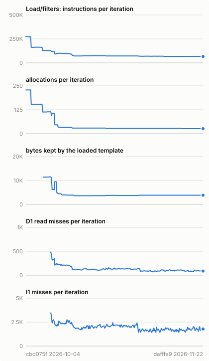
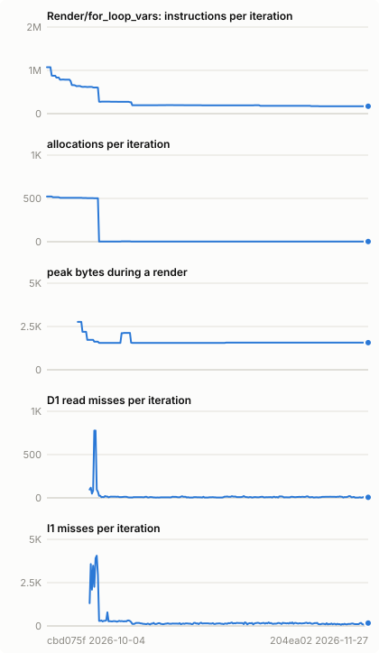
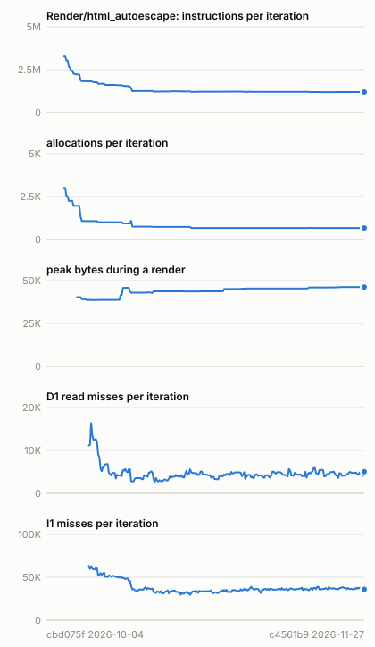

# Benchmark trend

Instruction and allocation counts per iteration on master, one record per commit (228 so far, latest [8be3bdc](https://github.com/jinja2cpp/Jinja2Cpp/commit/8be3bdcbc7af2bc99f98a5c781dfc4be3356e828) on 2026-11-15). Written by the `trend` job of `.github/workflows/benchmark.yml` with `bench/trend.py`; the data is `history.jsonl`.

Memory is the bytes a loaded template keeps for `Load/*` and the peak heap use of one render for `Render/*`; vs first compares with the first record that has it.

| Benchmark | Instructions | vs previous | vs first | Allocations | vs previous | vs first | Memory | vs previous | vs first |
|---|---:|---:|---:|---:|---:|---:|---:|---:|---:|
| [Load/chat_llama](#loadchat_llama) | 335,988 | 0% |  | 55 | 0% |  | 18,480 | 0% | -52.71% |
| [Render/chat_llama](#renderchat_llama) | 291,360 | -0.32% |  | 225 | 0% |  | 11,616 | 0% | -19.11% |
| [Load/chat_mistral](#loadchat_mistral) | 386,224 | -0.01% |  | 52 | 0% |  | 20,904 | 0% | -53.18% |
| [Render/chat_mistral](#renderchat_mistral) | 494,332 | -0.11% |  | 402 | 0% |  | 9,952 | 0% | -24.65% |
| [Load/chat_qwen](#loadchat_qwen) | 261,852 | 0% |  | 44 | 0% |  | 14,432 | 0% | -47.19% |
| [Render/chat_qwen](#renderchat_qwen) | 273,332 | -0.14% |  | 212 | 0% |  | 8,304 | 0% | -2.35% |
| [Load/config_file](#loadconfig_file) | 94,912 | 0% |  | 25 | 0% |  | 5,480 | 0% | -48.11% |
| [Render/config_file](#renderconfig_file) | 1,277,789 | -0.52% |  | 908 | -0.22% |  | 25,640 | +0.31% | +7.69% |
| [Load/dict_ops](#loaddict_ops) | 32,527 | 0% | -77.99% | 9 | 0% | -93.13% | 2,192 | 0% | -48.50% |
| [Render/dict_ops](#renderdict_ops) | 291,942 | -0.14% | -57.74% | 112 | 0% | -75.11% | 24,408 | 0% | -29.65% |
| [Load/expressions](#loadexpressions) | 44,486 | 0% | -78.42% | 16 | 0% | -89.04% | 2,744 | 0% | -55.28% |
| [Render/expressions](#renderexpressions) | 417,531 | 0% | -53.92% | 3 | 0% | -90.00% | 2,440 | 0% | -31.15% |
| [Load/filters](#loadfilters) | 67,539 | 0% | -75.39% | 27 | 0% | -88.16% | 3,864 | 0% | -66.15% |
| [Render/filters](#renderfilters) | 26,966 | -0.16% | -69.59% | 23 | 0% | -68.92% | 752 | 0% | -84.69% |
| [Load/for_filter_if](#loadfor_filter_if) | 29,344 | 0% | -78.33% | 7 | 0% | -94.31% | 1,920 | 0% | -44.32% |
| [Render/for_filter_if](#renderfor_filter_if) | 268,861 | -0.01% | -68.94% | 4 | 0% | -98.23% | 16,560 | 0% | +354.95% |
| [Load/for_loop_vars](#loadfor_loop_vars) | 39,169 | 0% | -78.32% | 10 | 0% | -93.63% | 2,384 | 0% | -47.26% |
| [Render/for_loop_vars](#renderfor_loop_vars) | 172,260 | -0.01% | -83.94% | 2 | 0% | -99.62% | 1,568 | 0% | -43.35% |
| [Load/for_range](#loadfor_range) | 13,368 | 0% | -76.42% | 7 | 0% | -87.50% | 1,104 | 0% | -44.80% |
| [Render/for_range](#renderfor_range) | 37,466 | -0.01% | -59.37% | 3 | 0% | -88.89% | 408 | 0% | -73.02% |
| [Load/hf_deepseek_v31](#loadhf_deepseek_v31) | 384,216 | 0% |  | 55 | 0% |  | 21,992 | 0% | +0.81% |
| [Render/hf_deepseek_v31](#renderhf_deepseek_v31) | 91,730 | -0.41% |  | 43 | 0% |  | 2,480 | 0% | 0% |
| [Load/hf_gpt_oss](#loadhf_gpt_oss) | 1,523,527 | -0.11% |  | 283 | -1.39% |  | 74,752 | +0.24% | +0.71% |
| [Render/hf_gpt_oss](#renderhf_gpt_oss) | 168,915 | -0.91% |  | 155 | -0.64% |  | 5,704 | +0.71% | +15.56% |
| [Load/hf_mistral_small](#loadhf_mistral_small) | 592,518 | 0% |  | 88 | 0% |  | 33,064 | 0% | +0.39% |
| [Render/hf_mistral_small](#renderhf_mistral_small) | 141,082 | -0.27% |  | 99 | 0% |  | 6,120 | 0% | -0.26% |
| [Load/hf_qwen3](#loadhf_qwen3) | 477,046 | 0% |  | 82 | 0% |  | 25,576 | 0% | +0.38% |
| [Render/hf_qwen3](#renderhf_qwen3) | 118,634 | -0.19% |  | 100 | 0% |  | 3,248 | 0% | 0% |
| [Load/html_autoescape](#loadhtml_autoescape) | 190,064 | 0% |  | 43 | 0% |  | 12,688 | 0% | -48.59% |
| [Render/html_autoescape](#renderhtml_autoescape) | 1,199,465 | -0.05% |  | 674 | -0.15% |  | 46,032 | +0.09% | +13.99% |
| [Load/inheritance](#loadinheritance) | 21,978 | 0% | -80.74% | 7 | 0% | -93.46% | 1,360 | 0% | -52.65% |
| [Render/inheritance](#renderinheritance) | 137,059 | -0.94% | -81.67% | 35 | -7.89% | -94.37% | 7,960 | +0.51% | +32.31% |
| [Load/int_arith](#loadint_arith) | 65,431 | 0% |  | 20 | 0% |  | 3,888 | 0% | +0.83% |
| [Render/int_arith](#renderint_arith) | 829,332 | -0.29% |  | 12 | 0% |  | 3,272 | 0% | -0.49% |
| [Module/keep](#modulekeep) | 7,141 | -0.70% |  | 7 | 0% |  |  |  |  |
| [Module/keep_written](#modulekeep_written) | 29,287 | +0.12% |  | 11 | 0% |  |  |  |  |
| [Load/large_static](#loadlarge_static) | 147,997 | 0% | -83.30% | 14 | 0% | -96.82% | 43,136 | 0% | -19.20% |
| [Render/large_static](#renderlarge_static) | 20,727 | -0.13% | -72.41% | 1 | 0% | -94.44% | 36,552 | 0% | -1.83% |
| [RenderSink/large_static](#rendersinklarge_static) | 12,716 | -0.21% |  | 0 |  |  | 0 |  |  |
| [RenderTo/large_static](#rendertolarge_static) | 20,290 | -0.13% |  | 0 |  |  | 0 |  |  |
| [Load/macros](#loadmacros) | 54,856 | -0.30% | -75.94% | 26 | -3.70% | -86.02% | 4,432 | +0.91% | -28.70% |
| [Render/macros](#rendermacros) | 643,874 | -0.17% | -74.88% | 308 | 0% | -88.71% | 20,576 | 0% | +39.78% |
| [Load/many_tags](#loadmany_tags) | 8,765,035 | 0% | -80.15% | 951 | 0% | -97.22% | 438,128 | 0% | -58.48% |
| [Render/many_tags](#rendermany_tags) | 732,586 | -1.17% | -64.83% | 2 | 0% | -90.48% | 5,648 | 0% | -10.52% |
| [Load/mitsuhiko_table](#loadmitsuhiko_table) | 45,372 | 0% | -80.90% | 19 | 0% | -89.67% | 3,376 | 0% | -44.33% |
| [Render/mitsuhiko_table](#rendermitsuhiko_table) | 5,158,985 | +0.10% | -58.25% | 33 | 0% | -99.19% | 381,536 | 0% | +9.95% |
| [RenderSink/mitsuhiko_table](#rendersinkmitsuhiko_table) | 5,086,007 | +0.10% |  | 32 | 0% |  | 37,064 | 0% | +28.59% |
| [RenderTo/mitsuhiko_table](#rendertomitsuhiko_table) | 5,158,541 | +0.10% |  | 32 | 0% |  | 37,064 | 0% | +28.59% |
| [Load/mitsuhiko_table_wide](#loadmitsuhiko_table_wide) | 53,060 | 0% |  | 35 | 0% |  | 5,704 | 0% | -30.98% |
| [Render/mitsuhiko_table_wide](#rendermitsuhiko_table_wide) | 5,505,092 | +0.10% |  | 33 | 0% |  | 1,414,928 | 0% | +2.46% |
| [RenderSink/mitsuhiko_table_wide](#rendersinkmitsuhiko_table_wide) | 5,328,145 | +0.10% |  | 32 | 0% |  | 37,064 | 0% | +28.59% |
| [RenderTo/mitsuhiko_table_wide](#rendertomitsuhiko_table_wide) | 5,504,418 | +0.09% |  | 32 | 0% |  | 37,064 | 0% | +28.59% |
| [Load/plain_text](#loadplain_text) | 3,757 | 0% | -61.17% | 4 | 0% | -77.78% | 688 | 0% | -38.57% |
| [Render/plain_text](#renderplain_text) | 1,048 | -0.95% | -84.57% | 1 | 0% | -91.67% | 40 | 0% | -94.44% |
| [RenderSink/plain_text](#rendersinkplain_text) | 749 | -1.45% |  | 0 |  |  | 0 |  |  |
| [RenderTo/plain_text](#rendertoplain_text) | 849 | -1.16% |  | 0 |  |  | 0 |  |  |
| [Load/prompt_budget](#loadprompt_budget) | 34,647 | 0% |  | 18 | 0% |  | 2,240 | 0% | +0.72% |
| [Render/prompt_budget](#renderprompt_budget) | 1,319,979 | +0.01% |  | 76 | 0% |  | 36,416 | 0% | 0% |
| [Load/strings](#loadstrings) | 69,422 | 0% | -76.21% | 30 | 0% | -86.61% | 4,360 | 0% | -51.77% |
| [Render/strings](#renderstrings) | 581,665 | -0.22% | -72.27% | 344 | 0% | -83.73% | 9,088 | 0% | -49.31% |
| [Load/substitute](#loadsubstitute) | 7,537 | 0% | -74.76% | 6 | 0% | -83.78% | 848 | 0% | -44.21% |
| [Render/substitute](#rendersubstitute) | 2,215 | -1.86% | -74.87% | 1 | 0% | -91.67% | 40 | 0% | -94.44% |
| [RenderSink/substitute](#rendersinksubstitute) | 1,920 | -2.19% |  | 0 |  |  | 0 |  |  |
| [RenderTo/substitute](#rendertosubstitute) | 2,020 | -2.04% |  | 0 |  |  | 0 |  |  |

## Cache misses

Misses per iteration in callgrind's cache model (`count.py --cache-sim`: 32 KB 8-way L1, 8 MB 16-way last level, no prefetcher); reported, not gated.

| Benchmark | D1 read misses | vs previous | D1 write misses | vs previous | LL data read misses | vs previous | I1 misses | vs previous |
|---|---:|---:|---:|---:|---:|---:|---:|---:|
| Load/chat_llama | 762 | -0.26% | 761 | 0% | 0 |  | 7,374 | -5.74% |
| Render/chat_llama | 1,191 | -3.87% | 527 | -3.66% | 0 |  | 3,989 | -2.64% |
| Load/chat_mistral | 1,113 | -0.36% | 1,088 | 0% | 0 |  | 8,326 | -6.91% |
| Render/chat_mistral | 1,974 | +1.13% | 616 | +4.58% | 0 |  | 10,358 | -0.48% |
| Load/chat_qwen | 578 | -0.34% | 632 | 0% | 0 |  | 4,459 | -9.79% |
| Render/chat_qwen | 1,093 | +0.37% | 416 | +1.96% | 0 |  | 3,476 | +0.81% |
| Load/config_file | 223 | -0.45% | 184 | 0% | 0 |  | 2,673 | -5.61% |
| Render/config_file | 6,391 | -5.77% | 1,581 | -9.71% | 0 |  | 43,926 | -2.57% |
| Load/dict_ops | 51 | 0% | 28 | -6.67% | 0 |  | 1,338 | -2.34% |
| Render/dict_ops | 694 | +3.74% | 430 | +0.94% | 0 |  | 850 | +1.80% |
| Load/expressions | 32 | -11.11% | 23 | -17.86% | 0 |  | 1,323 | -0.45% |
| Render/expressions | 3 | 0% | 1 | 0% | 0 |  | 299 | -15.77% |
| Load/filters | 107 | -1.83% | 45 | -8.16% | 0 |  | 1,428 | -14.13% |
| Render/filters | 20 | +81.82% | 1 | -50.00% | 0 |  | 780 | -1.02% |
| Load/for_filter_if | 28 | -3.45% | 12 | -7.69% | 0 |  | 1,077 | -3.58% |
| Render/for_filter_if | 1,738 | -0.11% | 140 | +4.48% | 0 |  | 184 | +2.22% |
| Load/for_loop_vars | 45 | -10.00% | 20 | -13.04% | 0 |  | 1,121 | -6.74% |
| Render/for_loop_vars | 7 | +40.00% | 1 | 0% | 0 |  | 162 | -1.82% |
| Load/for_range | 7 | -22.22% | 3 | -40.00% | 0 |  | 789 | +3.68% |
| Render/for_range | 2 | 0% | 0 |  | 0 |  | 129 | -11.03% |
| Load/hf_deepseek_v31 | 1,046 | -0.29% | 981 | 0% | 0 |  | 6,108 | -8.05% |
| Render/hf_deepseek_v31 | 377 | +2.45% | 85 | -7.61% | 0 |  | 1,443 | -1.77% |
| Load/hf_gpt_oss | 4,745 | +1.87% | 3,388 | +0.44% | 0 |  | 22,023 | -4.94% |
| Render/hf_gpt_oss | 1,264 | -0.32% | 418 | +0.97% | 0 |  | 4,660 | -2.39% |
| Load/hf_mistral_small | 1,920 | -0.21% | 1,651 | +0.06% | 0 |  | 10,912 | -6.54% |
| Render/hf_mistral_small | 971 | 0% | 300 | -2.91% | 0 |  | 3,731 | -0.53% |
| Load/hf_qwen3 | 1,499 | -0.20% | 1,346 | 0% | 0 |  | 8,528 | -10.27% |
| Render/hf_qwen3 | 709 | -0.70% | 224 | 0% | 0 |  | 2,636 | -1.68% |
| Load/html_autoescape | 508 | -0.20% | 539 | -0.19% | 0 |  | 3,864 | -14.87% |
| Render/html_autoescape | 5,867 | +14.95% | 1,572 | +16.88% | 0 |  | 37,567 | +6.73% |
| Load/inheritance | 4 | -20.00% | 3 | 0% | 0 |  | 690 | -3.09% |
| Render/inheritance | 603 | +0.17% | 108 | -4.42% | 0 |  | 957 | -1.14% |
| Load/int_arith | 83 | -2.35% | 65 | 0% | 0 |  | 2,030 | -2.36% |
| Render/int_arith | 13 | +44.44% | 4 | -20.00% | 0 |  | 766 | +0.92% |
| Module/keep | 1 | 0% | 3 | 0% | 0 |  | 438 | -0.90% |
| Module/keep_written | 1,136 | +0.09% | 561 | 0% | 0 |  | 752 | +4.16% |
| Load/large_static | 1,927 | -0.05% | 905 | 0% | 0 |  | 334 | -5.65% |
| Render/large_static | 709 | +0.28% | 576 | 0% | 0 |  | 6 | 0% |
| RenderSink/large_static | 1 | 0% | 0 |  | 0 |  | 2 | -50.00% |
| RenderTo/large_static | 686 | +0.29% | 577 | -0.17% | 0 |  | 4 | -33.33% |
| Load/macros | 84 | -9.68% | 68 | -16.05% | 0 |  | 1,688 | -4.20% |
| Render/macros | 770 | -3.51% | 234 | -11.70% | 0 |  | 612 | -38.62% |
| Load/many_tags | 29,662 | -0.06% | 22,687 | -0.06% | 0 |  | 226,614 | -6.27% |
| Render/many_tags | 6,126 | -0.36% | 755 | -4.91% | 0 |  | 227 | +99.12% |
| Load/mitsuhiko_table | 38 | -2.56% | 48 | 0% | 0 |  | 872 | -3.43% |
| Render/mitsuhiko_table | 10,022 | -0.16% | 6,291 | +0.56% | 0 |  | 342 | -5.79% |
| RenderSink/mitsuhiko_table | 9,969 | -0.12% | 1,217 | +1.42% | 0 |  | 307 | -4.66% |
| RenderTo/mitsuhiko_table | 10,029 | -0.22% | 6,296 | +0.49% | 0 |  | 327 | -6.30% |
| Load/mitsuhiko_table_wide | 83 | -4.60% | 75 | -1.32% | 0 |  | 973 | +1.88% |
| Render/mitsuhiko_table_wide | 10,234 | +0.39% | 22,654 | -0.16% | 0 |  | 347 | -9.87% |
| RenderSink/mitsuhiko_table_wide | 10,058 | +0.30% | 1,207 | -7.65% | 0 |  | 305 | -3.17% |
| RenderTo/mitsuhiko_table_wide | 10,253 | +0.21% | 22,594 | -0.45% | 0 |  | 331 | -6.23% |
| Load/plain_text | 0 |  | 2 | 0% | 0 |  | 6 | -82.35% |
| Render/plain_text | 1 | 0% | 0 |  | 0 |  | 6 | -14.29% |
| RenderSink/plain_text | 1 | 0% | 0 |  | 0 |  | 4 | -33.33% |
| RenderTo/plain_text | 1 | 0% | 0 |  | 0 |  | 6 | -14.29% |
| Load/prompt_budget | 86 | -4.44% | 43 | -4.44% | 0 |  | 1,362 | -3.13% |
| Render/prompt_budget | 4,824 | +0.21% | 562 | +0.72% | 0 |  | 904 | -0.44% |
| Load/strings | 142 | -1.39% | 109 | -0.91% | 0 |  | 2,704 | -0.92% |
| Render/strings | 413 | 0% | 476 | 0% | 0 |  | 1,610 | +1.32% |
| Load/substitute | 2 | -33.33% | 3 | -25.00% | 0 |  | 190 | -14.41% |
| Render/substitute | 1 | 0% | 0 |  | 0 |  | 4 | -33.33% |
| RenderSink/substitute | 0 |  | 0 |  | 0 |  | 2 | -50.00% |
| RenderTo/substitute | 1 | 0% | 0 |  | 0 |  | 4 | -20.00% |

## Charts

### Load/chat_llama

### Render/chat_llama

### Load/chat_mistral

### Render/chat_mistral

### Load/chat_qwen

### Render/chat_qwen

### Load/config_file

### Render/config_file

### Load/dict_ops

### Render/dict_ops

### Load/expressions

### Render/expressions

### Load/filters

### Render/filters

### Load/for_filter_if

### Render/for_filter_if

### Load/for_loop_vars

### Render/for_loop_vars

### Load/for_range

### Render/for_range

### Load/hf_deepseek_v31

### Render/hf_deepseek_v31

### Load/hf_gpt_oss

### Render/hf_gpt_oss

### Load/hf_mistral_small

### Render/hf_mistral_small

### Load/hf_qwen3

### Render/hf_qwen3

### Load/html_autoescape

### Render/html_autoescape

### Load/inheritance

### Render/inheritance

### Load/int_arith

### Render/int_arith

### Module/keep

### Module/keep_written

### Load/large_static

### Render/large_static

### RenderSink/large_static

### RenderTo/large_static

### Load/macros

### Render/macros

### Load/many_tags

### Render/many_tags

### Load/mitsuhiko_table

### Render/mitsuhiko_table

### RenderSink/mitsuhiko_table

### RenderTo/mitsuhiko_table

### Load/mitsuhiko_table_wide

### Render/mitsuhiko_table_wide

### RenderSink/mitsuhiko_table_wide

### RenderTo/mitsuhiko_table_wide

### Load/plain_text

### Render/plain_text

### RenderSink/plain_text

### RenderTo/plain_text

### Load/prompt_budget

### Render/prompt_budget

### Load/strings

### Render/strings

### Load/substitute

### Render/substitute

### RenderSink/substitute

### RenderTo/substitute

