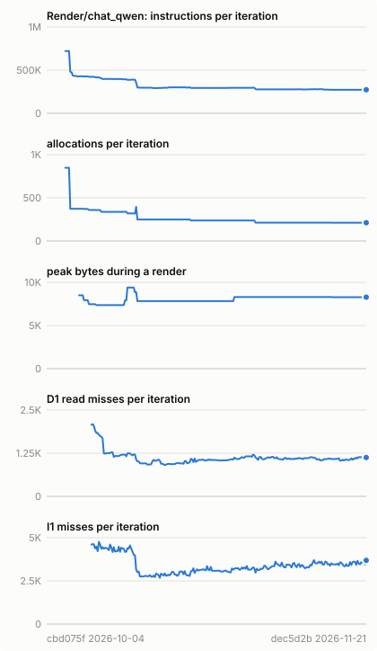

# Benchmark trend

Instruction and allocation counts per iteration on master, one record per commit (229 so far, latest [9118188](https://github.com/jinja2cpp/Jinja2Cpp/commit/91181886a62b0fb21b984410cdb20770003d9b9e) on 2026-11-15). Written by the `trend` job of `.github/workflows/benchmark.yml` with `bench/trend.py`; the data is `history.jsonl`.

Memory is the bytes a loaded template keeps for `Load/*` and the peak heap use of one render for `Render/*`; vs first compares with the first record that has it.

| Benchmark | Instructions | vs previous | vs first | Allocations | vs previous | vs first | Memory | vs previous | vs first |
|---|---:|---:|---:|---:|---:|---:|---:|---:|---:|
| [Load/chat_llama](#loadchat_llama) | 335,988 | 0% |  | 55 | 0% |  | 18,480 | 0% | -52.71% |
| [Render/chat_llama](#renderchat_llama) | 290,909 | -0.15% |  | 225 | 0% |  | 11,616 | 0% | -19.11% |
| [Load/chat_mistral](#loadchat_mistral) | 386,224 | 0% |  | 52 | 0% |  | 20,904 | 0% | -53.18% |
| [Render/chat_mistral](#renderchat_mistral) | 493,376 | -0.19% |  | 402 | 0% |  | 9,952 | 0% | -24.65% |
| [Load/chat_qwen](#loadchat_qwen) | 261,852 | 0% |  | 44 | 0% |  | 14,432 | 0% | -47.19% |
| [Render/chat_qwen](#renderchat_qwen) | 272,831 | -0.18% |  | 212 | 0% |  | 8,304 | 0% | -2.35% |
| [Load/config_file](#loadconfig_file) | 94,912 | 0% |  | 25 | 0% |  | 5,480 | 0% | -48.11% |
| [Render/config_file](#renderconfig_file) | 1,274,961 | -0.22% |  | 908 | 0% |  | 25,640 | 0% | +7.69% |
| [Load/dict_ops](#loaddict_ops) | 32,527 | 0% | -77.99% | 9 | 0% | -93.13% | 2,192 | 0% | -48.50% |
| [Render/dict_ops](#renderdict_ops) | 291,164 | -0.27% | -57.85% | 112 | 0% | -75.11% | 24,408 | 0% | -29.65% |
| [Load/expressions](#loadexpressions) | 44,486 | 0% | -78.42% | 16 | 0% | -89.04% | 2,744 | 0% | -55.28% |
| [Render/expressions](#renderexpressions) | 417,488 | -0.01% | -53.93% | 3 | 0% | -90.00% | 2,440 | 0% | -31.15% |
| [Load/filters](#loadfilters) | 67,539 | 0% | -75.39% | 27 | 0% | -88.16% | 3,864 | 0% | -66.15% |
| [Render/filters](#renderfilters) | 26,902 | -0.24% | -69.66% | 23 | 0% | -68.92% | 752 | 0% | -84.69% |
| [Load/for_filter_if](#loadfor_filter_if) | 29,344 | 0% | -78.33% | 7 | 0% | -94.31% | 1,920 | 0% | -44.32% |
| [Render/for_filter_if](#renderfor_filter_if) | 268,811 | -0.02% | -68.94% | 4 | 0% | -98.23% | 16,560 | 0% | +354.95% |
| [Load/for_loop_vars](#loadfor_loop_vars) | 39,169 | 0% | -78.32% | 10 | 0% | -93.63% | 2,384 | 0% | -47.26% |
| [Render/for_loop_vars](#renderfor_loop_vars) | 172,217 | -0.02% | -83.95% | 2 | 0% | -99.62% | 1,568 | 0% | -43.35% |
| [Load/for_range](#loadfor_range) | 13,368 | 0% | -76.42% | 7 | 0% | -87.50% | 1,104 | 0% | -44.80% |
| [Render/for_range](#renderfor_range) | 37,423 | -0.11% | -59.42% | 3 | 0% | -88.89% | 408 | 0% | -73.02% |
| [Load/hf_deepseek_v31](#loadhf_deepseek_v31) | 384,216 | 0% |  | 55 | 0% |  | 21,992 | 0% | +0.81% |
| [Render/hf_deepseek_v31](#renderhf_deepseek_v31) | 91,627 | -0.11% |  | 43 | 0% |  | 2,480 | 0% | 0% |
| [Load/hf_gpt_oss](#loadhf_gpt_oss) | 1,523,296 | -0.02% |  | 283 | 0% |  | 74,784 | +0.04% | +0.75% |
| [Render/hf_gpt_oss](#renderhf_gpt_oss) | 168,489 | -0.25% |  | 155 | 0% |  | 5,704 | 0% | +15.56% |
| [Load/hf_mistral_small](#loadhf_mistral_small) | 592,518 | 0% |  | 88 | 0% |  | 33,064 | 0% | +0.39% |
| [Render/hf_mistral_small](#renderhf_mistral_small) | 140,808 | -0.19% |  | 99 | 0% |  | 6,120 | 0% | -0.26% |
| [Load/hf_qwen3](#loadhf_qwen3) | 477,046 | 0% |  | 82 | 0% |  | 25,576 | 0% | +0.38% |
| [Render/hf_qwen3](#renderhf_qwen3) | 118,360 | -0.23% |  | 100 | 0% |  | 3,248 | 0% | 0% |
| [Load/html_autoescape](#loadhtml_autoescape) | 190,064 | 0% |  | 43 | 0% |  | 12,688 | 0% | -48.59% |
| [Render/html_autoescape](#renderhtml_autoescape) | 1,199,359 | -0.01% |  | 674 | 0% |  | 46,032 | 0% | +13.99% |
| [Load/inheritance](#loadinheritance) | 21,978 | 0% | -80.74% | 7 | 0% | -93.46% | 1,360 | 0% | -52.65% |
| [Render/inheritance](#renderinheritance) | 136,972 | -0.06% | -81.68% | 35 | 0% | -94.37% | 7,960 | 0% | +32.31% |
| [Load/int_arith](#loadint_arith) | 65,431 | 0% |  | 20 | 0% |  | 3,888 | 0% | +0.83% |
| [Render/int_arith](#renderint_arith) | 829,268 | -0.01% |  | 12 | 0% |  | 3,272 | 0% | -0.49% |
| [Module/keep](#modulekeep) | 7,141 | 0% |  | 7 | 0% |  |  |  |  |
| [Module/keep_written](#modulekeep_written) | 29,280 | -0.02% |  | 11 | 0% |  |  |  |  |
| [Load/large_static](#loadlarge_static) | 147,997 | 0% | -83.30% | 14 | 0% | -96.82% | 43,136 | 0% | -19.20% |
| [Render/large_static](#renderlarge_static) | 20,691 | -0.17% | -72.46% | 1 | 0% | -94.44% | 36,552 | 0% | -1.83% |
| [RenderSink/large_static](#rendersinklarge_static) | 12,680 | -0.28% |  | 0 |  |  | 0 |  |  |
| [RenderTo/large_static](#rendertolarge_static) | 20,254 | -0.18% |  | 0 |  |  | 0 |  |  |
| [Load/macros](#loadmacros) | 54,849 | -0.01% | -75.94% | 26 | 0% | -86.02% | 4,432 | 0% | -28.70% |
| [Render/macros](#rendermacros) | 643,817 | -0.01% | -74.88% | 308 | 0% | -88.71% | 20,576 | 0% | +39.78% |
| [Load/many_tags](#loadmany_tags) | 8,765,035 | 0% | -80.15% | 951 | 0% | -97.22% | 438,128 | 0% | -58.48% |
| [Render/many_tags](#rendermany_tags) | 732,543 | -0.01% | -64.83% | 2 | 0% | -90.48% | 5,648 | 0% | -10.52% |
| [Load/mitsuhiko_table](#loadmitsuhiko_table) | 45,372 | 0% | -80.90% | 19 | 0% | -89.67% | 3,376 | 0% | -44.33% |
| [Render/mitsuhiko_table](#rendermitsuhiko_table) | 5,158,886 | 0% | -58.25% | 33 | 0% | -99.19% | 381,536 | 0% | +9.95% |
| [RenderSink/mitsuhiko_table](#rendersinkmitsuhiko_table) | 5,085,908 | 0% |  | 32 | 0% |  | 37,064 | 0% | +28.59% |
| [RenderTo/mitsuhiko_table](#rendertomitsuhiko_table) | 5,158,442 | 0% |  | 32 | 0% |  | 37,064 | 0% | +28.59% |
| [Load/mitsuhiko_table_wide](#loadmitsuhiko_table_wide) | 53,060 | 0% |  | 35 | 0% |  | 5,704 | 0% | -30.98% |
| [Render/mitsuhiko_table_wide](#rendermitsuhiko_table_wide) | 5,504,993 | 0% |  | 33 | 0% |  | 1,414,928 | 0% | +2.46% |
| [RenderSink/mitsuhiko_table_wide](#rendersinkmitsuhiko_table_wide) | 5,328,046 | 0% |  | 32 | 0% |  | 37,064 | 0% | +28.59% |
| [RenderTo/mitsuhiko_table_wide](#rendertomitsuhiko_table_wide) | 5,504,319 | 0% |  | 32 | 0% |  | 37,064 | 0% | +28.59% |
| [Load/plain_text](#loadplain_text) | 3,757 | 0% | -61.17% | 4 | 0% | -77.78% | 688 | 0% | -38.57% |
| [Render/plain_text](#renderplain_text) | 1,012 | -3.44% | -85.10% | 1 | 0% | -91.67% | 40 | 0% | -94.44% |
| [RenderSink/plain_text](#rendersinkplain_text) | 713 | -4.81% |  | 0 |  |  | 0 |  |  |
| [RenderTo/plain_text](#rendertoplain_text) | 813 | -4.24% |  | 0 |  |  | 0 |  |  |
| [Load/prompt_budget](#loadprompt_budget) | 34,647 | 0% |  | 18 | 0% |  | 2,240 | 0% | +0.72% |
| [Render/prompt_budget](#renderprompt_budget) | 1,319,890 | -0.01% |  | 76 | 0% |  | 36,416 | 0% | 0% |
| [Load/strings](#loadstrings) | 69,422 | 0% | -76.21% | 30 | 0% | -86.61% | 4,360 | 0% | -51.77% |
| [Render/strings](#renderstrings) | 581,526 | -0.02% | -72.28% | 344 | 0% | -83.73% | 9,088 | 0% | -49.31% |
| [Load/substitute](#loadsubstitute) | 7,537 | 0% | -74.76% | 6 | 0% | -83.78% | 848 | 0% | -44.21% |
| [Render/substitute](#rendersubstitute) | 2,179 | -1.63% | -75.28% | 1 | 0% | -91.67% | 40 | 0% | -94.44% |
| [RenderSink/substitute](#rendersinksubstitute) | 1,884 | -1.88% |  | 0 |  |  | 0 |  |  |
| [RenderTo/substitute](#rendertosubstitute) | 1,984 | -1.78% |  | 0 |  |  | 0 |  |  |

## Cache misses

Misses per iteration in callgrind's cache model (`count.py --cache-sim`: 32 KB 8-way L1, 8 MB 16-way last level, no prefetcher); reported, not gated.

| Benchmark | D1 read misses | vs previous | D1 write misses | vs previous | LL data read misses | vs previous | I1 misses | vs previous |
|---|---:|---:|---:|---:|---:|---:|---:|---:|
| Load/chat_llama | 761 | -0.13% | 762 | +0.13% | 0 |  | 8,152 | +10.55% |
| Render/chat_llama | 1,189 | -0.17% | 532 | +0.95% | 0 |  | 4,016 | +0.68% |
| Load/chat_mistral | 1,116 | +0.27% | 1,087 | -0.09% | 0 |  | 8,919 | +7.12% |
| Render/chat_mistral | 1,965 | -0.46% | 615 | -0.16% | 0 |  | 10,248 | -1.06% |
| Load/chat_qwen | 573 | -0.87% | 632 | 0% | 0 |  | 4,895 | +9.78% |
| Render/chat_qwen | 1,094 | +0.09% | 413 | -0.72% | 0 |  | 3,378 | -2.82% |
| Load/config_file | 223 | 0% | 186 | +1.09% | 0 |  | 2,843 | +6.36% |
| Render/config_file | 6,510 | +1.86% | 1,800 | +13.85% | 0 |  | 43,778 | -0.34% |
| Load/dict_ops | 51 | 0% | 28 | 0% | 0 |  | 1,375 | +2.77% |
| Render/dict_ops | 697 | +0.43% | 428 | -0.47% | 0 |  | 858 | +0.94% |
| Load/expressions | 32 | 0% | 23 | 0% | 0 |  | 1,360 | +2.80% |
| Render/expressions | 3 | 0% | 1 | 0% | 0 |  | 281 | -6.02% |
| Load/filters | 107 | 0% | 45 | 0% | 0 |  | 1,837 | +28.64% |
| Render/filters | 20 | 0% | 1 | 0% | 0 |  | 784 | +0.51% |
| Load/for_filter_if | 28 | 0% | 12 | 0% | 0 |  | 1,095 | +1.67% |
| Render/for_filter_if | 1,735 | -0.17% | 141 | +0.71% | 0 |  | 205 | +11.41% |
| Load/for_loop_vars | 45 | 0% | 20 | 0% | 0 |  | 1,191 | +6.24% |
| Render/for_loop_vars | 7 | 0% | 0 | -100.00% | 0 |  | 178 | +9.88% |
| Load/for_range | 7 | 0% | 3 | 0% | 0 |  | 781 | -1.01% |
| Render/for_range | 2 | 0% | 0 |  | 0 |  | 138 | +6.98% |
| Load/hf_deepseek_v31 | 1,046 | 0% | 981 | 0% | 0 |  | 7,019 | +14.91% |
| Render/hf_deepseek_v31 | 372 | -1.33% | 88 | +3.53% | 0 |  | 1,453 | +0.69% |
| Load/hf_gpt_oss | 4,736 | -0.19% | 3,388 | 0% | 0 |  | 24,243 | +10.08% |
| Render/hf_gpt_oss | 1,270 | +0.47% | 423 | +1.20% | 0 |  | 4,778 | +2.53% |
| Load/hf_mistral_small | 1,920 | 0% | 1,651 | 0% | 0 |  | 11,606 | +6.36% |
| Render/hf_mistral_small | 965 | -0.62% | 300 | 0% | 0 |  | 3,726 | -0.13% |
| Load/hf_qwen3 | 1,499 | 0% | 1,345 | -0.07% | 0 |  | 9,469 | +11.03% |
| Render/hf_qwen3 | 703 | -0.85% | 225 | +0.45% | 0 |  | 2,692 | +2.12% |
| Load/html_autoescape | 508 | 0% | 539 | 0% | 0 |  | 4,213 | +9.03% |
| Render/html_autoescape | 5,951 | +1.43% | 1,570 | -0.13% | 0 |  | 37,658 | +0.24% |
| Load/inheritance | 4 | 0% | 3 | 0% | 0 |  | 740 | +7.25% |
| Render/inheritance | 599 | -0.66% | 109 | +0.93% | 0 |  | 971 | +1.46% |
| Load/int_arith | 83 | 0% | 65 | 0% | 0 |  | 2,054 | +1.18% |
| Render/int_arith | 13 | 0% | 4 | 0% | 0 |  | 745 | -2.74% |
| Module/keep | 1 | 0% | 3 | 0% | 0 |  | 441 | +0.68% |
| Module/keep_written | 1,136 | 0% | 561 | 0% | 0 |  | 730 | -2.93% |
| Load/large_static | 1,929 | +0.10% | 905 | 0% | 0 |  | 305 | -8.68% |
| Render/large_static | 708 | -0.14% | 575 | -0.17% | 0 |  | 5 | -16.67% |
| RenderSink/large_static | 1 | 0% | 0 |  | 0 |  | 3 | +50.00% |
| RenderTo/large_static | 685 | -0.15% | 576 | -0.17% | 0 |  | 4 | 0% |
| Load/macros | 84 | 0% | 68 | 0% | 0 |  | 1,758 | +4.15% |
| Render/macros | 769 | -0.13% | 229 | -2.14% | 0 |  | 951 | +55.39% |
| Load/many_tags | 29,662 | 0% | 22,687 | 0% | 0 |  | 240,517 | +6.14% |
| Render/many_tags | 6,128 | +0.03% | 750 | -0.66% | 0 |  | 123 | -45.81% |
| Load/mitsuhiko_table | 38 | 0% | 48 | 0% | 0 |  | 920 | +5.50% |
| Render/mitsuhiko_table | 10,021 | -0.01% | 6,292 | +0.02% | 0 |  | 353 | +3.22% |
| RenderSink/mitsuhiko_table | 9,967 | -0.02% | 1,218 | +0.08% | 0 |  | 305 | -0.65% |
| RenderTo/mitsuhiko_table | 10,026 | -0.03% | 6,296 | 0% | 0 |  | 332 | +1.53% |
| Load/mitsuhiko_table_wide | 83 | 0% | 75 | 0% | 0 |  | 995 | +2.26% |
| Render/mitsuhiko_table_wide | 10,240 | +0.06% | 22,654 | 0% | 0 |  | 349 | +0.58% |
| RenderSink/mitsuhiko_table_wide | 10,053 | -0.05% | 1,208 | +0.08% | 0 |  | 299 | -1.97% |
| RenderTo/mitsuhiko_table_wide | 10,262 | +0.09% | 22,590 | -0.02% | 0 |  | 329 | -0.60% |
| Load/plain_text | 0 |  | 2 | 0% | 0 |  | 16 | +166.67% |
| Render/plain_text | 1 | 0% | 0 |  | 0 |  | 7 | +16.67% |
| RenderSink/plain_text | 1 | 0% | 0 |  | 0 |  | 5 | +25.00% |
| RenderTo/plain_text | 1 | 0% | 0 |  | 0 |  | 6 | 0% |
| Load/prompt_budget | 85 | -1.16% | 42 | -2.33% | 0 |  | 1,425 | +4.63% |
| Render/prompt_budget | 4,819 | -0.10% | 559 | -0.53% | 0 |  | 1,061 | +17.37% |
| Load/strings | 142 | 0% | 109 | 0% | 0 |  | 2,841 | +5.07% |
| Render/strings | 415 | +0.48% | 474 | -0.42% | 0 |  | 1,566 | -2.73% |
| Load/substitute | 2 | 0% | 3 | 0% | 0 |  | 186 | -2.11% |
| Render/substitute | 1 | 0% | 0 |  | 0 |  | 4 | 0% |
| RenderSink/substitute | 0 |  | 0 |  | 0 |  | 3 | +50.00% |
| RenderTo/substitute | 1 | 0% | 0 |  | 0 |  | 3 | -25.00% |

## Charts

### Load/chat_llama

### Render/chat_llama

### Load/chat_mistral

### Render/chat_mistral

### Load/chat_qwen

### Render/chat_qwen

### Load/config_file

### Render/config_file

### Load/dict_ops

### Render/dict_ops

### Load/expressions

### Render/expressions

### Load/filters

### Render/filters

### Load/for_filter_if

### Render/for_filter_if

### Load/for_loop_vars

### Render/for_loop_vars

### Load/for_range

### Render/for_range

### Load/hf_deepseek_v31

### Render/hf_deepseek_v31

### Load/hf_gpt_oss

### Render/hf_gpt_oss

### Load/hf_mistral_small

### Render/hf_mistral_small

### Load/hf_qwen3

### Render/hf_qwen3

### Load/html_autoescape

### Render/html_autoescape

### Load/inheritance

### Render/inheritance

### Load/int_arith

### Render/int_arith

### Module/keep

### Module/keep_written

### Load/large_static

### Render/large_static

### RenderSink/large_static

### RenderTo/large_static

### Load/macros

### Render/macros

### Load/many_tags

### Render/many_tags

### Load/mitsuhiko_table

### Render/mitsuhiko_table

### RenderSink/mitsuhiko_table

### RenderTo/mitsuhiko_table

### Load/mitsuhiko_table_wide

### Render/mitsuhiko_table_wide

### RenderSink/mitsuhiko_table_wide

### RenderTo/mitsuhiko_table_wide

### Load/plain_text

### Render/plain_text

### RenderSink/plain_text

### RenderTo/plain_text

### Load/prompt_budget

### Render/prompt_budget

### Load/strings

### Render/strings

### Load/substitute

### Render/substitute

### RenderSink/substitute

### RenderTo/substitute

