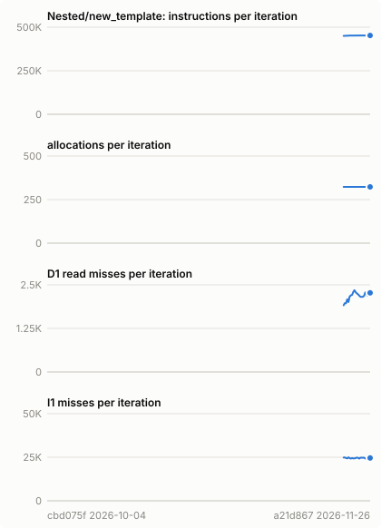

# Benchmark trend

Instruction and allocation counts per iteration on master, one record per commit (251 so far, latest [f59ec32](https://github.com/jinja2cpp/Jinja2Cpp/commit/f59ec32a23c1930e5b3619d09934423d394a7c7a) on 2026-11-20). Written by the `trend` job of `.github/workflows/benchmark.yml` with `bench/trend.py`; the data is `history.jsonl`.

Memory is the bytes a loaded template keeps for `Load/*` and the peak heap use of one render for `Render/*`; vs first compares with the first record that has it.

| Benchmark | Instructions | vs previous | vs first | Allocations | vs previous | vs first | Memory | vs previous | vs first |
|---|---:|---:|---:|---:|---:|---:|---:|---:|---:|
| [Load/chat_llama](#loadchat_llama) | 334,942 | 0% |  | 54 | 0% |  | 18,520 | 0% | -52.61% |
| [Render/chat_llama](#renderchat_llama) | 290,162 | +0.06% |  | 224 | 0% |  | 11,592 | 0% | -19.28% |
| [Load/chat_mistral](#loadchat_mistral) | 384,150 | 0% |  | 51 | 0% |  | 20,976 | 0% | -53.02% |
| [Render/chat_mistral](#renderchat_mistral) | 490,763 | +0.17% |  | 392 | 0% |  | 9,784 | 0% | -25.92% |
| [Load/chat_qwen](#loadchat_qwen) | 261,000 | -0.01% |  | 43 | 0% |  | 14,472 | 0% | -47.04% |
| [Render/chat_qwen](#renderchat_qwen) | 272,391 | +0.06% |  | 211 | 0% |  | 8,280 | 0% | -2.63% |
| [Load/config_file](#loadconfig_file) | 94,067 | +0.01% |  | 24 | 0% |  | 5,520 | 0% | -47.73% |
| [Render/config_file](#renderconfig_file) | 1,275,273 | +0.16% |  | 908 | 0% |  | 25,880 | 0% | +8.70% |
| [Load/dict_ops](#loaddict_ops) | 31,816 | +0.02% | -78.47% | 8 | 0% | -93.89% | 2,216 | 0% | -47.93% |
| [Render/dict_ops](#renderdict_ops) | 290,580 | +0.05% | -57.94% | 112 | 0% | -75.11% | 24,408 | 0% | -29.65% |
| [Load/expressions](#loadexpressions) | 43,686 | 0% | -78.81% | 15 | 0% | -89.73% | 2,752 | 0% | -55.15% |
| [Render/expressions](#renderexpressions) | 414,389 | +0.01% | -54.27% | 3 | 0% | -90.00% | 2,440 | 0% | -31.15% |
| [Load/filters](#loadfilters) | 67,309 | +0.04% | -75.47% | 26 | 0% | -88.60% | 3,856 | 0% | -66.22% |
| [Render/filters](#renderfilters) | 26,501 | +0.17% | -70.11% | 23 | 0% | -68.92% | 752 | 0% | -84.69% |
| [Load/for_filter_if](#loadfor_filter_if) | 28,548 | +0.02% | -78.91% | 6 | 0% | -95.12% | 1,928 | 0% | -44.08% |
| [Render/for_filter_if](#renderfor_filter_if) | 267,147 | +0.01% | -69.13% | 4 | 0% | -98.23% | 16,560 | 0% | +354.95% |
| [Load/for_loop_vars](#loadfor_loop_vars) | 38,340 | -0.02% | -78.78% | 9 | 0% | -94.27% | 2,392 | 0% | -47.08% |
| [Render/for_loop_vars](#renderfor_loop_vars) | 170,786 | +0.02% | -84.08% | 2 | 0% | -99.62% | 1,568 | 0% | -43.35% |
| [Load/for_range](#loadfor_range) | 12,481 | 0% | -77.98% | 6 | 0% | -89.29% | 1,128 | 0% | -43.60% |
| [Render/for_range](#renderfor_range) | 37,171 | +0.08% | -59.69% | 3 | 0% | -88.89% | 408 | 0% | -73.02% |
| [Load/hf_deepseek_v31](#loadhf_deepseek_v31) | 383,007 | 0% |  | 54 | 0% |  | 22,032 | 0% | +0.99% |
| [Render/hf_deepseek_v31](#renderhf_deepseek_v31) | 90,296 | +0.09% |  | 42 | 0% |  | 2,456 | 0% | -0.97% |
| [Load/hf_gpt_oss](#loadhf_gpt_oss) | 1,522,251 | 0% |  | 282 | 0% |  | 75,000 | 0% | +1.05% |
| [Render/hf_gpt_oss](#renderhf_gpt_oss) | 168,668 | +0.18% |  | 153 | 0% |  | 5,936 | +1.37% | +20.26% |
| [Load/hf_mistral_small](#loadhf_mistral_small) | 591,017 | +0.01% |  | 87 | 0% |  | 33,136 | 0% | +0.61% |
| [Render/hf_mistral_small](#renderhf_mistral_small) | 139,366 | +0.08% |  | 97 | 0% |  | 6,096 | 0% | -0.65% |
| [Load/hf_qwen3](#loadhf_qwen3) | 475,632 | -0.01% |  | 81 | 0% |  | 25,632 | 0% | +0.60% |
| [Render/hf_qwen3](#renderhf_qwen3) | 117,010 | +0.16% |  | 99 | 0% |  | 3,224 | 0% | -0.74% |
| [Load/html_autoescape](#loadhtml_autoescape) | 188,657 | -0.01% |  | 42 | 0% |  | 12,728 | 0% | -48.43% |
| [Render/html_autoescape](#renderhtml_autoescape) | 1,197,244 | -0.01% |  | 674 | 0% |  | 46,176 | 0% | +14.34% |
| [Load/inheritance](#loadinheritance) | 21,295 | 0% | -81.34% | 6 | 0% | -94.39% | 1,368 | 0% | -52.37% |
| [Render/inheritance](#renderinheritance) | 135,989 | +0.03% | -81.82% | 35 | 0% | -94.37% | 8,136 | 0% | +35.24% |
| [Load/int_arith](#loadint_arith) | 64,588 | 0% |  | 19 | 0% |  | 3,896 | 0% | +1.04% |
| [Render/int_arith](#renderint_arith) | 825,316 | 0% |  | 12 | 0% |  | 3,272 | 0% | -0.49% |
| [Module/keep](#modulekeep) | 6,942 | 0% |  | 6 | 0% |  |  |  |  |
| [Module/keep_written](#modulekeep_written) | 29,004 | -0.01% |  | 10 | 0% |  |  |  |  |
| [Load/large_static](#loadlarge_static) | 146,658 | 0% | -83.45% | 13 | 0% | -97.05% | 43,128 | 0% | -19.21% |
| [Render/large_static](#renderlarge_static) | 20,332 | 0% | -72.94% | 1 | 0% | -94.44% | 36,552 | 0% | -1.83% |
| [RenderSink/large_static](#rendersinklarge_static) | 12,621 | 0% |  | 0 |  |  | 0 |  |  |
| [RenderTo/large_static](#rendertolarge_static) | 19,895 | 0% |  | 0 |  |  | 0 |  |  |
| [Load/macros](#loadmacros) | 53,988 | 0% | -76.32% | 25 | 0% | -86.56% | 4,472 | 0% | -28.06% |
| [Render/macros](#rendermacros) | 645,292 | 0% | -74.82% | 308 | 0% | -88.71% | 20,608 | 0% | +40.00% |
| [Load/many_tags](#loadmany_tags) | 8,770,245 | +0.02% | -80.14% | 950 | 0% | -97.23% | 438,120 | 0% | -58.48% |
| [Render/many_tags](#rendermany_tags) | 732,445 | 0% | -64.84% | 2 | 0% | -90.48% | 5,648 | 0% | -10.52% |
| [Load/mitsuhiko_table](#loadmitsuhiko_table) | 44,592 | 0% | -81.23% | 18 | 0% | -90.22% | 3,416 | 0% | -43.67% |
| [Render/mitsuhiko_table](#rendermitsuhiko_table) | 5,103,516 | +0.55% | -58.70% | 33 | 0% | -99.19% | 381,536 | 0% | +9.95% |
| [RenderSink/mitsuhiko_table](#rendersinkmitsuhiko_table) | 5,033,303 | +0.56% |  | 32 | 0% |  | 37,064 | 0% | +28.59% |
| [RenderTo/mitsuhiko_table](#rendertomitsuhiko_table) | 5,102,993 | +0.55% |  | 32 | 0% |  | 37,064 | 0% | +28.59% |
| [Load/mitsuhiko_table_wide](#loadmitsuhiko_table_wide) | 52,331 | 0% |  | 34 | 0% |  | 5,744 | 0% | -30.49% |
| [Render/mitsuhiko_table_wide](#rendermitsuhiko_table_wide) | 5,449,145 | +0.52% |  | 33 | 0% |  | 1,414,928 | 0% | +2.46% |
| [RenderSink/mitsuhiko_table_wide](#rendersinkmitsuhiko_table_wide) | 5,275,072 | +0.53% |  | 32 | 0% |  | 37,064 | 0% | +28.59% |
| [RenderTo/mitsuhiko_table_wide](#rendertomitsuhiko_table_wide) | 5,448,562 | +0.52% |  | 32 | 0% |  | 37,064 | 0% | +28.59% |
| [Nested/new_template](#nestednew_template) | 451,535 | +0.11% |  | 323 | 0% |  |  |  |  |
| [Load/plain_text](#loadplain_text) | 2,932 | 0% | -69.70% | 3 | 0% | -83.33% | 680 | 0% | -39.29% |
| [Render/plain_text](#renderplain_text) | 962 | 0% | -85.84% | 1 | 0% | -91.67% | 40 | 0% | -94.44% |
| [RenderSink/plain_text](#rendersinkplain_text) | 667 | 0% |  | 0 |  |  | 0 |  |  |
| [RenderTo/plain_text](#rendertoplain_text) | 763 | 0% |  | 0 |  |  | 0 |  |  |
| [Load/prompt_budget](#loadprompt_budget) | 34,135 | -0.06% |  | 17 | 0% |  | 2,248 | 0% | +1.08% |
| [Render/prompt_budget](#renderprompt_budget) | 1,321,830 | 0% |  | 76 | 0% |  | 36,416 | 0% | 0% |
| [Nested/shared_globals](#nestedshared_globals) | 159,804 | +0.26% |  | 160 | 0% |  |  |  |  |
| [Load/strings](#loadstrings) | 68,823 | +0.03% | -76.42% | 29 | 0% | -87.05% | 4,384 | 0% | -51.50% |
| [Render/strings](#renderstrings) | 581,227 | +0.01% | -72.29% | 344 | 0% | -83.73% | 9,088 | 0% | -49.31% |
| [Load/substitute](#loadsubstitute) | 6,642 | 0% | -77.75% | 5 | 0% | -86.49% | 840 | 0% | -44.74% |
| [Render/substitute](#rendersubstitute) | 1,643 | 0% | -81.36% | 1 | 0% | -91.67% | 40 | 0% | -94.44% |
| [RenderSink/substitute](#rendersinksubstitute) | 1,352 | 0% |  | 0 |  |  | 0 |  |  |
| [RenderTo/substitute](#rendertosubstitute) | 1,448 | 0% |  | 0 |  |  | 0 |  |  |

## Cache misses

Misses per iteration in callgrind's cache model (`count.py --cache-sim`: 32 KB 8-way L1, 8 MB 16-way last level, no prefetcher); reported, not gated.

| Benchmark | D1 read misses | vs previous | D1 write misses | vs previous | LL data read misses | vs previous | I1 misses | vs previous |
|---|---:|---:|---:|---:|---:|---:|---:|---:|
| Load/chat_llama | 748 | -1.32% | 757 | -0.13% | 0 |  | 7,996 | +2.43% |
| Render/chat_llama | 1,166 | -0.85% | 539 | +2.28% | 0 |  | 4,259 | +7.44% |
| Load/chat_mistral | 1,135 | -1.05% | 1,094 | -1.08% | 0 |  | 9,338 | +4.76% |
| Render/chat_mistral | 2,120 | +2.27% | 674 | +0.60% | 0 |  | 10,842 | +3.33% |
| Load/chat_qwen | 554 | +0.36% | 647 | +0.94% | 0 |  | 4,904 | +3.29% |
| Render/chat_qwen | 1,102 | -1.78% | 423 | +0.95% | 0 |  | 3,657 | +6.65% |
| Load/config_file | 194 | -3.48% | 193 | +2.12% | 0 |  | 2,858 | +1.85% |
| Render/config_file | 7,011 | +1.34% | 1,743 | -1.80% | 0 |  | 46,097 | +4.16% |
| Load/dict_ops | 38 | -5.00% | 25 | -10.71% | 0 |  | 1,409 | -0.07% |
| Render/dict_ops | 683 | -0.15% | 420 | -1.18% | 0 |  | 841 | +2.69% |
| Load/expressions | 23 | +4.55% | 18 | +28.57% | 0 |  | 1,329 | -3.90% |
| Render/expressions | 3 | -25.00% | 1 | 0% | 0 |  | 285 | -14.16% |
| Load/filters | 102 | +27.50% | 41 | +7.89% | 0 |  | 1,942 | -4.10% |
| Render/filters | 6 | 0% | 3 | +50.00% | 0 |  | 757 | +3.56% |
| Load/for_filter_if | 33 | +57.14% | 19 | +5.56% | 0 |  | 1,130 | +5.21% |
| Render/for_filter_if | 1,719 | -0.29% | 80 | -1.23% | 0 |  | 132 | -3.65% |
| Load/for_loop_vars | 32 | +18.52% | 26 | +4.00% | 0 |  | 1,135 | +1.07% |
| Render/for_loop_vars | 4 | -69.23% | 1 | -66.67% | 0 |  | 89 | -16.82% |
| Load/for_range | 2 | -33.33% | 3 | -40.00% | 0 |  | 768 | +3.78% |
| Render/for_range | 10 | 0% | 0 |  | 0 |  | 167 | +33.60% |
| Load/hf_deepseek_v31 | 994 | +1.95% | 996 | +0.81% | 0 |  | 7,299 | +4.93% |
| Render/hf_deepseek_v31 | 372 | +0.54% | 95 | +6.74% | 0 |  | 1,553 | +4.51% |
| Load/hf_gpt_oss | 4,729 | +0.25% | 3,393 | +0.30% | 0 |  | 24,049 | +1.70% |
| Render/hf_gpt_oss | 1,305 | +0.15% | 402 | +0.75% | 0 |  | 5,071 | +5.84% |
| Load/hf_mistral_small | 1,914 | +1.27% | 1,647 | +0.55% | 0 |  | 12,369 | +3.63% |
| Render/hf_mistral_small | 970 | -2.51% | 336 | +12.00% | 0 |  | 3,870 | +3.09% |
| Load/hf_qwen3 | 1,564 | -1.39% | 1,349 | -0.37% | 0 |  | 9,489 | +3.81% |
| Render/hf_qwen3 | 694 | +0.14% | 234 | +10.38% | 0 |  | 2,771 | +3.74% |
| Load/html_autoescape | 535 | -1.83% | 541 | +0.19% | 0 |  | 4,162 | -0.57% |
| Render/html_autoescape | 4,636 | -1.34% | 1,386 | -13.75% | 0 |  | 37,531 | +0.76% |
| Load/inheritance | 1 | -50.00% | 3 | 0% | 0 |  | 717 | +2.87% |
| Render/inheritance | 619 | +0.16% | 116 | -3.33% | 0 |  | 1,046 | +0.87% |
| Load/int_arith | 75 | -1.32% | 65 | +1.56% | 0 |  | 2,050 | -6.05% |
| Render/int_arith | 10 | 0% | 6 | +100.00% | 0 |  | 795 | +8.61% |
| Module/keep | 1 | 0% | 2 | 0% | 0 |  | 426 | -1.84% |
| Module/keep_written | 1,144 | 0% | 563 | 0% | 0 |  | 744 | -1.33% |
| Load/large_static | 1,917 | -0.05% | 910 | +0.11% | 0 |  | 258 | +2.79% |
| Render/large_static | 701 | 0% | 569 | 0% | 0 |  | 5 | 0% |
| RenderSink/large_static | 2 | +100.00% | 0 |  | 0 |  | 3 | 0% |
| RenderTo/large_static | 681 | 0% | 570 | 0% | 0 |  | 4 | -20.00% |
| Load/macros | 66 | -13.16% | 61 | -24.69% | 0 |  | 1,754 | +1.15% |
| Render/macros | 779 | -0.26% | 250 | -0.40% | 0 |  | 1,348 | -26.46% |
| Load/many_tags | 28,092 | +0.44% | 22,618 | -0.04% | 0 |  | 242,905 | -0.32% |
| Render/many_tags | 6,102 | -0.28% | 789 | +0.25% | 0 |  | 120 | -20.00% |
| Load/mitsuhiko_table | 28 | +12.00% | 41 | +7.89% | 0 |  | 976 | +14.02% |
| Render/mitsuhiko_table | 10,051 | +0.16% | 6,245 | -0.11% | 0 |  | 325 | +5.18% |
| RenderSink/mitsuhiko_table | 10,043 | +0.17% | 1,196 | -0.42% | 0 |  | 255 | +3.66% |
| RenderTo/mitsuhiko_table | 10,093 | +0.10% | 6,249 | -0.11% | 0 |  | 295 | +2.08% |
| Load/mitsuhiko_table_wide | 78 | +1.30% | 94 | +3.30% | 0 |  | 968 | -6.65% |
| Render/mitsuhiko_table_wide | 10,209 | +0.24% | 22,711 | -0.01% | 0 |  | 357 | +7.85% |
| RenderSink/mitsuhiko_table_wide | 10,037 | +0.19% | 1,284 | -1.00% | 0 |  | 280 | +7.28% |
| RenderTo/mitsuhiko_table_wide | 10,202 | +0.11% | 22,662 | -0.08% | 0 |  | 331 | +12.59% |
| Nested/new_template | 2,008 | -3.79% | 1,553 | +14.53% | 0 |  | 24,961 | +2.57% |
| Load/plain_text | 0 |  | 1 | 0% | 0 |  | 33 | +1000.00% |
| Render/plain_text | 1 | 0% | 0 |  | 0 |  | 7 | +16.67% |
| RenderSink/plain_text | 1 | 0% | 0 |  | 0 |  | 4 | -20.00% |
| RenderTo/plain_text | 1 | 0% | 0 |  | 0 |  | 6 | 0% |
| Load/prompt_budget | 70 | -2.78% | 60 | +5.26% | 0 |  | 1,383 | -5.14% |
| Render/prompt_budget | 4,786 | -0.10% | 551 | -0.54% | 0 |  | 903 | -2.17% |
| Nested/shared_globals | 190 | +65.22% | 98 | +53.12% | 0 |  | 9,129 | +0.05% |
| Load/strings | 127 | -15.33% | 110 | -4.35% | 0 |  | 2,852 | -0.14% |
| Render/strings | 416 | +0.24% | 476 | +2.15% | 0 |  | 1,629 | +3.63% |
| Load/substitute | 1 | 0% | 2 | 0% | 0 |  | 141 | -3.42% |
| Render/substitute | 1 | 0% | 0 |  | 0 |  | 4 | 0% |
| RenderSink/substitute | 1 | 0% | 0 |  | 0 |  | 3 | -25.00% |
| RenderTo/substitute | 1 | 0% | 0 |  | 0 |  | 3 | -25.00% |

## Charts

### Load/chat_llama

### Render/chat_llama

### Load/chat_mistral

### Render/chat_mistral

### Load/chat_qwen

### Render/chat_qwen

### Load/config_file

### Render/config_file

### Load/dict_ops

### Render/dict_ops

### Load/expressions

### Render/expressions

### Load/filters

### Render/filters

### Load/for_filter_if

### Render/for_filter_if

### Load/for_loop_vars

### Render/for_loop_vars

### Load/for_range

### Render/for_range

### Load/hf_deepseek_v31

### Render/hf_deepseek_v31

### Load/hf_gpt_oss

### Render/hf_gpt_oss

### Load/hf_mistral_small

### Render/hf_mistral_small

### Load/hf_qwen3

### Render/hf_qwen3

### Load/html_autoescape

### Render/html_autoescape

### Load/inheritance

### Render/inheritance

### Load/int_arith

### Render/int_arith

### Module/keep

### Module/keep_written

### Load/large_static

### Render/large_static

### RenderSink/large_static

### RenderTo/large_static

### Load/macros

### Render/macros

### Load/many_tags

### Render/many_tags

### Load/mitsuhiko_table

### Render/mitsuhiko_table

### RenderSink/mitsuhiko_table

### RenderTo/mitsuhiko_table

### Load/mitsuhiko_table_wide

### Render/mitsuhiko_table_wide

### RenderSink/mitsuhiko_table_wide

### RenderTo/mitsuhiko_table_wide

### Nested/new_template

### Load/plain_text

### Render/plain_text

### RenderSink/plain_text

### RenderTo/plain_text

### Load/prompt_budget

### Render/prompt_budget

### Nested/shared_globals

### Load/strings

### Render/strings

### Load/substitute

### Render/substitute

### RenderSink/substitute

### RenderTo/substitute

