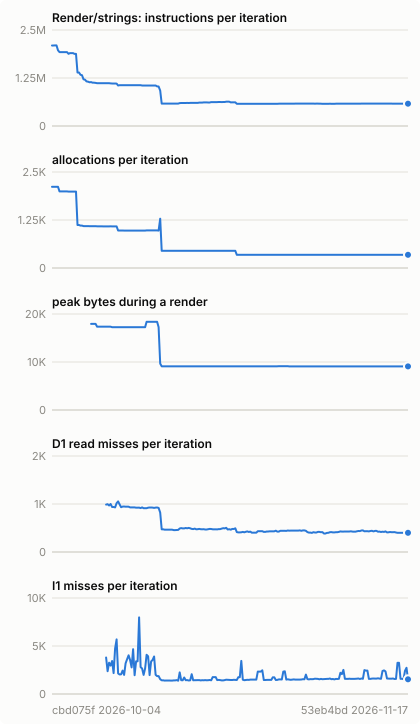

# Benchmark trend

Instruction and allocation counts per iteration on master, one record per commit (274 so far, latest [ca49198](https://github.com/jinja2cpp/Jinja2Cpp/commit/ca491982f08db9fa8f30d15b938f735da8c8692e) on 2026-11-27). Written by the `trend` job of `.github/workflows/benchmark.yml` with `bench/trend.py`; the data is `history.jsonl`.

Memory is the bytes a loaded template keeps for `Load/*` and the peak heap use of one render for `Render/*`; vs first compares with the first record that has it.

| Benchmark | Instructions | vs previous | vs first | Allocations | vs previous | vs first | Memory | vs previous | vs first |
|---|---:|---:|---:|---:|---:|---:|---:|---:|---:|
| [Load/big_int_radix](#loadbig_int_radix) | 43,556 | -0.01% |  | 14 | 0% |  | 2,688 | 0% | 0% |
| [Render/big_int_radix](#renderbig_int_radix) | 146,579,786 | 0% |  | 123 | 0% |  | 1,540,760 | 0% | -39.13% |
| [Load/chat_llama](#loadchat_llama) | 338,594 | -0.02% |  | 54 | 0% |  | 18,536 | 0% | -52.57% |
| [Render/chat_llama](#renderchat_llama) | 291,210 | -0.40% |  | 224 | 0% |  | 11,608 | -0.14% | -19.16% |
| [Load/chat_mistral](#loadchat_mistral) | 389,742 | -0.01% |  | 52 | 0% |  | 21,024 | 0% | -52.91% |
| [Render/chat_mistral](#renderchat_mistral) | 495,276 | -0.07% |  | 392 | 0% |  | 9,816 | -0.16% | -25.68% |
| [Load/chat_qwen](#loadchat_qwen) | 263,855 | +0.03% |  | 43 | 0% |  | 14,472 | 0% | -47.04% |
| [Render/chat_qwen](#renderchat_qwen) | 274,240 | +0.41% |  | 211 | 0% |  | 8,280 | 0% | -2.63% |
| [Load/config_file](#loadconfig_file) | 94,986 | -0.03% |  | 24 | 0% |  | 5,520 | 0% | -47.73% |
| [Render/config_file](#renderconfig_file) | 1,254,617 | +0.16% |  | 882 | 0% |  | 25,976 | 0% | +9.11% |
| [Load/dict_ops](#loaddict_ops) | 32,180 | 0% | -78.22% | 8 | 0% | -93.89% | 2,216 | 0% | -47.93% |
| [Render/dict_ops](#renderdict_ops) | 293,242 | +0.04% | -57.55% | 112 | 0% | -75.11% | 24,424 | 0% | -29.61% |
| [Load/expressions](#loadexpressions) | 44,436 | 0% | -78.44% | 15 | 0% | -89.73% | 2,752 | 0% | -55.15% |
| [Render/expressions](#renderexpressions) | 414,651 | 0% | -54.24% | 3 | 0% | -90.00% | 2,440 | 0% | -31.15% |
| [Load/filters](#loadfilters) | 67,184 | -0.07% | -75.52% | 26 | 0% | -88.60% | 3,856 | 0% | -66.22% |
| [Render/filters](#renderfilters) | 25,107 | +0.02% | -71.68% | 22 | 0% | -70.27% | 784 | 0% | -84.04% |
| [Load/for_filter_if](#loadfor_filter_if) | 28,817 | 0% | -78.72% | 6 | 0% | -95.12% | 1,928 | 0% | -44.08% |
| [Render/for_filter_if](#renderfor_filter_if) | 267,172 | +0.37% | -69.13% | 4 | 0% | -98.23% | 16,560 | 0% | +354.95% |
| [Load/for_loop_vars](#loadfor_loop_vars) | 38,608 | +0.04% | -78.63% | 9 | 0% | -94.27% | 2,392 | 0% | -47.08% |
| [Render/for_loop_vars](#renderfor_loop_vars) | 170,823 | 0% | -84.08% | 2 | 0% | -99.62% | 1,568 | 0% | -43.35% |
| [Load/for_range](#loadfor_range) | 12,693 | 0% | -77.61% | 6 | 0% | -89.29% | 1,128 | 0% | -43.60% |
| [Render/for_range](#renderfor_range) | 37,233 | 0% | -59.62% | 3 | 0% | -88.89% | 408 | 0% | -73.02% |
| [Load/hf_deepseek_v31](#loadhf_deepseek_v31) | 387,746 | 0% |  | 54 | 0% |  | 22,064 | 0% | +1.14% |
| [Render/hf_deepseek_v31](#renderhf_deepseek_v31) | 90,471 | +0.05% |  | 42 | 0% |  | 2,456 | 0% | -0.97% |
| [Load/hf_gpt_oss](#loadhf_gpt_oss) | 1,537,964 | +0.01% |  | 282 | 0% |  | 75,192 | 0% | +1.30% |
| [Render/hf_gpt_oss](#renderhf_gpt_oss) | 170,659 | 0% |  | 153 | 0% |  | 6,000 | -1.06% | +21.56% |
| [Load/hf_mistral_small](#loadhf_mistral_small) | 596,408 | 0% |  | 87 | 0% |  | 33,168 | 0% | +0.70% |
| [Render/hf_mistral_small](#renderhf_mistral_small) | 140,451 | -0.18% |  | 97 | 0% |  | 6,128 | 0% | -0.13% |
| [Load/hf_qwen3](#loadhf_qwen3) | 485,000 | +0.02% |  | 81 | 0% |  | 25,744 | 0% | +1.04% |
| [Render/hf_qwen3](#renderhf_qwen3) | 117,559 | +0.14% |  | 99 | 0% |  | 3,224 | 0% | -0.74% |
| [Load/html_autoescape](#loadhtml_autoescape) | 190,017 | 0% |  | 42 | 0% |  | 12,728 | 0% | -48.43% |
| [Render/html_autoescape](#renderhtml_autoescape) | 1,197,765 | +0.03% |  | 674 | 0% |  | 46,256 | 0% | +14.54% |
| [Load/inheritance](#loadinheritance) | 21,536 | 0% | -81.13% | 6 | 0% | -94.39% | 1,368 | 0% | -52.37% |
| [Render/inheritance](#renderinheritance) | 137,469 | +0.24% | -81.62% | 35 | 0% | -94.37% | 8,168 | 0% | +35.77% |
| [Load/int_arith](#loadint_arith) | 65,560 | -0.02% |  | 19 | 0% |  | 3,896 | 0% | +1.04% |
| [Render/int_arith](#renderint_arith) | 825,531 | +0.14% |  | 12 | 0% |  | 3,288 | 0% | 0% |
| [Module/keep](#modulekeep) | 7,228 | +0.33% |  | 6 | 0% |  |  |  |  |
| [Module/keep_written](#modulekeep_written) | 29,246 | +0.12% |  | 10 | 0% |  |  |  |  |
| [Load/large_static](#loadlarge_static) | 147,307 | 0% | -83.37% | 13 | 0% | -97.05% | 43,128 | 0% | -19.21% |
| [Render/large_static](#renderlarge_static) | 20,340 | 0% | -72.93% | 1 | 0% | -94.44% | 36,552 | 0% | -1.83% |
| [RenderSink/large_static](#rendersinklarge_static) | 12,629 | 0% |  | 0 |  |  | 0 |  |  |
| [RenderTo/large_static](#rendertolarge_static) | 19,893 | -0.05% |  | 0 |  |  | 0 |  |  |
| [Load/macros](#loadmacros) | 54,758 | 0% | -75.98% | 25 | 0% | -86.56% | 4,488 | 0% | -27.80% |
| [Render/macros](#rendermacros) | 645,215 | -0.43% | -74.83% | 308 | 0% | -88.71% | 20,608 | 0% | +40.00% |
| [Load/many_tags](#loadmany_tags) | 8,795,021 | -0.04% | -80.09% | 950 | 0% | -97.23% | 438,136 | 0% | -58.48% |
| [Render/many_tags](#rendermany_tags) | 732,451 | +0.25% | -64.84% | 2 | 0% | -90.48% | 5,648 | 0% | -10.52% |
| [Load/mitsuhiko_table](#loadmitsuhiko_table) | 44,985 | 0% | -81.06% | 18 | 0% | -90.22% | 3,416 | 0% | -43.67% |
| [Render/mitsuhiko_table](#rendermitsuhiko_table) | 5,129,109 | 0% | -58.49% | 33 | 0% | -99.19% | 381,536 | 0% | +9.95% |
| [RenderSink/mitsuhiko_table](#rendersinkmitsuhiko_table) | 5,059,015 | 0% |  | 32 | 0% |  | 37,064 | 0% | +28.59% |
| [RenderTo/mitsuhiko_table](#rendertomitsuhiko_table) | 5,128,568 | -0.01% |  | 32 | 0% |  | 37,064 | 0% | +28.59% |
| [Load/mitsuhiko_table_wide](#loadmitsuhiko_table_wide) | 52,450 | -0.02% |  | 34 | 0% |  | 5,744 | 0% | -30.49% |
| [Render/mitsuhiko_table_wide](#rendermitsuhiko_table_wide) | 5,475,321 | 0% |  | 33 | 0% |  | 1,414,928 | 0% | +2.46% |
| [RenderSink/mitsuhiko_table_wide](#rendersinkmitsuhiko_table_wide) | 5,301,047 | 0% |  | 32 | 0% |  | 37,064 | 0% | +28.59% |
| [RenderTo/mitsuhiko_table_wide](#rendertomitsuhiko_table_wide) | 5,474,536 | 0% |  | 32 | 0% |  | 37,064 | 0% | +28.59% |
| [Nested/new_template](#nestednew_template) | 455,131 | -0.09% |  | 323 | 0% |  |  |  |  |
| [Load/plain_text](#loadplain_text) | 2,943 | 0% | -69.58% | 3 | 0% | -83.33% | 680 | 0% | -39.29% |
| [Render/plain_text](#renderplain_text) | 970 | 0% | -85.72% | 1 | 0% | -91.67% | 40 | 0% | -94.44% |
| [RenderSink/plain_text](#rendersinkplain_text) | 675 | 0% |  | 0 |  |  | 0 |  |  |
| [RenderTo/plain_text](#rendertoplain_text) | 771 | 0% |  | 0 |  |  | 0 |  |  |
| [Load/prompt_budget](#loadprompt_budget) | 34,446 | +0.14% |  | 17 | 0% |  | 2,248 | 0% | +1.08% |
| [Render/prompt_budget](#renderprompt_budget) | 1,325,567 | +0.01% |  | 76 | 0% |  | 36,640 | 0% | +0.62% |
| [Nested/shared_globals](#nestedshared_globals) | 160,773 | -0.21% |  | 160 | 0% |  |  |  |  |
| [Load/strings](#loadstrings) | 69,227 | -0.05% | -76.28% | 29 | 0% | -87.05% | 4,384 | 0% | -51.50% |
| [Render/strings](#renderstrings) | 587,322 | +0.63% | -72.00% | 344 | 0% | -83.73% | 9,120 | 0% | -49.13% |
| [Load/substitute](#loadsubstitute) | 6,675 | 0% | -77.64% | 5 | 0% | -86.49% | 840 | 0% | -44.74% |
| [Render/substitute](#rendersubstitute) | 1,651 | 0% | -81.27% | 1 | 0% | -91.67% | 40 | 0% | -94.44% |
| [RenderSink/substitute](#rendersinksubstitute) | 1,360 | 0% |  | 0 |  |  | 0 |  |  |
| [RenderTo/substitute](#rendertosubstitute) | 1,456 | 0% |  | 0 |  |  | 0 |  |  |

## Cache misses

Misses per iteration in callgrind's cache model (`count.py --cache-sim`: 32 KB 8-way L1, 8 MB 16-way last level, no prefetcher); reported, not gated.

| Benchmark | D1 read misses | vs previous | D1 write misses | vs previous | LL data read misses | vs previous | I1 misses | vs previous |
|---|---:|---:|---:|---:|---:|---:|---:|---:|
| Load/big_int_radix | 90 | -3.23% | 61 | -1.61% | 0 |  | 2,065 | +5.90% |
| Render/big_int_radix | 364,129 | +0.02% | 350,974 | +0.01% | 0 |  | 3,717 | -24.08% |
| Load/chat_llama | 776 | -3.84% | 770 | 0% | 0 |  | 8,084 | +3.34% |
| Render/chat_llama | 1,203 | +0.59% | 535 | -3.43% | 0 |  | 4,484 | +1.63% |
| Load/chat_mistral | 1,121 | -1.06% | 1,095 | -0.82% | 0 |  | 9,288 | +6.71% |
| Render/chat_mistral | 1,994 | +2.31% | 638 | +0.16% | 0 |  | 11,709 | +6.61% |
| Load/chat_qwen | 529 | -2.58% | 650 | -0.91% | 0 |  | 4,893 | +6.21% |
| Render/chat_qwen | 1,122 | +4.96% | 437 | +2.34% | 0 |  | 3,766 | +0.13% |
| Load/config_file | 211 | -0.94% | 191 | +2.14% | 0 |  | 2,931 | +7.17% |
| Render/config_file | 6,542 | -0.47% | 1,701 | -9.28% | 0 |  | 44,076 | -4.32% |
| Load/dict_ops | 44 | +12.82% | 32 | -3.03% | 0 |  | 1,426 | +0.99% |
| Render/dict_ops | 712 | -0.14% | 396 | -0.25% | 0 |  | 770 | -4.35% |
| Load/expressions | 29 | +31.82% | 32 | +3.23% | 0 |  | 1,368 | -0.51% |
| Render/expressions | 7 | +75.00% | 3 | +200.00% | 0 |  | 319 | +4.25% |
| Load/filters | 84 | -5.62% | 53 | +3.92% | 0 |  | 1,730 | -2.32% |
| Render/filters | 21 | -4.55% | 7 | +40.00% | 0 |  | 710 | +6.13% |
| Load/for_filter_if | 12 | -33.33% | 4 | -55.56% | 0 |  | 1,102 | +5.76% |
| Render/for_filter_if | 1,704 | -0.58% | 91 | +3.41% | 0 |  | 153 | -7.27% |
| Load/for_loop_vars | 23 | -32.35% | 17 | -15.00% | 0 |  | 1,144 | +8.03% |
| Render/for_loop_vars | 7 | +75.00% | 0 |  | 0 |  | 103 | -26.43% |
| Load/for_range | 2 | -71.43% | 5 | -54.55% | 0 |  | 782 | +4.83% |
| Render/for_range | 4 | +100.00% | 2 | +100.00% | 0 |  | 196 | +29.80% |
| Load/hf_deepseek_v31 | 964 | -1.53% | 975 | -0.51% | 0 |  | 7,009 | +10.08% |
| Render/hf_deepseek_v31 | 391 | +0.51% | 88 | -1.12% | 0 |  | 1,582 | -1.43% |
| Load/hf_gpt_oss | 4,720 | -0.13% | 3,404 | -0.38% | 0 |  | 24,514 | +6.60% |
| Render/hf_gpt_oss | 1,301 | -0.61% | 423 | 0% | 0 |  | 5,074 | +0.26% |
| Load/hf_mistral_small | 1,898 | -0.73% | 1,645 | +0.18% | 0 |  | 12,032 | +5.77% |
| Render/hf_mistral_small | 1,001 | -0.20% | 322 | +1.58% | 0 |  | 3,776 | -3.85% |
| Load/hf_qwen3 | 1,502 | -2.09% | 1,297 | -0.54% | 0 |  | 9,804 | +8.09% |
| Render/hf_qwen3 | 724 | +4.62% | 237 | +6.28% | 0 |  | 2,816 | -0.46% |
| Load/html_autoescape | 457 | -3.99% | 539 | 0% | 0 |  | 4,364 | +9.48% |
| Render/html_autoescape | 5,146 | +24.03% | 1,721 | +1.83% | 0 |  | 36,964 | -0.68% |
| Load/inheritance | 2 | -77.78% | 3 | -40.00% | 0 |  | 711 | +3.80% |
| Render/inheritance | 589 | -1.17% | 115 | -2.54% | 0 |  | 1,030 | -5.24% |
| Load/int_arith | 74 | -15.91% | 65 | +3.17% | 0 |  | 2,263 | +5.85% |
| Render/int_arith | 28 | +27.27% | 14 | +16.67% | 0 |  | 767 | -4.96% |
| Module/keep | 5 | +150.00% | 3 | +50.00% | 0 |  | 499 | -0.80% |
| Module/keep_written | 1,152 | -0.17% | 575 | +0.17% | 0 |  | 782 | +0.51% |
| Load/large_static | 1,919 | -0.10% | 904 | 0% | 0 |  | 303 | +17.90% |
| Render/large_static | 700 | 0% | 571 | 0% | 0 |  | 5 | +66.67% |
| RenderSink/large_static | 1 | 0% | 0 |  | 0 |  | 2 | 0% |
| RenderTo/large_static | 679 | 0% | 573 | +0.17% | 0 |  | 5 | +66.67% |
| Load/macros | 64 | -8.57% | 57 | -1.72% | 0 |  | 1,827 | +3.22% |
| Render/macros | 754 | -0.26% | 246 | +7.89% | 0 |  | 638 | -72.74% |
| Load/many_tags | 28,324 | -5.53% | 22,639 | -0.90% | 0 |  | 260,874 | +7.70% |
| Render/many_tags | 6,123 | +0.05% | 804 | +1.64% | 0 |  | 46 | -58.18% |
| Load/mitsuhiko_table | 38 | -13.64% | 48 | -14.29% | 0 |  | 987 | +11.02% |
| Render/mitsuhiko_table | 10,056 | -0.02% | 6,341 | +0.48% | 0 |  | 325 | +0.93% |
| RenderSink/mitsuhiko_table | 9,955 | -0.01% | 1,193 | 0% | 0 |  | 242 | -11.68% |
| RenderTo/mitsuhiko_table | 10,063 | -0.02% | 6,296 | +0.66% | 0 |  | 284 | -4.70% |
| Load/mitsuhiko_table_wide | 88 | +1.15% | 79 | -1.25% | 0 |  | 970 | -13.00% |
| Render/mitsuhiko_table_wide | 10,147 | -0.40% | 22,550 | -0.14% | 0 |  | 294 | -14.29% |
| RenderSink/mitsuhiko_table_wide | 10,013 | -0.44% | 1,243 | -0.96% | 0 |  | 221 | -22.18% |
| RenderTo/mitsuhiko_table_wide | 10,146 | -0.32% | 22,656 | 0% | 0 |  | 262 | -14.66% |
| Nested/new_template | 2,360 | -0.08% | 1,653 | -1.49% | 0 |  | 25,172 | +0.66% |
| Load/plain_text | 0 |  | 2 | 0% | 0 |  | 10 | +233.33% |
| Render/plain_text | 1 | 0% | 0 |  | 0 |  | 7 | +40.00% |
| RenderSink/plain_text | 1 | 0% | 0 |  | 0 |  | 5 | +25.00% |
| RenderTo/plain_text | 1 | -50.00% | 0 |  | 0 |  | 6 | +20.00% |
| Load/prompt_budget | 63 | -5.97% | 48 | +4.35% | 0 |  | 1,453 | +1.82% |
| Render/prompt_budget | 4,777 | -0.08% | 543 | -0.73% | 0 |  | 826 | -11.28% |
| Nested/shared_globals | 253 | +63.23% | 123 | +112.07% | 0 |  | 9,229 | -2.95% |
| Load/strings | 140 | -7.28% | 82 | -8.89% | 0 |  | 2,931 | +2.16% |
| Render/strings | 429 | +0.47% | 480 | -0.62% | 0 |  | 1,584 | -1.06% |
| Load/substitute | 1 | 0% | 3 | -25.00% | 0 |  | 148 | -3.90% |
| Render/substitute | 1 | 0% | 0 |  | 0 |  | 5 | +25.00% |
| RenderSink/substitute | 1 | 0% | 0 |  | 0 |  | 2 | 0% |
| RenderTo/substitute | 1 | -50.00% | 0 |  | 0 |  | 4 | 0% |

## Charts

### Load/big_int_radix

### Render/big_int_radix

### Load/chat_llama

### Render/chat_llama

### Load/chat_mistral

### Render/chat_mistral

### Load/chat_qwen

### Render/chat_qwen

### Load/config_file

### Render/config_file

### Load/dict_ops

### Render/dict_ops

### Load/expressions

### Render/expressions

### Load/filters

### Render/filters

### Load/for_filter_if

### Render/for_filter_if

### Load/for_loop_vars

### Render/for_loop_vars

### Load/for_range

### Render/for_range

### Load/hf_deepseek_v31

### Render/hf_deepseek_v31

### Load/hf_gpt_oss

### Render/hf_gpt_oss

### Load/hf_mistral_small

### Render/hf_mistral_small

### Load/hf_qwen3

### Render/hf_qwen3

### Load/html_autoescape

### Render/html_autoescape

### Load/inheritance

### Render/inheritance

### Load/int_arith

### Render/int_arith

### Module/keep

### Module/keep_written

### Load/large_static

### Render/large_static

### RenderSink/large_static

### RenderTo/large_static

### Load/macros

### Render/macros

### Load/many_tags

### Render/many_tags

### Load/mitsuhiko_table

### Render/mitsuhiko_table

### RenderSink/mitsuhiko_table

### RenderTo/mitsuhiko_table

### Load/mitsuhiko_table_wide

### Render/mitsuhiko_table_wide

### RenderSink/mitsuhiko_table_wide

### RenderTo/mitsuhiko_table_wide

### Nested/new_template

### Load/plain_text

### Render/plain_text

### RenderSink/plain_text

### RenderTo/plain_text

### Load/prompt_budget

### Render/prompt_budget

### Nested/shared_globals

### Load/strings

### Render/strings

### Load/substitute

### Render/substitute

### RenderSink/substitute

### RenderTo/substitute

