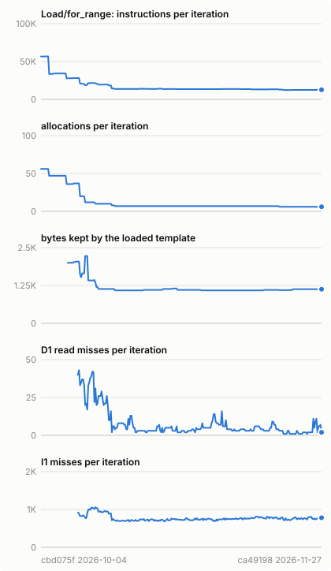

# Benchmark trend

Instruction and allocation counts per iteration on master, one record per commit (236 so far, latest [b09ba85](https://github.com/jinja2cpp/Jinja2Cpp/commit/b09ba852b054eb1d8c0b6c6cede3694af47eb0df) on 2026-11-16). Written by the `trend` job of `.github/workflows/benchmark.yml` with `bench/trend.py`; the data is `history.jsonl`.

Memory is the bytes a loaded template keeps for `Load/*` and the peak heap use of one render for `Render/*`; vs first compares with the first record that has it.

| Benchmark | Instructions | vs previous | vs first | Allocations | vs previous | vs first | Memory | vs previous | vs first |
|---|---:|---:|---:|---:|---:|---:|---:|---:|---:|
| [Load/chat_llama](#loadchat_llama) | 335,524 | 0% |  | 54 | 0% |  | 18,472 | 0% | -52.73% |
| [Render/chat_llama](#renderchat_llama) | 288,853 | 0% |  | 224 | 0% |  | 11,592 | 0% | -19.28% |
| [Load/chat_mistral](#loadchat_mistral) | 385,600 | 0% |  | 51 | 0% |  | 20,896 | 0% | -53.20% |
| [Render/chat_mistral](#renderchat_mistral) | 491,161 | 0% |  | 401 | 0% |  | 9,992 | 0% | -24.35% |
| [Load/chat_qwen](#loadchat_qwen) | 261,340 | 0% |  | 43 | 0% |  | 14,424 | 0% | -47.22% |
| [Render/chat_qwen](#renderchat_qwen) | 271,637 | 0% |  | 211 | 0% |  | 8,280 | 0% | -2.63% |
| [Load/config_file](#loadconfig_file) | 94,414 | 0% |  | 24 | 0% |  | 5,472 | 0% | -48.18% |
| [Render/config_file](#renderconfig_file) | 1,262,622 | 0% |  | 908 | 0% |  | 25,576 | 0% | +7.43% |
| [Load/dict_ops](#loaddict_ops) | 32,040 | 0% | -78.32% | 8 | 0% | -93.89% | 2,184 | 0% | -48.68% |
| [Render/dict_ops](#renderdict_ops) | 290,441 | 0% | -57.96% | 112 | 0% | -75.11% | 24,408 | 0% | -29.65% |
| [Load/expressions](#loadexpressions) | 44,017 | 0% | -78.65% | 15 | 0% | -89.73% | 2,736 | 0% | -55.41% |
| [Render/expressions](#renderexpressions) | 415,811 | 0% | -54.11% | 3 | 0% | -90.00% | 2,440 | 0% | -31.15% |
| [Load/filters](#loadfilters) | 67,165 | 0% | -75.53% | 26 | 0% | -88.60% | 3,856 | 0% | -66.22% |
| [Render/filters](#renderfilters) | 26,383 | 0% | -70.25% | 23 | 0% | -68.92% | 752 | 0% | -84.69% |
| [Load/for_filter_if](#loadfor_filter_if) | 28,875 | 0% | -78.67% | 6 | 0% | -95.12% | 1,912 | 0% | -44.55% |
| [Render/for_filter_if](#renderfor_filter_if) | 267,395 | 0% | -69.10% | 4 | 0% | -98.23% | 16,560 | 0% | +354.95% |
| [Load/for_loop_vars](#loadfor_loop_vars) | 38,728 | 0% | -78.56% | 9 | 0% | -94.27% | 2,376 | 0% | -47.43% |
| [Render/for_loop_vars](#renderfor_loop_vars) | 170,641 | 0% | -84.09% | 2 | 0% | -99.62% | 1,568 | 0% | -43.35% |
| [Load/for_range](#loadfor_range) | 12,931 | 0% | -77.19% | 6 | 0% | -89.29% | 1,096 | 0% | -45.20% |
| [Render/for_range](#renderfor_range) | 37,046 | 0% | -59.82% | 3 | 0% | -88.89% | 408 | 0% | -73.02% |
| [Load/hf_deepseek_v31](#loadhf_deepseek_v31) | 384,412 | 0% |  | 54 | 0% |  | 21,984 | 0% | +0.77% |
| [Render/hf_deepseek_v31](#renderhf_deepseek_v31) | 89,961 | 0% |  | 42 | 0% |  | 2,456 | 0% | -0.97% |
| [Load/hf_gpt_oss](#loadhf_gpt_oss) | 1,523,046 | -0.03% |  | 282 | 0% |  | 74,792 | +0.02% | +0.77% |
| [Render/hf_gpt_oss](#renderhf_gpt_oss) | 167,156 | -0.08% |  | 153 | -0.65% |  | 5,664 | 0% | +14.75% |
| [Load/hf_mistral_small](#loadhf_mistral_small) | 592,078 | 0% |  | 87 | 0% |  | 33,072 | 0% | +0.41% |
| [Render/hf_mistral_small](#renderhf_mistral_small) | 139,058 | -0.03% |  | 97 | -1.02% |  | 6,096 | 0% | -0.65% |
| [Load/hf_qwen3](#loadhf_qwen3) | 476,840 | 0% |  | 81 | 0% |  | 25,568 | 0% | +0.35% |
| [Render/hf_qwen3](#renderhf_qwen3) | 116,711 | 0% |  | 99 | 0% |  | 3,224 | 0% | -0.74% |
| [Load/html_autoescape](#loadhtml_autoescape) | 189,482 | 0% |  | 42 | 0% |  | 12,680 | 0% | -48.62% |
| [Render/html_autoescape](#renderhtml_autoescape) | 1,195,275 | 0% |  | 674 | 0% |  | 45,968 | 0% | +13.83% |
| [Load/inheritance](#loadinheritance) | 21,544 | 0% | -81.12% | 6 | 0% | -94.39% | 1,352 | 0% | -52.92% |
| [Render/inheritance](#renderinheritance) | 134,056 | 0% | -82.07% | 35 | 0% | -94.37% | 7,960 | 0% | +32.31% |
| [Load/int_arith](#loadint_arith) | 64,949 | 0% |  | 19 | 0% |  | 3,880 | 0% | +0.62% |
| [Render/int_arith](#renderint_arith) | 827,268 | 0% |  | 12 | 0% |  | 3,272 | 0% | -0.49% |
| [Module/keep](#modulekeep) | 6,880 | -3.47% |  | 6 | -14.29% |  |  |  |  |
| [Module/keep_written](#modulekeep_written) | 29,019 | -0.84% |  | 10 | -9.09% |  |  |  |  |
| [Load/large_static](#loadlarge_static) | 147,594 | 0% | -83.34% | 13 | 0% | -97.05% | 43,128 | 0% | -19.21% |
| [Render/large_static](#renderlarge_static) | 20,322 | 0% | -72.95% | 1 | 0% | -94.44% | 36,552 | 0% | -1.83% |
| [RenderSink/large_static](#rendersinklarge_static) | 12,310 | 0% |  | 0 |  |  | 0 |  |  |
| [RenderTo/large_static](#rendertolarge_static) | 19,885 | 0% |  | 0 |  |  | 0 |  |  |
| [Load/macros](#loadmacros) | 54,689 | 0% | -76.01% | 25 | 0% | -86.56% | 4,424 | 0% | -28.83% |
| [Render/macros](#rendermacros) | 640,833 | 0% | -75.00% | 308 | 0% | -88.71% | 20,576 | 0% | +39.78% |
| [Load/many_tags](#loadmany_tags) | 8,764,284 | 0% | -80.16% | 950 | 0% | -97.23% | 438,120 | 0% | -58.48% |
| [Render/many_tags](#rendermany_tags) | 730,181 | 0% | -64.95% | 2 | 0% | -90.48% | 5,648 | 0% | -10.52% |
| [Load/mitsuhiko_table](#loadmitsuhiko_table) | 44,868 | 0% | -81.11% | 18 | 0% | -90.22% | 3,368 | 0% | -44.46% |
| [Render/mitsuhiko_table](#rendermitsuhiko_table) | 5,068,134 | 0% | -58.98% | 33 | 0% | -99.19% | 381,536 | 0% | +9.95% |
| [RenderSink/mitsuhiko_table](#rendersinkmitsuhiko_table) | 4,995,275 | 0% |  | 32 | 0% |  | 37,064 | 0% | +28.59% |
| [RenderTo/mitsuhiko_table](#rendertomitsuhiko_table) | 5,067,640 | 0% |  | 32 | 0% |  | 37,064 | 0% | +28.59% |
| [Load/mitsuhiko_table_wide](#loadmitsuhiko_table_wide) | 52,588 | 0% |  | 34 | 0% |  | 5,696 | 0% | -31.07% |
| [Render/mitsuhiko_table_wide](#rendermitsuhiko_table_wide) | 5,414,545 | 0% |  | 33 | 0% |  | 1,414,928 | 0% | +2.46% |
| [RenderSink/mitsuhiko_table_wide](#rendersinkmitsuhiko_table_wide) | 5,237,717 | 0% |  | 32 | 0% |  | 37,064 | 0% | +28.59% |
| [RenderTo/mitsuhiko_table_wide](#rendertomitsuhiko_table_wide) | 5,413,964 | 0% |  | 32 | 0% |  | 37,064 | 0% | +28.59% |
| [Load/plain_text](#loadplain_text) | 3,338 | 0% | -65.50% | 3 | 0% | -83.33% | 680 | 0% | -39.29% |
| [Render/plain_text](#renderplain_text) | 951 | 0% | -86.00% | 1 | 0% | -91.67% | 40 | 0% | -94.44% |
| [RenderSink/plain_text](#rendersinkplain_text) | 651 | 0% |  | 0 |  |  | 0 |  |  |
| [RenderTo/plain_text](#rendertoplain_text) | 752 | 0% |  | 0 |  |  | 0 |  |  |
| [Load/prompt_budget](#loadprompt_budget) | 34,212 | 0% |  | 17 | 0% |  | 2,232 | 0% | +0.36% |
| [Render/prompt_budget](#renderprompt_budget) | 1,319,253 | 0% |  | 76 | 0% |  | 36,416 | 0% | 0% |
| [Load/strings](#loadstrings) | 68,998 | 0% | -76.36% | 29 | 0% | -87.05% | 4,352 | 0% | -51.86% |
| [Render/strings](#renderstrings) | 580,440 | 0% | -72.33% | 344 | 0% | -83.73% | 9,088 | 0% | -49.31% |
| [Load/substitute](#loadsubstitute) | 7,118 | 0% | -76.16% | 5 | 0% | -86.49% | 840 | 0% | -44.74% |
| [Render/substitute](#rendersubstitute) | 1,631 | 0% | -81.49% | 1 | 0% | -91.67% | 40 | 0% | -94.44% |
| [RenderSink/substitute](#rendersinksubstitute) | 1,335 | 0% |  | 0 |  |  | 0 |  |  |
| [RenderTo/substitute](#rendertosubstitute) | 1,436 | 0% |  | 0 |  |  | 0 |  |  |

## Cache misses

Misses per iteration in callgrind's cache model (`count.py --cache-sim`: 32 KB 8-way L1, 8 MB 16-way last level, no prefetcher); reported, not gated.

| Benchmark | D1 read misses | vs previous | D1 write misses | vs previous | LL data read misses | vs previous | I1 misses | vs previous |
|---|---:|---:|---:|---:|---:|---:|---:|---:|
| Load/chat_llama | 737 | +0.27% | 750 | +0.27% | 0 |  | 8,084 | -1.68% |
| Render/chat_llama | 1,150 | -0.86% | 525 | +0.57% | 0 |  | 4,084 | +0.29% |
| Load/chat_mistral | 1,086 | +0.28% | 1,074 | +0.09% | 0 |  | 9,420 | -2.85% |
| Render/chat_mistral | 1,923 | +0.52% | 601 | +2.91% | 0 |  | 9,754 | -5.10% |
| Load/chat_qwen | 569 | +0.71% | 627 | 0% | 0 |  | 5,028 | -3.18% |
| Render/chat_qwen | 1,098 | +1.20% | 430 | +1.42% | 0 |  | 3,411 | -2.49% |
| Load/config_file | 226 | +1.80% | 186 | -1.59% | 0 |  | 2,938 | +0.38% |
| Render/config_file | 5,877 | -0.20% | 1,576 | -1.44% | 0 |  | 41,709 | -2.65% |
| Load/dict_ops | 47 | +2.17% | 26 | 0% | 0 |  | 1,411 | -1.26% |
| Render/dict_ops | 660 | -1.20% | 418 | -0.24% | 0 |  | 816 | +0.74% |
| Load/expressions | 49 | +6.52% | 35 | +9.38% | 0 |  | 1,308 | -2.61% |
| Render/expressions | 9 | -10.00% | 4 | 0% | 0 |  | 265 | -7.67% |
| Load/filters | 105 | +3.96% | 47 | 0% | 0 |  | 1,628 | -3.21% |
| Render/filters | 8 | -11.11% | 0 |  | 0 |  | 743 | -0.27% |
| Load/for_filter_if | 34 | 0% | 17 | -5.56% | 0 |  | 1,141 | -3.47% |
| Render/for_filter_if | 1,698 | -0.12% | 86 | -4.44% | 0 |  | 131 | +32.32% |
| Load/for_loop_vars | 46 | -4.17% | 22 | -15.38% | 0 |  | 1,172 | -3.62% |
| Render/for_loop_vars | 12 | +9.09% | 2 | 0% | 0 |  | 96 | -15.79% |
| Load/for_range | 3 | 0% | 5 | 0% | 0 |  | 790 | -0.50% |
| Render/for_range | 1 | 0% | 0 |  | 0 |  | 121 | -11.03% |
| Load/hf_deepseek_v31 | 1,058 | -0.28% | 1,007 | +0.40% | 0 |  | 7,406 | -4.23% |
| Render/hf_deepseek_v31 | 336 | +1.82% | 81 | +3.85% | 0 |  | 1,499 | +2.74% |
| Load/hf_gpt_oss | 4,613 | -0.39% | 3,334 | -0.39% | 0 |  | 25,026 | -2.95% |
| Render/hf_gpt_oss | 1,245 | -0.24% | 398 | -1.24% | 0 |  | 4,629 | -0.86% |
| Load/hf_mistral_small | 1,915 | +0.16% | 1,658 | +0.06% | 0 |  | 12,279 | -3.63% |
| Render/hf_mistral_small | 976 | +0.10% | 294 | +2.08% | 0 |  | 3,700 | -0.35% |
| Load/hf_qwen3 | 1,526 | +0.13% | 1,346 | -0.07% | 0 |  | 9,721 | -6.00% |
| Render/hf_qwen3 | 682 | +0.89% | 224 | +2.28% | 0 |  | 2,643 | +0.69% |
| Load/html_autoescape | 479 | +0.21% | 532 | -0.37% | 0 |  | 4,193 | -5.90% |
| Render/html_autoescape | 5,426 | -0.55% | 1,765 | -0.40% | 0 |  | 36,523 | +1.33% |
| Load/inheritance | 8 | 0% | 4 | 0% | 0 |  | 724 | +1.69% |
| Render/inheritance | 596 | +0.17% | 108 | -0.92% | 0 |  | 872 | -6.54% |
| Load/int_arith | 94 | +4.44% | 66 | +3.12% | 0 |  | 2,170 | -0.73% |
| Render/int_arith | 11 | +37.50% | 4 | +33.33% | 0 |  | 745 | +7.04% |
| Module/keep | 2 | 0% | 2 | 0% | 0 |  | 415 | -6.32% |
| Module/keep_written | 1,131 | -0.18% | 563 | 0% | 0 |  | 714 | -4.93% |
| Load/large_static | 1,925 | -0.10% | 908 | +0.11% | 0 |  | 313 | -5.15% |
| Render/large_static | 701 | -0.14% | 568 | -0.18% | 0 |  | 4 | -69.23% |
| RenderSink/large_static | 1 | 0% | 0 |  | 0 |  | 4 | +100.00% |
| RenderTo/large_static | 678 | 0% | 571 | -0.17% | 0 |  | 4 | -20.00% |
| Load/macros | 86 | +1.18% | 71 | +1.43% | 0 |  | 1,801 | -1.10% |
| Render/macros | 749 | 0% | 244 | -0.81% | 0 |  | 1,362 | -38.70% |
| Load/many_tags | 27,854 | +0.15% | 22,628 | +0.03% | 0 |  | 240,218 | -6.62% |
| Render/many_tags | 6,091 | -0.08% | 785 | +3.97% | 0 |  | 84 | +58.49% |
| Load/mitsuhiko_table | 54 | +10.20% | 55 | +14.58% | 0 |  | 941 | -2.18% |
| Render/mitsuhiko_table | 10,013 | -0.10% | 6,299 | -0.11% | 0 |  | 322 | +2.55% |
| RenderSink/mitsuhiko_table | 9,957 | -0.08% | 1,207 | -0.17% | 0 |  | 257 | +2.39% |
| RenderTo/mitsuhiko_table | 10,027 | -0.09% | 6,311 | +0.05% | 0 |  | 290 | +3.20% |
| Load/mitsuhiko_table_wide | 99 | +1.02% | 93 | -1.06% | 0 |  | 977 | +0.51% |
| Render/mitsuhiko_table_wide | 10,246 | 0% | 22,732 | -0.04% | 0 |  | 314 | -1.26% |
| RenderSink/mitsuhiko_table_wide | 10,052 | -0.04% | 1,303 | -1.29% | 0 |  | 261 | +0.38% |
| RenderTo/mitsuhiko_table_wide | 10,251 | +0.05% | 22,727 | -0.03% | 0 |  | 296 | +0.68% |
| Load/plain_text | 0 |  | 2 | 0% | 0 |  | 14 | -44.00% |
| Render/plain_text | 1 | 0% | 0 |  | 0 |  | 6 | +20.00% |
| RenderSink/plain_text | 1 | 0% | 0 |  | 0 |  | 5 | +25.00% |
| RenderTo/plain_text | 1 | 0% | 0 |  | 0 |  | 5 | 0% |
| Load/prompt_budget | 80 | -1.23% | 51 | +4.08% | 0 |  | 1,414 | -2.48% |
| Render/prompt_budget | 4,786 | -0.02% | 541 | -0.37% | 0 |  | 880 | -1.79% |
| Load/strings | 159 | 0% | 128 | 0% | 0 |  | 2,873 | -0.93% |
| Render/strings | 402 | +0.25% | 460 | -0.65% | 0 |  | 2,416 | +57.19% |
| Load/substitute | 2 | 0% | 3 | 0% | 0 |  | 200 | +25.79% |
| Render/substitute | 1 | 0% | 0 |  | 0 |  | 4 | -20.00% |
| RenderSink/substitute | 0 |  | 0 |  | 0 |  | 4 | +33.33% |
| RenderTo/substitute | 1 | 0% | 0 |  | 0 |  | 3 | -40.00% |

## Charts

### Load/chat_llama

### Render/chat_llama

### Load/chat_mistral

### Render/chat_mistral

### Load/chat_qwen

### Render/chat_qwen

### Load/config_file

### Render/config_file

### Load/dict_ops

### Render/dict_ops

### Load/expressions

### Render/expressions

### Load/filters

### Render/filters

### Load/for_filter_if

### Render/for_filter_if

### Load/for_loop_vars

### Render/for_loop_vars

### Load/for_range

### Render/for_range

### Load/hf_deepseek_v31

### Render/hf_deepseek_v31

### Load/hf_gpt_oss

### Render/hf_gpt_oss

### Load/hf_mistral_small

### Render/hf_mistral_small

### Load/hf_qwen3

### Render/hf_qwen3

### Load/html_autoescape

### Render/html_autoescape

### Load/inheritance

### Render/inheritance

### Load/int_arith

### Render/int_arith

### Module/keep

### Module/keep_written

### Load/large_static

### Render/large_static

### RenderSink/large_static

### RenderTo/large_static

### Load/macros

### Render/macros

### Load/many_tags

### Render/many_tags

### Load/mitsuhiko_table

### Render/mitsuhiko_table

### RenderSink/mitsuhiko_table

### RenderTo/mitsuhiko_table

### Load/mitsuhiko_table_wide

### Render/mitsuhiko_table_wide

### RenderSink/mitsuhiko_table_wide

### RenderTo/mitsuhiko_table_wide

### Load/plain_text

### Render/plain_text

### RenderSink/plain_text

### RenderTo/plain_text

### Load/prompt_budget

### Render/prompt_budget

### Load/strings

### Render/strings

### Load/substitute

### Render/substitute

### RenderSink/substitute

### RenderTo/substitute

