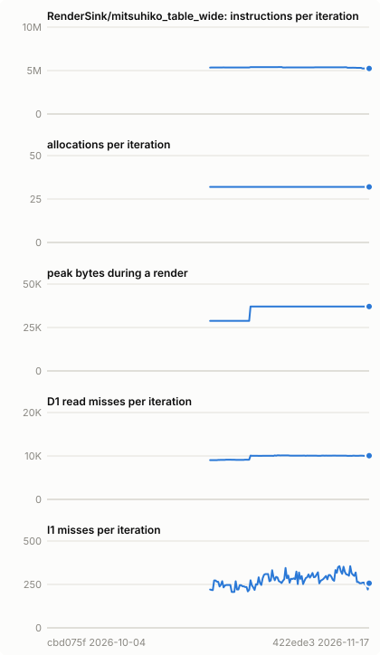

# Benchmark trend

Instruction and allocation counts per iteration on master, one record per commit (232 so far, latest [3f66175](https://github.com/jinja2cpp/Jinja2Cpp/commit/3f66175e6375fad9f112c0903b95fc27b26b21a8) on 2026-11-16). Written by the `trend` job of `.github/workflows/benchmark.yml` with `bench/trend.py`; the data is `history.jsonl`.

Memory is the bytes a loaded template keeps for `Load/*` and the peak heap use of one render for `Render/*`; vs first compares with the first record that has it.

| Benchmark | Instructions | vs previous | vs first | Allocations | vs previous | vs first | Memory | vs previous | vs first |
|---|---:|---:|---:|---:|---:|---:|---:|---:|---:|
| [Load/chat_llama](#loadchat_llama) | 335,871 | 0% |  | 55 | 0% |  | 18,480 | 0% | -52.71% |
| [Render/chat_llama](#renderchat_llama) | 289,163 | 0% |  | 224 | 0% |  | 11,592 | 0% | -19.28% |
| [Load/chat_mistral](#loadchat_mistral) | 385,948 | 0% |  | 52 | 0% |  | 20,904 | 0% | -53.18% |
| [Render/chat_mistral](#renderchat_mistral) | 491,568 | 0% |  | 401 | 0% |  | 9,960 | 0% | -24.59% |
| [Load/chat_qwen](#loadchat_qwen) | 261,762 | 0% |  | 44 | 0% |  | 14,432 | 0% | -47.19% |
| [Render/chat_qwen](#renderchat_qwen) | 271,760 | 0% |  | 211 | 0% |  | 8,280 | 0% | -2.63% |
| [Load/config_file](#loadconfig_file) | 94,836 | 0% |  | 25 | 0% |  | 5,480 | 0% | -48.11% |
| [Render/config_file](#renderconfig_file) | 1,269,317 | 0% |  | 908 | 0% |  | 25,576 | 0% | +7.43% |
| [Load/dict_ops](#loaddict_ops) | 32,457 | 0% | -78.04% | 9 | 0% | -93.13% | 2,192 | 0% | -48.50% |
| [Render/dict_ops](#renderdict_ops) | 290,612 | 0% | -57.93% | 112 | 0% | -75.11% | 24,408 | 0% | -29.65% |
| [Load/expressions](#loadexpressions) | 44,439 | 0% | -78.44% | 16 | 0% | -89.04% | 2,744 | 0% | -55.28% |
| [Render/expressions](#renderexpressions) | 415,881 | 0% | -54.10% | 3 | 0% | -90.00% | 2,440 | 0% | -31.15% |
| [Load/filters](#loadfilters) | 67,542 | 0% | -75.39% | 27 | 0% | -88.16% | 3,864 | 0% | -66.15% |
| [Render/filters](#renderfilters) | 26,375 | 0% | -70.25% | 23 | 0% | -68.92% | 752 | 0% | -84.69% |
| [Load/for_filter_if](#loadfor_filter_if) | 29,297 | 0% | -78.36% | 7 | 0% | -94.31% | 1,920 | 0% | -44.32% |
| [Render/for_filter_if](#renderfor_filter_if) | 267,465 | 0% | -69.10% | 4 | 0% | -98.23% | 16,560 | 0% | +354.95% |
| [Load/for_loop_vars](#loadfor_loop_vars) | 39,123 | 0% | -78.34% | 10 | 0% | -93.63% | 2,384 | 0% | -47.26% |
| [Render/for_loop_vars](#renderfor_loop_vars) | 170,711 | 0% | -84.09% | 2 | 0% | -99.62% | 1,568 | 0% | -43.35% |
| [Load/for_range](#loadfor_range) | 13,355 | 0% | -76.44% | 7 | 0% | -87.50% | 1,104 | 0% | -44.80% |
| [Render/for_range](#renderfor_range) | 37,116 | 0% | -59.75% | 3 | 0% | -88.89% | 408 | 0% | -73.02% |
| [Load/hf_deepseek_v31](#loadhf_deepseek_v31) | 384,028 | 0% |  | 55 | 0% |  | 21,992 | 0% | +0.81% |
| [Render/hf_deepseek_v31](#renderhf_deepseek_v31) | 90,158 | 0% |  | 42 | 0% |  | 2,456 | 0% | -0.97% |
| [Load/hf_gpt_oss](#loadhf_gpt_oss) | 1,523,236 | +0.01% |  | 283 | 0% |  | 74,752 | -0.04% | +0.71% |
| [Render/hf_gpt_oss](#renderhf_gpt_oss) | 167,393 | 0% |  | 154 | 0% |  | 5,664 | 0% | +14.75% |
| [Load/hf_mistral_small](#loadhf_mistral_small) | 592,342 | 0% |  | 88 | 0% |  | 33,064 | 0% | +0.39% |
| [Render/hf_mistral_small](#renderhf_mistral_small) | 139,074 | 0% |  | 98 | 0% |  | 6,112 | 0% | -0.39% |
| [Load/hf_qwen3](#loadhf_qwen3) | 476,889 | 0% |  | 82 | 0% |  | 25,576 | 0% | +0.38% |
| [Render/hf_qwen3](#renderhf_qwen3) | 116,543 | 0% |  | 99 | 0% |  | 3,224 | 0% | -0.74% |
| [Load/html_autoescape](#loadhtml_autoescape) | 189,904 | 0% |  | 43 | 0% |  | 12,688 | 0% | -48.59% |
| [Render/html_autoescape](#renderhtml_autoescape) | 1,195,967 | 0% |  | 674 | 0% |  | 45,968 | 0% | +13.83% |
| [Load/inheritance](#loadinheritance) | 21,966 | 0% | -80.75% | 7 | 0% | -93.46% | 1,360 | 0% | -52.65% |
| [Render/inheritance](#renderinheritance) | 134,255 | 0% | -82.05% | 35 | 0% | -94.37% | 7,960 | 0% | +32.31% |
| [Load/int_arith](#loadint_arith) | 65,380 | 0% |  | 20 | 0% |  | 3,888 | 0% | +0.83% |
| [Render/int_arith](#renderint_arith) | 827,334 | 0% |  | 12 | 0% |  | 3,272 | 0% | -0.49% |
| [Module/keep](#modulekeep) | 7,127 | 0% |  | 7 | 0% |  |  |  |  |
| [Module/keep_written](#modulekeep_written) | 29,266 | 0% |  | 11 | 0% |  |  |  |  |
| [Load/large_static](#loadlarge_static) | 148,000 | 0% | -83.30% | 14 | 0% | -96.82% | 43,136 | 0% | -19.20% |
| [Render/large_static](#renderlarge_static) | 20,322 | 0% | -72.95% | 1 | 0% | -94.44% | 36,552 | 0% | -1.83% |
| [RenderSink/large_static](#rendersinklarge_static) | 12,310 | 0% |  | 0 |  |  | 0 |  |  |
| [RenderTo/large_static](#rendertolarge_static) | 19,885 | 0% |  | 0 |  |  | 0 |  |  |
| [Load/macros](#loadmacros) | 54,802 | 0% | -75.96% | 26 | 0% | -86.02% | 4,432 | 0% | -28.70% |
| [Render/macros](#rendermacros) | 641,115 | 0% | -74.99% | 308 | 0% | -88.71% | 20,576 | 0% | +39.78% |
| [Load/many_tags](#loadmany_tags) | 8,764,438 | 0% | -80.16% | 951 | 0% | -97.22% | 438,128 | 0% | -58.48% |
| [Render/many_tags](#rendermany_tags) | 730,177 | 0% | -64.95% | 2 | 0% | -90.48% | 5,648 | 0% | -10.52% |
| [Load/mitsuhiko_table](#loadmitsuhiko_table) | 45,290 | 0% | -80.94% | 19 | 0% | -89.67% | 3,376 | 0% | -44.33% |
| [Render/mitsuhiko_table](#rendermitsuhiko_table) | 5,138,153 | 0% | -58.42% | 33 | 0% | -99.19% | 381,536 | 0% | +9.95% |
| [RenderSink/mitsuhiko_table](#rendersinkmitsuhiko_table) | 5,065,435 | 0% |  | 32 | 0% |  | 37,064 | 0% | +28.59% |
| [RenderTo/mitsuhiko_table](#rendertomitsuhiko_table) | 5,137,634 | 0% |  | 32 | 0% |  | 37,064 | 0% | +28.59% |
| [Load/mitsuhiko_table_wide](#loadmitsuhiko_table_wide) | 52,978 | 0% |  | 35 | 0% |  | 5,704 | 0% | -30.98% |
| [Render/mitsuhiko_table_wide](#rendermitsuhiko_table_wide) | 5,484,396 | 0% |  | 33 | 0% |  | 1,414,928 | 0% | +2.46% |
| [RenderSink/mitsuhiko_table_wide](#rendersinkmitsuhiko_table_wide) | 5,307,442 | 0% |  | 32 | 0% |  | 37,064 | 0% | +28.59% |
| [RenderTo/mitsuhiko_table_wide](#rendertomitsuhiko_table_wide) | 5,483,689 | 0% |  | 32 | 0% |  | 37,064 | 0% | +28.59% |
| [Load/plain_text](#loadplain_text) | 3,760 | 0% | -61.14% | 4 | 0% | -77.78% | 688 | 0% | -38.57% |
| [Render/plain_text](#renderplain_text) | 951 | 0% | -86.00% | 1 | 0% | -91.67% | 40 | 0% | -94.44% |
| [RenderSink/plain_text](#rendersinkplain_text) | 651 | 0% |  | 0 |  |  | 0 |  |  |
| [RenderTo/plain_text](#rendertoplain_text) | 752 | 0% |  | 0 |  |  | 0 |  |  |
| [Load/prompt_budget](#loadprompt_budget) | 34,634 | 0% |  | 18 | 0% |  | 2,240 | 0% | +0.72% |
| [Render/prompt_budget](#renderprompt_budget) | 1,319,269 | 0% |  | 76 | 0% |  | 36,416 | 0% | 0% |
| [Load/strings](#loadstrings) | 69,355 | 0% | -76.24% | 30 | 0% | -86.61% | 4,360 | 0% | -51.77% |
| [Render/strings](#renderstrings) | 580,724 | 0% | -72.31% | 344 | 0% | -83.73% | 9,088 | 0% | -49.31% |
| [Load/substitute](#loadsubstitute) | 7,540 | 0% | -74.75% | 6 | 0% | -83.78% | 848 | 0% | -44.21% |
| [Render/substitute](#rendersubstitute) | 1,631 | 0% | -81.49% | 1 | 0% | -91.67% | 40 | 0% | -94.44% |
| [RenderSink/substitute](#rendersinksubstitute) | 1,335 | 0% |  | 0 |  |  | 0 |  |  |
| [RenderTo/substitute](#rendertosubstitute) | 1,436 | 0% |  | 0 |  |  | 0 |  |  |

## Cache misses

Misses per iteration in callgrind's cache model (`count.py --cache-sim`: 32 KB 8-way L1, 8 MB 16-way last level, no prefetcher); reported, not gated.

| Benchmark | D1 read misses | vs previous | D1 write misses | vs previous | LL data read misses | vs previous | I1 misses | vs previous |
|---|---:|---:|---:|---:|---:|---:|---:|---:|
| Load/chat_llama | 731 | 0% | 753 | 0% | 0 |  | 7,526 | 0% |
| Render/chat_llama | 1,167 | +0.09% | 524 | 0% | 0 |  | 3,913 | 0% |
| Load/chat_mistral | 1,093 | -0.36% | 1,074 | +0.09% | 0 |  | 8,384 | 0% |
| Render/chat_mistral | 1,896 | 0% | 610 | +0.16% | 0 |  | 10,077 | 0% |
| Load/chat_qwen | 566 | +0.35% | 628 | -0.16% | 0 |  | 4,489 | 0% |
| Render/chat_qwen | 1,079 | -0.09% | 444 | +0.23% | 0 |  | 3,459 | 0% |
| Load/config_file | 220 | +0.46% | 185 | -0.54% | 0 |  | 2,743 | 0% |
| Render/config_file | 5,887 | 0% | 1,623 | 0% | 0 |  | 44,112 | 0% |
| Load/dict_ops | 52 | 0% | 28 | 0% | 0 |  | 1,335 | 0% |
| Render/dict_ops | 661 | 0% | 427 | 0% | 0 |  | 794 | 0% |
| Load/expressions | 35 | 0% | 27 | 0% | 0 |  | 1,297 | 0% |
| Render/expressions | 3 | 0% | 1 | 0% | 0 |  | 274 | 0% |
| Load/filters | 110 | 0% | 49 | 0% | 0 |  | 1,745 | 0% |
| Render/filters | 9 | 0% | 0 |  | 0 |  | 743 | 0% |
| Load/for_filter_if | 26 | 0% | 14 | 0% | 0 |  | 1,053 | 0% |
| Render/for_filter_if | 1,704 | 0% | 84 | 0% | 0 |  | 112 | 0% |
| Load/for_loop_vars | 47 | 0% | 21 | 0% | 0 |  | 1,109 | 0% |
| Render/for_loop_vars | 7 | 0% | 2 | 0% | 0 |  | 97 | 0% |
| Load/for_range | 4 | 0% | 4 | 0% | 0 |  | 759 | 0% |
| Render/for_range | 1 | 0% | 0 |  | 0 |  | 114 | 0% |
| Load/hf_deepseek_v31 | 1,014 | 0% | 973 | 0% | 0 |  | 6,189 | 0% |
| Render/hf_deepseek_v31 | 334 | 0% | 77 | 0% | 0 |  | 1,509 | 0% |
| Load/hf_gpt_oss | 4,693 | +0.02% | 3,375 | +0.06% | 0 |  | 22,045 | -0.03% |
| Render/hf_gpt_oss | 1,244 | -0.40% | 396 | 0% | 0 |  | 4,710 | 0% |
| Load/hf_mistral_small | 1,891 | 0% | 1,647 | 0% | 0 |  | 11,005 | 0% |
| Render/hf_mistral_small | 957 | 0% | 289 | 0% | 0 |  | 3,673 | 0% |
| Load/hf_qwen3 | 1,489 | +0.13% | 1,338 | +0.07% | 0 |  | 8,835 | 0% |
| Render/hf_qwen3 | 669 | +0.15% | 214 | 0% | 0 |  | 2,666 | 0% |
| Load/html_autoescape | 498 | 0% | 539 | 0% | 0 |  | 4,013 | 0% |
| Render/html_autoescape | 4,592 | 0% | 1,391 | 0% | 0 |  | 38,906 | 0% |
| Load/inheritance | 8 | 0% | 5 | 0% | 0 |  | 700 | 0% |
| Render/inheritance | 590 | 0% | 108 | 0% | 0 |  | 957 | 0% |
| Load/int_arith | 73 | 0% | 56 | 0% | 0 |  | 2,028 | 0% |
| Render/int_arith | 6 | 0% | 3 | 0% | 0 |  | 2,728 | 0% |
| Module/keep | 2 | 0% | 2 | 0% | 0 |  | 414 | 0% |
| Module/keep_written | 1,132 | 0% | 564 | 0% | 0 |  | 773 | 0% |
| Load/large_static | 1,927 | -0.10% | 905 | 0% | 0 |  | 303 | 0% |
| Render/large_static | 700 | 0% | 570 | 0% | 0 |  | 6 | 0% |
| RenderSink/large_static | 1 | 0% | 0 |  | 0 |  | 4 | 0% |
| RenderTo/large_static | 677 | 0% | 571 | 0% | 0 |  | 5 | 0% |
| Load/macros | 80 | 0% | 67 | 0% | 0 |  | 1,718 | 0% |
| Render/macros | 751 | 0% | 247 | 0% | 0 |  | 2,516 | 0% |
| Load/many_tags | 28,424 | 0% | 22,592 | 0% | 0 |  | 242,108 | 0% |
| Render/many_tags | 6,095 | 0% | 754 | 0% | 0 |  | 96 | 0% |
| Load/mitsuhiko_table | 47 | 0% | 51 | 0% | 0 |  | 859 | 0% |
| Render/mitsuhiko_table | 10,007 | 0% | 6,310 | 0% | 0 |  | 303 | 0% |
| RenderSink/mitsuhiko_table | 9,983 | 0% | 1,214 | 0% | 0 |  | 247 | 0% |
| RenderTo/mitsuhiko_table | 10,025 | 0% | 6,311 | 0% | 0 |  | 275 | 0% |
| Load/mitsuhiko_table_wide | 81 | 0% | 77 | 0% | 0 |  | 1,020 | 0% |
| Render/mitsuhiko_table_wide | 10,224 | 0% | 22,672 | 0% | 0 |  | 318 | 0% |
| RenderSink/mitsuhiko_table_wide | 10,039 | 0% | 1,301 | 0% | 0 |  | 264 | 0% |
| RenderTo/mitsuhiko_table_wide | 10,227 | 0% | 22,686 | 0% | 0 |  | 283 | 0% |
| Load/plain_text | 0 |  | 2 | 0% | 0 |  | 29 | 0% |
| Render/plain_text | 1 | 0% | 0 |  | 0 |  | 5 | 0% |
| RenderSink/plain_text | 1 | 0% | 0 |  | 0 |  | 5 | 0% |
| RenderTo/plain_text | 1 | 0% | 0 |  | 0 |  | 4 | 0% |
| Load/prompt_budget | 82 | -4.65% | 43 | -2.27% | 0 |  | 1,426 | 0% |
| Render/prompt_budget | 4,793 | +0.08% | 545 | 0% | 0 |  | 866 | 0% |
| Load/strings | 137 | 0% | 110 | 0% | 0 |  | 2,767 | 0% |
| Render/strings | 399 | 0% | 459 | 0% | 0 |  | 3,255 | 0% |
| Load/substitute | 2 | 0% | 3 | 0% | 0 |  | 220 | 0% |
| Render/substitute | 1 | 0% | 0 |  | 0 |  | 5 | 0% |
| RenderSink/substitute | 1 | 0% | 0 |  | 0 |  | 4 | 0% |
| RenderTo/substitute | 1 | 0% | 0 |  | 0 |  | 5 | 0% |

## Charts

### Load/chat_llama

### Render/chat_llama

### Load/chat_mistral

### Render/chat_mistral

### Load/chat_qwen

### Render/chat_qwen

### Load/config_file

### Render/config_file

### Load/dict_ops

### Render/dict_ops

### Load/expressions

### Render/expressions

### Load/filters

### Render/filters

### Load/for_filter_if

### Render/for_filter_if

### Load/for_loop_vars

### Render/for_loop_vars

### Load/for_range

### Render/for_range

### Load/hf_deepseek_v31

### Render/hf_deepseek_v31

### Load/hf_gpt_oss

### Render/hf_gpt_oss

### Load/hf_mistral_small

### Render/hf_mistral_small

### Load/hf_qwen3

### Render/hf_qwen3

### Load/html_autoescape

### Render/html_autoescape

### Load/inheritance

### Render/inheritance

### Load/int_arith

### Render/int_arith

### Module/keep

### Module/keep_written

### Load/large_static

### Render/large_static

### RenderSink/large_static

### RenderTo/large_static

### Load/macros

### Render/macros

### Load/many_tags

### Render/many_tags

### Load/mitsuhiko_table

### Render/mitsuhiko_table

### RenderSink/mitsuhiko_table

### RenderTo/mitsuhiko_table

### Load/mitsuhiko_table_wide

### Render/mitsuhiko_table_wide

### RenderSink/mitsuhiko_table_wide

### RenderTo/mitsuhiko_table_wide

### Load/plain_text

### Render/plain_text

### RenderSink/plain_text

### RenderTo/plain_text

### Load/prompt_budget

### Render/prompt_budget

### Load/strings

### Render/strings

### Load/substitute

### Render/substitute

### RenderSink/substitute

### RenderTo/substitute

