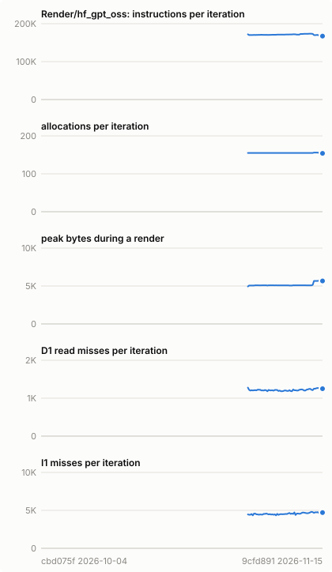

# Benchmark trend

Instruction and allocation counts per iteration on master, one record per commit (245 so far, latest [21ac183](https://github.com/jinja2cpp/Jinja2Cpp/commit/21ac18372e6fe785dd9aa68c02bbcea03dc85c62) on 2026-11-17). Written by the `trend` job of `.github/workflows/benchmark.yml` with `bench/trend.py`; the data is `history.jsonl`.

Memory is the bytes a loaded template keeps for `Load/*` and the peak heap use of one render for `Render/*`; vs first compares with the first record that has it.

| Benchmark | Instructions | vs previous | vs first | Allocations | vs previous | vs first | Memory | vs previous | vs first |
|---|---:|---:|---:|---:|---:|---:|---:|---:|---:|
| [Load/chat_llama](#loadchat_llama) | 334,333 | 0% |  | 54 | 0% |  | 18,472 | 0% | -52.73% |
| [Render/chat_llama](#renderchat_llama) | 289,694 | 0% |  | 224 | 0% |  | 11,608 | 0% | -19.16% |
| [Load/chat_mistral](#loadchat_mistral) | 383,405 | 0% |  | 51 | 0% |  | 20,896 | 0% | -53.20% |
| [Render/chat_mistral](#renderchat_mistral) | 491,536 | 0% |  | 401 | 0% |  | 10,024 | 0% | -24.11% |
| [Load/chat_qwen](#loadchat_qwen) | 260,233 | 0% |  | 43 | 0% |  | 14,424 | 0% | -47.22% |
| [Render/chat_qwen](#renderchat_qwen) | 271,418 | 0% |  | 211 | 0% |  | 8,280 | 0% | -2.63% |
| [Load/config_file](#loadconfig_file) | 93,675 | +0.01% |  | 24 | 0% |  | 5,472 | 0% | -48.18% |
| [Render/config_file](#renderconfig_file) | 1,266,090 | 0% |  | 908 | 0% |  | 25,704 | 0% | +7.96% |
| [Load/dict_ops](#loaddict_ops) | 31,602 | +0.02% | -78.62% | 8 | 0% | -93.89% | 2,184 | 0% | -48.68% |
| [Render/dict_ops](#renderdict_ops) | 290,685 | 0% | -57.92% | 112 | 0% | -75.11% | 24,408 | 0% | -29.65% |
| [Load/expressions](#loadexpressions) | 43,528 | +0.02% | -78.89% | 15 | 0% | -89.73% | 2,736 | 0% | -55.41% |
| [Render/expressions](#renderexpressions) | 414,279 | 0% | -54.28% | 3 | 0% | -90.00% | 2,440 | 0% | -31.15% |
| [Load/filters](#loadfilters) | 66,764 | +0.01% | -75.67% | 26 | 0% | -88.60% | 3,856 | 0% | -66.22% |
| [Render/filters](#renderfilters) | 26,363 | 0% | -70.27% | 23 | 0% | -68.92% | 752 | 0% | -84.69% |
| [Load/for_filter_if](#loadfor_filter_if) | 28,426 | +0.02% | -79.00% | 6 | 0% | -95.12% | 1,912 | 0% | -44.55% |
| [Render/for_filter_if](#renderfor_filter_if) | 267,252 | 0% | -69.12% | 4 | 0% | -98.23% | 16,560 | 0% | +354.95% |
| [Load/for_loop_vars](#loadfor_loop_vars) | 38,248 | +0.02% | -78.83% | 9 | 0% | -94.27% | 2,376 | 0% | -47.43% |
| [Render/for_loop_vars](#renderfor_loop_vars) | 170,642 | 0% | -84.09% | 2 | 0% | -99.62% | 1,568 | 0% | -43.35% |
| [Load/for_range](#loadfor_range) | 12,376 | +0.06% | -78.17% | 6 | 0% | -89.29% | 1,096 | 0% | -45.20% |
| [Render/for_range](#renderfor_range) | 37,063 | 0% | -59.81% | 3 | 0% | -88.89% | 408 | 0% | -73.02% |
| [Load/hf_deepseek_v31](#loadhf_deepseek_v31) | 382,365 | 0% |  | 54 | 0% |  | 21,984 | 0% | +0.77% |
| [Render/hf_deepseek_v31](#renderhf_deepseek_v31) | 89,964 | 0% |  | 42 | 0% |  | 2,456 | 0% | -0.97% |
| [Load/hf_gpt_oss](#loadhf_gpt_oss) | 1,521,287 | 0% |  | 282 | 0% |  | 74,920 | 0% | +0.94% |
| [Render/hf_gpt_oss](#renderhf_gpt_oss) | 167,819 | 0% |  | 153 | 0% |  | 5,784 | 0% | +17.18% |
| [Load/hf_mistral_small](#loadhf_mistral_small) | 588,555 | 0% |  | 87 | 0% |  | 33,056 | 0% | +0.36% |
| [Render/hf_mistral_small](#renderhf_mistral_small) | 139,084 | 0% |  | 97 | 0% |  | 6,112 | 0% | -0.39% |
| [Load/hf_qwen3](#loadhf_qwen3) | 474,841 | 0% |  | 81 | 0% |  | 25,568 | 0% | +0.35% |
| [Render/hf_qwen3](#renderhf_qwen3) | 116,592 | 0% |  | 99 | 0% |  | 3,224 | 0% | -0.74% |
| [Load/html_autoescape](#loadhtml_autoescape) | 188,388 | 0% |  | 42 | 0% |  | 12,680 | 0% | -48.62% |
| [Render/html_autoescape](#renderhtml_autoescape) | 1,195,269 | 0% |  | 674 | 0% |  | 46,064 | 0% | +14.06% |
| [Load/inheritance](#loadinheritance) | 21,159 | +0.03% | -81.46% | 6 | 0% | -94.39% | 1,352 | 0% | -52.92% |
| [Render/inheritance](#renderinheritance) | 134,662 | 0% | -81.99% | 35 | 0% | -94.37% | 8,072 | 0% | +34.18% |
| [Load/int_arith](#loadint_arith) | 64,371 | +0.01% |  | 19 | 0% |  | 3,880 | 0% | +0.62% |
| [Render/int_arith](#renderint_arith) | 825,503 | 0% |  | 12 | 0% |  | 3,272 | 0% | -0.49% |
| [Module/keep](#modulekeep) | 6,886 | 0% |  | 6 | 0% |  |  |  |  |
| [Module/keep_written](#modulekeep_written) | 28,948 | 0% |  | 10 | 0% |  |  |  |  |
| [Load/large_static](#loadlarge_static) | 146,472 | 0% | -83.47% | 13 | 0% | -97.05% | 43,128 | 0% | -19.21% |
| [Render/large_static](#renderlarge_static) | 20,248 | 0% | -73.05% | 1 | 0% | -94.44% | 36,552 | 0% | -1.83% |
| [RenderSink/large_static](#rendersinklarge_static) | 12,616 | 0% |  | 0 |  |  | 0 |  |  |
| [RenderTo/large_static](#rendertolarge_static) | 19,889 | 0% |  | 0 |  |  | 0 |  |  |
| [Load/macros](#loadmacros) | 53,835 | +0.01% | -76.38% | 25 | 0% | -86.56% | 4,456 | 0% | -28.31% |
| [Render/macros](#rendermacros) | 643,029 | 0% | -74.91% | 308 | 0% | -88.71% | 20,576 | 0% | +39.78% |
| [Load/many_tags](#loadmany_tags) | 8,736,832 | 0% | -80.22% | 950 | 0% | -97.23% | 438,120 | 0% | -58.48% |
| [Render/many_tags](#rendermany_tags) | 732,438 | 0% | -64.84% | 2 | 0% | -90.48% | 5,648 | 0% | -10.52% |
| [Load/mitsuhiko_table](#loadmitsuhiko_table) | 44,314 | +0.02% | -81.35% | 18 | 0% | -90.22% | 3,368 | 0% | -44.46% |
| [Render/mitsuhiko_table](#rendermitsuhiko_table) | 5,067,121 | 0% | -58.99% | 33 | 0% | -99.19% | 381,536 | 0% | +9.95% |
| [RenderSink/mitsuhiko_table](#rendersinkmitsuhiko_table) | 4,997,057 | 0% |  | 32 | 0% |  | 37,064 | 0% | +28.59% |
| [RenderTo/mitsuhiko_table](#rendertomitsuhiko_table) | 5,066,627 | 0% |  | 32 | 0% |  | 37,064 | 0% | +28.59% |
| [Load/mitsuhiko_table_wide](#loadmitsuhiko_table_wide) | 52,054 | +0.01% |  | 34 | 0% |  | 5,696 | 0% | -31.07% |
| [Render/mitsuhiko_table_wide](#rendermitsuhiko_table_wide) | 5,413,104 | 0% |  | 33 | 0% |  | 1,414,928 | 0% | +2.46% |
| [RenderSink/mitsuhiko_table_wide](#rendersinkmitsuhiko_table_wide) | 5,239,067 | 0% |  | 32 | 0% |  | 37,064 | 0% | +28.59% |
| [RenderTo/mitsuhiko_table_wide](#rendertomitsuhiko_table_wide) | 5,412,569 | 0% |  | 32 | 0% |  | 37,064 | 0% | +28.59% |
| [Load/plain_text](#loadplain_text) | 2,930 | +0.24% | -69.72% | 3 | 0% | -83.33% | 680 | 0% | -39.29% |
| [Render/plain_text](#renderplain_text) | 957 | 0% | -85.91% | 1 | 0% | -91.67% | 40 | 0% | -94.44% |
| [RenderSink/plain_text](#rendersinkplain_text) | 662 | 0% |  | 0 |  |  | 0 |  |  |
| [RenderTo/plain_text](#rendertoplain_text) | 758 | 0% |  | 0 |  |  | 0 |  |  |
| [Load/prompt_budget](#loadprompt_budget) | 33,798 | +0.02% |  | 17 | 0% |  | 2,232 | 0% | +0.36% |
| [Render/prompt_budget](#renderprompt_budget) | 1,319,629 | 0% |  | 76 | 0% |  | 36,416 | 0% | 0% |
| [Load/strings](#loadstrings) | 68,441 | +0.01% | -76.55% | 29 | 0% | -87.05% | 4,352 | 0% | -51.86% |
| [Render/strings](#renderstrings) | 581,393 | 0% | -72.28% | 344 | 0% | -83.73% | 9,088 | 0% | -49.31% |
| [Load/substitute](#loadsubstitute) | 6,632 | +0.11% | -77.79% | 5 | 0% | -86.49% | 840 | 0% | -44.74% |
| [Render/substitute](#rendersubstitute) | 1,636 | 0% | -81.44% | 1 | 0% | -91.67% | 40 | 0% | -94.44% |
| [RenderSink/substitute](#rendersinksubstitute) | 1,347 | 0% |  | 0 |  |  | 0 |  |  |
| [RenderTo/substitute](#rendertosubstitute) | 1,441 | 0% |  | 0 |  |  | 0 |  |  |

## Cache misses

Misses per iteration in callgrind's cache model (`count.py --cache-sim`: 32 KB 8-way L1, 8 MB 16-way last level, no prefetcher); reported, not gated.

| Benchmark | D1 read misses | vs previous | D1 write misses | vs previous | LL data read misses | vs previous | I1 misses | vs previous |
|---|---:|---:|---:|---:|---:|---:|---:|---:|
| Load/chat_llama | 742 | +1.09% | 759 | +0.13% | 0 |  | 8,021 | +2.26% |
| Render/chat_llama | 1,198 | +0.17% | 526 | +1.54% | 0 |  | 4,201 | -1.06% |
| Load/chat_mistral | 1,109 | +0.18% | 1,086 | 0% | 0 |  | 9,449 | +7.31% |
| Render/chat_mistral | 2,031 | +0.30% | 642 | +1.90% | 0 |  | 10,544 | +0.14% |
| Load/chat_qwen | 549 | -0.90% | 647 | +0.62% | 0 |  | 5,031 | +8.87% |
| Render/chat_qwen | 1,061 | +0.66% | 422 | +0.72% | 0 |  | 3,588 | +6.41% |
| Load/config_file | 218 | -0.91% | 193 | -0.52% | 0 |  | 2,750 | -2.86% |
| Render/config_file | 6,600 | -0.71% | 1,752 | +1.68% | 0 |  | 42,155 | -4.51% |
| Load/dict_ops | 41 | +10.81% | 23 | +15.00% | 0 |  | 1,368 | +1.26% |
| Render/dict_ops | 666 | 0% | 418 | -0.48% | 0 |  | 814 | -0.85% |
| Load/expressions | 18 | +5.88% | 18 | 0% | 0 |  | 1,351 | +7.05% |
| Render/expressions | 3 | -25.00% | 1 | 0% | 0 |  | 273 | -7.46% |
| Load/filters | 75 | -2.60% | 40 | +8.11% | 0 |  | 1,683 | -7.37% |
| Render/filters | 14 | -17.65% | 5 | 0% | 0 |  | 738 | -3.66% |
| Load/for_filter_if | 26 | +8.33% | 12 | 0% | 0 |  | 1,096 | +1.01% |
| Render/for_filter_if | 1,710 | +0.18% | 97 | -2.02% | 0 |  | 124 | +5.98% |
| Load/for_loop_vars | 33 | +26.92% | 19 | +11.76% | 0 |  | 1,167 | +1.74% |
| Render/for_loop_vars | 10 | -16.67% | 3 | 0% | 0 |  | 85 | -29.75% |
| Load/for_range | 1 | 0% | 4 | 0% | 0 |  | 740 | +2.49% |
| Render/for_range | 6 | -25.00% | 2 | 0% | 0 |  | 118 | -19.73% |
| Load/hf_deepseek_v31 | 1,009 | +0.70% | 989 | 0% | 0 |  | 7,158 | +9.99% |
| Render/hf_deepseek_v31 | 373 | +1.36% | 91 | +5.81% | 0 |  | 1,483 | +2.99% |
| Load/hf_gpt_oss | 4,659 | +0.02% | 3,380 | +0.03% | 0 |  | 24,780 | +4.06% |
| Render/hf_gpt_oss | 1,251 | 0% | 409 | +0.99% | 0 |  | 4,726 | -0.17% |
| Load/hf_mistral_small | 1,846 | -0.05% | 1,635 | +0.06% | 0 |  | 12,092 | +8.46% |
| Render/hf_mistral_small | 947 | +0.21% | 300 | +3.09% | 0 |  | 3,759 | +0.62% |
| Load/hf_qwen3 | 1,545 | +0.59% | 1,340 | 0% | 0 |  | 9,728 | +5.48% |
| Render/hf_qwen3 | 700 | -0.28% | 218 | +0.93% | 0 |  | 2,677 | +3.96% |
| Load/html_autoescape | 510 | +1.19% | 525 | 0% | 0 |  | 4,224 | -0.17% |
| Render/html_autoescape | 5,070 | +2.16% | 1,655 | +1.29% | 0 |  | 37,283 | +1.29% |
| Load/inheritance | 1 | 0% | 3 | 0% | 0 |  | 696 | +0.87% |
| Render/inheritance | 600 | -0.83% | 114 | +0.88% | 0 |  | 977 | -2.40% |
| Load/int_arith | 81 | +1.25% | 54 | +5.88% | 0 |  | 2,072 | +3.70% |
| Render/int_arith | 10 | -33.33% | 5 | 0% | 0 |  | 725 | -3.20% |
| Module/keep | 2 | 0% | 3 | 0% | 0 |  | 401 | -4.75% |
| Module/keep_written | 1,146 | +0.26% | 564 | 0% | 0 |  | 722 | -2.96% |
| Load/large_static | 1,920 | +0.05% | 902 | +0.11% | 0 |  | 271 | +10.16% |
| Render/large_static | 705 | -0.14% | 580 | -0.17% | 0 |  | 4 | -20.00% |
| RenderSink/large_static | 1 | 0% | 0 |  | 0 |  | 1 | -66.67% |
| RenderTo/large_static | 680 | 0% | 568 | -0.18% | 0 |  | 4 | 0% |
| Load/macros | 77 | -1.28% | 55 | +3.77% | 0 |  | 1,743 | +2.59% |
| Render/macros | 768 | -0.26% | 228 | -1.72% | 0 |  | 1,537 | +161.39% |
| Load/many_tags | 28,047 | +0.32% | 22,663 | +0.07% | 0 |  | 263,492 | +6.45% |
| Render/many_tags | 6,125 | +0.03% | 788 | -2.35% | 0 |  | 171 | +106.02% |
| Load/mitsuhiko_table | 38 | +2.70% | 50 | 0% | 0 |  | 889 | +7.24% |
| Render/mitsuhiko_table | 10,004 | -0.13% | 6,296 | -0.03% | 0 |  | 292 | -1.02% |
| RenderSink/mitsuhiko_table | 9,990 | -0.12% | 1,222 | -0.73% | 0 |  | 221 | -5.96% |
| RenderTo/mitsuhiko_table | 10,039 | -0.15% | 6,312 | +0.02% | 0 |  | 259 | -5.82% |
| Load/mitsuhiko_table_wide | 90 | +1.12% | 101 | +4.12% | 0 |  | 964 | -3.21% |
| Render/mitsuhiko_table_wide | 10,244 | +0.01% | 22,694 | -0.02% | 0 |  | 313 | +13.82% |
| RenderSink/mitsuhiko_table_wide | 10,047 | +0.02% | 1,313 | -0.08% | 0 |  | 240 | +6.67% |
| RenderTo/mitsuhiko_table_wide | 10,258 | +0.16% | 22,733 | -0.02% | 0 |  | 278 | 0% |
| Load/plain_text | 0 |  | 1 | 0% | 0 |  | 10 | +400.00% |
| Render/plain_text | 1 | 0% | 1 | 0% | 0 |  | 7 | +16.67% |
| RenderSink/plain_text | 1 | 0% | 0 |  | 0 |  | 5 | 0% |
| RenderTo/plain_text | 1 | 0% | 0 |  | 0 |  | 6 | 0% |
| Load/prompt_budget | 64 | +3.23% | 38 | -7.32% | 0 |  | 1,409 | +2.03% |
| Render/prompt_budget | 4,821 | +0.06% | 538 | -0.55% | 0 |  | 882 | +0.92% |
| Load/strings | 133 | 0% | 102 | -2.86% | 0 |  | 2,825 | +1.95% |
| Render/strings | 426 | +0.24% | 478 | +0.63% | 0 |  | 1,524 | -1.99% |
| Load/substitute | 1 | 0% | 3 | 0% | 0 |  | 148 | +28.70% |
| Render/substitute | 2 | +100.00% | 1 | 0% | 0 |  | 3 | 0% |
| RenderSink/substitute | 1 | 0% | 0 |  | 0 |  | 1 | -66.67% |
| RenderTo/substitute | 2 | +100.00% | 0 |  | 0 |  | 2 | -33.33% |

## Charts

### Load/chat_llama

### Render/chat_llama

### Load/chat_mistral

### Render/chat_mistral

### Load/chat_qwen

### Render/chat_qwen

### Load/config_file

### Render/config_file

### Load/dict_ops

### Render/dict_ops

### Load/expressions

### Render/expressions

### Load/filters

### Render/filters

### Load/for_filter_if

### Render/for_filter_if

### Load/for_loop_vars

### Render/for_loop_vars

### Load/for_range

### Render/for_range

### Load/hf_deepseek_v31

### Render/hf_deepseek_v31

### Load/hf_gpt_oss

### Render/hf_gpt_oss

### Load/hf_mistral_small

### Render/hf_mistral_small

### Load/hf_qwen3

### Render/hf_qwen3

### Load/html_autoescape

### Render/html_autoescape

### Load/inheritance

### Render/inheritance

### Load/int_arith

### Render/int_arith

### Module/keep

### Module/keep_written

### Load/large_static

### Render/large_static

### RenderSink/large_static

### RenderTo/large_static

### Load/macros

### Render/macros

### Load/many_tags

### Render/many_tags

### Load/mitsuhiko_table

### Render/mitsuhiko_table

### RenderSink/mitsuhiko_table

### RenderTo/mitsuhiko_table

### Load/mitsuhiko_table_wide

### Render/mitsuhiko_table_wide

### RenderSink/mitsuhiko_table_wide

### RenderTo/mitsuhiko_table_wide

### Load/plain_text

### Render/plain_text

### RenderSink/plain_text

### RenderTo/plain_text

### Load/prompt_budget

### Render/prompt_budget

### Load/strings

### Render/strings

### Load/substitute

### Render/substitute

### RenderSink/substitute

### RenderTo/substitute

