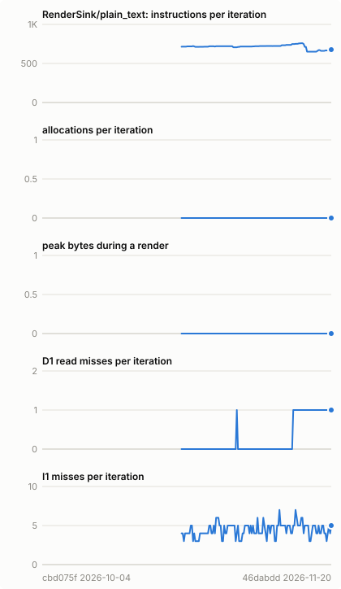
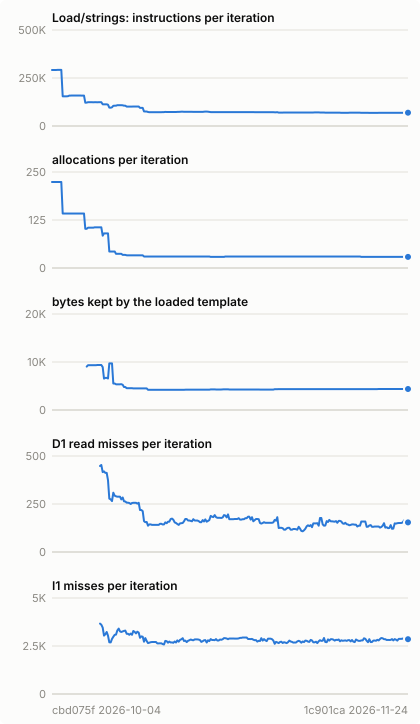

# Benchmark trend

Instruction and allocation counts per iteration on master, one record per commit (271 so far, latest [c4561b9](https://github.com/jinja2cpp/Jinja2Cpp/commit/c4561b9476a7e8fa0adcece6d90d51547d2e2311) on 2026-11-27). Written by the `trend` job of `.github/workflows/benchmark.yml` with `bench/trend.py`; the data is `history.jsonl`.

Memory is the bytes a loaded template keeps for `Load/*` and the peak heap use of one render for `Render/*`; vs first compares with the first record that has it.

| Benchmark | Instructions | vs previous | vs first | Allocations | vs previous | vs first | Memory | vs previous | vs first |
|---|---:|---:|---:|---:|---:|---:|---:|---:|---:|
| [Load/big_int_radix](#loadbig_int_radix) | 43,446 | +0.38% |  | 14 | 0% |  | 2,688 | 0% | 0% |
| [Render/big_int_radix](#renderbig_int_radix) | 146,578,689 | 0% |  | 123 | 0% |  | 1,540,760 | 0% | -39.13% |
| [Load/chat_llama](#loadchat_llama) | 338,299 | -0.01% |  | 54 | 0% |  | 18,536 | 0% | -52.57% |
| [Render/chat_llama](#renderchat_llama) | 292,011 | +0.09% |  | 224 | 0% |  | 11,624 | 0% | -19.05% |
| [Load/chat_mistral](#loadchat_mistral) | 388,757 | +0.44% |  | 52 | +1.96% |  | 21,024 | +0.23% | -52.91% |
| [Render/chat_mistral](#renderchat_mistral) | 493,880 | +0.21% |  | 392 | 0% |  | 9,832 | +0.16% | -25.56% |
| [Load/chat_qwen](#loadchat_qwen) | 263,303 | 0% |  | 43 | 0% |  | 14,472 | 0% | -47.04% |
| [Render/chat_qwen](#renderchat_qwen) | 273,410 | 0% |  | 211 | 0% |  | 8,280 | 0% | -2.63% |
| [Load/config_file](#loadconfig_file) | 94,748 | +0.08% |  | 24 | 0% |  | 5,520 | 0% | -47.73% |
| [Render/config_file](#renderconfig_file) | 1,250,864 | +0.03% |  | 882 | 0% |  | 25,976 | 0% | +9.11% |
| [Load/dict_ops](#loaddict_ops) | 32,073 | +0.10% | -78.30% | 8 | 0% | -93.89% | 2,216 | 0% | -47.93% |
| [Render/dict_ops](#renderdict_ops) | 291,520 | -0.04% | -57.80% | 112 | 0% | -75.11% | 24,424 | 0% | -29.61% |
| [Load/expressions](#loadexpressions) | 44,265 | +0.12% | -78.53% | 15 | 0% | -89.73% | 2,752 | 0% | -55.15% |
| [Render/expressions](#renderexpressions) | 414,654 | +0.01% | -54.24% | 3 | 0% | -90.00% | 2,440 | 0% | -31.15% |
| [Load/filters](#loadfilters) | 67,174 | -0.49% | -75.52% | 26 | 0% | -88.60% | 3,856 | 0% | -66.22% |
| [Render/filters](#renderfilters) | 24,962 | 0% | -71.85% | 22 | 0% | -70.27% | 784 | 0% | -84.04% |
| [Load/for_filter_if](#loadfor_filter_if) | 28,665 | -0.01% | -78.83% | 6 | 0% | -95.12% | 1,928 | 0% | -44.08% |
| [Render/for_filter_if](#renderfor_filter_if) | 267,135 | 0% | -69.13% | 4 | 0% | -98.23% | 16,560 | 0% | +354.95% |
| [Load/for_loop_vars](#loadfor_loop_vars) | 38,416 | +0.24% | -78.74% | 9 | 0% | -94.27% | 2,392 | 0% | -47.08% |
| [Render/for_loop_vars](#renderfor_loop_vars) | 170,826 | 0% | -84.08% | 2 | 0% | -99.62% | 1,568 | 0% | -43.35% |
| [Load/for_range](#loadfor_range) | 12,606 | +0.35% | -77.76% | 6 | 0% | -89.29% | 1,128 | 0% | -43.60% |
| [Render/for_range](#renderfor_range) | 37,236 | +0.08% | -59.62% | 3 | 0% | -88.89% | 408 | 0% | -73.02% |
| [Load/hf_deepseek_v31](#loadhf_deepseek_v31) | 386,918 | +0.16% |  | 54 | 0% |  | 22,064 | +0.15% | +1.14% |
| [Render/hf_deepseek_v31](#renderhf_deepseek_v31) | 90,748 | +0.03% |  | 42 | 0% |  | 2,456 | 0% | -0.97% |
| [Load/hf_gpt_oss](#loadhf_gpt_oss) | 1,535,440 | +0.18% |  | 282 | 0% |  | 75,192 | +0.13% | +1.30% |
| [Render/hf_gpt_oss](#renderhf_gpt_oss) | 170,958 | +0.18% |  | 153 | 0% |  | 6,064 | +0.26% | +22.85% |
| [Load/hf_mistral_small](#loadhf_mistral_small) | 595,099 | +0.17% |  | 87 | 0% |  | 33,168 | +0.10% | +0.70% |
| [Render/hf_mistral_small](#renderhf_mistral_small) | 140,911 | +0.29% |  | 97 | 0% |  | 6,128 | 0% | -0.13% |
| [Load/hf_qwen3](#loadhf_qwen3) | 483,678 | +0.75% |  | 81 | 0% |  | 25,744 | +0.37% | +1.04% |
| [Render/hf_qwen3](#renderhf_qwen3) | 117,843 | +0.03% |  | 99 | 0% |  | 3,224 | 0% | -0.74% |
| [Load/html_autoescape](#loadhtml_autoescape) | 189,612 | +0.08% |  | 42 | 0% |  | 12,728 | 0% | -48.43% |
| [Render/html_autoescape](#renderhtml_autoescape) | 1,198,945 | +0.01% |  | 674 | 0% |  | 46,256 | 0% | +14.54% |
| [Load/inheritance](#loadinheritance) | 21,461 | +0.05% | -81.19% | 6 | 0% | -94.39% | 1,368 | 0% | -52.37% |
| [Render/inheritance](#renderinheritance) | 137,119 | +0.02% | -81.66% | 35 | 0% | -94.37% | 8,168 | 0% | +35.77% |
| [Load/int_arith](#loadint_arith) | 65,407 | +0.20% |  | 19 | 0% |  | 3,896 | 0% | +1.04% |
| [Render/int_arith](#renderint_arith) | 825,555 | +0.01% |  | 12 | 0% |  | 3,288 | 0% | 0% |
| [Module/keep](#modulekeep) | 7,204 | +0.71% |  | 6 | 0% |  |  |  |  |
| [Module/keep_written](#modulekeep_written) | 29,209 | +0.17% |  | 10 | 0% |  |  |  |  |
| [Load/large_static](#loadlarge_static) | 147,306 | +0.10% | -83.37% | 13 | 0% | -97.05% | 43,128 | 0% | -19.21% |
| [Render/large_static](#renderlarge_static) | 20,343 | 0% | -72.93% | 1 | 0% | -94.44% | 36,552 | 0% | -1.83% |
| [RenderSink/large_static](#rendersinklarge_static) | 12,632 | +0.01% |  | 0 |  |  | 0 |  |  |
| [RenderTo/large_static](#rendertolarge_static) | 19,906 | +0.31% |  | 0 |  |  | 0 |  |  |
| [Load/macros](#loadmacros) | 54,574 | +0.20% | -76.06% | 25 | 0% | -86.56% | 4,488 | 0% | -27.80% |
| [Render/macros](#rendermacros) | 648,603 | +0.09% | -74.69% | 308 | 0% | -88.71% | 20,608 | 0% | +40.00% |
| [Load/many_tags](#loadmany_tags) | 8,798,620 | -0.12% | -80.08% | 950 | 0% | -97.23% | 438,136 | 0% | -58.48% |
| [Render/many_tags](#rendermany_tags) | 732,458 | 0% | -64.84% | 2 | 0% | -90.48% | 5,648 | 0% | -10.52% |
| [Load/mitsuhiko_table](#loadmitsuhiko_table) | 44,842 | +0.09% | -81.12% | 18 | 0% | -90.22% | 3,416 | 0% | -43.67% |
| [Render/mitsuhiko_table](#rendermitsuhiko_table) | 5,129,120 | 0% | -58.49% | 33 | 0% | -99.19% | 381,536 | 0% | +9.95% |
| [RenderSink/mitsuhiko_table](#rendersinkmitsuhiko_table) | 5,058,849 | 0% |  | 32 | 0% |  | 37,064 | 0% | +28.59% |
| [RenderTo/mitsuhiko_table](#rendertomitsuhiko_table) | 5,128,675 | 0% |  | 32 | 0% |  | 37,064 | 0% | +28.59% |
| [Load/mitsuhiko_table_wide](#loadmitsuhiko_table_wide) | 52,307 | +0.04% |  | 34 | 0% |  | 5,744 | 0% | -30.49% |
| [Render/mitsuhiko_table_wide](#rendermitsuhiko_table_wide) | 5,474,954 | 0% |  | 33 | 0% |  | 1,414,928 | 0% | +2.46% |
| [RenderSink/mitsuhiko_table_wide](#rendersinkmitsuhiko_table_wide) | 5,300,881 | 0% |  | 32 | 0% |  | 37,064 | 0% | +28.59% |
| [RenderTo/mitsuhiko_table_wide](#rendertomitsuhiko_table_wide) | 5,474,370 | 0% |  | 32 | 0% |  | 37,064 | 0% | +28.59% |
| [Nested/new_template](#nestednew_template) | 454,363 | +0.19% |  | 323 | 0% |  |  |  |  |
| [Load/plain_text](#loadplain_text) | 2,942 | +0.34% | -69.59% | 3 | 0% | -83.33% | 680 | 0% | -39.29% |
| [Render/plain_text](#renderplain_text) | 973 | +0.10% | -85.68% | 1 | 0% | -91.67% | 40 | 0% | -94.44% |
| [RenderSink/plain_text](#rendersinkplain_text) | 678 | +0.15% |  | 0 |  |  | 0 |  |  |
| [RenderTo/plain_text](#rendertoplain_text) | 774 | +0.13% |  | 0 |  |  | 0 |  |  |
| [Load/prompt_budget](#loadprompt_budget) | 34,270 | -0.23% |  | 17 | 0% |  | 2,248 | 0% | +1.08% |
| [Render/prompt_budget](#renderprompt_budget) | 1,325,197 | 0% |  | 76 | 0% |  | 36,640 | 0% | +0.62% |
| [Nested/shared_globals](#nestedshared_globals) | 160,946 | +0.25% |  | 160 | 0% |  |  |  |  |
| [Load/strings](#loadstrings) | 69,125 | -0.17% | -76.31% | 29 | 0% | -87.05% | 4,384 | 0% | -51.50% |
| [Render/strings](#renderstrings) | 581,600 | 0% | -72.27% | 344 | 0% | -83.73% | 9,120 | 0% | -49.13% |
| [Load/substitute](#loadsubstitute) | 6,674 | +0.18% | -77.65% | 5 | 0% | -86.49% | 840 | 0% | -44.74% |
| [Render/substitute](#rendersubstitute) | 1,654 | +0.06% | -81.23% | 1 | 0% | -91.67% | 40 | 0% | -94.44% |
| [RenderSink/substitute](#rendersinksubstitute) | 1,363 | +0.07% |  | 0 |  |  | 0 |  |  |
| [RenderTo/substitute](#rendertosubstitute) | 1,459 | +0.07% |  | 0 |  |  | 0 |  |  |

## Cache misses

Misses per iteration in callgrind's cache model (`count.py --cache-sim`: 32 KB 8-way L1, 8 MB 16-way last level, no prefetcher); reported, not gated.

| Benchmark | D1 read misses | vs previous | D1 write misses | vs previous | LL data read misses | vs previous | I1 misses | vs previous |
|---|---:|---:|---:|---:|---:|---:|---:|---:|
| Load/big_int_radix | 97 | -4.90% | 62 | +6.90% | 0 |  | 2,055 | +0.64% |
| Render/big_int_radix | 364,267 | +0.01% | 350,999 | 0% | 0 |  | 4,172 | -7.39% |
| Load/chat_llama | 771 | 0% | 772 | +0.13% | 0 |  | 8,404 | +3.28% |
| Render/chat_llama | 1,164 | +0.69% | 552 | +0.73% | 0 |  | 4,358 | +1.70% |
| Load/chat_mistral | 1,101 | +3.09% | 1,102 | +0.82% | 0 |  | 9,620 | +4.59% |
| Render/chat_mistral | 1,931 | -1.73% | 630 | -0.47% | 0 |  | 10,427 | +0.31% |
| Load/chat_qwen | 534 | -2.55% | 647 | +0.31% | 0 |  | 5,196 | +2.51% |
| Render/chat_qwen | 1,036 | -1.33% | 417 | +1.21% | 0 |  | 3,717 | -0.43% |
| Load/config_file | 205 | +2.50% | 192 | -1.03% | 0 |  | 2,931 | -0.14% |
| Render/config_file | 6,803 | -3.53% | 1,942 | +0.36% | 0 |  | 43,907 | -8.22% |
| Load/dict_ops | 45 | +7.14% | 30 | +20.00% | 0 |  | 1,456 | +4.22% |
| Render/dict_ops | 711 | -0.28% | 397 | +1.28% | 0 |  | 758 | -0.92% |
| Load/expressions | 40 | +5.26% | 37 | +15.62% | 0 |  | 1,427 | +3.41% |
| Render/expressions | 3 | 0% | 1 | 0% | 0 |  | 297 | +3.48% |
| Load/filters | 86 | +2.38% | 47 | -4.08% | 0 |  | 1,830 | +11.25% |
| Render/filters | 19 | -5.00% | 6 | -14.29% | 0 |  | 690 | -5.09% |
| Load/for_filter_if | 14 | +7.69% | 7 | +16.67% | 0 |  | 1,115 | +0.54% |
| Render/for_filter_if | 1,709 | -0.06% | 88 | +1.15% | 0 |  | 97 | -29.20% |
| Load/for_loop_vars | 52 | +8.33% | 23 | +27.78% | 0 |  | 1,139 | -3.64% |
| Render/for_loop_vars | 6 | +50.00% | 0 |  | 0 |  | 95 | -2.06% |
| Load/for_range | 6 | +200.00% | 7 | +133.33% | 0 |  | 752 | -1.83% |
| Render/for_range | 2 | 0% | 1 | 0% | 0 |  | 84 | -44.00% |
| Load/hf_deepseek_v31 | 976 | +0.51% | 976 | +1.04% | 0 |  | 7,265 | +8.90% |
| Render/hf_deepseek_v31 | 375 | +4.46% | 80 | -6.98% | 0 |  | 1,478 | +2.07% |
| Load/hf_gpt_oss | 4,716 | +1.40% | 3,412 | +0.15% | 0 |  | 26,740 | +9.41% |
| Render/hf_gpt_oss | 1,309 | -0.46% | 417 | +1.21% | 0 |  | 4,949 | -1.86% |
| Load/hf_mistral_small | 1,876 | +0.59% | 1,650 | +0.43% | 0 |  | 12,326 | +3.74% |
| Render/hf_mistral_small | 982 | +1.03% | 311 | +1.30% | 0 |  | 3,774 | +0.11% |
| Load/hf_qwen3 | 1,502 | +2.60% | 1,304 | +0.85% | 0 |  | 10,319 | +4.77% |
| Render/hf_qwen3 | 675 | -0.15% | 222 | -2.63% | 0 |  | 2,750 | +0.18% |
| Load/html_autoescape | 479 | +1.70% | 541 | +0.56% | 0 |  | 4,505 | +3.42% |
| Render/html_autoescape | 5,048 | +25.14% | 1,865 | +26.78% | 0 |  | 35,912 | -8.06% |
| Load/inheritance | 8 | +60.00% | 6 | +100.00% | 0 |  | 693 | +1.61% |
| Render/inheritance | 593 | -0.34% | 117 | -0.85% | 0 |  | 1,043 | -0.38% |
| Load/int_arith | 73 | -14.12% | 69 | -8.00% | 0 |  | 2,336 | +7.25% |
| Render/int_arith | 32 | -5.88% | 15 | -11.76% | 0 |  | 764 | -3.29% |
| Module/keep | 3 | 0% | 2 | 0% | 0 |  | 463 | -2.73% |
| Module/keep_written | 1,155 | -0.09% | 572 | 0% | 0 |  | 797 | +6.41% |
| Load/large_static | 1,918 | +0.10% | 903 | -0.44% | 0 |  | 277 | -1.77% |
| Render/large_static | 699 | 0% | 571 | 0% | 0 |  | 4 | -20.00% |
| RenderSink/large_static | 1 | 0% | 0 |  | 0 |  | 2 | -33.33% |
| RenderTo/large_static | 678 | 0% | 573 | -1.55% | 0 |  | 3 | 0% |
| Load/macros | 73 | -8.75% | 59 | -7.81% | 0 |  | 1,849 | +4.05% |
| Render/macros | 756 | -0.40% | 235 | -4.08% | 0 |  | 618 | -3.74% |
| Load/many_tags | 28,157 | +0.95% | 22,653 | +0.46% | 0 |  | 251,705 | -0.13% |
| Render/many_tags | 6,119 | +0.31% | 791 | -1.62% | 0 |  | 89 | -5.32% |
| Load/mitsuhiko_table | 47 | +9.30% | 59 | +15.69% | 0 |  | 917 | +1.78% |
| Render/mitsuhiko_table | 10,052 | +0.03% | 6,304 | +0.13% | 0 |  | 305 | +0.99% |
| RenderSink/mitsuhiko_table | 9,953 | +0.11% | 1,199 | -0.33% | 0 |  | 239 | +6.22% |
| RenderTo/mitsuhiko_table | 10,058 | +0.04% | 6,251 | -0.03% | 0 |  | 263 | -9.31% |
| Load/mitsuhiko_table_wide | 79 | +3.95% | 87 | +7.41% | 0 |  | 1,070 | +3.78% |
| Render/mitsuhiko_table_wide | 10,196 | -0.06% | 22,584 | -0.04% | 0 |  | 306 | -6.13% |
| RenderSink/mitsuhiko_table_wide | 10,039 | +0.13% | 1,253 | -0.56% | 0 |  | 235 | 0% |
| RenderTo/mitsuhiko_table_wide | 10,178 | -0.04% | 22,662 | -0.02% | 0 |  | 280 | -1.75% |
| Nested/new_template | 2,279 | +4.25% | 1,709 | +2.03% | 0 |  | 24,693 | +0.51% |
| Load/plain_text | 0 |  | 2 | +100.00% | 0 |  | 40 | +263.64% |
| Render/plain_text | 1 | 0% | 0 |  | 0 |  | 7 | +16.67% |
| RenderSink/plain_text | 1 | 0% | 0 |  | 0 |  | 4 | -20.00% |
| RenderTo/plain_text | 1 | 0% | 0 |  | 0 |  | 6 | 0% |
| Load/prompt_budget | 66 | -5.71% | 56 | +5.66% | 0 |  | 1,444 | +2.12% |
| Render/prompt_budget | 4,773 | +0.02% | 543 | +0.37% | 0 |  | 938 | -6.57% |
| Nested/shared_globals | 191 | -8.61% | 77 | +5.48% | 0 |  | 9,193 | -2.47% |
| Load/strings | 144 | 0% | 86 | +6.17% | 0 |  | 2,961 | +3.75% |
| Render/strings | 421 | +1.20% | 484 | +0.41% | 0 |  | 1,565 | -0.76% |
| Load/substitute | 1 | 0% | 3 | +50.00% | 0 |  | 162 | -5.26% |
| Render/substitute | 1 | 0% | 0 |  | 0 |  | 4 | 0% |
| RenderSink/substitute | 1 | 0% | 0 |  | 0 |  | 2 | -33.33% |
| RenderTo/substitute | 2 | +100.00% | 0 |  | 0 |  | 3 | 0% |

## Charts

### Load/big_int_radix

### Render/big_int_radix

### Load/chat_llama

### Render/chat_llama

### Load/chat_mistral

### Render/chat_mistral

### Load/chat_qwen

### Render/chat_qwen

### Load/config_file

### Render/config_file

### Load/dict_ops

### Render/dict_ops

### Load/expressions

### Render/expressions

### Load/filters

### Render/filters

### Load/for_filter_if

### Render/for_filter_if

### Load/for_loop_vars

### Render/for_loop_vars

### Load/for_range

### Render/for_range

### Load/hf_deepseek_v31

### Render/hf_deepseek_v31

### Load/hf_gpt_oss

### Render/hf_gpt_oss

### Load/hf_mistral_small

### Render/hf_mistral_small

### Load/hf_qwen3

### Render/hf_qwen3

### Load/html_autoescape

### Render/html_autoescape

### Load/inheritance

### Render/inheritance

### Load/int_arith

### Render/int_arith

### Module/keep

### Module/keep_written

### Load/large_static

### Render/large_static

### RenderSink/large_static

### RenderTo/large_static

### Load/macros

### Render/macros

### Load/many_tags

### Render/many_tags

### Load/mitsuhiko_table

### Render/mitsuhiko_table

### RenderSink/mitsuhiko_table

### RenderTo/mitsuhiko_table

### Load/mitsuhiko_table_wide

### Render/mitsuhiko_table_wide

### RenderSink/mitsuhiko_table_wide

### RenderTo/mitsuhiko_table_wide

### Nested/new_template

### Load/plain_text

### Render/plain_text

### RenderSink/plain_text

### RenderTo/plain_text

### Load/prompt_budget

### Render/prompt_budget

### Nested/shared_globals

### Load/strings

### Render/strings

### Load/substitute

### Render/substitute

### RenderSink/substitute

### RenderTo/substitute

