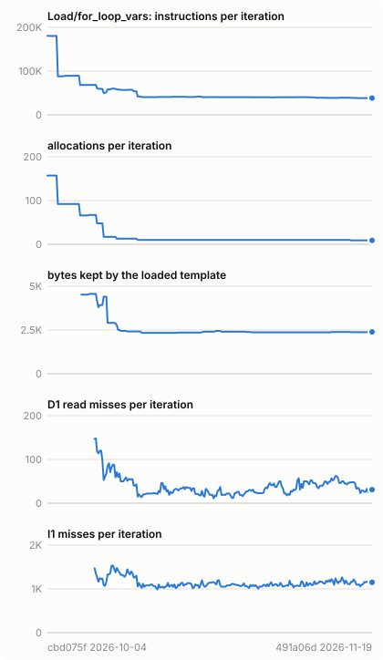
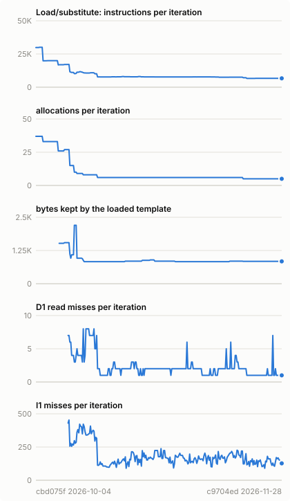

# Benchmark trend

Instruction and allocation counts per iteration on master, one record per commit (224 so far, latest [814e834](https://github.com/jinja2cpp/Jinja2Cpp/commit/814e834c64bab8f6a543b2a5006b4852ac649792) on 2026-11-15). Written by the `trend` job of `.github/workflows/benchmark.yml` with `bench/trend.py`; the data is `history.jsonl`.

Memory is the bytes a loaded template keeps for `Load/*` and the peak heap use of one render for `Render/*`; vs first compares with the first record that has it.

| Benchmark | Instructions | vs previous | vs first | Allocations | vs previous | vs first | Memory | vs previous | vs first |
|---|---:|---:|---:|---:|---:|---:|---:|---:|---:|
| [Load/chat_llama](#loadchat_llama) | 335,983 | +0.17% |  | 55 | 0% |  | 18,480 | 0% | -52.71% |
| [Render/chat_llama](#renderchat_llama) | 292,227 | -1.19% |  | 225 | 0% |  | 11,616 | 0% | -19.11% |
| [Load/chat_mistral](#loadchat_mistral) | 386,172 | +0.28% |  | 52 | 0% |  | 20,904 | 0% | -53.18% |
| [Render/chat_mistral](#renderchat_mistral) | 494,865 | -1.43% |  | 402 | 0% |  | 9,952 | -0.32% | -24.65% |
| [Load/chat_qwen](#loadchat_qwen) | 261,847 | +0.26% |  | 44 | 0% |  | 14,432 | 0% | -47.19% |
| [Render/chat_qwen](#renderchat_qwen) | 273,717 | -1.82% |  | 212 | 0% |  | 8,304 | 0% | -2.35% |
| [Load/config_file](#loadconfig_file) | 94,907 | +0.69% |  | 25 | 0% |  | 5,480 | 0% | -48.11% |
| [Render/config_file](#renderconfig_file) | 1,278,921 | +0.08% |  | 910 | +0.22% |  | 25,560 | +4.11% | +7.36% |
| [Load/dict_ops](#loaddict_ops) | 32,522 | +0.89% | -77.99% | 9 | 0% | -93.13% | 2,192 | 0% | -48.50% |
| [Render/dict_ops](#renderdict_ops) | 292,336 | -1.37% | -57.68% | 112 | 0% | -75.11% | 24,408 | 0% | -29.65% |
| [Load/expressions](#loadexpressions) | 44,481 | +0.56% | -78.42% | 16 | 0% | -89.04% | 2,744 | 0% | -55.28% |
| [Render/expressions](#renderexpressions) | 417,531 | -2.22% | -53.92% | 3 | 0% | -90.00% | 2,440 | 0% | -31.15% |
| [Load/filters](#loadfilters) | 67,534 | +0.03% | -75.39% | 27 | 0% | -88.16% | 3,864 | 0% | -66.15% |
| [Render/filters](#renderfilters) | 27,013 | -2.93% | -69.53% | 23 | 0% | -68.92% | 752 | 0% | -84.69% |
| [Load/for_filter_if](#loadfor_filter_if) | 29,339 | +0.97% | -78.33% | 7 | 0% | -94.31% | 1,920 | 0% | -44.32% |
| [Render/for_filter_if](#renderfor_filter_if) | 268,877 | -2.23% | -68.93% | 4 | 0% | -98.23% | 16,560 | 0% | +354.95% |
| [Load/for_loop_vars](#loadfor_loop_vars) | 39,144 | +0.78% | -78.33% | 10 | 0% | -93.63% | 2,384 | 0% | -47.26% |
| [Render/for_loop_vars](#renderfor_loop_vars) | 172,280 | -4.61% | -83.94% | 2 | 0% | -99.62% | 1,568 | 0% | -43.35% |
| [Load/for_range](#loadfor_range) | 13,363 | +0.78% | -76.42% | 7 | 0% | -87.50% | 1,104 | 0% | -44.80% |
| [Render/for_range](#renderfor_range) | 37,468 | -2.60% | -59.37% | 3 | 0% | -88.89% | 408 | 0% | -73.02% |
| [Load/hf_deepseek_v31](#loadhf_deepseek_v31) | 384,051 | +0.31% |  | 55 | 0% |  | 21,992 | 0% | +0.81% |
| [Render/hf_deepseek_v31](#renderhf_deepseek_v31) | 92,219 | -1.11% |  | 43 | 0% |  | 2,480 | 0% | 0% |
| [Load/hf_gpt_oss](#loadhf_gpt_oss) | 1,525,523 | +0.20% |  | 287 | 0% |  | 74,576 | -0.15% | +0.47% |
| [Render/hf_gpt_oss](#renderhf_gpt_oss) | 169,975 | -1.86% |  | 156 | +0.65% |  | 5,664 | +10.11% | +14.75% |
| [Load/hf_mistral_small](#loadhf_mistral_small) | 592,136 | +0.08% |  | 88 | 0% |  | 33,064 | 0% | +0.39% |
| [Render/hf_mistral_small](#renderhf_mistral_small) | 141,361 | -1.05% |  | 99 | 0% |  | 6,120 | 0% | -0.26% |
| [Load/hf_qwen3](#loadhf_qwen3) | 477,185 | +0.29% |  | 82 | 0% |  | 25,576 | 0% | +0.38% |
| [Render/hf_qwen3](#renderhf_qwen3) | 118,975 | -2.04% |  | 100 | 0% |  | 3,248 | 0% | 0% |
| [Load/html_autoescape](#loadhtml_autoescape) | 190,045 | +0.76% |  | 43 | 0% |  | 12,688 | 0% | -48.59% |
| [Render/html_autoescape](#renderhtml_autoescape) | 1,200,135 | -0.94% |  | 675 | +0.15% |  | 45,992 | +1.11% | +13.89% |
| [Load/inheritance](#loadinheritance) | 21,973 | +0.15% | -80.75% | 7 | 0% | -93.46% | 1,360 | 0% | -52.65% |
| [Render/inheritance](#renderinheritance) | 138,236 | -0.01% | -81.52% | 38 | +8.57% | -93.89% | 7,920 | +6.80% | +31.65% |
| [Load/int_arith](#loadint_arith) | 65,435 | +0.66% |  | 20 | 0% |  | 3,888 | 0% | +0.83% |
| [Render/int_arith](#renderint_arith) | 831,752 | +0.03% |  | 12 | 0% |  | 3,272 | 0% | -0.49% |
| [Module/keep](#modulekeep) | 7,203 | -0.05% |  | 7 | 0% |  |  |  |  |
| [Module/keep_written](#modulekeep_written) | 29,263 | +0.39% |  | 11 | 0% |  |  |  |  |
| [Load/large_static](#loadlarge_static) | 147,992 | +0.17% | -83.30% | 14 | 0% | -96.82% | 43,136 | 0% | -19.20% |
| [Render/large_static](#renderlarge_static) | 20,750 | +0.03% | -72.38% | 1 | 0% | -94.44% | 36,552 | 0% | -1.83% |
| [RenderSink/large_static](#rendersinklarge_static) | 12,740 | +0.08% |  | 0 |  |  | 0 |  |  |
| [RenderTo/large_static](#rendertolarge_static) | 20,313 | +0.03% |  | 0 |  |  | 0 |  |  |
| [Load/macros](#loadmacros) | 55,035 | +0.17% | -75.86% | 27 | 0% | -85.48% | 4,392 | -0.36% | -29.34% |
| [Render/macros](#rendermacros) | 644,256 | -2.70% | -74.86% | 308 | 0% | -88.71% | 20,576 | 0% | +39.78% |
| [Load/many_tags](#loadmany_tags) | 8,765,429 | +0.58% | -80.15% | 951 | 0% | -97.22% | 438,176 | 0% | -58.48% |
| [Render/many_tags](#rendermany_tags) | 741,006 | +1.51% | -64.43% | 2 | 0% | -90.48% | 5,648 | 0% | -10.52% |
| [Load/mitsuhiko_table](#loadmitsuhiko_table) | 45,350 | +0.56% | -80.91% | 19 | 0% | -89.67% | 3,376 | 0% | -44.33% |
| [Render/mitsuhiko_table](#rendermitsuhiko_table) | 5,154,377 | -1.18% | -58.29% | 33 | 0% | -99.19% | 381,536 | 0% | +9.95% |
| [RenderSink/mitsuhiko_table](#rendersinkmitsuhiko_table) | 5,081,461 | -1.20% |  | 32 | 0% |  | 37,064 | 0% | +28.59% |
| [RenderTo/mitsuhiko_table](#rendertomitsuhiko_table) | 5,153,641 | -1.19% |  | 32 | 0% |  | 37,064 | 0% | +28.59% |
| [Load/mitsuhiko_table_wide](#loadmitsuhiko_table_wide) | 53,055 | +0.48% |  | 35 | 0% |  | 5,704 | 0% | -30.98% |
| [Render/mitsuhiko_table_wide](#rendermitsuhiko_table_wide) | 5,499,867 | -1.12% |  | 33 | 0% |  | 1,414,928 | 0% | +2.46% |
| [RenderSink/mitsuhiko_table_wide](#rendersinkmitsuhiko_table_wide) | 5,323,081 | -1.16% |  | 32 | 0% |  | 37,064 | 0% | +28.59% |
| [RenderTo/mitsuhiko_table_wide](#rendertomitsuhiko_table_wide) | 5,499,345 | -1.12% |  | 32 | 0% |  | 37,064 | 0% | +28.59% |
| [Load/plain_text](#loadplain_text) | 3,752 | 0% | -61.22% | 4 | 0% | -77.78% | 688 | 0% | -38.57% |
| [Render/plain_text](#renderplain_text) | 1,055 | +0.38% | -84.47% | 1 | 0% | -91.67% | 40 | 0% | -94.44% |
| [RenderSink/plain_text](#rendersinkplain_text) | 757 | +0.67% |  | 0 |  |  | 0 |  |  |
| [RenderTo/plain_text](#rendertoplain_text) | 856 | +0.47% |  | 0 |  |  | 0 |  |  |
| [Load/prompt_budget](#loadprompt_budget) | 34,642 | +0.52% |  | 18 | 0% |  | 2,240 | 0% | +0.72% |
| [Render/prompt_budget](#renderprompt_budget) | 1,319,824 | -0.05% |  | 76 | 0% |  | 36,416 | 0% | 0% |
| [Load/strings](#loadstrings) | 69,400 | +0.59% | -76.22% | 30 | 0% | -86.61% | 4,360 | 0% | -51.77% |
| [Render/strings](#renderstrings) | 583,043 | -0.19% | -72.20% | 344 | 0% | -83.73% | 9,088 | 0% | -49.31% |
| [Load/substitute](#loadsubstitute) | 7,532 | +0.01% | -74.77% | 6 | 0% | -83.78% | 848 | 0% | -44.21% |
| [Render/substitute](#rendersubstitute) | 2,254 | -1.36% | -74.43% | 1 | 0% | -91.67% | 40 | 0% | -94.44% |
| [RenderSink/substitute](#rendersinksubstitute) | 1,960 | -1.46% |  | 0 |  |  | 0 |  |  |
| [RenderTo/substitute](#rendertosubstitute) | 2,059 | -1.48% |  | 0 |  |  | 0 |  |  |

## Cache misses

Misses per iteration in callgrind's cache model (`count.py --cache-sim`: 32 KB 8-way L1, 8 MB 16-way last level, no prefetcher); reported, not gated.

| Benchmark | D1 read misses | vs previous | D1 write misses | vs previous | LL data read misses | vs previous | I1 misses | vs previous |
|---|---:|---:|---:|---:|---:|---:|---:|---:|
| Load/chat_llama | 755 | 0% | 757 | -0.53% | 0 |  | 7,835 | +0.12% |
| Render/chat_llama | 1,205 | +2.38% | 540 | +3.25% | 0 |  | 4,501 | +11.72% |
| Load/chat_mistral | 1,095 | -0.73% | 1,078 | -0.09% | 0 |  | 8,718 | -2.00% |
| Render/chat_mistral | 1,928 | -0.62% | 607 | +5.20% | 0 |  | 10,593 | -0.94% |
| Load/chat_qwen | 575 | -0.52% | 629 | +0.16% | 0 |  | 4,719 | -0.88% |
| Render/chat_qwen | 1,073 | +2.68% | 414 | +4.55% | 0 |  | 3,444 | -0.03% |
| Load/config_file | 221 | -3.07% | 180 | -8.16% | 0 |  | 2,822 | +0.71% |
| Render/config_file | 6,117 | +2.43% | 1,626 | +7.97% | 0 |  | 45,737 | +1.55% |
| Load/dict_ops | 44 | -21.43% | 25 | -16.67% | 0 |  | 1,369 | +0.66% |
| Render/dict_ops | 673 | +0.15% | 426 | +2.16% | 0 |  | 860 | -2.27% |
| Load/expressions | 25 | -26.47% | 23 | -14.81% | 0 |  | 1,328 | -1.12% |
| Render/expressions | 7 | +16.67% | 3 | -40.00% | 0 |  | 316 | +2.60% |
| Load/filters | 106 | +9.28% | 50 | +11.11% | 0 |  | 1,756 | +9.00% |
| Render/filters | 10 | -28.57% | 1 | -83.33% | 0 |  | 800 | +1.27% |
| Load/for_filter_if | 25 | -10.71% | 12 | 0% | 0 |  | 1,124 | +4.95% |
| Render/for_filter_if | 1,736 | 0% | 137 | +7.03% | 0 |  | 230 | +4.07% |
| Load/for_loop_vars | 46 | -19.30% | 21 | -4.55% | 0 |  | 1,175 | +4.26% |
| Render/for_loop_vars | 9 | +50.00% | 1 | -50.00% | 0 |  | 137 | -22.60% |
| Load/for_range | 5 | +66.67% | 4 | 0% | 0 |  | 798 | +4.04% |
| Render/for_range | 1 | 0% | 0 |  | 0 |  | 153 | +15.91% |
| Load/hf_deepseek_v31 | 1,015 | +2.01% | 987 | 0% | 0 |  | 6,377 | -2.75% |
| Render/hf_deepseek_v31 | 380 | +9.20% | 90 | +9.76% | 0 |  | 1,707 | +10.99% |
| Load/hf_gpt_oss | 4,654 | +0.24% | 3,369 | -0.68% | 0 |  | 23,164 | -5.88% |
| Render/hf_gpt_oss | 1,252 | +3.30% | 399 | +1.01% | 0 |  | 4,662 | -2.35% |
| Load/hf_mistral_small | 1,871 | 0% | 1,635 | +0.18% | 0 |  | 11,199 | -1.91% |
| Render/hf_mistral_small | 986 | +3.35% | 288 | -4.95% | 0 |  | 3,870 | +2.63% |
| Load/hf_qwen3 | 1,532 | +0.20% | 1,342 | -0.07% | 0 |  | 9,168 | -2.75% |
| Render/hf_qwen3 | 694 | +0.43% | 214 | -2.28% | 0 |  | 2,722 | +0.85% |
| Load/html_autoescape | 492 | -1.60% | 536 | +0.75% | 0 |  | 4,215 | +1.84% |
| Render/html_autoescape | 4,822 | +8.82% | 1,346 | +2.12% | 0 |  | 34,776 | -1.80% |
| Load/inheritance | 5 | -28.57% | 3 | -25.00% | 0 |  | 737 | -0.67% |
| Render/inheritance | 608 | +1.67% | 111 | +13.27% | 0 |  | 996 | +3.86% |
| Load/int_arith | 71 | -16.47% | 57 | -8.06% | 0 |  | 2,040 | -3.45% |
| Render/int_arith | 9 | -47.06% | 5 | -54.55% | 0 |  | 814 | +7.81% |
| Module/keep | 1 | 0% | 3 | +50.00% | 0 |  | 458 | +6.26% |
| Module/keep_written | 1,134 | -0.18% | 561 | -0.18% | 0 |  | 773 | +3.76% |
| Load/large_static | 1,929 | +0.21% | 904 | 0% | 0 |  | 326 | +11.26% |
| Render/large_static | 707 | -0.28% | 577 | +1.41% | 0 |  | 23 | +228.57% |
| RenderSink/large_static | 1 |  | 0 |  | 0 |  | 4 | -20.00% |
| RenderTo/large_static | 686 | +0.15% | 576 | +0.52% | 0 |  | 12 | +100.00% |
| Load/macros | 90 | -8.16% | 76 | 0% | 0 |  | 1,754 | -1.13% |
| Render/macros | 793 | +5.17% | 281 | +22.17% | 0 |  | 677 | -52.22% |
| Load/many_tags | 28,768 | +3.02% | 22,619 | +0.21% | 0 |  | 246,664 | +3.77% |
| Render/many_tags | 6,129 | -1.73% | 787 | -8.17% | 0 |  | 160 | +30.08% |
| Load/mitsuhiko_table | 42 | -17.65% | 51 | -17.74% | 0 |  | 884 | +2.08% |
| Render/mitsuhiko_table | 10,052 | -0.16% | 6,260 | -0.32% | 0 |  | 382 | -0.52% |
| RenderSink/mitsuhiko_table | 9,989 | -0.13% | 1,201 | -1.40% | 0 |  | 308 | -8.61% |
| RenderTo/mitsuhiko_table | 10,053 | -0.37% | 6,262 | -0.60% | 0 |  | 342 | -4.47% |
| Load/mitsuhiko_table_wide | 95 | +4.40% | 81 | -3.57% | 0 |  | 1,018 | -7.79% |
| Render/mitsuhiko_table_wide | 10,191 | -0.36% | 22,683 | +0.07% | 0 |  | 408 | +5.43% |
| RenderSink/mitsuhiko_table_wide | 10,025 | -0.40% | 1,297 | +0.39% | 0 |  | 306 | -0.65% |
| RenderTo/mitsuhiko_table_wide | 10,224 | -0.16% | 22,684 | +0.04% | 0 |  | 371 | +2.49% |
| Load/plain_text | 0 |  | 2 | 0% | 0 |  | 22 | -4.35% |
| Render/plain_text | 1 | 0% | 0 |  | 0 |  | 7 | +16.67% |
| RenderSink/plain_text | 1 | 0% | 0 |  | 0 |  | 5 | 0% |
| RenderTo/plain_text | 1 | 0% | 0 |  | 0 |  | 6 | +20.00% |
| Load/prompt_budget | 78 | -6.02% | 42 | -10.64% | 0 |  | 1,416 | -1.67% |
| Render/prompt_budget | 4,803 | -0.31% | 559 | +2.76% | 0 |  | 1,135 | -19.27% |
| Load/strings | 139 | -2.80% | 105 | -3.67% | 0 |  | 2,805 | +0.07% |
| Render/strings | 409 | -4.88% | 463 | -4.73% | 0 |  | 1,619 | -31.34% |
| Load/substitute | 4 | +100.00% | 4 | +33.33% | 0 |  | 167 | -10.22% |
| Render/substitute | 1 |  | 0 |  | 0 |  | 26 | +420.00% |
| RenderSink/substitute | 1 |  | 0 |  | 0 |  | 4 | -20.00% |
| RenderTo/substitute | 1 |  | 0 |  | 0 |  | 14 | +133.33% |

## Charts

### Load/chat_llama

### Render/chat_llama

### Load/chat_mistral

### Render/chat_mistral

### Load/chat_qwen

### Render/chat_qwen

### Load/config_file

### Render/config_file

### Load/dict_ops

### Render/dict_ops

### Load/expressions

### Render/expressions

### Load/filters

### Render/filters

### Load/for_filter_if

### Render/for_filter_if

### Load/for_loop_vars

### Render/for_loop_vars

### Load/for_range

### Render/for_range

### Load/hf_deepseek_v31

### Render/hf_deepseek_v31

### Load/hf_gpt_oss

### Render/hf_gpt_oss

### Load/hf_mistral_small

### Render/hf_mistral_small

### Load/hf_qwen3

### Render/hf_qwen3

### Load/html_autoescape

### Render/html_autoescape

### Load/inheritance

### Render/inheritance

### Load/int_arith

### Render/int_arith

### Module/keep

### Module/keep_written

### Load/large_static

### Render/large_static

### RenderSink/large_static

### RenderTo/large_static

### Load/macros

### Render/macros

### Load/many_tags

### Render/many_tags

### Load/mitsuhiko_table

### Render/mitsuhiko_table

### RenderSink/mitsuhiko_table

### RenderTo/mitsuhiko_table

### Load/mitsuhiko_table_wide

### Render/mitsuhiko_table_wide

### RenderSink/mitsuhiko_table_wide

### RenderTo/mitsuhiko_table_wide

### Load/plain_text

### Render/plain_text

### RenderSink/plain_text

### RenderTo/plain_text

### Load/prompt_budget

### Render/prompt_budget

### Load/strings

### Render/strings

### Load/substitute

### Render/substitute

### RenderSink/substitute

### RenderTo/substitute

