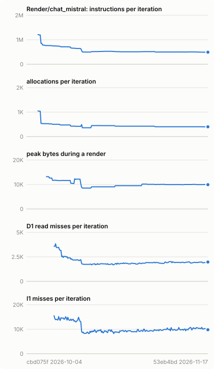

# Benchmark trend

Instruction and allocation counts per iteration on master, one record per commit (268 so far, latest [1c901ca](https://github.com/jinja2cpp/Jinja2Cpp/commit/1c901ca66a9372e68aaaa6807a57644d08edf950) on 2026-11-24). Written by the `trend` job of `.github/workflows/benchmark.yml` with `bench/trend.py`; the data is `history.jsonl`.

Memory is the bytes a loaded template keeps for `Load/*` and the peak heap use of one render for `Render/*`; vs first compares with the first record that has it.

| Benchmark | Instructions | vs previous | vs first | Allocations | vs previous | vs first | Memory | vs previous | vs first |
|---|---:|---:|---:|---:|---:|---:|---:|---:|---:|
| [Load/big_int_radix](#loadbig_int_radix) | 43,266 | 0% |  | 14 | 0% |  | 2,688 | 0% | 0% |
| [Render/big_int_radix](#renderbig_int_radix) | 308,312,440 | 0% |  | 163 | 0% |  | 1,540,760 | 0% | -39.13% |
| [Load/chat_llama](#loadchat_llama) | 337,434 | 0% |  | 54 | 0% |  | 18,536 | 0% | -52.57% |
| [Render/chat_llama](#renderchat_llama) | 291,416 | +0.06% |  | 224 | 0% |  | 11,608 | 0% | -19.16% |
| [Load/chat_mistral](#loadchat_mistral) | 385,885 | 0% |  | 51 | 0% |  | 20,976 | 0% | -53.02% |
| [Render/chat_mistral](#renderchat_mistral) | 492,106 | +0.14% |  | 392 | 0% |  | 9,752 | 0% | -26.17% |
| [Load/chat_qwen](#loadchat_qwen) | 262,663 | 0% |  | 43 | 0% |  | 14,472 | 0% | -47.04% |
| [Render/chat_qwen](#renderchat_qwen) | 273,113 | +0.06% |  | 211 | 0% |  | 8,280 | 0% | -2.63% |
| [Load/config_file](#loadconfig_file) | 94,403 | 0% |  | 24 | 0% |  | 5,520 | 0% | -47.73% |
| [Render/config_file](#renderconfig_file) | 1,248,205 | +0.24% |  | 882 | 0% |  | 25,960 | 0% | +9.04% |
| [Load/dict_ops](#loaddict_ops) | 31,968 | 0% | -78.37% | 8 | 0% | -93.89% | 2,216 | 0% | -47.93% |
| [Render/dict_ops](#renderdict_ops) | 289,045 | +0.02% | -58.16% | 112 | 0% | -75.11% | 24,408 | 0% | -29.65% |
| [Load/expressions](#loadexpressions) | 44,175 | 0% | -78.57% | 15 | 0% | -89.73% | 2,752 | 0% | -55.15% |
| [Render/expressions](#renderexpressions) | 414,625 | +0.05% | -54.24% | 3 | 0% | -90.00% | 2,440 | 0% | -31.15% |
| [Load/filters](#loadfilters) | 67,517 | 0% | -75.40% | 26 | 0% | -88.60% | 3,856 | 0% | -66.22% |
| [Render/filters](#renderfilters) | 24,925 | +0.58% | -71.89% | 22 | 0% | -70.27% | 752 | 0% | -84.69% |
| [Load/for_filter_if](#loadfor_filter_if) | 28,571 | 0% | -78.90% | 6 | 0% | -95.12% | 1,928 | 0% | -44.08% |
| [Render/for_filter_if](#renderfor_filter_if) | 266,180 | +0.01% | -69.25% | 4 | 0% | -98.23% | 16,560 | 0% | +354.95% |
| [Load/for_loop_vars](#loadfor_loop_vars) | 38,233 | 0% | -78.84% | 9 | 0% | -94.27% | 2,392 | 0% | -47.08% |
| [Render/for_loop_vars](#renderfor_loop_vars) | 170,827 | +0.02% | -84.08% | 2 | 0% | -99.62% | 1,568 | 0% | -43.35% |
| [Load/for_range](#loadfor_range) | 12,526 | 0% | -77.90% | 6 | 0% | -89.29% | 1,128 | 0% | -43.60% |
| [Render/for_range](#renderfor_range) | 37,207 | +0.06% | -59.65% | 3 | 0% | -88.89% | 408 | 0% | -73.02% |
| [Load/hf_deepseek_v31](#loadhf_deepseek_v31) | 384,912 | 0% |  | 54 | 0% |  | 22,032 | 0% | +0.99% |
| [Render/hf_deepseek_v31](#renderhf_deepseek_v31) | 90,703 | +0.09% |  | 42 | 0% |  | 2,456 | 0% | -0.97% |
| [Load/hf_gpt_oss](#loadhf_gpt_oss) | 1,528,372 | +0.02% |  | 282 | 0% |  | 75,016 | +0.02% | +1.07% |
| [Render/hf_gpt_oss](#renderhf_gpt_oss) | 169,434 | +0.10% |  | 153 | 0% |  | 5,984 | 0% | +21.23% |
| [Load/hf_mistral_small](#loadhf_mistral_small) | 592,679 | 0% |  | 87 | 0% |  | 33,136 | 0% | +0.61% |
| [Render/hf_mistral_small](#renderhf_mistral_small) | 140,344 | +0.09% |  | 97 | 0% |  | 6,096 | 0% | -0.65% |
| [Load/hf_qwen3](#loadhf_qwen3) | 478,885 | 0% |  | 81 | 0% |  | 25,648 | 0% | +0.66% |
| [Render/hf_qwen3](#renderhf_qwen3) | 117,453 | +0.23% |  | 99 | 0% |  | 3,224 | 0% | -0.74% |
| [Load/html_autoescape](#loadhtml_autoescape) | 189,392 | 0% |  | 42 | 0% |  | 12,728 | 0% | -48.43% |
| [Render/html_autoescape](#renderhtml_autoescape) | 1,197,268 | -0.01% |  | 674 | 0% |  | 46,256 | 0% | +14.54% |
| [Load/inheritance](#loadinheritance) | 21,312 | 0% | -81.32% | 6 | 0% | -94.39% | 1,368 | 0% | -52.37% |
| [Render/inheritance](#renderinheritance) | 136,833 | +0.02% | -81.70% | 35 | 0% | -94.37% | 8,168 | 0% | +35.77% |
| [Load/int_arith](#loadint_arith) | 65,188 | 0% |  | 19 | 0% |  | 3,896 | 0% | +1.04% |
| [Render/int_arith](#renderint_arith) | 824,262 | +0.01% |  | 12 | 0% |  | 3,272 | 0% | -0.49% |
| [Module/keep](#modulekeep) | 7,163 | 0% |  | 6 | 0% |  |  |  |  |
| [Module/keep_written](#modulekeep_written) | 29,158 | 0% |  | 10 | 0% |  |  |  |  |
| [Load/large_static](#loadlarge_static) | 147,158 | 0% | -83.39% | 13 | 0% | -97.05% | 43,128 | 0% | -19.21% |
| [Render/large_static](#renderlarge_static) | 20,342 | 0% | -72.93% | 1 | 0% | -94.44% | 36,552 | 0% | -1.83% |
| [RenderSink/large_static](#rendersinklarge_static) | 12,631 | 0% |  | 0 |  |  | 0 |  |  |
| [RenderTo/large_static](#rendertolarge_static) | 19,845 | 0% |  | 0 |  |  | 0 |  |  |
| [Load/macros](#loadmacros) | 54,385 | 0% | -76.14% | 25 | 0% | -86.56% | 4,472 | 0% | -28.06% |
| [Render/macros](#rendermacros) | 647,419 | 0% | -74.74% | 308 | 0% | -88.71% | 20,608 | 0% | +40.00% |
| [Load/many_tags](#loadmany_tags) | 8,785,186 | 0% | -80.11% | 950 | 0% | -97.23% | 438,136 | 0% | -58.48% |
| [Render/many_tags](#rendermany_tags) | 730,657 | 0% | -64.92% | 2 | 0% | -90.48% | 5,648 | 0% | -10.52% |
| [Load/mitsuhiko_table](#loadmitsuhiko_table) | 44,693 | 0% | -81.19% | 18 | 0% | -90.22% | 3,416 | 0% | -43.67% |
| [Render/mitsuhiko_table](#rendermitsuhiko_table) | 5,129,298 | +0.47% | -58.49% | 33 | 0% | -99.19% | 381,536 | 0% | +9.95% |
| [RenderSink/mitsuhiko_table](#rendersinkmitsuhiko_table) | 5,059,393 | +0.48% |  | 32 | 0% |  | 37,064 | 0% | +28.59% |
| [RenderTo/mitsuhiko_table](#rendertomitsuhiko_table) | 5,128,754 | +0.47% |  | 32 | 0% |  | 37,064 | 0% | +28.59% |
| [Load/mitsuhiko_table_wide](#loadmitsuhiko_table_wide) | 52,178 | 0% |  | 34 | 0% |  | 5,744 | 0% | -30.49% |
| [Render/mitsuhiko_table_wide](#rendermitsuhiko_table_wide) | 5,475,532 | +0.44% |  | 33 | 0% |  | 1,414,928 | 0% | +2.46% |
| [RenderSink/mitsuhiko_table_wide](#rendersinkmitsuhiko_table_wide) | 5,301,437 | +0.46% |  | 32 | 0% |  | 37,064 | 0% | +28.59% |
| [RenderTo/mitsuhiko_table_wide](#rendertomitsuhiko_table_wide) | 5,474,926 | +0.44% |  | 32 | 0% |  | 37,064 | 0% | +28.59% |
| [Nested/new_template](#nestednew_template) | 452,706 | +0.11% |  | 323 | 0% |  |  |  |  |
| [Load/plain_text](#loadplain_text) | 2,932 | 0% | -69.70% | 3 | 0% | -83.33% | 680 | 0% | -39.29% |
| [Render/plain_text](#renderplain_text) | 972 | 0% | -85.69% | 1 | 0% | -91.67% | 40 | 0% | -94.44% |
| [RenderSink/plain_text](#rendersinkplain_text) | 677 | 0% |  | 0 |  |  | 0 |  |  |
| [RenderTo/plain_text](#rendertoplain_text) | 773 | 0% |  | 0 |  |  | 0 |  |  |
| [Load/prompt_budget](#loadprompt_budget) | 34,335 | 0% |  | 17 | 0% |  | 2,248 | 0% | +1.08% |
| [Render/prompt_budget](#renderprompt_budget) | 1,324,994 | 0% |  | 76 | 0% |  | 36,640 | 0% | +0.62% |
| [Nested/shared_globals](#nestedshared_globals) | 160,550 | +0.32% |  | 160 | 0% |  |  |  |  |
| [Load/strings](#loadstrings) | 69,091 | 0% | -76.33% | 29 | 0% | -87.05% | 4,384 | 0% | -51.50% |
| [Render/strings](#renderstrings) | 580,903 | +0.03% | -72.31% | 344 | 0% | -83.73% | 9,088 | 0% | -49.31% |
| [Load/substitute](#loadsubstitute) | 6,662 | 0% | -77.69% | 5 | 0% | -86.49% | 840 | 0% | -44.74% |
| [Render/substitute](#rendersubstitute) | 1,653 | 0% | -81.24% | 1 | 0% | -91.67% | 40 | 0% | -94.44% |
| [RenderSink/substitute](#rendersinksubstitute) | 1,362 | 0% |  | 0 |  |  | 0 |  |  |
| [RenderTo/substitute](#rendertosubstitute) | 1,458 | 0% |  | 0 |  |  | 0 |  |  |

## Cache misses

Misses per iteration in callgrind's cache model (`count.py --cache-sim`: 32 KB 8-way L1, 8 MB 16-way last level, no prefetcher); reported, not gated.

| Benchmark | D1 read misses | vs previous | D1 write misses | vs previous | LL data read misses | vs previous | I1 misses | vs previous |
|---|---:|---:|---:|---:|---:|---:|---:|---:|
| Load/big_int_radix | 108 | -2.70% | 59 | +1.72% | 0 |  | 1,997 | +2.83% |
| Render/big_int_radix | 774,964 | +0.01% | 515,296 | 0% | 0 |  | 4,342 | +1.61% |
| Load/chat_llama | 819 | +3.28% | 784 | +1.03% | 0 |  | 7,957 | +3.32% |
| Render/chat_llama | 1,182 | -4.29% | 548 | -3.69% | 0 |  | 4,411 | +0.66% |
| Load/chat_mistral | 1,097 | +1.11% | 1,099 | +0.55% | 0 |  | 9,038 | +4.46% |
| Render/chat_mistral | 1,990 | +0.40% | 647 | -2.85% | 0 |  | 10,512 | +2.47% |
| Load/chat_qwen | 550 | +2.42% | 650 | +0.46% | 0 |  | 4,841 | +2.91% |
| Render/chat_qwen | 1,050 | -3.58% | 414 | -3.50% | 0 |  | 3,783 | +4.30% |
| Load/config_file | 210 | +1.45% | 194 | +4.86% | 0 |  | 2,768 | -0.14% |
| Render/config_file | 7,379 | +1.49% | 1,905 | +0.53% | 0 |  | 43,942 | -2.98% |
| Load/dict_ops | 42 | +13.51% | 25 | +19.05% | 0 |  | 1,392 | +1.38% |
| Render/dict_ops | 695 | +0.29% | 422 | +0.24% | 0 |  | 759 | -0.78% |
| Load/expressions | 38 | +15.15% | 31 | +14.81% | 0 |  | 1,333 | +0.15% |
| Render/expressions | 3 | 0% | 0 | -100.00% | 0 |  | 319 | +5.63% |
| Load/filters | 99 | +2.06% | 55 | +5.77% | 0 |  | 1,774 | +5.91% |
| Render/filters | 24 | +4.35% | 6 | -14.29% | 0 |  | 693 | -2.12% |
| Load/for_filter_if | 27 | +42.11% | 10 | +100.00% | 0 |  | 1,070 | +1.90% |
| Render/for_filter_if | 1,719 | -0.12% | 87 | -3.33% | 0 |  | 167 | +17.61% |
| Load/for_loop_vars | 51 | -1.92% | 19 | +11.76% | 0 |  | 1,105 | +1.19% |
| Render/for_loop_vars | 9 | +125.00% | 0 |  | 0 |  | 85 | -17.48% |
| Load/for_range | 9 | +80.00% | 5 | +25.00% | 0 |  | 738 | -3.15% |
| Render/for_range | 2 | 0% | 1 | 0% | 0 |  | 172 | +25.55% |
| Load/hf_deepseek_v31 | 976 | +1.99% | 973 | +0.10% | 0 |  | 6,475 | +1.28% |
| Render/hf_deepseek_v31 | 383 | -1.54% | 86 | -5.49% | 0 |  | 1,514 | +2.92% |
| Load/hf_gpt_oss | 4,710 | +0.13% | 3,403 | +0.03% | 0 |  | 23,068 | +3.84% |
| Render/hf_gpt_oss | 1,311 | +0.08% | 420 | +0.96% | 0 |  | 4,908 | -0.51% |
| Load/hf_mistral_small | 1,886 | +0.64% | 1,656 | +0.55% | 0 |  | 11,848 | +4.75% |
| Render/hf_mistral_small | 1,003 | -1.67% | 315 | -3.08% | 0 |  | 3,746 | +0.89% |
| Load/hf_qwen3 | 1,508 | +0.40% | 1,305 | +0.38% | 0 |  | 9,383 | +5.06% |
| Render/hf_qwen3 | 696 | -1.83% | 227 | -3.81% | 0 |  | 2,701 | -0.30% |
| Load/html_autoescape | 501 | +2.87% | 544 | +1.49% | 0 |  | 4,093 | +6.01% |
| Render/html_autoescape | 4,701 | -3.23% | 1,573 | -3.73% | 0 |  | 37,584 | +1.58% |
| Load/inheritance | 8 | +60.00% | 5 | +66.67% | 0 |  | 716 | +0.85% |
| Render/inheritance | 599 | +0.34% | 117 | -1.68% | 0 |  | 1,050 | -0.85% |
| Load/int_arith | 98 | +22.50% | 79 | +2.60% | 0 |  | 2,113 | +2.18% |
| Render/int_arith | 29 | -19.44% | 14 | -30.00% | 0 |  | 764 | -2.18% |
| Module/keep | 2 | 0% | 2 | 0% | 0 |  | 464 | -3.73% |
| Module/keep_written | 1,147 | +0.17% | 579 | 0% | 0 |  | 751 | -3.96% |
| Load/large_static | 1,918 | +0.10% | 910 | -0.11% | 0 |  | 263 | -10.85% |
| Render/large_static | 699 | -0.14% | 571 | +0.18% | 0 |  | 5 | +66.67% |
| RenderSink/large_static | 2 | 0% | 0 |  | 0 |  | 2 | -33.33% |
| RenderTo/large_static | 678 | -0.15% | 582 | +0.17% | 0 |  | 5 | +66.67% |
| Load/macros | 81 | -4.71% | 64 | -8.57% | 0 |  | 1,729 | 0% |
| Render/macros | 758 | -0.13% | 268 | -0.37% | 0 |  | 1,302 | -15.29% |
| Load/many_tags | 28,101 | +0.71% | 22,584 | -0.06% | 0 |  | 242,933 | +0.42% |
| Render/many_tags | 6,102 | +0.13% | 792 | +1.80% | 0 |  | 117 | +10.38% |
| Load/mitsuhiko_table | 41 | -8.89% | 48 | -7.69% | 0 |  | 882 | +2.92% |
| Render/mitsuhiko_table | 10,049 | +0.11% | 6,335 | 0% | 0 |  | 296 | +10.04% |
| RenderSink/mitsuhiko_table | 9,965 | +0.08% | 1,203 | -0.08% | 0 |  | 217 | -10.33% |
| RenderTo/mitsuhiko_table | 10,051 | +0.08% | 6,288 | +0.02% | 0 |  | 270 | +12.03% |
| Load/mitsuhiko_table_wide | 87 | -4.40% | 84 | -9.68% | 0 |  | 1,150 | +14.43% |
| Render/mitsuhiko_table_wide | 10,325 | -0.03% | 22,594 | -0.02% | 0 |  | 285 | -1.38% |
| RenderSink/mitsuhiko_table_wide | 10,030 | -0.03% | 1,264 | -0.39% | 0 |  | 239 | -1.65% |
| RenderTo/mitsuhiko_table_wide | 10,181 | -0.09% | 22,674 | 0% | 0 |  | 274 | +4.98% |
| Nested/new_template | 2,244 | +2.65% | 1,640 | +0.24% | 0 |  | 24,627 | +1.48% |
| Load/plain_text | 0 |  | 1 | 0% | 0 |  | 3 | 0% |
| Render/plain_text | 1 | 0% | 0 |  | 0 |  | 6 | +20.00% |
| RenderSink/plain_text | 1 | 0% | 0 |  | 0 |  | 5 | +25.00% |
| RenderTo/plain_text | 2 | 0% | 0 |  | 0 |  | 6 | +20.00% |
| Load/prompt_budget | 72 | -2.70% | 45 | -11.76% | 0 |  | 1,439 | +1.70% |
| Render/prompt_budget | 4,785 | -0.04% | 548 | +0.37% | 0 |  | 794 | -3.29% |
| Nested/shared_globals | 189 | -16.37% | 118 | +9.26% | 0 |  | 9,189 | +0.10% |
| Load/strings | 154 | +4.76% | 86 | +10.26% | 0 |  | 2,854 | +0.60% |
| Render/strings | 428 | -0.70% | 481 | +0.63% | 0 |  | 1,586 | -29.01% |
| Load/substitute | 1 | 0% | 2 | 0% | 0 |  | 105 | -6.25% |
| Render/substitute | 1 | 0% | 0 |  | 0 |  | 5 | +66.67% |
| RenderSink/substitute | 1 | 0% | 0 |  | 0 |  | 3 | 0% |
| RenderTo/substitute | 1 | 0% | 0 |  | 0 |  | 5 | +66.67% |

## Charts

### Load/big_int_radix

### Render/big_int_radix

### Load/chat_llama

### Render/chat_llama

### Load/chat_mistral

### Render/chat_mistral

### Load/chat_qwen

### Render/chat_qwen

### Load/config_file

### Render/config_file

### Load/dict_ops

### Render/dict_ops

### Load/expressions

### Render/expressions

### Load/filters

### Render/filters

### Load/for_filter_if

### Render/for_filter_if

### Load/for_loop_vars

### Render/for_loop_vars

### Load/for_range

### Render/for_range

### Load/hf_deepseek_v31

### Render/hf_deepseek_v31

### Load/hf_gpt_oss

### Render/hf_gpt_oss

### Load/hf_mistral_small

### Render/hf_mistral_small

### Load/hf_qwen3

### Render/hf_qwen3

### Load/html_autoescape

### Render/html_autoescape

### Load/inheritance

### Render/inheritance

### Load/int_arith

### Render/int_arith

### Module/keep

### Module/keep_written

### Load/large_static

### Render/large_static

### RenderSink/large_static

### RenderTo/large_static

### Load/macros

### Render/macros

### Load/many_tags

### Render/many_tags

### Load/mitsuhiko_table

### Render/mitsuhiko_table

### RenderSink/mitsuhiko_table

### RenderTo/mitsuhiko_table

### Load/mitsuhiko_table_wide

### Render/mitsuhiko_table_wide

### RenderSink/mitsuhiko_table_wide

### RenderTo/mitsuhiko_table_wide

### Nested/new_template

### Load/plain_text

### Render/plain_text

### RenderSink/plain_text

### RenderTo/plain_text

### Load/prompt_budget

### Render/prompt_budget

### Nested/shared_globals

### Load/strings

### Render/strings

### Load/substitute

### Render/substitute

### RenderSink/substitute

### RenderTo/substitute

