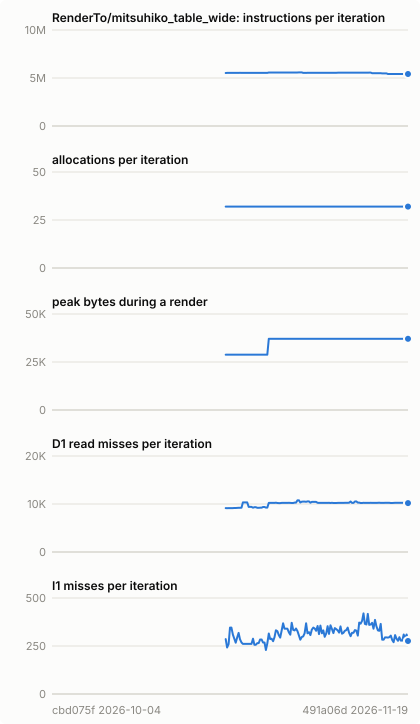

# Benchmark trend

Instruction and allocation counts per iteration on master, one record per commit (272 so far, latest [204ea02](https://github.com/jinja2cpp/Jinja2Cpp/commit/204ea02c6e8d580a2756e8437d2b2716c7206395) on 2026-11-27). Written by the `trend` job of `.github/workflows/benchmark.yml` with `bench/trend.py`; the data is `history.jsonl`.

Memory is the bytes a loaded template keeps for `Load/*` and the peak heap use of one render for `Render/*`; vs first compares with the first record that has it.

| Benchmark | Instructions | vs previous | vs first | Allocations | vs previous | vs first | Memory | vs previous | vs first |
|---|---:|---:|---:|---:|---:|---:|---:|---:|---:|
| [Load/big_int_radix](#loadbig_int_radix) | 43,548 | +0.23% |  | 14 | 0% |  | 2,688 | 0% | 0% |
| [Render/big_int_radix](#renderbig_int_radix) | 146,578,690 | 0% |  | 123 | 0% |  | 1,540,760 | 0% | -39.13% |
| [Load/chat_llama](#loadchat_llama) | 338,747 | +0.13% |  | 54 | 0% |  | 18,536 | 0% | -52.57% |
| [Render/chat_llama](#renderchat_llama) | 292,012 | 0% |  | 224 | 0% |  | 11,624 | 0% | -19.05% |
| [Load/chat_mistral](#loadchat_mistral) | 389,873 | +0.29% |  | 52 | 0% |  | 21,024 | 0% | -52.91% |
| [Render/chat_mistral](#renderchat_mistral) | 493,926 | +0.01% |  | 392 | 0% |  | 9,832 | 0% | -25.56% |
| [Load/chat_qwen](#loadchat_qwen) | 263,811 | +0.19% |  | 43 | 0% |  | 14,472 | 0% | -47.04% |
| [Render/chat_qwen](#renderchat_qwen) | 273,411 | 0% |  | 211 | 0% |  | 8,280 | 0% | -2.63% |
| [Load/config_file](#loadconfig_file) | 94,993 | +0.26% |  | 24 | 0% |  | 5,520 | 0% | -47.73% |
| [Render/config_file](#renderconfig_file) | 1,251,234 | +0.03% |  | 882 | 0% |  | 25,976 | 0% | +9.11% |
| [Load/dict_ops](#loaddict_ops) | 32,194 | +0.38% | -78.21% | 8 | 0% | -93.89% | 2,216 | 0% | -47.93% |
| [Render/dict_ops](#renderdict_ops) | 291,521 | 0% | -57.80% | 112 | 0% | -75.11% | 24,424 | 0% | -29.61% |
| [Load/expressions](#loadexpressions) | 44,436 | +0.39% | -78.44% | 15 | 0% | -89.73% | 2,752 | 0% | -55.15% |
| [Render/expressions](#renderexpressions) | 414,655 | 0% | -54.24% | 3 | 0% | -90.00% | 2,440 | 0% | -31.15% |
| [Load/filters](#loadfilters) | 67,175 | 0% | -75.52% | 26 | 0% | -88.60% | 3,856 | 0% | -66.22% |
| [Render/filters](#renderfilters) | 24,963 | 0% | -71.85% | 22 | 0% | -70.27% | 784 | 0% | -84.04% |
| [Load/for_filter_if](#loadfor_filter_if) | 28,817 | +0.53% | -78.72% | 6 | 0% | -95.12% | 1,928 | 0% | -44.08% |
| [Render/for_filter_if](#renderfor_filter_if) | 267,136 | 0% | -69.13% | 4 | 0% | -98.23% | 16,560 | 0% | +354.95% |
| [Load/for_loop_vars](#loadfor_loop_vars) | 38,593 | +0.46% | -78.64% | 9 | 0% | -94.27% | 2,392 | 0% | -47.08% |
| [Render/for_loop_vars](#renderfor_loop_vars) | 170,827 | 0% | -84.08% | 2 | 0% | -99.62% | 1,568 | 0% | -43.35% |
| [Load/for_range](#loadfor_range) | 12,693 | +0.69% | -77.61% | 6 | 0% | -89.29% | 1,128 | 0% | -43.60% |
| [Render/for_range](#renderfor_range) | 37,237 | 0% | -59.62% | 3 | 0% | -88.89% | 408 | 0% | -73.02% |
| [Load/hf_deepseek_v31](#loadhf_deepseek_v31) | 387,770 | +0.22% |  | 54 | 0% |  | 22,064 | 0% | +1.14% |
| [Render/hf_deepseek_v31](#renderhf_deepseek_v31) | 90,749 | 0% |  | 42 | 0% |  | 2,456 | 0% | -0.97% |
| [Load/hf_gpt_oss](#loadhf_gpt_oss) | 1,537,986 | +0.17% |  | 282 | 0% |  | 75,192 | 0% | +1.30% |
| [Render/hf_gpt_oss](#renderhf_gpt_oss) | 170,971 | +0.01% |  | 153 | 0% |  | 6,064 | 0% | +22.85% |
| [Load/hf_mistral_small](#loadhf_mistral_small) | 596,435 | +0.22% |  | 87 | 0% |  | 33,168 | 0% | +0.70% |
| [Render/hf_mistral_small](#renderhf_mistral_small) | 140,912 | 0% |  | 97 | 0% |  | 6,128 | 0% | -0.13% |
| [Load/hf_qwen3](#loadhf_qwen3) | 484,943 | +0.26% |  | 81 | 0% |  | 25,744 | 0% | +1.04% |
| [Render/hf_qwen3](#renderhf_qwen3) | 117,844 | 0% |  | 99 | 0% |  | 3,224 | 0% | -0.74% |
| [Load/html_autoescape](#loadhtml_autoescape) | 190,042 | +0.23% |  | 42 | 0% |  | 12,728 | 0% | -48.43% |
| [Render/html_autoescape](#renderhtml_autoescape) | 1,198,953 | 0% |  | 674 | 0% |  | 46,256 | 0% | +14.54% |
| [Load/inheritance](#loadinheritance) | 21,536 | +0.35% | -81.13% | 6 | 0% | -94.39% | 1,368 | 0% | -52.37% |
| [Render/inheritance](#renderinheritance) | 137,439 | +0.23% | -81.62% | 35 | 0% | -94.37% | 8,168 | 0% | +35.77% |
| [Load/int_arith](#loadint_arith) | 65,584 | +0.27% |  | 19 | 0% |  | 3,896 | 0% | +1.04% |
| [Render/int_arith](#renderint_arith) | 825,556 | 0% |  | 12 | 0% |  | 3,288 | 0% | 0% |
| [Module/keep](#modulekeep) | 7,204 | 0% |  | 6 | 0% |  |  |  |  |
| [Module/keep_written](#modulekeep_written) | 29,209 | 0% |  | 10 | 0% |  |  |  |  |
| [Load/large_static](#loadlarge_static) | 147,307 | 0% | -83.37% | 13 | 0% | -97.05% | 43,128 | 0% | -19.21% |
| [Render/large_static](#renderlarge_static) | 20,344 | 0% | -72.92% | 1 | 0% | -94.44% | 36,552 | 0% | -1.83% |
| [RenderSink/large_static](#rendersinklarge_static) | 12,633 | +0.01% |  | 0 |  |  | 0 |  |  |
| [RenderTo/large_static](#rendertolarge_static) | 19,907 | +0.01% |  | 0 |  |  | 0 |  |  |
| [Load/macros](#loadmacros) | 54,765 | +0.35% | -75.98% | 25 | 0% | -86.56% | 4,488 | 0% | -27.80% |
| [Render/macros](#rendermacros) | 648,607 | 0% | -74.69% | 308 | 0% | -88.71% | 20,608 | 0% | +40.00% |
| [Load/many_tags](#loadmany_tags) | 8,798,621 | 0% | -80.08% | 950 | 0% | -97.23% | 438,136 | 0% | -58.48% |
| [Render/many_tags](#rendermany_tags) | 732,459 | 0% | -64.84% | 2 | 0% | -90.48% | 5,648 | 0% | -10.52% |
| [Load/mitsuhiko_table](#loadmitsuhiko_table) | 44,985 | +0.32% | -81.06% | 18 | 0% | -90.22% | 3,416 | 0% | -43.67% |
| [Render/mitsuhiko_table](#rendermitsuhiko_table) | 5,129,121 | 0% | -58.49% | 33 | 0% | -99.19% | 381,536 | 0% | +9.95% |
| [RenderSink/mitsuhiko_table](#rendersinkmitsuhiko_table) | 5,058,850 | 0% |  | 32 | 0% |  | 37,064 | 0% | +28.59% |
| [RenderTo/mitsuhiko_table](#rendertomitsuhiko_table) | 5,128,676 | 0% |  | 32 | 0% |  | 37,064 | 0% | +28.59% |
| [Load/mitsuhiko_table_wide](#loadmitsuhiko_table_wide) | 52,450 | +0.27% |  | 34 | 0% |  | 5,744 | 0% | -30.49% |
| [Render/mitsuhiko_table_wide](#rendermitsuhiko_table_wide) | 5,474,955 | 0% |  | 33 | 0% |  | 1,414,928 | 0% | +2.46% |
| [RenderSink/mitsuhiko_table_wide](#rendersinkmitsuhiko_table_wide) | 5,300,882 | 0% |  | 32 | 0% |  | 37,064 | 0% | +28.59% |
| [RenderTo/mitsuhiko_table_wide](#rendertomitsuhiko_table_wide) | 5,474,371 | 0% |  | 32 | 0% |  | 37,064 | 0% | +28.59% |
| [Nested/new_template](#nestednew_template) | 455,494 | +0.25% |  | 323 | 0% |  |  |  |  |
| [Load/plain_text](#loadplain_text) | 2,943 | +0.03% | -69.58% | 3 | 0% | -83.33% | 680 | 0% | -39.29% |
| [Render/plain_text](#renderplain_text) | 974 | +0.10% | -85.66% | 1 | 0% | -91.67% | 40 | 0% | -94.44% |
| [RenderSink/plain_text](#rendersinkplain_text) | 679 | +0.15% |  | 0 |  |  | 0 |  |  |
| [RenderTo/plain_text](#rendertoplain_text) | 775 | +0.13% |  | 0 |  |  | 0 |  |  |
| [Load/prompt_budget](#loadprompt_budget) | 34,378 | +0.32% |  | 17 | 0% |  | 2,248 | 0% | +1.08% |
| [Render/prompt_budget](#renderprompt_budget) | 1,325,198 | 0% |  | 76 | 0% |  | 36,640 | 0% | +0.62% |
| [Nested/shared_globals](#nestedshared_globals) | 160,987 | +0.03% |  | 160 | 0% |  |  |  |  |
| [Load/strings](#loadstrings) | 69,258 | +0.19% | -76.27% | 29 | 0% | -87.05% | 4,384 | 0% | -51.50% |
| [Render/strings](#renderstrings) | 581,601 | 0% | -72.27% | 344 | 0% | -83.73% | 9,120 | 0% | -49.13% |
| [Load/substitute](#loadsubstitute) | 6,675 | +0.01% | -77.64% | 5 | 0% | -86.49% | 840 | 0% | -44.74% |
| [Render/substitute](#rendersubstitute) | 1,655 | +0.06% | -81.22% | 1 | 0% | -91.67% | 40 | 0% | -94.44% |
| [RenderSink/substitute](#rendersinksubstitute) | 1,364 | +0.07% |  | 0 |  |  | 0 |  |  |
| [RenderTo/substitute](#rendertosubstitute) | 1,460 | +0.07% |  | 0 |  |  | 0 |  |  |

## Cache misses

Misses per iteration in callgrind's cache model (`count.py --cache-sim`: 32 KB 8-way L1, 8 MB 16-way last level, no prefetcher); reported, not gated.

| Benchmark | D1 read misses | vs previous | D1 write misses | vs previous | LL data read misses | vs previous | I1 misses | vs previous |
|---|---:|---:|---:|---:|---:|---:|---:|---:|
| Load/big_int_radix | 96 | -1.03% | 63 | +1.61% | 0 |  | 1,986 | -3.36% |
| Render/big_int_radix | 364,267 | 0% | 350,999 | 0% | 0 |  | 4,115 | -1.37% |
| Load/chat_llama | 770 | -0.13% | 773 | +0.13% | 0 |  | 8,026 | -4.50% |
| Render/chat_llama | 1,164 | 0% | 552 | 0% | 0 |  | 4,340 | -0.41% |
| Load/chat_mistral | 1,099 | -0.18% | 1,103 | +0.09% | 0 |  | 9,150 | -4.89% |
| Render/chat_mistral | 1,931 | 0% | 630 | 0% | 0 |  | 10,565 | +1.32% |
| Load/chat_qwen | 533 | -0.19% | 648 | +0.15% | 0 |  | 4,950 | -4.73% |
| Render/chat_qwen | 1,036 | 0% | 417 | 0% | 0 |  | 3,683 | -0.91% |
| Load/config_file | 206 | +0.49% | 192 | 0% | 0 |  | 2,847 | -2.87% |
| Render/config_file | 6,810 | +0.10% | 1,943 | +0.05% | 0 |  | 42,969 | -2.14% |
| Load/dict_ops | 45 | 0% | 30 | 0% | 0 |  | 1,424 | -2.20% |
| Render/dict_ops | 711 | 0% | 397 | 0% | 0 |  | 746 | -1.58% |
| Load/expressions | 40 | 0% | 38 | +2.70% | 0 |  | 1,347 | -5.61% |
| Render/expressions | 3 | 0% | 1 | 0% | 0 |  | 334 | +12.46% |
| Load/filters | 86 | 0% | 47 | 0% | 0 |  | 1,734 | -5.25% |
| Render/filters | 19 | 0% | 6 | 0% | 0 |  | 689 | -0.14% |
| Load/for_filter_if | 14 | 0% | 7 | 0% | 0 |  | 1,091 | -2.15% |
| Render/for_filter_if | 1,709 | 0% | 88 | 0% | 0 |  | 223 | +129.90% |
| Load/for_loop_vars | 52 | 0% | 23 | 0% | 0 |  | 1,131 | -0.70% |
| Render/for_loop_vars | 6 | 0% | 0 |  | 0 |  | 165 | +73.68% |
| Load/for_range | 6 | 0% | 7 | 0% | 0 |  | 774 | +2.93% |
| Render/for_range | 2 | 0% | 1 | 0% | 0 |  | 184 | +119.05% |
| Load/hf_deepseek_v31 | 974 | -0.20% | 977 | +0.10% | 0 |  | 6,887 | -5.20% |
| Render/hf_deepseek_v31 | 375 | 0% | 80 | 0% | 0 |  | 1,493 | +1.01% |
| Load/hf_gpt_oss | 4,714 | -0.04% | 3,411 | -0.03% | 0 |  | 24,214 | -9.45% |
| Render/hf_gpt_oss | 1,309 | 0% | 417 | 0% | 0 |  | 4,932 | -0.34% |
| Load/hf_mistral_small | 1,875 | -0.05% | 1,651 | +0.06% | 0 |  | 11,952 | -3.03% |
| Render/hf_mistral_small | 982 | 0% | 311 | 0% | 0 |  | 3,776 | +0.05% |
| Load/hf_qwen3 | 1,502 | 0% | 1,304 | 0% | 0 |  | 9,674 | -6.25% |
| Render/hf_qwen3 | 675 | 0% | 222 | 0% | 0 |  | 2,751 | +0.04% |
| Load/html_autoescape | 476 | -0.63% | 542 | +0.18% | 0 |  | 4,199 | -6.79% |
| Render/html_autoescape | 5,048 | 0% | 1,865 | 0% | 0 |  | 37,389 | +4.11% |
| Load/inheritance | 8 | 0% | 6 | 0% | 0 |  | 715 | +3.17% |
| Render/inheritance | 594 | +0.17% | 114 | -2.56% | 0 |  | 1,051 | +0.77% |
| Load/int_arith | 73 | 0% | 69 | 0% | 0 |  | 2,206 | -5.57% |
| Render/int_arith | 32 | 0% | 15 | 0% | 0 |  | 781 | +2.23% |
| Module/keep | 3 | 0% | 2 | 0% | 0 |  | 458 | -1.08% |
| Module/keep_written | 1,155 | 0% | 572 | 0% | 0 |  | 756 | -5.14% |
| Load/large_static | 1,917 | -0.05% | 904 | +0.11% | 0 |  | 285 | +2.89% |
| Render/large_static | 699 | 0% | 571 | 0% | 0 |  | 5 | +25.00% |
| RenderSink/large_static | 1 | 0% | 0 |  | 0 |  | 2 | 0% |
| RenderTo/large_static | 678 | 0% | 573 | 0% | 0 |  | 5 | +66.67% |
| Load/macros | 73 | 0% | 59 | 0% | 0 |  | 1,825 | -1.30% |
| Render/macros | 756 | 0% | 235 | 0% | 0 |  | 886 | +43.37% |
| Load/many_tags | 28,157 | 0% | 22,653 | 0% | 0 |  | 251,055 | -0.26% |
| Render/many_tags | 6,119 | 0% | 791 | 0% | 0 |  | 128 | +43.82% |
| Load/mitsuhiko_table | 47 | 0% | 60 | +1.69% | 0 |  | 936 | +2.07% |
| Render/mitsuhiko_table | 10,052 | 0% | 6,304 | 0% | 0 |  | 317 | +3.93% |
| RenderSink/mitsuhiko_table | 9,953 | 0% | 1,199 | 0% | 0 |  | 237 | -0.84% |
| RenderTo/mitsuhiko_table | 10,058 | 0% | 6,251 | 0% | 0 |  | 300 | +14.07% |
| Load/mitsuhiko_table_wide | 79 | 0% | 87 | 0% | 0 |  | 1,048 | -2.06% |
| Render/mitsuhiko_table_wide | 10,196 | 0% | 22,584 | 0% | 0 |  | 304 | -0.65% |
| RenderSink/mitsuhiko_table_wide | 10,039 | 0% | 1,253 | 0% | 0 |  | 235 | 0% |
| RenderTo/mitsuhiko_table_wide | 10,178 | 0% | 22,662 | 0% | 0 |  | 284 | +1.43% |
| Nested/new_template | 2,279 | 0% | 1,709 | 0% | 0 |  | 24,868 | +0.71% |
| Load/plain_text | 0 |  | 2 | 0% | 0 |  | 25 | -37.50% |
| Render/plain_text | 1 | 0% | 0 |  | 0 |  | 7 | 0% |
| RenderSink/plain_text | 1 | 0% | 0 |  | 0 |  | 4 | 0% |
| RenderTo/plain_text | 1 | 0% | 0 |  | 0 |  | 7 | +16.67% |
| Load/prompt_budget | 65 | -1.52% | 56 | 0% | 0 |  | 1,430 | -0.97% |
| Render/prompt_budget | 4,773 | 0% | 543 | 0% | 0 |  | 803 | -14.39% |
| Nested/shared_globals | 191 | 0% | 77 | 0% | 0 |  | 9,196 | +0.03% |
| Load/strings | 144 | 0% | 86 | 0% | 0 |  | 2,907 | -1.82% |
| Render/strings | 421 | 0% | 484 | 0% | 0 |  | 2,433 | +55.46% |
| Load/substitute | 1 | 0% | 3 | 0% | 0 |  | 168 | +3.70% |
| Render/substitute | 1 | 0% | 0 |  | 0 |  | 5 | +25.00% |
| RenderSink/substitute | 1 | 0% | 0 |  | 0 |  | 2 | 0% |
| RenderTo/substitute | 2 | 0% | 0 |  | 0 |  | 4 | +33.33% |

## Charts

### Load/big_int_radix

### Render/big_int_radix

### Load/chat_llama

### Render/chat_llama

### Load/chat_mistral

### Render/chat_mistral

### Load/chat_qwen

### Render/chat_qwen

### Load/config_file

### Render/config_file

### Load/dict_ops

### Render/dict_ops

### Load/expressions

### Render/expressions

### Load/filters

### Render/filters

### Load/for_filter_if

### Render/for_filter_if

### Load/for_loop_vars

### Render/for_loop_vars

### Load/for_range

### Render/for_range

### Load/hf_deepseek_v31

### Render/hf_deepseek_v31

### Load/hf_gpt_oss

### Render/hf_gpt_oss

### Load/hf_mistral_small

### Render/hf_mistral_small

### Load/hf_qwen3

### Render/hf_qwen3

### Load/html_autoescape

### Render/html_autoescape

### Load/inheritance

### Render/inheritance

### Load/int_arith

### Render/int_arith

### Module/keep

### Module/keep_written

### Load/large_static

### Render/large_static

### RenderSink/large_static

### RenderTo/large_static

### Load/macros

### Render/macros

### Load/many_tags

### Render/many_tags

### Load/mitsuhiko_table

### Render/mitsuhiko_table

### RenderSink/mitsuhiko_table

### RenderTo/mitsuhiko_table

### Load/mitsuhiko_table_wide

### Render/mitsuhiko_table_wide

### RenderSink/mitsuhiko_table_wide

### RenderTo/mitsuhiko_table_wide

### Nested/new_template

### Load/plain_text

### Render/plain_text

### RenderSink/plain_text

### RenderTo/plain_text

### Load/prompt_budget

### Render/prompt_budget

### Nested/shared_globals

### Load/strings

### Render/strings

### Load/substitute

### Render/substitute

### RenderSink/substitute

### RenderTo/substitute

