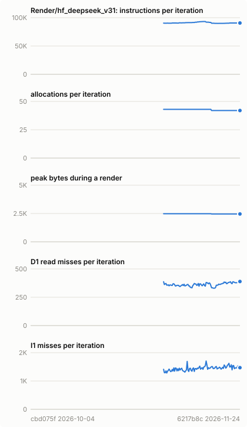
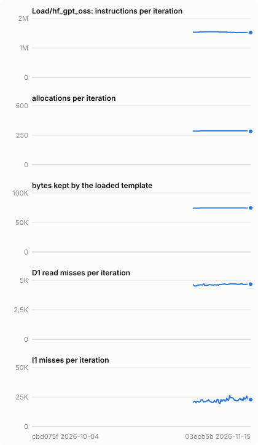
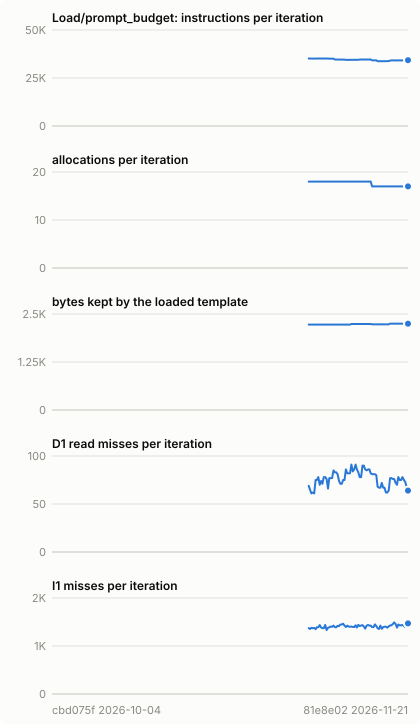

# Benchmark trend

Instruction and allocation counts per iteration on master, one record per commit (239 so far, latest [4560d26](https://github.com/jinja2cpp/Jinja2Cpp/commit/4560d260fea694c1fe842a31519a861c33de602f) on 2026-11-17). Written by the `trend` job of `.github/workflows/benchmark.yml` with `bench/trend.py`; the data is `history.jsonl`.

Memory is the bytes a loaded template keeps for `Load/*` and the peak heap use of one render for `Render/*`; vs first compares with the first record that has it.

| Benchmark | Instructions | vs previous | vs first | Allocations | vs previous | vs first | Memory | vs previous | vs first |
|---|---:|---:|---:|---:|---:|---:|---:|---:|---:|
| [Load/chat_llama](#loadchat_llama) | 334,149 | -0.10% |  | 54 | 0% |  | 18,472 | 0% | -52.73% |
| [Render/chat_llama](#renderchat_llama) | 289,659 | -0.05% |  | 224 | 0% |  | 11,592 | 0% | -19.28% |
| [Load/chat_mistral](#loadchat_mistral) | 383,118 | -0.27% |  | 51 | 0% |  | 20,896 | 0% | -53.20% |
| [Render/chat_mistral](#renderchat_mistral) | 491,735 | +0.06% |  | 401 | 0% |  | 9,976 | +0.32% | -24.47% |
| [Load/chat_qwen](#loadchat_qwen) | 259,974 | -0.24% |  | 43 | 0% |  | 14,424 | 0% | -47.22% |
| [Render/chat_qwen](#renderchat_qwen) | 271,402 | -0.07% |  | 211 | 0% |  | 8,280 | 0% | -2.63% |
| [Load/config_file](#loadconfig_file) | 93,481 | -0.42% |  | 24 | 0% |  | 5,472 | 0% | -48.18% |
| [Render/config_file](#renderconfig_file) | 1,265,132 | +0.18% |  | 908 | 0% |  | 25,576 | 0% | +7.43% |
| [Load/dict_ops](#loaddict_ops) | 31,578 | -0.21% | -78.63% | 8 | 0% | -93.89% | 2,184 | 0% | -48.68% |
| [Render/dict_ops](#renderdict_ops) | 290,498 | +0.02% | -57.95% | 112 | 0% | -75.11% | 24,408 | 0% | -29.65% |
| [Load/expressions](#loadexpressions) | 43,520 | -0.16% | -78.89% | 15 | 0% | -89.73% | 2,736 | 0% | -55.41% |
| [Render/expressions](#renderexpressions) | 414,262 | -0.37% | -54.28% | 3 | 0% | -90.00% | 2,440 | 0% | -31.15% |
| [Load/filters](#loadfilters) | 66,768 | +0.14% | -75.67% | 26 | 0% | -88.60% | 3,856 | 0% | -66.22% |
| [Render/filters](#renderfilters) | 26,358 | -0.09% | -70.27% | 23 | 0% | -68.92% | 752 | 0% | -84.69% |
| [Load/for_filter_if](#loadfor_filter_if) | 28,363 | -0.43% | -79.05% | 6 | 0% | -95.12% | 1,912 | 0% | -44.55% |
| [Render/for_filter_if](#renderfor_filter_if) | 267,251 | -0.05% | -69.12% | 4 | 0% | -98.23% | 16,560 | 0% | +354.95% |
| [Load/for_loop_vars](#loadfor_loop_vars) | 38,157 | -0.43% | -78.88% | 9 | 0% | -94.27% | 2,376 | 0% | -47.43% |
| [Render/for_loop_vars](#renderfor_loop_vars) | 170,641 | 0% | -84.09% | 2 | 0% | -99.62% | 1,568 | 0% | -43.35% |
| [Load/for_range](#loadfor_range) | 12,368 | -0.31% | -78.18% | 6 | 0% | -89.29% | 1,096 | 0% | -45.20% |
| [Render/for_range](#renderfor_range) | 37,046 | 0% | -59.82% | 3 | 0% | -88.89% | 408 | 0% | -73.02% |
| [Load/hf_deepseek_v31](#loadhf_deepseek_v31) | 382,194 | -0.22% |  | 54 | 0% |  | 21,984 | 0% | +0.77% |
| [Render/hf_deepseek_v31](#renderhf_deepseek_v31) | 89,938 | -0.02% |  | 42 | 0% |  | 2,456 | 0% | -0.97% |
| [Load/hf_gpt_oss](#loadhf_gpt_oss) | 1,518,516 | -0.13% |  | 282 | 0% |  | 74,744 | 0% | +0.70% |
| [Render/hf_gpt_oss](#renderhf_gpt_oss) | 167,269 | +0.10% |  | 153 | 0% |  | 5,736 | +1.27% | +16.21% |
| [Load/hf_mistral_small](#loadhf_mistral_small) | 588,323 | -0.18% |  | 87 | 0% |  | 33,056 | 0% | +0.36% |
| [Render/hf_mistral_small](#renderhf_mistral_small) | 139,147 | +0.03% |  | 97 | 0% |  | 6,112 | 0% | -0.39% |
| [Load/hf_qwen3](#loadhf_qwen3) | 474,319 | -0.26% |  | 81 | 0% |  | 25,568 | 0% | +0.35% |
| [Render/hf_qwen3](#renderhf_qwen3) | 116,540 | -0.03% |  | 99 | 0% |  | 3,224 | 0% | -0.74% |
| [Load/html_autoescape](#loadhtml_autoescape) | 187,961 | -0.43% |  | 42 | 0% |  | 12,680 | 0% | -48.62% |
| [Render/html_autoescape](#renderhtml_autoescape) | 1,194,617 | -0.01% |  | 674 | 0% |  | 45,968 | 0% | +13.83% |
| [Load/inheritance](#loadinheritance) | 21,152 | -0.11% | -81.46% | 6 | 0% | -94.39% | 1,352 | 0% | -52.92% |
| [Render/inheritance](#renderinheritance) | 134,002 | -0.04% | -82.08% | 35 | 0% | -94.37% | 7,960 | 0% | +32.31% |
| [Load/int_arith](#loadint_arith) | 64,305 | -0.27% |  | 19 | 0% |  | 3,880 | 0% | +0.62% |
| [Render/int_arith](#renderint_arith) | 825,465 | -0.22% |  | 12 | 0% |  | 3,272 | 0% | -0.49% |
| [Module/keep](#modulekeep) | 6,880 | 0% |  | 6 | 0% |  |  |  |  |
| [Module/keep_written](#modulekeep_written) | 28,919 | -0.34% |  | 10 | 0% |  |  |  |  |
| [Load/large_static](#loadlarge_static) | 146,465 | -0.30% | -83.47% | 13 | 0% | -97.05% | 43,128 | 0% | -19.21% |
| [Render/large_static](#renderlarge_static) | 20,322 | 0% | -72.95% | 1 | 0% | -94.44% | 36,552 | 0% | -1.83% |
| [RenderSink/large_static](#rendersinklarge_static) | 12,310 | 0% |  | 0 |  |  | 0 |  |  |
| [RenderTo/large_static](#rendertolarge_static) | 19,885 | 0% |  | 0 |  |  | 0 |  |  |
| [Load/macros](#loadmacros) | 53,983 | -0.52% | -76.32% | 25 | 0% | -86.56% | 4,424 | 0% | -28.83% |
| [Render/macros](#rendermacros) | 640,833 | 0% | -75.00% | 308 | 0% | -88.71% | 20,576 | 0% | +39.78% |
| [Load/many_tags](#loadmany_tags) | 8,723,925 | -0.26% | -80.25% | 950 | 0% | -97.23% | 438,120 | 0% | -58.48% |
| [Render/many_tags](#rendermany_tags) | 731,827 | +0.23% | -64.87% | 2 | 0% | -90.48% | 5,648 | 0% | -10.52% |
| [Load/mitsuhiko_table](#loadmitsuhiko_table) | 44,307 | -0.31% | -81.35% | 18 | 0% | -90.22% | 3,368 | 0% | -44.46% |
| [Render/mitsuhiko_table](#rendermitsuhiko_table) | 5,068,136 | 0% | -58.98% | 33 | 0% | -99.19% | 381,536 | 0% | +9.95% |
| [RenderSink/mitsuhiko_table](#rendersinkmitsuhiko_table) | 4,995,277 | 0% |  | 32 | 0% |  | 37,064 | 0% | +28.59% |
| [RenderTo/mitsuhiko_table](#rendertomitsuhiko_table) | 5,067,642 | 0% |  | 32 | 0% |  | 37,064 | 0% | +28.59% |
| [Load/mitsuhiko_table_wide](#loadmitsuhiko_table_wide) | 52,047 | -0.26% |  | 34 | 0% |  | 5,696 | 0% | -31.07% |
| [Render/mitsuhiko_table_wide](#rendermitsuhiko_table_wide) | 5,414,088 | 0% |  | 33 | 0% |  | 1,414,928 | 0% | +2.46% |
| [RenderSink/mitsuhiko_table_wide](#rendersinkmitsuhiko_table_wide) | 5,237,308 | 0% |  | 32 | 0% |  | 37,064 | 0% | +28.59% |
| [RenderTo/mitsuhiko_table_wide](#rendertomitsuhiko_table_wide) | 5,413,555 | 0% |  | 32 | 0% |  | 37,064 | 0% | +28.59% |
| [Load/plain_text](#loadplain_text) | 2,923 | +0.14% | -69.79% | 3 | 0% | -83.33% | 680 | 0% | -39.29% |
| [Render/plain_text](#renderplain_text) | 951 | 0% | -86.00% | 1 | 0% | -91.67% | 40 | 0% | -94.44% |
| [RenderSink/plain_text](#rendersinkplain_text) | 651 | 0% |  | 0 |  |  | 0 |  |  |
| [RenderTo/plain_text](#rendertoplain_text) | 752 | 0% |  | 0 |  |  | 0 |  |  |
| [Load/prompt_budget](#loadprompt_budget) | 33,762 | -0.04% |  | 17 | 0% |  | 2,232 | 0% | +0.36% |
| [Render/prompt_budget](#renderprompt_budget) | 1,320,058 | +0.05% |  | 76 | 0% |  | 36,416 | 0% | 0% |
| [Load/strings](#loadstrings) | 68,396 | -0.22% | -76.56% | 29 | 0% | -87.05% | 4,352 | 0% | -51.86% |
| [Render/strings](#renderstrings) | 581,388 | +0.16% | -72.28% | 344 | 0% | -83.73% | 9,088 | 0% | -49.31% |
| [Load/substitute](#loadsubstitute) | 6,625 | -0.21% | -77.81% | 5 | 0% | -86.49% | 840 | 0% | -44.74% |
| [Render/substitute](#rendersubstitute) | 1,631 | 0% | -81.49% | 1 | 0% | -91.67% | 40 | 0% | -94.44% |
| [RenderSink/substitute](#rendersinksubstitute) | 1,335 | 0% |  | 0 |  |  | 0 |  |  |
| [RenderTo/substitute](#rendertosubstitute) | 1,436 | 0% |  | 0 |  |  | 0 |  |  |

## Cache misses

Misses per iteration in callgrind's cache model (`count.py --cache-sim`: 32 KB 8-way L1, 8 MB 16-way last level, no prefetcher); reported, not gated.

| Benchmark | D1 read misses | vs previous | D1 write misses | vs previous | LL data read misses | vs previous | I1 misses | vs previous |
|---|---:|---:|---:|---:|---:|---:|---:|---:|
| Load/chat_llama | 747 | -1.84% | 760 | -1.55% | 0 |  | 7,679 | -1.65% |
| Render/chat_llama | 1,194 | +3.56% | 527 | +1.54% | 0 |  | 4,117 | +1.45% |
| Load/chat_mistral | 1,091 | -0.55% | 1,089 | -0.27% | 0 |  | 8,689 | -2.83% |
| Render/chat_mistral | 1,945 | -1.57% | 629 | +2.44% | 0 |  | 10,661 | +8.91% |
| Load/chat_qwen | 562 | +2.93% | 639 | -1.08% | 0 |  | 4,519 | -6.34% |
| Render/chat_qwen | 1,059 | +2.02% | 433 | +3.34% | 0 |  | 3,465 | -2.12% |
| Load/config_file | 213 | +2.90% | 185 | -3.14% | 0 |  | 2,831 | +3.62% |
| Render/config_file | 6,490 | +8.42% | 1,610 | +8.86% | 0 |  | 43,201 | +6.98% |
| Load/dict_ops | 37 | +19.35% | 22 | +15.79% | 0 |  | 1,352 | +1.35% |
| Render/dict_ops | 663 | -1.19% | 426 | +1.43% | 0 |  | 827 | +1.72% |
| Load/expressions | 25 | -7.41% | 22 | +4.76% | 0 |  | 1,333 | +3.57% |
| Render/expressions | 4 | -55.56% | 1 | -75.00% | 0 |  | 291 | +8.99% |
| Load/filters | 89 | +7.23% | 42 | +5.00% | 0 |  | 1,709 | +17.78% |
| Render/filters | 11 | +83.33% | 1 |  | 0 |  | 725 | -0.68% |
| Load/for_filter_if | 28 | +33.33% | 11 | 0% | 0 |  | 1,037 | -1.33% |
| Render/for_filter_if | 1,714 | +0.82% | 91 | +3.41% | 0 |  | 143 | +28.83% |
| Load/for_loop_vars | 34 | -2.86% | 21 | +16.67% | 0 |  | 1,102 | +0.64% |
| Render/for_loop_vars | 13 | +8.33% | 3 | +50.00% | 0 |  | 117 | +31.46% |
| Load/for_range | 1 | 0% | 4 | 0% | 0 |  | 769 | +7.70% |
| Render/for_range | 7 | +600.00% | 1 |  | 0 |  | 121 | -3.97% |
| Load/hf_deepseek_v31 | 1,043 | +2.05% | 996 | 0% | 0 |  | 6,602 | -5.06% |
| Render/hf_deepseek_v31 | 357 | +0.28% | 79 | +2.60% | 0 |  | 1,449 | +1.61% |
| Load/hf_gpt_oss | 4,666 | +0.71% | 3,382 | +0.30% | 0 |  | 22,359 | -4.94% |
| Render/hf_gpt_oss | 1,248 | -0.24% | 394 | +1.03% | 1 |  | 4,883 | +5.37% |
| Load/hf_mistral_small | 1,893 | +3.78% | 1,633 | +0.31% | 0 |  | 11,458 | -3.79% |
| Render/hf_mistral_small | 951 | +1.39% | 288 | +1.77% | 0 |  | 3,786 | +5.58% |
| Load/hf_qwen3 | 1,560 | +1.36% | 1,342 | +0.52% | 0 |  | 9,185 | -2.00% |
| Render/hf_qwen3 | 667 | -1.91% | 222 | 0% | 0 |  | 2,685 | +2.72% |
| Load/html_autoescape | 519 | +3.80% | 530 | -0.75% | 0 |  | 4,142 | +3.76% |
| Render/html_autoescape | 4,410 | +11.70% | 1,173 | -9.77% | 0 |  | 36,847 | -1.14% |
| Load/inheritance | 1 | -50.00% | 3 | 0% | 0 |  | 701 | +1.45% |
| Render/inheritance | 601 | +0.84% | 108 | 0% | 0 |  | 879 | -1.24% |
| Load/int_arith | 84 | +13.51% | 55 | +7.84% | 0 |  | 2,236 | +13.97% |
| Render/int_arith | 16 | +77.78% | 6 | +100.00% | 0 |  | 742 | +4.07% |
| Module/keep | 1 | -50.00% | 2 | 0% | 0 |  | 402 | -5.19% |
| Module/keep_written | 1,147 | +1.06% | 562 | -0.18% | 0 |  | 728 | -1.09% |
| Load/large_static | 1,914 | +0.05% | 901 | -0.66% | 0 |  | 254 | +7.63% |
| Render/large_static | 703 | +0.14% | 568 | -0.18% | 0 |  | 4 | -80.00% |
| RenderSink/large_static | 1 | 0% | 0 |  | 0 |  | 2 | 0% |
| RenderTo/large_static | 679 | +0.15% | 571 | -0.17% | 0 |  | 4 | -33.33% |
| Load/macros | 74 | +4.23% | 55 | -5.17% | 0 |  | 1,749 | +3.25% |
| Render/macros | 743 | -0.67% | 247 | +1.23% | 0 |  | 709 | +23.95% |
| Load/many_tags | 27,820 | +0.18% | 22,595 | -0.08% | 0 |  | 249,713 | +6.13% |
| Render/many_tags | 6,100 | +0.16% | 786 | +0.38% | 0 |  | 88 | -30.16% |
| Load/mitsuhiko_table | 45 | +15.38% | 48 | +11.63% | 0 |  | 833 | -5.45% |
| Render/mitsuhiko_table | 10,030 | +0.11% | 6,296 | -0.10% | 0 |  | 288 | -7.10% |
| RenderSink/mitsuhiko_table | 9,973 | +0.10% | 1,215 | +0.33% | 0 |  | 236 | +9.77% |
| RenderTo/mitsuhiko_table | 10,046 | +0.12% | 6,309 | -0.06% | 0 |  | 271 | -4.58% |
| Load/mitsuhiko_table_wide | 89 | -7.29% | 96 | +3.23% | 0 |  | 984 | +3.47% |
| Render/mitsuhiko_table_wide | 10,235 | +0.20% | 22,690 | -0.01% | 0 |  | 292 | -2.34% |
| RenderSink/mitsuhiko_table_wide | 10,049 | +0.19% | 1,308 | -0.08% | 0 |  | 221 | -11.60% |
| RenderTo/mitsuhiko_table_wide | 10,230 | +0.16% | 22,721 | +0.02% | 0 |  | 270 | -3.91% |
| Load/plain_text | 0 |  | 1 | 0% | 0 |  | 3 | +50.00% |
| Render/plain_text | 1 | 0% | 0 |  | 0 |  | 6 | -25.00% |
| RenderSink/plain_text | 1 | 0% | 0 |  | 0 |  | 4 | -20.00% |
| RenderTo/plain_text | 1 | 0% | 0 |  | 0 |  | 5 | -37.50% |
| Load/prompt_budget | 67 | 0% | 41 | -12.77% | 0 |  | 1,424 | +5.09% |
| Render/prompt_budget | 4,811 | 0% | 549 | +0.18% | 0 |  | 1,317 | +51.21% |
| Load/strings | 138 | +4.55% | 99 | -6.60% | 0 |  | 2,854 | +5.74% |
| Render/strings | 420 | +5.26% | 471 | +1.29% | 0 |  | 1,558 | +1.90% |
| Load/substitute | 1 | 0% | 3 | +50.00% | 0 |  | 141 | +16.53% |
| Render/substitute | 1 | 0% | 0 |  | 0 |  | 4 | -20.00% |
| RenderSink/substitute | 0 |  | 0 |  | 0 |  | 2 | -77.78% |
| RenderTo/substitute | 1 | 0% | 0 |  | 0 |  | 3 | -25.00% |

## Charts

### Load/chat_llama

### Render/chat_llama

### Load/chat_mistral

### Render/chat_mistral

### Load/chat_qwen

### Render/chat_qwen

### Load/config_file

### Render/config_file

### Load/dict_ops

### Render/dict_ops

### Load/expressions

### Render/expressions

### Load/filters

### Render/filters

### Load/for_filter_if

### Render/for_filter_if

### Load/for_loop_vars

### Render/for_loop_vars

### Load/for_range

### Render/for_range

### Load/hf_deepseek_v31

### Render/hf_deepseek_v31

### Load/hf_gpt_oss

### Render/hf_gpt_oss

### Load/hf_mistral_small

### Render/hf_mistral_small

### Load/hf_qwen3

### Render/hf_qwen3

### Load/html_autoescape

### Render/html_autoescape

### Load/inheritance

### Render/inheritance

### Load/int_arith

### Render/int_arith

### Module/keep

### Module/keep_written

### Load/large_static

### Render/large_static

### RenderSink/large_static

### RenderTo/large_static

### Load/macros

### Render/macros

### Load/many_tags

### Render/many_tags

### Load/mitsuhiko_table

### Render/mitsuhiko_table

### RenderSink/mitsuhiko_table

### RenderTo/mitsuhiko_table

### Load/mitsuhiko_table_wide

### Render/mitsuhiko_table_wide

### RenderSink/mitsuhiko_table_wide

### RenderTo/mitsuhiko_table_wide

### Load/plain_text

### Render/plain_text

### RenderSink/plain_text

### RenderTo/plain_text

### Load/prompt_budget

### Render/prompt_budget

### Load/strings

### Render/strings

### Load/substitute

### Render/substitute

### RenderSink/substitute

### RenderTo/substitute

