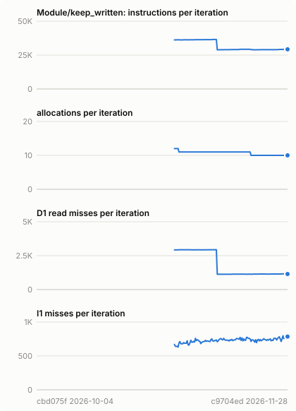

# Benchmark trend

Instruction and allocation counts per iteration on master, one record per commit (249 so far, latest [491a06d](https://github.com/jinja2cpp/Jinja2Cpp/commit/491a06dda5844ce4d24298dfa32d1f5ecda6cc30) on 2026-11-19). Written by the `trend` job of `.github/workflows/benchmark.yml` with `bench/trend.py`; the data is `history.jsonl`.

Memory is the bytes a loaded template keeps for `Load/*` and the peak heap use of one render for `Render/*`; vs first compares with the first record that has it.

| Benchmark | Instructions | vs previous | vs first | Allocations | vs previous | vs first | Memory | vs previous | vs first |
|---|---:|---:|---:|---:|---:|---:|---:|---:|---:|
| [Load/chat_llama](#loadchat_llama) | 334,981 | 0% |  | 54 | 0% |  | 18,520 | 0% | -52.61% |
| [Render/chat_llama](#renderchat_llama) | 289,916 | -0.47% |  | 224 | 0% |  | 11,592 | 0% | -19.28% |
| [Load/chat_mistral](#loadchat_mistral) | 384,158 | 0% |  | 51 | 0% |  | 20,976 | 0% | -53.02% |
| [Render/chat_mistral](#renderchat_mistral) | 489,790 | -0.29% |  | 392 | 0% |  | 9,800 | -0.16% | -25.80% |
| [Load/chat_qwen](#loadchat_qwen) | 261,049 | 0% |  | 43 | 0% |  | 14,472 | 0% | -47.04% |
| [Render/chat_qwen](#renderchat_qwen) | 272,282 | +0.23% |  | 211 | 0% |  | 8,280 | 0% | -2.63% |
| [Load/config_file](#loadconfig_file) | 94,069 | 0% |  | 24 | 0% |  | 5,520 | 0% | -47.73% |
| [Render/config_file](#renderconfig_file) | 1,273,591 | +0.11% |  | 908 | 0% |  | 25,848 | +0.50% | +8.57% |
| [Load/dict_ops](#loaddict_ops) | 31,818 | 0% | -78.47% | 8 | 0% | -93.89% | 2,216 | 0% | -47.93% |
| [Render/dict_ops](#renderdict_ops) | 290,433 | +0.03% | -57.96% | 112 | 0% | -75.11% | 24,408 | 0% | -29.65% |
| [Load/expressions](#loadexpressions) | 43,695 | 0% | -78.80% | 15 | 0% | -89.73% | 2,752 | 0% | -55.15% |
| [Render/expressions](#renderexpressions) | 414,361 | 0% | -54.27% | 3 | 0% | -90.00% | 2,440 | 0% | -31.15% |
| [Load/filters](#loadfilters) | 67,290 | 0% | -75.48% | 26 | 0% | -88.60% | 3,856 | 0% | -66.22% |
| [Render/filters](#renderfilters) | 26,455 | 0% | -70.16% | 23 | 0% | -68.92% | 752 | 0% | -84.69% |
| [Load/for_filter_if](#loadfor_filter_if) | 28,550 | 0% | -78.91% | 6 | 0% | -95.12% | 1,928 | 0% | -44.08% |
| [Render/for_filter_if](#renderfor_filter_if) | 267,119 | 0% | -69.14% | 4 | 0% | -98.23% | 16,560 | 0% | +354.95% |
| [Load/for_loop_vars](#loadfor_loop_vars) | 38,356 | 0% | -78.77% | 9 | 0% | -94.27% | 2,392 | 0% | -47.08% |
| [Render/for_loop_vars](#renderfor_loop_vars) | 170,756 | 0% | -84.08% | 2 | 0% | -99.62% | 1,568 | 0% | -43.35% |
| [Load/for_range](#loadfor_range) | 12,490 | 0% | -77.97% | 6 | 0% | -89.29% | 1,128 | 0% | -43.60% |
| [Render/for_range](#renderfor_range) | 37,143 | 0% | -59.72% | 3 | 0% | -88.89% | 408 | 0% | -73.02% |
| [Load/hf_deepseek_v31](#loadhf_deepseek_v31) | 383,271 | 0% |  | 54 | 0% |  | 22,032 | 0% | +0.99% |
| [Render/hf_deepseek_v31](#renderhf_deepseek_v31) | 90,218 | +0.11% |  | 42 | 0% |  | 2,456 | 0% | -0.97% |
| [Load/hf_gpt_oss](#loadhf_gpt_oss) | 1,522,428 | 0% |  | 282 | 0% |  | 75,000 | 0% | +1.05% |
| [Render/hf_gpt_oss](#renderhf_gpt_oss) | 168,519 | -0.41% |  | 153 | 0% |  | 5,856 | +1.67% | +18.64% |
| [Load/hf_mistral_small](#loadhf_mistral_small) | 589,805 | 0% |  | 87 | 0% |  | 33,136 | 0% | +0.61% |
| [Render/hf_mistral_small](#renderhf_mistral_small) | 139,372 | 0% |  | 97 | 0% |  | 6,096 | 0% | -0.65% |
| [Load/hf_qwen3](#loadhf_qwen3) | 476,021 | 0% |  | 81 | 0% |  | 25,632 | 0% | +0.60% |
| [Render/hf_qwen3](#renderhf_qwen3) | 116,829 | +0.03% |  | 99 | 0% |  | 3,224 | 0% | -0.74% |
| [Load/html_autoescape](#loadhtml_autoescape) | 188,681 | 0% |  | 42 | 0% |  | 12,728 | 0% | -48.43% |
| [Render/html_autoescape](#renderhtml_autoescape) | 1,196,829 | +0.01% |  | 674 | 0% |  | 46,144 | +0.14% | +14.26% |
| [Load/inheritance](#loadinheritance) | 21,304 | 0% | -81.33% | 6 | 0% | -94.39% | 1,368 | 0% | -52.37% |
| [Render/inheritance](#renderinheritance) | 135,309 | +0.14% | -81.91% | 35 | 0% | -94.37% | 8,104 | +0.40% | +34.71% |
| [Load/int_arith](#loadint_arith) | 64,597 | 0% |  | 19 | 0% |  | 3,896 | 0% | +1.04% |
| [Render/int_arith](#renderint_arith) | 825,280 | 0% |  | 12 | 0% |  | 3,272 | 0% | -0.49% |
| [Module/keep](#modulekeep) | 6,942 | +0.03% |  | 6 | 0% |  |  |  |  |
| [Module/keep_written](#modulekeep_written) | 29,006 | 0% |  | 10 | 0% |  |  |  |  |
| [Load/large_static](#loadlarge_static) | 146,667 | 0% | -83.45% | 13 | 0% | -97.05% | 43,128 | 0% | -19.21% |
| [Render/large_static](#renderlarge_static) | 20,332 | +0.39% | -72.94% | 1 | 0% | -94.44% | 36,552 | 0% | -1.83% |
| [RenderSink/large_static](#rendersinklarge_static) | 12,621 | 0% |  | 0 |  |  | 0 |  |  |
| [RenderTo/large_static](#rendertolarge_static) | 19,895 | 0% |  | 0 |  |  | 0 |  |  |
| [Load/macros](#loadmacros) | 53,997 | 0% | -76.31% | 25 | 0% | -86.56% | 4,472 | 0% | -28.06% |
| [Render/macros](#rendermacros) | 644,448 | +0.01% | -74.86% | 308 | 0% | -88.71% | 20,608 | +0.16% | +40.00% |
| [Load/many_tags](#loadmany_tags) | 8,768,226 | 0% | -80.15% | 950 | 0% | -97.23% | 438,120 | 0% | -58.48% |
| [Render/many_tags](#rendermany_tags) | 732,445 | 0% | -64.84% | 2 | 0% | -90.48% | 5,648 | 0% | -10.52% |
| [Load/mitsuhiko_table](#loadmitsuhiko_table) | 44,601 | 0% | -81.23% | 18 | 0% | -90.22% | 3,416 | 0% | -43.67% |
| [Render/mitsuhiko_table](#rendermitsuhiko_table) | 5,075,460 | 0% | -58.92% | 33 | 0% | -99.19% | 381,536 | 0% | +9.95% |
| [RenderSink/mitsuhiko_table](#rendersinkmitsuhiko_table) | 5,005,162 | 0% |  | 32 | 0% |  | 37,064 | 0% | +28.59% |
| [RenderTo/mitsuhiko_table](#rendertomitsuhiko_table) | 5,074,937 | 0% |  | 32 | 0% |  | 37,064 | 0% | +28.59% |
| [Load/mitsuhiko_table_wide](#loadmitsuhiko_table_wide) | 52,340 | 0% |  | 34 | 0% |  | 5,744 | 0% | -30.49% |
| [Render/mitsuhiko_table_wide](#rendermitsuhiko_table_wide) | 5,421,239 | 0% |  | 33 | 0% |  | 1,414,928 | 0% | +2.46% |
| [RenderSink/mitsuhiko_table_wide](#rendersinkmitsuhiko_table_wide) | 5,247,212 | 0% |  | 32 | 0% |  | 37,064 | 0% | +28.59% |
| [RenderTo/mitsuhiko_table_wide](#rendertomitsuhiko_table_wide) | 5,420,702 | 0% |  | 32 | 0% |  | 37,064 | 0% | +28.59% |
| [Nested/new_template](#nestednew_template) | 451,101 | +0.16% |  | 323 | 0% |  |  |  |  |
| [Load/plain_text](#loadplain_text) | 2,941 | 0% | -69.60% | 3 | 0% | -83.33% | 680 | 0% | -39.29% |
| [Render/plain_text](#renderplain_text) | 962 | 0% | -85.84% | 1 | 0% | -91.67% | 40 | 0% | -94.44% |
| [RenderSink/plain_text](#rendersinkplain_text) | 667 | 0% |  | 0 |  |  | 0 |  |  |
| [RenderTo/plain_text](#rendertoplain_text) | 763 | 0% |  | 0 |  |  | 0 |  |  |
| [Load/prompt_budget](#loadprompt_budget) | 34,163 | 0% |  | 17 | 0% |  | 2,248 | 0% | +1.08% |
| [Render/prompt_budget](#renderprompt_budget) | 1,321,760 | 0% |  | 76 | 0% |  | 36,416 | 0% | 0% |
| [Nested/shared_globals](#nestedshared_globals) | 159,326 | +0.47% |  | 160 | 0% |  |  |  |  |
| [Load/strings](#loadstrings) | 68,812 | 0% | -76.42% | 29 | 0% | -87.05% | 4,384 | 0% | -51.50% |
| [Render/strings](#renderstrings) | 581,209 | +0.01% | -72.29% | 344 | 0% | -83.73% | 9,088 | 0% | -49.31% |
| [Load/substitute](#loadsubstitute) | 6,651 | 0% | -77.72% | 5 | 0% | -86.49% | 840 | 0% | -44.74% |
| [Render/substitute](#rendersubstitute) | 1,643 | 0% | -81.36% | 1 | 0% | -91.67% | 40 | 0% | -94.44% |
| [RenderSink/substitute](#rendersinksubstitute) | 1,352 | 0% |  | 0 |  |  | 0 |  |  |
| [RenderTo/substitute](#rendertosubstitute) | 1,448 | 0% |  | 0 |  |  | 0 |  |  |

## Cache misses

Misses per iteration in callgrind's cache model (`count.py --cache-sim`: 32 KB 8-way L1, 8 MB 16-way last level, no prefetcher); reported, not gated.

| Benchmark | D1 read misses | vs previous | D1 write misses | vs previous | LL data read misses | vs previous | I1 misses | vs previous |
|---|---:|---:|---:|---:|---:|---:|---:|---:|
| Load/chat_llama | 735 | -1.74% | 760 | -1.55% | 0 |  | 7,960 | -2.37% |
| Render/chat_llama | 1,179 | -2.48% | 520 | -2.26% | 0 |  | 4,202 | -1.15% |
| Load/chat_mistral | 1,096 | -0.36% | 1,101 | -0.81% | 0 |  | 8,965 | -5.22% |
| Render/chat_mistral | 2,073 | -0.34% | 677 | +3.52% | 0 |  | 10,384 | -5.96% |
| Load/chat_qwen | 549 | -0.36% | 644 | -1.08% | 0 |  | 4,885 | -0.51% |
| Render/chat_qwen | 1,087 | -0.73% | 415 | -4.82% | 0 |  | 3,602 | -0.39% |
| Load/config_file | 195 | -4.88% | 188 | -3.09% | 0 |  | 2,914 | -0.17% |
| Render/config_file | 7,438 | +2.59% | 1,810 | -2.79% | 0 |  | 43,784 | +2.71% |
| Load/dict_ops | 38 | +18.75% | 29 | +20.83% | 0 |  | 1,415 | -2.14% |
| Render/dict_ops | 687 | +3.31% | 420 | +0.96% | 0 |  | 822 | -1.56% |
| Load/expressions | 17 | -22.73% | 13 | -31.58% | 0 |  | 1,301 | -9.02% |
| Render/expressions | 6 | +100.00% | 2 | +100.00% | 0 |  | 302 | -4.43% |
| Load/filters | 80 | -2.44% | 36 | +2.86% | 0 |  | 1,881 | +3.35% |
| Render/filters | 15 | +50.00% | 1 | 0% | 0 |  | 733 | -4.06% |
| Load/for_filter_if | 20 | -16.67% | 18 | 0% | 0 |  | 1,081 | -5.84% |
| Render/for_filter_if | 1,722 | +0.47% | 82 | -13.68% | 0 |  | 158 | +4.64% |
| Load/for_loop_vars | 31 | +3.33% | 25 | +4.17% | 0 |  | 1,149 | -6.43% |
| Render/for_loop_vars | 14 | -17.65% | 3 | -50.00% | 0 |  | 66 | -37.14% |
| Load/for_range | 1 | 0% | 3 | 0% | 0 |  | 780 | -2.01% |
| Render/for_range | 8 | +300.00% | 0 |  | 0 |  | 167 | +18.44% |
| Load/hf_deepseek_v31 | 972 | 0% | 992 | +1.43% | 0 |  | 6,936 | -5.98% |
| Render/hf_deepseek_v31 | 383 | +1.06% | 90 | -2.17% | 0 |  | 1,455 | -4.78% |
| Load/hf_gpt_oss | 4,642 | +0.43% | 3,410 | +0.21% | 0 |  | 23,724 | -5.19% |
| Render/hf_gpt_oss | 1,324 | -1.19% | 397 | -4.57% | 0 |  | 4,930 | -0.84% |
| Load/hf_mistral_small | 1,853 | +0.11% | 1,632 | -0.43% | 0 |  | 11,725 | -4.86% |
| Render/hf_mistral_small | 983 | +0.20% | 302 | +1.68% | 0 |  | 3,874 | +2.27% |
| Load/hf_qwen3 | 1,588 | -0.13% | 1,346 | -0.30% | 0 |  | 9,370 | -2.58% |
| Render/hf_qwen3 | 692 | -2.26% | 219 | +1.86% | 0 |  | 2,691 | -1.75% |
| Load/html_autoescape | 538 | +1.13% | 544 | +0.93% | 0 |  | 4,487 | +0.47% |
| Render/html_autoescape | 3,609 | -9.66% | 1,323 | -7.22% | 0 |  | 36,030 | -1.54% |
| Load/inheritance | 7 | +250.00% | 4 | +33.33% | 0 |  | 705 | -0.70% |
| Render/inheritance | 621 | +3.50% | 118 | +2.61% | 0 |  | 1,040 | +3.90% |
| Load/int_arith | 77 | -12.50% | 58 | -3.33% | 0 |  | 2,087 | -4.35% |
| Render/int_arith | 7 | 0% | 1 | -75.00% | 0 |  | 744 | -0.13% |
| Module/keep | 1 | -50.00% | 2 | 0% | 0 |  | 379 | -16.15% |
| Module/keep_written | 1,144 | -0.17% | 566 | +0.35% | 0 |  | 739 | +0.82% |
| Load/large_static | 1,915 | 0% | 909 | 0% | 0 |  | 297 | -10.81% |
| Render/large_static | 700 | 0% | 568 | -2.24% | 0 |  | 3 | 0% |
| RenderSink/large_static | 1 | 0% | 0 |  | 0 |  | 3 | +50.00% |
| RenderTo/large_static | 680 | 0% | 569 | 0% | 0 |  | 3 | 0% |
| Load/macros | 79 | +17.91% | 69 | +4.55% | 0 |  | 1,745 | -3.32% |
| Render/macros | 782 | +2.62% | 249 | -0.80% | 0 |  | 1,303 | -56.32% |
| Load/many_tags | 27,880 | +0.36% | 22,637 | +0.23% | 0 |  | 264,562 | +3.60% |
| Render/many_tags | 6,114 | +0.16% | 782 | -0.13% | 0 |  | 122 | -0.81% |
| Load/mitsuhiko_table | 28 | -3.45% | 38 | -11.63% | 0 |  | 912 | -4.30% |
| Render/mitsuhiko_table | 10,024 | -0.01% | 6,246 | -0.22% | 0 |  | 302 | -9.58% |
| RenderSink/mitsuhiko_table | 10,006 | +0.32% | 1,214 | +0.58% | 0 |  | 255 | -15.00% |
| RenderTo/mitsuhiko_table | 10,064 | +0.41% | 6,261 | +0.08% | 0 |  | 286 | -9.21% |
| Load/mitsuhiko_table_wide | 80 | +11.11% | 93 | +1.09% | 0 |  | 951 | +7.34% |
| Render/mitsuhiko_table_wide | 10,184 | -0.56% | 22,662 | -0.03% | 0 |  | 298 | -11.57% |
| RenderSink/mitsuhiko_table_wide | 10,001 | -0.55% | 1,284 | -1.00% | 0 |  | 240 | -9.77% |
| RenderTo/mitsuhiko_table_wide | 10,182 | -0.55% | 22,673 | -0.07% | 0 |  | 276 | -10.97% |
| Nested/new_template | 1,971 | -0.20% | 1,379 | -3.16% | 0 |  | 24,528 | -1.39% |
| Load/plain_text | 0 |  | 1 | 0% | 0 |  | 5 | +66.67% |
| Render/plain_text | 1 | 0% | 0 |  | 0 |  | 6 | 0% |
| RenderSink/plain_text | 1 | 0% | 0 |  | 0 |  | 4 | +33.33% |
| RenderTo/plain_text | 2 | 0% | 0 |  | 0 |  | 5 | 0% |
| Load/prompt_budget | 76 | 0% | 63 | 0% | 0 |  | 1,491 | +2.40% |
| Render/prompt_budget | 4,811 | -0.12% | 541 | 0% | 0 |  | 949 | -14.12% |
| Nested/shared_globals | 261 | +6.97% | 137 | +26.85% | 0 |  | 9,348 | +0.95% |
| Load/strings | 137 | +5.38% | 112 | -8.20% | 0 |  | 2,903 | -0.51% |
| Render/strings | 415 | -2.12% | 466 | -2.71% | 0 |  | 1,578 | -37.41% |
| Load/substitute | 1 | 0% | 2 | 0% | 0 |  | 102 | -32.89% |
| Render/substitute | 1 | 0% | 0 |  | 0 |  | 3 | 0% |
| RenderSink/substitute | 1 | 0% | 0 |  | 0 |  | 3 | +200.00% |
| RenderTo/substitute | 1 | 0% | 0 |  | 0 |  | 3 | 0% |

## Charts

### Load/chat_llama

### Render/chat_llama

### Load/chat_mistral

### Render/chat_mistral

### Load/chat_qwen

### Render/chat_qwen

### Load/config_file

### Render/config_file

### Load/dict_ops

### Render/dict_ops

### Load/expressions

### Render/expressions

### Load/filters

### Render/filters

### Load/for_filter_if

### Render/for_filter_if

### Load/for_loop_vars

### Render/for_loop_vars

### Load/for_range

### Render/for_range

### Load/hf_deepseek_v31

### Render/hf_deepseek_v31

### Load/hf_gpt_oss

### Render/hf_gpt_oss

### Load/hf_mistral_small

### Render/hf_mistral_small

### Load/hf_qwen3

### Render/hf_qwen3

### Load/html_autoescape

### Render/html_autoescape

### Load/inheritance

### Render/inheritance

### Load/int_arith

### Render/int_arith

### Module/keep

### Module/keep_written

### Load/large_static

### Render/large_static

### RenderSink/large_static

### RenderTo/large_static

### Load/macros

### Render/macros

### Load/many_tags

### Render/many_tags

### Load/mitsuhiko_table

### Render/mitsuhiko_table

### RenderSink/mitsuhiko_table

### RenderTo/mitsuhiko_table

### Load/mitsuhiko_table_wide

### Render/mitsuhiko_table_wide

### RenderSink/mitsuhiko_table_wide

### RenderTo/mitsuhiko_table_wide

### Nested/new_template

### Load/plain_text

### Render/plain_text

### RenderSink/plain_text

### RenderTo/plain_text

### Load/prompt_budget

### Render/prompt_budget

### Nested/shared_globals

### Load/strings

### Render/strings

### Load/substitute

### Render/substitute

### RenderSink/substitute

### RenderTo/substitute

