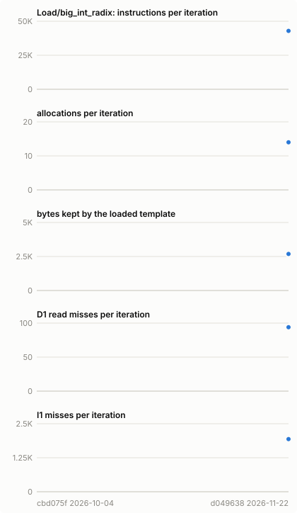
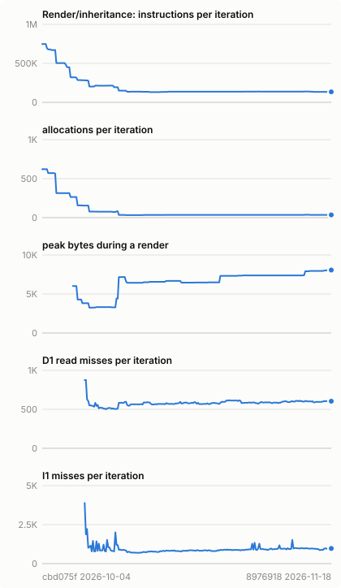

# Benchmark trend

Instruction and allocation counts per iteration on master, one record per commit (259 so far, latest [81e8e02](https://github.com/jinja2cpp/Jinja2Cpp/commit/81e8e029718367a3e66e27aadde75351aeb983c6) on 2026-11-21). Written by the `trend` job of `.github/workflows/benchmark.yml` with `bench/trend.py`; the data is `history.jsonl`.

Memory is the bytes a loaded template keeps for `Load/*` and the peak heap use of one render for `Render/*`; vs first compares with the first record that has it.

| Benchmark | Instructions | vs previous | vs first | Allocations | vs previous | vs first | Memory | vs previous | vs first |
|---|---:|---:|---:|---:|---:|---:|---:|---:|---:|
| [Load/big_int_radix](#loadbig_int_radix) | 42,901 |  |  | 14 |  |  | 2,688 |  | 0% |
| [Render/big_int_radix](#renderbig_int_radix) | 1,520,667,068 |  |  | 297,927 |  |  | 2,531,168 |  | 0% |
| [Load/chat_llama](#loadchat_llama) | 336,580 | 0% |  | 54 | 0% |  | 18,536 | 0% | -52.57% |
| [Render/chat_llama](#renderchat_llama) | 291,742 | +0.06% |  | 224 | 0% |  | 11,608 | 0% | -19.16% |
| [Load/chat_mistral](#loadchat_mistral) | 384,970 | 0% |  | 51 | 0% |  | 20,976 | 0% | -53.02% |
| [Render/chat_mistral](#renderchat_mistral) | 492,060 | +0.01% |  | 392 | 0% |  | 9,752 | 0% | -26.17% |
| [Load/chat_qwen](#loadchat_qwen) | 261,949 | 0% |  | 43 | 0% |  | 14,472 | 0% | -47.04% |
| [Render/chat_qwen](#renderchat_qwen) | 273,688 | +0.13% |  | 211 | 0% |  | 8,280 | 0% | -2.63% |
| [Load/config_file](#loadconfig_file) | 94,181 | 0% |  | 24 | 0% |  | 5,520 | 0% | -47.73% |
| [Render/config_file](#renderconfig_file) | 1,278,317 | -0.06% |  | 908 | 0% |  | 25,928 | 0% | +8.90% |
| [Load/dict_ops](#loaddict_ops) | 31,891 | 0% | -78.42% | 8 | 0% | -93.89% | 2,216 | 0% | -47.93% |
| [Render/dict_ops](#renderdict_ops) | 290,794 | +0.07% | -57.91% | 112 | 0% | -75.11% | 24,408 | 0% | -29.65% |
| [Load/expressions](#loadexpressions) | 43,776 | 0% | -78.76% | 15 | 0% | -89.73% | 2,752 | 0% | -55.15% |
| [Render/expressions](#renderexpressions) | 414,402 | 0% | -54.27% | 3 | 0% | -90.00% | 2,440 | 0% | -31.15% |
| [Load/filters](#loadfilters) | 66,945 | 0% | -75.61% | 26 | 0% | -88.60% | 3,856 | 0% | -66.22% |
| [Render/filters](#renderfilters) | 26,521 | 0% | -70.09% | 23 | 0% | -68.92% | 752 | 0% | -84.69% |
| [Load/for_filter_if](#loadfor_filter_if) | 28,529 | 0% | -78.93% | 6 | 0% | -95.12% | 1,928 | 0% | -44.08% |
| [Render/for_filter_if](#renderfor_filter_if) | 267,113 | +0.36% | -69.14% | 4 | 0% | -98.23% | 16,560 | 0% | +354.95% |
| [Load/for_loop_vars](#loadfor_loop_vars) | 38,173 | 0% | -78.87% | 9 | 0% | -94.27% | 2,392 | 0% | -47.08% |
| [Render/for_loop_vars](#renderfor_loop_vars) | 170,804 | 0% | -84.08% | 2 | 0% | -99.62% | 1,568 | 0% | -43.35% |
| [Load/for_range](#loadfor_range) | 12,493 | 0% | -77.96% | 6 | 0% | -89.29% | 1,128 | 0% | -43.60% |
| [Render/for_range](#renderfor_range) | 37,184 | 0% | -59.67% | 3 | 0% | -88.89% | 408 | 0% | -73.02% |
| [Load/hf_deepseek_v31](#loadhf_deepseek_v31) | 384,079 | 0% |  | 54 | 0% |  | 22,032 | 0% | +0.99% |
| [Render/hf_deepseek_v31](#renderhf_deepseek_v31) | 90,661 | +0.03% |  | 42 | 0% |  | 2,456 | 0% | -0.97% |
| [Load/hf_gpt_oss](#loadhf_gpt_oss) | 1,525,591 | -0.02% |  | 282 | 0% |  | 75,000 | -0.02% | +1.05% |
| [Render/hf_gpt_oss](#renderhf_gpt_oss) | 169,439 | +0.11% |  | 153 | 0% |  | 5,984 | 0% | +21.23% |
| [Load/hf_mistral_small](#loadhf_mistral_small) | 591,348 | 0% |  | 87 | 0% |  | 33,136 | 0% | +0.61% |
| [Render/hf_mistral_small](#renderhf_mistral_small) | 140,394 | +0.02% |  | 97 | 0% |  | 6,096 | 0% | -0.65% |
| [Load/hf_qwen3](#loadhf_qwen3) | 477,651 | 0% |  | 81 | 0% |  | 25,648 | 0% | +0.66% |
| [Render/hf_qwen3](#renderhf_qwen3) | 117,633 | +0.08% |  | 99 | 0% |  | 3,224 | 0% | -0.74% |
| [Load/html_autoescape](#loadhtml_autoescape) | 188,984 | 0% |  | 42 | 0% |  | 12,728 | 0% | -48.43% |
| [Render/html_autoescape](#renderhtml_autoescape) | 1,197,839 | +0.06% |  | 674 | 0% |  | 46,224 | 0% | +14.46% |
| [Load/inheritance](#loadinheritance) | 21,300 | 0% | -81.34% | 6 | 0% | -94.39% | 1,368 | 0% | -52.37% |
| [Render/inheritance](#renderinheritance) | 136,837 | +0.22% | -81.70% | 35 | 0% | -94.37% | 8,136 | 0% | +35.24% |
| [Load/int_arith](#loadint_arith) | 64,690 | 0% |  | 19 | 0% |  | 3,896 | 0% | +1.04% |
| [Render/int_arith](#renderint_arith) | 825,943 | +0.15% |  | 12 | 0% |  | 3,272 | 0% | -0.49% |
| [Module/keep](#modulekeep) | 6,975 | -0.21% |  | 6 | 0% |  |  |  |  |
| [Module/keep_written](#modulekeep_written) | 28,974 | -0.05% |  | 10 | 0% |  |  |  |  |
| [Load/large_static](#loadlarge_static) | 146,958 | 0% | -83.41% | 13 | 0% | -97.05% | 43,128 | 0% | -19.21% |
| [Render/large_static](#renderlarge_static) | 20,343 | 0% | -72.93% | 1 | 0% | -94.44% | 36,552 | 0% | -1.83% |
| [RenderSink/large_static](#rendersinklarge_static) | 12,632 | 0% |  | 0 |  |  | 0 |  |  |
| [RenderTo/large_static](#rendertolarge_static) | 19,846 | 0% |  | 0 |  |  | 0 |  |  |
| [Load/macros](#loadmacros) | 54,293 | 0% | -76.18% | 25 | 0% | -86.56% | 4,472 | 0% | -28.06% |
| [Render/macros](#rendermacros) | 644,591 | -0.43% | -74.85% | 308 | 0% | -88.71% | 20,608 | 0% | +40.00% |
| [Load/many_tags](#loadmany_tags) | 8,758,481 | 0% | -80.17% | 950 | 0% | -97.23% | 438,136 | 0% | -58.48% |
| [Render/many_tags](#rendermany_tags) | 732,458 | +0.25% | -64.84% | 2 | 0% | -90.48% | 5,648 | 0% | -10.52% |
| [Load/mitsuhiko_table](#loadmitsuhiko_table) | 44,630 | 0% | -81.21% | 18 | 0% | -90.22% | 3,416 | 0% | -43.67% |
| [Render/mitsuhiko_table](#rendermitsuhiko_table) | 5,105,155 | 0% | -58.68% | 33 | 0% | -99.19% | 381,536 | 0% | +9.95% |
| [RenderSink/mitsuhiko_table](#rendersinkmitsuhiko_table) | 5,035,250 | 0% |  | 32 | 0% |  | 37,064 | 0% | +28.59% |
| [RenderTo/mitsuhiko_table](#rendertomitsuhiko_table) | 5,104,611 | 0% |  | 32 | 0% |  | 37,064 | 0% | +28.59% |
| [Load/mitsuhiko_table_wide](#loadmitsuhiko_table_wide) | 52,115 | 0% |  | 34 | 0% |  | 5,744 | 0% | -30.49% |
| [Render/mitsuhiko_table_wide](#rendermitsuhiko_table_wide) | 5,451,389 | 0% |  | 33 | 0% |  | 1,414,928 | 0% | +2.46% |
| [RenderSink/mitsuhiko_table_wide](#rendersinkmitsuhiko_table_wide) | 5,277,294 | 0% |  | 32 | 0% |  | 37,064 | 0% | +28.59% |
| [RenderTo/mitsuhiko_table_wide](#rendertomitsuhiko_table_wide) | 5,450,783 | 0% |  | 32 | 0% |  | 37,064 | 0% | +28.59% |
| [Nested/new_template](#nestednew_template) | 452,135 | -0.09% |  | 323 | 0% |  |  |  |  |
| [Load/plain_text](#loadplain_text) | 2,932 | 0% | -69.70% | 3 | 0% | -83.33% | 680 | 0% | -39.29% |
| [Render/plain_text](#renderplain_text) | 973 | 0% | -85.68% | 1 | 0% | -91.67% | 40 | 0% | -94.44% |
| [RenderSink/plain_text](#rendersinkplain_text) | 678 | 0% |  | 0 |  |  | 0 |  |  |
| [RenderTo/plain_text](#rendertoplain_text) | 774 | 0% |  | 0 |  |  | 0 |  |  |
| [Load/prompt_budget](#loadprompt_budget) | 34,256 | 0% |  | 17 | 0% |  | 2,248 | 0% | +1.08% |
| [Render/prompt_budget](#renderprompt_budget) | 1,321,872 | +0.01% |  | 76 | 0% |  | 36,416 | 0% | 0% |
| [Nested/shared_globals](#nestedshared_globals) | 160,297 | -0.24% |  | 160 | 0% |  |  |  |  |
| [Load/strings](#loadstrings) | 68,802 | 0% | -76.43% | 29 | 0% | -87.05% | 4,384 | 0% | -51.50% |
| [Render/strings](#renderstrings) | 581,529 | +0.17% | -72.28% | 344 | 0% | -83.73% | 9,088 | 0% | -49.31% |
| [Load/substitute](#loadsubstitute) | 6,654 | 0% | -77.71% | 5 | 0% | -86.49% | 840 | 0% | -44.74% |
| [Render/substitute](#rendersubstitute) | 1,654 | 0% | -81.23% | 1 | 0% | -91.67% | 40 | 0% | -94.44% |
| [RenderSink/substitute](#rendersinksubstitute) | 1,363 | 0% |  | 0 |  |  | 0 |  |  |
| [RenderTo/substitute](#rendertosubstitute) | 1,459 | 0% |  | 0 |  |  | 0 |  |  |

## Cache misses

Misses per iteration in callgrind's cache model (`count.py --cache-sim`: 32 KB 8-way L1, 8 MB 16-way last level, no prefetcher); reported, not gated.

| Benchmark | D1 read misses | vs previous | D1 write misses | vs previous | LL data read misses | vs previous | I1 misses | vs previous |
|---|---:|---:|---:|---:|---:|---:|---:|---:|
| Load/big_int_radix | 91 |  | 50 |  | 0 |  | 1,982 |  |
| Render/big_int_radix | 1,237,432 |  | 868,487 |  | 0 |  | 4,527 |  |
| Load/chat_llama | 763 | +1.19% | 761 | -0.78% | 0 |  | 7,736 | -5.96% |
| Render/chat_llama | 1,188 | -2.14% | 563 | +0.18% | 0 |  | 4,216 | -1.17% |
| Load/chat_mistral | 1,126 | -0.71% | 1,112 | -0.18% | 0 |  | 8,679 | -5.69% |
| Render/chat_mistral | 2,121 | +1.73% | 677 | +0.59% | 0 |  | 10,497 | +0.50% |
| Load/chat_qwen | 534 | +0.19% | 658 | 0% | 0 |  | 4,571 | -9.79% |
| Render/chat_qwen | 1,122 | -0.18% | 437 | -0.91% | 0 |  | 3,674 | -0.43% |
| Load/config_file | 201 | +1.01% | 187 | 0% | 0 |  | 2,770 | -4.15% |
| Render/config_file | 6,625 | -2.01% | 1,902 | -3.01% | 0 |  | 44,266 | +3.27% |
| Load/dict_ops | 30 | +7.14% | 15 | -25.00% | 0 |  | 1,410 | +0.07% |
| Render/dict_ops | 688 | -0.29% | 422 | 0% | 0 |  | 837 | -0.95% |
| Load/expressions | 17 | -32.00% | 16 | -38.46% | 0 |  | 1,303 | -3.84% |
| Render/expressions | 6 | -60.00% | 2 | -50.00% | 0 |  | 335 | +7.03% |
| Load/filters | 89 | -1.11% | 49 | -9.26% | 0 |  | 2,022 | +13.92% |
| Render/filters | 19 | -13.64% | 4 | 0% | 0 |  | 772 | +4.04% |
| Load/for_filter_if | 6 | -66.67% | 4 | -33.33% | 0 |  | 1,046 | -2.15% |
| Render/for_filter_if | 1,716 | -0.23% | 85 | -1.16% | 0 |  | 157 | -16.04% |
| Load/for_loop_vars | 36 | -5.26% | 16 | 0% | 0 |  | 1,083 | -1.99% |
| Render/for_loop_vars | 8 | +33.33% | 2 | +100.00% | 0 |  | 139 | +0.72% |
| Load/for_range | 2 | 0% | 3 | 0% | 0 |  | 757 | -1.43% |
| Render/for_range | 2 | 0% | 1 | 0% | 0 |  | 136 | -12.82% |
| Load/hf_deepseek_v31 | 968 | +0.94% | 977 | -0.10% | 0 |  | 6,272 | -14.04% |
| Render/hf_deepseek_v31 | 385 | -0.52% | 89 | -3.26% | 0 |  | 1,546 | +0.13% |
| Load/hf_gpt_oss | 4,744 | -0.19% | 3,428 | +0.20% | 0 |  | 22,102 | -5.42% |
| Render/hf_gpt_oss | 1,314 | +0.54% | 413 | -1.43% | 0 |  | 4,933 | -0.44% |
| Load/hf_mistral_small | 1,892 | -0.63% | 1,654 | +0.24% | 0 |  | 10,943 | -9.24% |
| Render/hf_mistral_small | 1,014 | -0.69% | 323 | -0.31% | 0 |  | 3,778 | -1.07% |
| Load/hf_qwen3 | 1,514 | -0.07% | 1,315 | +0.31% | 0 |  | 9,062 | -4.79% |
| Render/hf_qwen3 | 710 | +1.14% | 226 | -1.74% | 0 |  | 2,777 | +2.06% |
| Load/html_autoescape | 482 | -0.62% | 550 | +1.29% | 0 |  | 3,969 | -7.93% |
| Render/html_autoescape | 5,003 | +2.94% | 1,720 | +10.82% | 0 |  | 36,258 | -0.91% |
| Load/inheritance | 2 | -60.00% | 2 | -50.00% | 0 |  | 706 | 0% |
| Render/inheritance | 608 | -1.30% | 124 | +2.48% | 0 |  | 1,047 | -0.66% |
| Load/int_arith | 70 | -1.41% | 62 | -3.12% | 0 |  | 2,051 | -1.44% |
| Render/int_arith | 34 | -15.00% | 22 | -4.35% | 0 |  | 795 | +1.15% |
| Module/keep | 2 | 0% | 3 | +50.00% | 0 |  | 409 | -1.21% |
| Module/keep_written | 1,145 | 0% | 559 | +0.36% | 0 |  | 734 | +1.52% |
| Load/large_static | 1,918 | +0.05% | 910 | 0% | 0 |  | 276 | -10.39% |
| Render/large_static | 700 | 0% | 570 | 0% | 0 |  | 5 | 0% |
| RenderSink/large_static | 2 | 0% | 0 |  | 0 |  | 1 | -50.00% |
| RenderTo/large_static | 679 | 0% | 581 | 0% | 0 |  | 4 | -20.00% |
| Load/macros | 86 | +10.26% | 64 | -7.25% | 0 |  | 1,732 | -2.37% |
| Render/macros | 759 | -0.65% | 265 | -0.38% | 0 |  | 1,757 | +103.83% |
| Load/many_tags | 28,916 | +3.16% | 22,668 | +0.23% | 0 |  | 242,773 | -1.34% |
| Render/many_tags | 6,119 | -0.24% | 791 | +0.64% | 0 |  | 105 | -8.70% |
| Load/mitsuhiko_table | 33 | 0% | 40 | -11.11% | 0 |  | 862 | -4.12% |
| Render/mitsuhiko_table | 10,065 | -0.04% | 6,341 | -0.05% | 0 |  | 335 | -1.47% |
| RenderSink/mitsuhiko_table | 9,972 | -0.06% | 1,199 | 0% | 0 |  | 288 | +3.60% |
| RenderTo/mitsuhiko_table | 10,056 | -0.03% | 6,283 | -0.02% | 0 |  | 313 | +5.03% |
| Load/mitsuhiko_table_wide | 75 | 0% | 83 | -8.79% | 0 |  | 925 | -6.75% |
| Render/mitsuhiko_table_wide | 10,193 | -0.10% | 22,597 | -0.01% | 0 |  | 321 | -6.14% |
| RenderSink/mitsuhiko_table_wide | 10,032 | -0.03% | 1,262 | -0.24% | 0 |  | 267 | -5.65% |
| RenderTo/mitsuhiko_table_wide | 10,177 | +0.01% | 22,672 | -0.02% | 0 |  | 302 | -6.21% |
| Nested/new_template | 2,230 | -1.11% | 1,597 | +1.27% | 0 |  | 24,623 | -0.59% |
| Load/plain_text | 0 |  | 1 | 0% | 0 |  | 11 | -57.69% |
| Render/plain_text | 1 | 0% | 0 |  | 0 |  | 7 | 0% |
| RenderSink/plain_text | 1 | 0% | 0 |  | 0 |  | 5 | 0% |
| RenderTo/plain_text | 1 | 0% | 0 |  | 0 |  | 6 | -14.29% |
| Load/prompt_budget | 64 | -5.88% | 39 | -4.88% | 0 |  | 1,470 | +0.82% |
| Render/prompt_budget | 4,799 | +0.02% | 549 | +0.18% | 0 |  | 903 | -15.21% |
| Nested/shared_globals | 252 | -3.45% | 144 | +2.13% | 0 |  | 9,220 | -0.47% |
| Load/strings | 148 | -0.67% | 83 | -1.19% | 0 |  | 2,827 | -1.15% |
| Render/strings | 436 | +0.23% | 483 | +0.21% | 0 |  | 1,567 | -32.66% |
| Load/substitute | 1 | 0% | 3 | +50.00% | 0 |  | 138 | -4.17% |
| Render/substitute | 1 | 0% | 0 |  | 0 |  | 4 | +33.33% |
| RenderSink/substitute | 1 | 0% | 0 |  | 0 |  | 2 | -33.33% |
| RenderTo/substitute | 2 | 0% | 0 |  | 0 |  | 3 | 0% |

## Charts

### Load/big_int_radix

### Render/big_int_radix

### Load/chat_llama

### Render/chat_llama

### Load/chat_mistral

### Render/chat_mistral

### Load/chat_qwen

### Render/chat_qwen

### Load/config_file

### Render/config_file

### Load/dict_ops

### Render/dict_ops

### Load/expressions

### Render/expressions

### Load/filters

### Render/filters

### Load/for_filter_if

### Render/for_filter_if

### Load/for_loop_vars

### Render/for_loop_vars

### Load/for_range

### Render/for_range

### Load/hf_deepseek_v31

### Render/hf_deepseek_v31

### Load/hf_gpt_oss

### Render/hf_gpt_oss

### Load/hf_mistral_small

### Render/hf_mistral_small

### Load/hf_qwen3

### Render/hf_qwen3

### Load/html_autoescape

### Render/html_autoescape

### Load/inheritance

### Render/inheritance

### Load/int_arith

### Render/int_arith

### Module/keep

### Module/keep_written

### Load/large_static

### Render/large_static

### RenderSink/large_static

### RenderTo/large_static

### Load/macros

### Render/macros

### Load/many_tags

### Render/many_tags

### Load/mitsuhiko_table

### Render/mitsuhiko_table

### RenderSink/mitsuhiko_table

### RenderTo/mitsuhiko_table

### Load/mitsuhiko_table_wide

### Render/mitsuhiko_table_wide

### RenderSink/mitsuhiko_table_wide

### RenderTo/mitsuhiko_table_wide

### Nested/new_template

### Load/plain_text

### Render/plain_text

### RenderSink/plain_text

### RenderTo/plain_text

### Load/prompt_budget

### Render/prompt_budget

### Nested/shared_globals

### Load/strings

### Render/strings

### Load/substitute

### Render/substitute

### RenderSink/substitute

### RenderTo/substitute

