# Benchmark trend

Instruction and allocation counts per iteration on master, one record per commit (127 so far, latest [431554e](https://github.com/jinja2cpp/Jinja2Cpp/commit/431554e0a5cbc4d44f80c3704f14efcd4650224b) on 2026-10-24). Written by the `trend` job of `.github/workflows/benchmark.yml` with `bench/trend.py`; the data is `history.jsonl`.

Memory is the bytes a loaded template keeps for `Load/*` and the peak heap use of one render for `Render/*`; vs first compares with the first record that has it.

| Benchmark | Instructions | vs previous | vs first | Allocations | vs previous | vs first | Memory | vs previous | vs first |
|---|---:|---:|---:|---:|---:|---:|---:|---:|---:|
| [Load/chat_llama](#loadchat_llama) | 345,151 | -0.02% |  | 55 | 0% |  | 18,272 | 0% | -53.24% |
| [Render/chat_llama](#renderchat_llama) | 306,058 | -0.01% |  | 251 | 0% |  | 11,136 | 0% | -22.45% |
| [Load/chat_mistral](#loadchat_mistral) | 394,431 | -0.02% |  | 51 | 0% |  | 20,728 | 0% | -53.57% |
| [Render/chat_mistral](#renderchat_mistral) | 508,289 | 0% |  | 424 | 0% |  | 9,520 | 0% | -27.92% |
| [Load/chat_qwen](#loadchat_qwen) | 266,308 | -0.02% |  | 44 | 0% |  | 14,432 | 0% | -47.19% |
| [Render/chat_qwen](#renderchat_qwen) | 293,511 | -0.01% |  | 238 | 0% |  | 7,824 | 0% | -8.00% |
| [Load/config_file](#loadconfig_file) | 98,895 | -0.01% |  | 25 | 0% |  | 5,464 | 0% | -48.26% |
| [Render/config_file](#renderconfig_file) | 1,256,584 | 0% |  | 908 | 0% |  | 23,320 | 0% | -2.05% |
| [Load/dict_ops](#loaddict_ops) | 33,264 | 0% | -77.49% | 9 | 0% | -93.13% | 2,208 | 0% | -48.12% |
| [Render/dict_ops](#renderdict_ops) | 297,730 | +0.02% | -56.90% | 112 | 0% | -75.11% | 24,408 | 0% | -29.65% |
| [Load/expressions](#loadexpressions) | 45,429 | 0% | -77.96% | 16 | 0% | -89.04% | 2,760 | 0% | -55.02% |
| [Render/expressions](#renderexpressions) | 423,478 | 0% | -53.27% | 3 | 0% | -90.00% | 2,440 | 0% | -31.15% |
| [Load/filters](#loadfilters) | 72,014 | 0% | -73.76% | 27 | 0% | -88.16% | 3,768 | 0% | -66.99% |
| [Render/filters](#renderfilters) | 30,953 | -0.04% | -65.09% | 29 | 0% | -60.81% | 1,376 | 0% | -71.99% |
| [Load/for_filter_if](#loadfor_filter_if) | 30,008 | -0.02% | -77.84% | 7 | 0% | -94.31% | 1,952 | 0% | -43.39% |
| [Render/for_filter_if](#renderfor_filter_if) | 271,637 | 0% | -68.61% | 4 | 0% | -98.23% | 13,328 | 0% | +266.15% |
| [Load/for_loop_vars](#loadfor_loop_vars) | 40,532 | -0.02% | -77.56% | 10 | 0% | -93.63% | 2,400 | 0% | -46.90% |
| [Render/for_loop_vars](#renderfor_loop_vars) | 194,195 | -0.01% | -81.90% | 2 | 0% | -99.62% | 1,552 | 0% | -43.93% |
| [Load/for_range](#loadfor_range) | 13,648 | 0% | -75.92% | 7 | 0% | -87.50% | 1,136 | 0% | -43.20% |
| [Render/for_range](#renderfor_range) | 38,749 | +0.01% | -57.98% | 3 | 0% | -88.89% | 408 | 0% | -73.02% |
| [Load/html_autoescape](#loadhtml_autoescape) | 194,405 | -0.01% |  | 43 | 0% |  | 12,592 | 0% | -48.98% |
| [Render/html_autoescape](#renderhtml_autoescape) | 1,210,170 | 0% |  | 674 | 0% |  | 43,680 | 0% | +8.16% |
| [Load/inheritance](#loadinheritance) | 23,162 | 0% | -79.70% | 7 | 0% | -93.46% | 1,472 | 0% | -48.75% |
| [Render/inheritance](#renderinheritance) | 136,419 | -0.01% | -81.76% | 35 | 0% | -94.37% | 6,456 | 0% | +7.31% |
| [Load/int_arith](#loadint_arith) | 66,039 | 0% |  | 20 | 0% |  | 3,856 | 0% | 0% |
| [Render/int_arith](#renderint_arith) | 819,382 | 0% |  | 12 | 0% |  | 3,288 | 0% | 0% |
| [Load/large_static](#loadlarge_static) | 155,062 | 0% | -82.50% | 14 | 0% | -96.82% | 43,168 | 0% | -19.14% |
| [Render/large_static](#renderlarge_static) | 20,881 | -0.06% | -72.21% | 1 | 0% | -94.44% | 36,552 | 0% | -1.83% |
| [RenderSink/large_static](#rendersinklarge_static) | 12,691 | +0.02% |  | 0 |  |  | 0 |  |  |
| [RenderTo/large_static](#rendertolarge_static) | 20,260 | 0% |  | 0 |  |  | 0 |  |  |
| [Load/macros](#loadmacros) | 55,353 | -0.06% | -75.72% | 27 | 0% | -85.48% | 4,392 | 0% | -29.34% |
| [Render/macros](#rendermacros) | 646,719 | 0% | -74.77% | 308 | 0% | -88.71% | 18,848 | 0% | +28.04% |
| [Load/many_tags](#loadmany_tags) | 9,109,588 | -0.02% | -79.37% | 951 | 0% | -97.22% | 431,232 | 0% | -59.13% |
| [Render/many_tags](#rendermany_tags) | 720,811 | 0% | -65.40% | 2 | 0% | -90.48% | 5,632 | 0% | -10.77% |
| [Load/mitsuhiko_table](#loadmitsuhiko_table) | 46,353 | 0% | -80.49% | 19 | 0% | -89.67% | 3,408 | 0% | -43.80% |
| [Render/mitsuhiko_table](#rendermitsuhiko_table) | 5,186,684 | 0% | -58.02% | 33 | 0% | -99.19% | 373,296 | 0% | +7.58% |
| [RenderSink/mitsuhiko_table](#rendersinkmitsuhiko_table) | 5,114,410 | 0% |  | 32 | 0% |  | 28,824 | 0% | 0% |
| [RenderTo/mitsuhiko_table](#rendertomitsuhiko_table) | 5,186,117 | 0% |  | 32 | 0% |  | 28,824 | 0% | 0% |
| [Load/mitsuhiko_table_wide](#loadmitsuhiko_table_wide) | 55,689 | 0% |  | 35 | 0% |  | 5,736 | 0% | -30.59% |
| [Render/mitsuhiko_table_wide](#rendermitsuhiko_table_wide) | 5,532,720 | 0% |  | 33 | 0% |  | 1,406,688 | 0% | +1.86% |
| [RenderSink/mitsuhiko_table_wide](#rendersinkmitsuhiko_table_wide) | 5,355,929 | 0% |  | 32 | 0% |  | 28,824 | 0% | 0% |
| [RenderTo/mitsuhiko_table_wide](#rendertomitsuhiko_table_wide) | 5,532,163 | 0% |  | 32 | 0% |  | 28,824 | 0% | 0% |
| [Load/plain_text](#loadplain_text) | 3,747 | 0% | -61.27% | 4 | 0% | -77.78% | 720 | 0% | -35.71% |
| [Render/plain_text](#renderplain_text) | 1,013 | -1.17% | -85.09% | 1 | 0% | -91.67% | 40 | 0% | -94.44% |
| [RenderSink/plain_text](#rendersinkplain_text) | 719 | +0.42% |  | 0 |  |  | 0 |  |  |
| [RenderTo/plain_text](#rendertoplain_text) | 814 | 0% |  | 0 |  |  | 0 |  |  |
| [Load/strings](#loadstrings) | 72,250 | 0% | -75.24% | 29 | 0% | -87.05% | 4,280 | 0% | -52.65% |
| [Render/strings](#renderstrings) | 577,480 | 0% | -72.47% | 344 | 0% | -83.73% | 9,104 | 0% | -49.22% |
| [Load/substitute](#loadsubstitute) | 7,776 | 0% | -73.96% | 6 | 0% | -83.78% | 880 | 0% | -42.11% |
| [Render/substitute](#rendersubstitute) | 2,230 | -0.54% | -74.70% | 1 | 0% | -91.67% | 40 | 0% | -94.44% |
| [RenderSink/substitute](#rendersinksubstitute) | 1,941 | +0.15% |  | 0 |  |  | 0 |  |  |
| [RenderTo/substitute](#rendertosubstitute) | 2,035 | 0% |  | 0 |  |  | 0 |  |  |

## Cache misses

Misses per iteration in callgrind's cache model (`count.py --cache-sim`: 32 KB 8-way L1, 8 MB 16-way last level, no prefetcher); reported, not gated.

| Benchmark | D1 read misses | vs previous | D1 write misses | vs previous | LL data read misses | vs previous | I1 misses | vs previous |
|---|---:|---:|---:|---:|---:|---:|---:|---:|
| Load/chat_llama | 684 | 0% | 715 | 0% | 0 |  | 7,555 | +3.06% |
| Render/chat_llama | 1,107 | +0.18% | 492 | +0.82% | 0 |  | 3,592 | +6.40% |
| Load/chat_mistral | 1,038 | 0% | 1,022 | 0% | 0 |  | 8,553 | +3.58% |
| Render/chat_mistral | 1,816 | -0.82% | 499 | -1.19% | 0 |  | 9,546 | +1.69% |
| Load/chat_qwen | 514 | 0% | 596 | 0% | 0 |  | 4,467 | +0.56% |
| Render/chat_qwen | 1,064 | +0.66% | 400 | -0.50% | 0 |  | 3,179 | +1.27% |
| Load/config_file | 172 | 0% | 162 | 0% | 0 |  | 2,997 | +0.88% |
| Render/config_file | 5,603 | +1.21% | 1,813 | +0.11% | 0 |  | 39,884 | +5.81% |
| Load/dict_ops | 33 | 0% | 19 | 0% | 0 |  | 1,296 | +0.62% |
| Render/dict_ops | 749 | +0.13% | 429 | -0.46% | 0 |  | 869 | -0.91% |
| Load/expressions | 34 | 0% | 17 | 0% | 0 |  | 1,349 | +1.43% |
| Render/expressions | 3 | -25.00% | 3 | -25.00% | 0 |  | 315 | +2.94% |
| Load/filters | 134 | 0% | 80 | 0% | 0 |  | 2,094 | +3.77% |
| Render/filters | 37 | 0% | 10 | +11.11% | 0 |  | 777 | -0.77% |
| Load/for_filter_if | 16 | 0% | 4 | 0% | 0 |  | 1,089 | 0% |
| Render/for_filter_if | 1,650 | -0.06% | 60 | +1.69% | 0 |  | 145 | -16.18% |
| Load/for_loop_vars | 19 | 0% | 10 | 0% | 0 |  | 1,154 | +1.05% |
| Render/for_loop_vars | 8 | 0% | 2 | -33.33% | 0 |  | 134 | -24.29% |
| Load/for_range | 5 | 0% | 5 | 0% | 0 |  | 718 | +0.84% |
| Render/for_range | 1 | 0% | 1 | 0% | 0 |  | 92 | +13.58% |
| Load/html_autoescape | 476 | 0% | 506 | 0% | 0 |  | 4,351 | +0.67% |
| Render/html_autoescape | 4,705 | -1.01% | 1,342 | +3.79% | 0 |  | 33,981 | +1.77% |
| Load/inheritance | 7 | 0% | 5 | 0% | 0 |  | 652 | +2.19% |
| Render/inheritance | 580 | +0.52% | 122 | +1.67% | 0 |  | 857 | +0.82% |
| Load/int_arith | 80 | 0% | 51 | 0% | 0 |  | 2,054 | +0.29% |
| Render/int_arith | 20 | 0% | 8 | 0% | 0 |  | 686 | -2.70% |
| Load/large_static | 1,942 | 0% | 910 | 0% | 0 |  | 268 | +2.68% |
| Render/large_static | 707 | -0.14% | 568 | 0% | 0 |  | 21 | +600.00% |
| RenderSink/large_static | 1 | 0% | 0 |  | 0 |  | 2 | +100.00% |
| RenderTo/large_static | 686 | 0% | 568 | 0% | 0 |  | 3 | 0% |
| Load/macros | 78 | 0% | 47 | 0% | 0 |  | 1,671 | +0.78% |
| Render/macros | 720 | -0.14% | 211 | -1.40% | 0 |  | 2,450 | +336.72% |
| Load/many_tags | 28,403 | 0% | 22,186 | 0% | 0 |  | 264,379 | +0.97% |
| Render/many_tags | 6,132 | -0.03% | 847 | +0.12% | 0 |  | 169 | +22.46% |
| Load/mitsuhiko_table | 18 | 0% | 15 | 0% | 0 |  | 864 | +4.35% |
| Render/mitsuhiko_table | 9,021 | -0.01% | 6,606 | +0.09% | 0 |  | 319 | -12.12% |
| RenderSink/mitsuhiko_table | 8,999 | +0.02% | 1,495 | -0.13% | 0 |  | 263 | -9.31% |
| RenderTo/mitsuhiko_table | 9,022 | 0% | 6,608 | 0% | 0 |  | 293 | -9.01% |
| Load/mitsuhiko_table_wide | 85 | 0% | 76 | 0% | 0 |  | 931 | -4.12% |
| Render/mitsuhiko_table_wide | 9,148 | -0.01% | 23,045 | +0.04% | 0 |  | 336 | -9.68% |
| RenderSink/mitsuhiko_table_wide | 9,048 | +0.08% | 1,533 | 0% | 0 |  | 266 | -2.56% |
| RenderTo/mitsuhiko_table_wide | 9,147 | 0% | 22,996 | 0% | 0 |  | 309 | -10.69% |
| Load/plain_text | 0 |  | 2 | 0% | 0 |  | 22 | 0% |
| Render/plain_text | 0 |  | 0 |  | 0 |  | 5 | 0% |
| RenderSink/plain_text | 0 |  | 0 |  | 0 |  | 4 | 0% |
| RenderTo/plain_text | 0 |  | 0 |  | 0 |  | 4 | 0% |
| Load/strings | 178 | 0% | 118 | 0% | 0 |  | 2,836 | +1.72% |
| Render/strings | 411 | +0.74% | 459 | -0.22% | 0 |  | 3,450 | +97.03% |
| Load/substitute | 2 | 0% | 3 | 0% | 0 |  | 170 | +11.84% |
| Render/substitute | 0 |  | 0 |  | 0 |  | 10 | +233.33% |
| RenderSink/substitute | 1 | 0% | 0 |  | 0 |  | 2 | 0% |
| RenderTo/substitute | 1 | 0% | 0 |  | 0 |  | 2 | 0% |

## Charts

### Load/chat_llama

### Render/chat_llama

### Load/chat_mistral

### Render/chat_mistral

### Load/chat_qwen

### Render/chat_qwen

### Load/config_file

### Render/config_file

### Load/dict_ops

### Render/dict_ops

### Load/expressions

### Render/expressions

### Load/filters

### Render/filters

### Load/for_filter_if

### Render/for_filter_if

### Load/for_loop_vars

### Render/for_loop_vars

### Load/for_range

### Render/for_range

### Load/html_autoescape

### Render/html_autoescape

### Load/inheritance

### Render/inheritance

### Load/int_arith

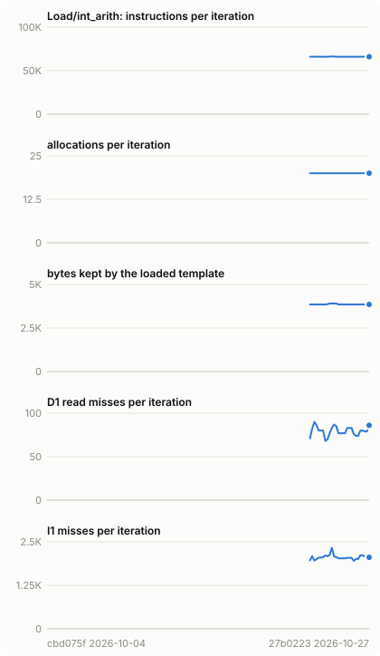

### Render/int_arith

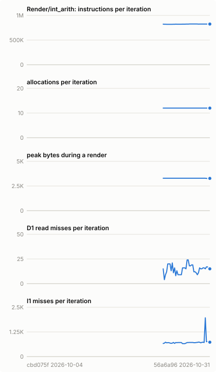

### Load/large_static

### Render/large_static

### RenderSink/large_static

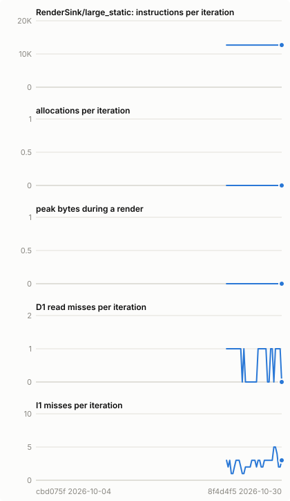

### RenderTo/large_static

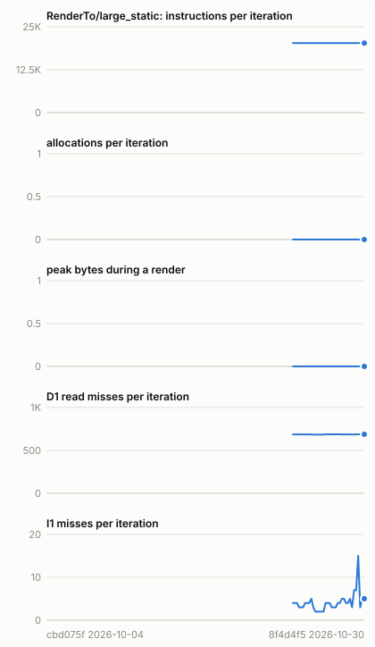

### Load/macros

### Render/macros

### Load/many_tags

### Render/many_tags

### Load/mitsuhiko_table

### Render/mitsuhiko_table

### RenderSink/mitsuhiko_table

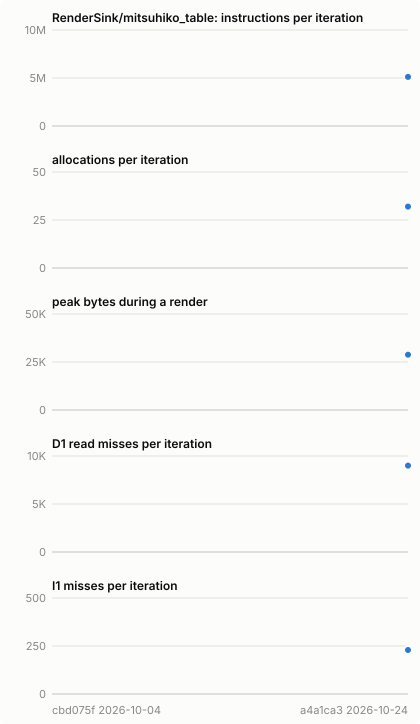

### RenderTo/mitsuhiko_table

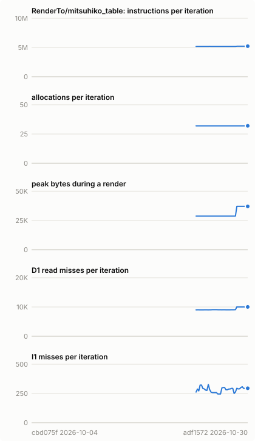

### Load/mitsuhiko_table_wide

### Render/mitsuhiko_table_wide

### RenderSink/mitsuhiko_table_wide

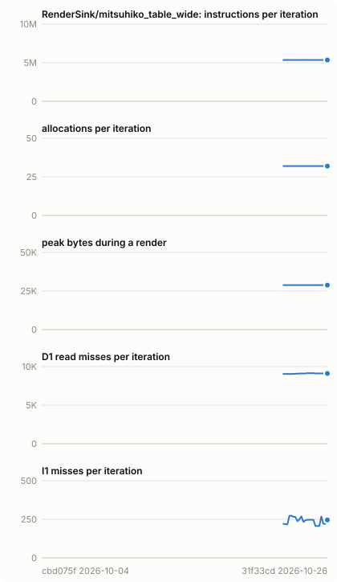

### RenderTo/mitsuhiko_table_wide

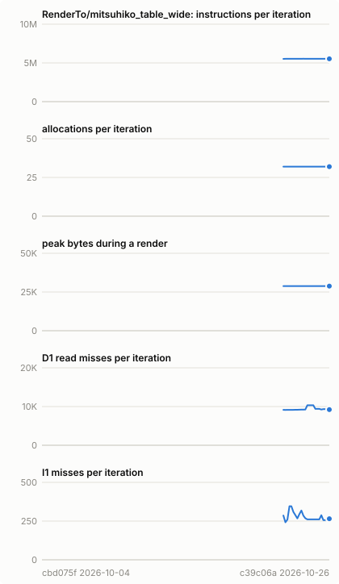

### Load/plain_text

### Render/plain_text

### RenderSink/plain_text

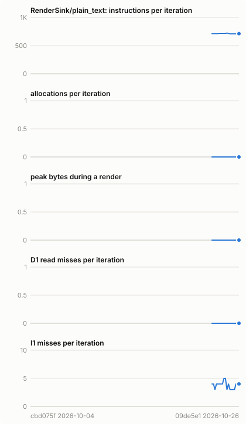

### RenderTo/plain_text

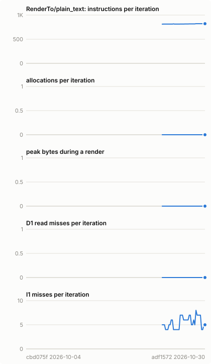

### Load/strings

### Render/strings

### Load/substitute

### Render/substitute

### RenderSink/substitute

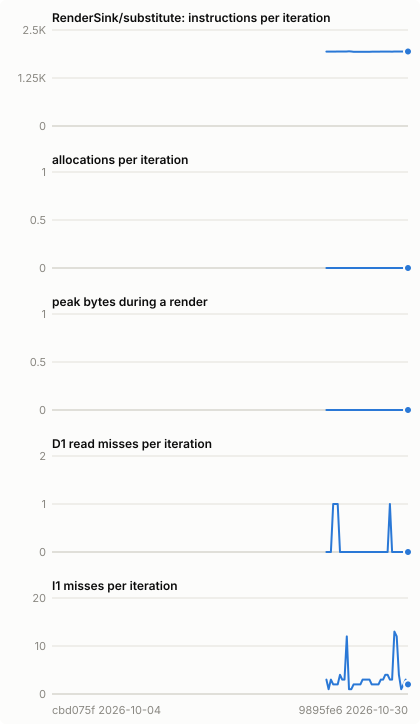

### RenderTo/substitute

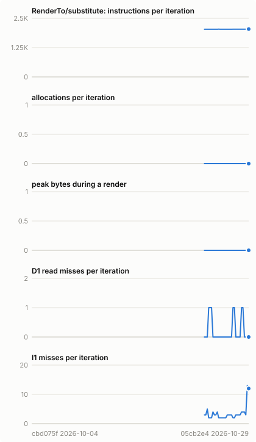
