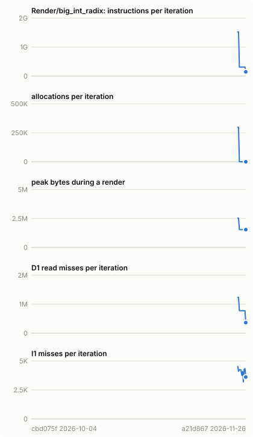

# Benchmark trend

Instruction and allocation counts per iteration on master, one record per commit (276 so far, latest [c9704ed](https://github.com/jinja2cpp/Jinja2Cpp/commit/c9704edb09bf8273629f8e58868c9e186d9ac5e7) on 2026-11-28). Written by the `trend` job of `.github/workflows/benchmark.yml` with `bench/trend.py`; the data is `history.jsonl`.

Memory is the bytes a loaded template keeps for `Load/*` and the peak heap use of one render for `Render/*`; vs first compares with the first record that has it.

| Benchmark | Instructions | vs previous | vs first | Allocations | vs previous | vs first | Memory | vs previous | vs first |
|---|---:|---:|---:|---:|---:|---:|---:|---:|---:|
| [Load/big_int_radix](#loadbig_int_radix) | 43,598 | +0.08% |  | 14 | 0% |  | 2,688 | 0% | 0% |
| [Render/big_int_radix](#renderbig_int_radix) | 146,579,787 | 0% |  | 123 | 0% |  | 1,540,760 | 0% | -39.13% |
| [Load/chat_llama](#loadchat_llama) | 338,874 | +0.07% |  | 54 | 0% |  | 18,536 | 0% | -52.57% |
| [Render/chat_llama](#renderchat_llama) | 291,243 | +0.01% |  | 224 | 0% |  | 11,608 | 0% | -19.16% |
| [Load/chat_mistral](#loadchat_mistral) | 390,084 | +0.07% |  | 52 | 0% |  | 21,024 | 0% | -52.91% |
| [Render/chat_mistral](#renderchat_mistral) | 495,343 | +0.01% |  | 392 | 0% |  | 9,816 | 0% | -25.68% |
| [Load/chat_qwen](#loadchat_qwen) | 264,033 | +0.04% |  | 43 | 0% |  | 14,472 | 0% | -47.04% |
| [Render/chat_qwen](#renderchat_qwen) | 274,241 | 0% |  | 211 | 0% |  | 8,280 | 0% | -2.63% |
| [Load/config_file](#loadconfig_file) | 95,100 | +0.08% |  | 24 | 0% |  | 5,520 | 0% | -47.73% |
| [Render/config_file](#renderconfig_file) | 1,254,644 | 0% |  | 882 | 0% |  | 25,992 | +0.06% | +9.17% |
| [Load/dict_ops](#loaddict_ops) | 32,215 | +0.10% | -78.20% | 8 | 0% | -93.89% | 2,216 | 0% | -47.93% |
| [Render/dict_ops](#renderdict_ops) | 293,243 | 0% | -57.55% | 112 | 0% | -75.11% | 24,424 | 0% | -29.61% |
| [Load/expressions](#loadexpressions) | 44,453 | +0.04% | -78.44% | 15 | 0% | -89.73% | 2,752 | 0% | -55.15% |
| [Render/expressions](#renderexpressions) | 414,652 | 0% | -54.24% | 3 | 0% | -90.00% | 2,440 | 0% | -31.15% |
| [Load/filters](#loadfilters) | 67,259 | +0.11% | -75.49% | 26 | 0% | -88.60% | 3,856 | 0% | -66.22% |
| [Render/filters](#renderfilters) | 25,108 | 0% | -71.68% | 22 | 0% | -70.27% | 784 | 0% | -84.04% |
| [Load/for_filter_if](#loadfor_filter_if) | 28,857 | +0.10% | -78.69% | 6 | 0% | -95.12% | 1,928 | 0% | -44.08% |
| [Render/for_filter_if](#renderfor_filter_if) | 267,173 | 0% | -69.13% | 4 | 0% | -98.23% | 16,560 | 0% | +354.95% |
| [Load/for_loop_vars](#loadfor_loop_vars) | 38,640 | +0.04% | -78.61% | 9 | 0% | -94.27% | 2,392 | 0% | -47.08% |
| [Render/for_loop_vars](#renderfor_loop_vars) | 170,824 | 0% | -84.08% | 2 | 0% | -99.62% | 1,568 | 0% | -43.35% |
| [Load/for_range](#loadfor_range) | 12,706 | +0.10% | -77.58% | 6 | 0% | -89.29% | 1,128 | 0% | -43.60% |
| [Render/for_range](#renderfor_range) | 37,234 | 0% | -59.62% | 3 | 0% | -88.89% | 408 | 0% | -73.02% |
| [Load/hf_deepseek_v31](#loadhf_deepseek_v31) | 387,987 | +0.05% |  | 54 | 0% |  | 22,064 | 0% | +1.14% |
| [Render/hf_deepseek_v31](#renderhf_deepseek_v31) | 90,472 | 0% |  | 42 | 0% |  | 2,456 | 0% | -0.97% |
| [Load/hf_gpt_oss](#loadhf_gpt_oss) | 1,538,828 | +0.04% |  | 282 | 0% |  | 75,192 | 0% | +1.30% |
| [Render/hf_gpt_oss](#renderhf_gpt_oss) | 170,657 | 0% |  | 153 | 0% |  | 6,000 | 0% | +21.56% |
| [Load/hf_mistral_small](#loadhf_mistral_small) | 596,853 | +0.06% |  | 87 | 0% |  | 33,168 | 0% | +0.70% |
| [Render/hf_mistral_small](#renderhf_mistral_small) | 140,448 | 0% |  | 97 | 0% |  | 6,128 | 0% | -0.13% |
| [Load/hf_qwen3](#loadhf_qwen3) | 485,425 | +0.05% |  | 81 | 0% |  | 25,744 | 0% | +1.04% |
| [Render/hf_qwen3](#renderhf_qwen3) | 117,560 | 0% |  | 99 | 0% |  | 3,224 | 0% | -0.74% |
| [Load/html_autoescape](#loadhtml_autoescape) | 190,286 | +0.10% |  | 42 | 0% |  | 12,728 | 0% | -48.43% |
| [Render/html_autoescape](#renderhtml_autoescape) | 1,197,767 | 0% |  | 674 | 0% |  | 46,272 | +0.03% | +14.58% |
| [Load/inheritance](#loadinheritance) | 21,555 | +0.09% | -81.11% | 6 | 0% | -94.39% | 1,368 | 0% | -52.37% |
| [Render/inheritance](#renderinheritance) | 137,537 | +0.05% | -81.61% | 35 | 0% | -94.37% | 8,168 | 0% | +35.77% |
| [Load/int_arith](#loadint_arith) | 65,625 | +0.08% |  | 19 | 0% |  | 3,896 | 0% | +1.04% |
| [Render/int_arith](#renderint_arith) | 825,532 | 0% |  | 12 | 0% |  | 3,288 | 0% | 0% |
| [Module/keep](#modulekeep) | 7,228 | 0% |  | 6 | 0% |  |  |  |  |
| [Module/keep_written](#modulekeep_written) | 29,246 | 0% |  | 10 | 0% |  |  |  |  |
| [Load/large_static](#loadlarge_static) | 147,757 | +0.31% | -83.32% | 13 | 0% | -97.05% | 43,128 | 0% | -19.21% |
| [Render/large_static](#renderlarge_static) | 20,341 | 0% | -72.93% | 1 | 0% | -94.44% | 36,552 | 0% | -1.83% |
| [RenderSink/large_static](#rendersinklarge_static) | 12,630 | +0.01% |  | 0 |  |  | 0 |  |  |
| [RenderTo/large_static](#rendertolarge_static) | 19,894 | +0.01% |  | 0 |  |  | 0 |  |  |
| [Load/macros](#loadmacros) | 54,824 | +0.10% | -75.95% | 25 | 0% | -86.56% | 4,488 | 0% | -27.80% |
| [Render/macros](#rendermacros) | 645,215 | 0% | -74.83% | 308 | 0% | -88.71% | 20,608 | 0% | +40.00% |
| [Load/many_tags](#loadmany_tags) | 8,814,273 | +0.19% | -80.04% | 950 | 0% | -97.23% | 438,136 | 0% | -58.48% |
| [Render/many_tags](#rendermany_tags) | 732,452 | 0% | -64.84% | 2 | 0% | -90.48% | 5,648 | 0% | -10.52% |
| [Load/mitsuhiko_table](#loadmitsuhiko_table) | 45,000 | +0.03% | -81.06% | 18 | 0% | -90.22% | 3,416 | 0% | -43.67% |
| [Render/mitsuhiko_table](#rendermitsuhiko_table) | 5,129,110 | 0% | -58.49% | 33 | 0% | -99.19% | 381,536 | 0% | +9.95% |
| [RenderSink/mitsuhiko_table](#rendersinkmitsuhiko_table) | 5,059,016 | 0% |  | 32 | 0% |  | 37,064 | 0% | +28.59% |
| [RenderTo/mitsuhiko_table](#rendertomitsuhiko_table) | 5,128,569 | 0% |  | 32 | 0% |  | 37,064 | 0% | +28.59% |
| [Load/mitsuhiko_table_wide](#loadmitsuhiko_table_wide) | 52,477 | +0.05% |  | 34 | 0% |  | 5,744 | 0% | -30.49% |
| [Render/mitsuhiko_table_wide](#rendermitsuhiko_table_wide) | 5,475,322 | 0% |  | 33 | 0% |  | 1,414,928 | 0% | +2.46% |
| [RenderSink/mitsuhiko_table_wide](#rendersinkmitsuhiko_table_wide) | 5,301,048 | 0% |  | 32 | 0% |  | 37,064 | 0% | +28.59% |
| [RenderTo/mitsuhiko_table_wide](#rendertomitsuhiko_table_wide) | 5,474,537 | 0% |  | 32 | 0% |  | 37,064 | 0% | +28.59% |
| [Nested/new_template](#nestednew_template) | 455,362 | +0.05% |  | 323 | 0% |  |  |  |  |
| [Load/plain_text](#loadplain_text) | 2,943 | 0% | -69.58% | 3 | 0% | -83.33% | 680 | 0% | -39.29% |
| [Render/plain_text](#renderplain_text) | 971 | +0.10% | -85.71% | 1 | 0% | -91.67% | 40 | 0% | -94.44% |
| [RenderSink/plain_text](#rendersinkplain_text) | 676 | +0.15% |  | 0 |  |  | 0 |  |  |
| [RenderTo/plain_text](#rendertoplain_text) | 772 | +0.13% |  | 0 |  |  | 0 |  |  |
| [Load/prompt_budget](#loadprompt_budget) | 34,463 | +0.03% |  | 17 | 0% |  | 2,248 | 0% | +1.08% |
| [Render/prompt_budget](#renderprompt_budget) | 1,325,520 | 0% |  | 76 | 0% |  | 36,640 | 0% | +0.62% |
| [Nested/shared_globals](#nestedshared_globals) | 160,774 | +0.01% |  | 160 | 0% |  |  |  |  |
| [Load/strings](#loadstrings) | 69,303 | +0.10% | -76.25% | 29 | 0% | -87.05% | 4,384 | 0% | -51.50% |
| [Render/strings](#renderstrings) | 587,317 | 0% | -72.00% | 344 | 0% | -83.73% | 9,120 | 0% | -49.13% |
| [Load/substitute](#loadsubstitute) | 6,683 | +0.12% | -77.62% | 5 | 0% | -86.49% | 840 | 0% | -44.74% |
| [Render/substitute](#rendersubstitute) | 1,652 | +0.06% | -81.26% | 1 | 0% | -91.67% | 40 | 0% | -94.44% |
| [RenderSink/substitute](#rendersinksubstitute) | 1,361 | +0.07% |  | 0 |  |  | 0 |  |  |
| [RenderTo/substitute](#rendertosubstitute) | 1,457 | +0.07% |  | 0 |  |  | 0 |  |  |

## Cache misses

Misses per iteration in callgrind's cache model (`count.py --cache-sim`: 32 KB 8-way L1, 8 MB 16-way last level, no prefetcher); reported, not gated.

| Benchmark | D1 read misses | vs previous | D1 write misses | vs previous | LL data read misses | vs previous | I1 misses | vs previous |
|---|---:|---:|---:|---:|---:|---:|---:|---:|
| Load/big_int_radix | 96 | +6.67% | 58 | -4.92% | 0 |  | 2,009 | -0.45% |
| Render/big_int_radix | 364,131 | 0% | 350,913 | -0.02% | 0 |  | 4,775 | +7.81% |
| Load/chat_llama | 780 | +0.52% | 772 | +0.26% | 0 |  | 7,958 | -0.20% |
| Render/chat_llama | 1,209 | +0.50% | 538 | +0.56% | 0 |  | 4,429 | +1.30% |
| Load/chat_mistral | 1,128 | +0.62% | 1,107 | +1.19% | 0 |  | 9,011 | -1.00% |
| Render/chat_mistral | 2,011 | +0.85% | 648 | +1.73% | 0 |  | 10,962 | -1.42% |
| Load/chat_qwen | 527 | -0.38% | 647 | -0.46% | 0 |  | 4,816 | -1.59% |
| Render/chat_qwen | 1,121 | -0.09% | 437 | 0% | 0 |  | 3,635 | -2.02% |
| Load/config_file | 208 | -0.95% | 193 | +1.05% | 0 |  | 2,790 | -1.31% |
| Render/config_file | 6,417 | -1.99% | 1,687 | -1.11% | 0 |  | 46,783 | +2.82% |
| Load/dict_ops | 43 | -2.27% | 30 | -6.25% | 0 |  | 1,407 | +1.81% |
| Render/dict_ops | 712 | 0% | 394 | -0.51% | 0 |  | 793 | +4.20% |
| Load/expressions | 31 | +6.90% | 33 | +3.12% | 0 |  | 1,362 | +3.34% |
| Render/expressions | 7 | 0% | 3 | 0% | 0 |  | 350 | +12.18% |
| Load/filters | 83 | -1.19% | 57 | +7.55% | 0 |  | 1,683 | +1.02% |
| Render/filters | 29 | +38.10% | 9 | +28.57% | 0 |  | 690 | -3.23% |
| Load/for_filter_if | 12 | 0% | 4 | 0% | 0 |  | 1,063 | -3.28% |
| Render/for_filter_if | 1,704 | 0% | 93 | +2.20% | 0 |  | 133 | -8.28% |
| Load/for_loop_vars | 23 | 0% | 17 | 0% | 0 |  | 1,152 | -0.35% |
| Render/for_loop_vars | 7 | 0% | 1 |  | 0 |  | 123 | +6.96% |
| Load/for_range | 2 | 0% | 4 | -20.00% | 0 |  | 767 | +0.92% |
| Render/for_range | 4 | 0% | 1 | -50.00% | 0 |  | 169 | +10.46% |
| Load/hf_deepseek_v31 | 966 | +0.21% | 979 | +0.41% | 0 |  | 6,759 | +1.08% |
| Render/hf_deepseek_v31 | 396 | +1.28% | 89 | +1.14% | 0 |  | 1,431 | -4.92% |
| Load/hf_gpt_oss | 4,722 | +0.04% | 3,407 | +0.09% | 0 |  | 23,430 | -1.32% |
| Render/hf_gpt_oss | 1,302 | +0.08% | 432 | +2.13% | 0 |  | 4,987 | +0.99% |
| Load/hf_mistral_small | 1,902 | +0.21% | 1,654 | +0.55% | 0 |  | 11,792 | -0.14% |
| Render/hf_mistral_small | 993 | -0.80% | 325 | +0.93% | 0 |  | 3,752 | +0.67% |
| Load/hf_qwen3 | 1,499 | -0.20% | 1,300 | +0.23% | 0 |  | 9,590 | -2.40% |
| Render/hf_qwen3 | 730 | +0.83% | 234 | -1.27% | 0 |  | 2,771 | +1.17% |
| Load/html_autoescape | 460 | +0.66% | 539 | 0% | 0 |  | 4,133 | +2.35% |
| Render/html_autoescape | 5,196 | +0.97% | 1,735 | +0.81% | 0 |  | 37,834 | +5.90% |
| Load/inheritance | 2 | 0% | 3 | -25.00% | 0 |  | 721 | +0.28% |
| Render/inheritance | 590 | 0% | 116 | +0.87% | 0 |  | 1,050 | +0.48% |
| Load/int_arith | 70 | -5.41% | 63 | -3.08% | 0 |  | 2,156 | -0.37% |
| Render/int_arith | 27 | -3.57% | 10 | -28.57% | 0 |  | 743 | -3.63% |
| Module/keep | 5 | 0% | 3 | 0% | 0 |  | 478 | -4.97% |
| Module/keep_written | 1,148 | -0.35% | 576 | +0.17% | 0 |  | 785 | +0.90% |
| Load/large_static | 1,921 | +0.10% | 905 | +0.11% | 0 |  | 273 | +5.41% |
| Render/large_static | 700 | 0% | 571 | 0% | 0 |  | 4 | -20.00% |
| RenderSink/large_static | 1 | 0% | 0 |  | 0 |  | 2 | -33.33% |
| RenderTo/large_static | 679 | 0% | 574 | +0.17% | 0 |  | 4 | 0% |
| Load/macros | 61 | -4.69% | 54 | -5.26% | 0 |  | 1,802 | +1.69% |
| Render/macros | 756 | +0.27% | 247 | +0.41% | 0 |  | 615 | -12.77% |
| Load/many_tags | 28,345 | +0.07% | 22,665 | +0.11% | 0 |  | 249,270 | +2.10% |
| Render/many_tags | 6,124 | +0.02% | 807 | +0.37% | 0 |  | 80 | -20.79% |
| Load/mitsuhiko_table | 39 | +2.63% | 47 | -2.08% | 0 |  | 924 | -0.65% |
| Render/mitsuhiko_table | 10,060 | +0.04% | 6,345 | +0.06% | 0 |  | 295 | -9.79% |
| RenderSink/mitsuhiko_table | 9,956 | +0.01% | 1,192 | -0.08% | 0 |  | 223 | -12.20% |
| RenderTo/mitsuhiko_table | 10,060 | -0.03% | 6,296 | 0% | 0 |  | 275 | -3.85% |
| Load/mitsuhiko_table_wide | 84 | -4.55% | 75 | -5.06% | 0 |  | 1,187 | -1.00% |
| Render/mitsuhiko_table_wide | 10,152 | +0.05% | 22,561 | +0.05% | 0 |  | 314 | +1.62% |
| RenderSink/mitsuhiko_table_wide | 10,011 | -0.02% | 1,242 | -0.08% | 0 |  | 243 | -10.33% |
| RenderTo/mitsuhiko_table_wide | 10,143 | -0.03% | 22,663 | +0.03% | 0 |  | 278 | -5.76% |
| Nested/new_template | 2,391 | +1.31% | 1,666 | +0.79% | 0 |  | 24,928 | +1.46% |
| Load/plain_text | 0 |  | 1 | -50.00% | 0 |  | 4 | -78.95% |
| Render/plain_text | 1 | 0% | 0 |  | 0 |  | 8 | +33.33% |
| RenderSink/plain_text | 1 | 0% | 0 |  | 0 |  | 5 | 0% |
| RenderTo/plain_text | 1 | 0% | 0 |  | 0 |  | 7 | +16.67% |
| Load/prompt_budget | 61 | -3.17% | 46 | -4.17% | 0 |  | 1,417 | +1.14% |
| Render/prompt_budget | 4,777 | -0.06% | 547 | +0.74% | 0 |  | 940 | -20.74% |
| Nested/shared_globals | 295 | +16.60% | 141 | +14.63% | 0 |  | 9,377 | +1.26% |
| Load/strings | 135 | -3.57% | 82 | 0% | 0 |  | 2,887 | -0.28% |
| Render/strings | 428 | -0.23% | 480 | 0% | 0 |  | 1,602 | -0.93% |
| Load/substitute | 1 | 0% | 3 | 0% | 0 |  | 127 | -11.81% |
| Render/substitute | 1 | 0% | 0 |  | 0 |  | 4 | -20.00% |
| RenderSink/substitute | 1 | 0% | 0 |  | 0 |  | 3 | 0% |
| RenderTo/substitute | 1 | 0% | 0 |  | 0 |  | 3 | -25.00% |

## Charts

### Load/big_int_radix

### Render/big_int_radix

### Load/chat_llama

### Render/chat_llama

### Load/chat_mistral

### Render/chat_mistral

### Load/chat_qwen

### Render/chat_qwen

### Load/config_file

### Render/config_file

### Load/dict_ops

### Render/dict_ops

### Load/expressions

### Render/expressions

### Load/filters

### Render/filters

### Load/for_filter_if

### Render/for_filter_if

### Load/for_loop_vars

### Render/for_loop_vars

### Load/for_range

### Render/for_range

### Load/hf_deepseek_v31

### Render/hf_deepseek_v31

### Load/hf_gpt_oss

### Render/hf_gpt_oss

### Load/hf_mistral_small

### Render/hf_mistral_small

### Load/hf_qwen3

### Render/hf_qwen3

### Load/html_autoescape

### Render/html_autoescape

### Load/inheritance

### Render/inheritance

### Load/int_arith

### Render/int_arith

### Module/keep

### Module/keep_written

### Load/large_static

### Render/large_static

### RenderSink/large_static

### RenderTo/large_static

### Load/macros

### Render/macros

### Load/many_tags

### Render/many_tags

### Load/mitsuhiko_table

### Render/mitsuhiko_table

### RenderSink/mitsuhiko_table

### RenderTo/mitsuhiko_table

### Load/mitsuhiko_table_wide

### Render/mitsuhiko_table_wide

### RenderSink/mitsuhiko_table_wide

### RenderTo/mitsuhiko_table_wide

### Nested/new_template

### Load/plain_text

### Render/plain_text

### RenderSink/plain_text

### RenderTo/plain_text

### Load/prompt_budget

### Render/prompt_budget

### Nested/shared_globals

### Load/strings

### Render/strings

### Load/substitute

### Render/substitute

### RenderSink/substitute

### RenderTo/substitute

