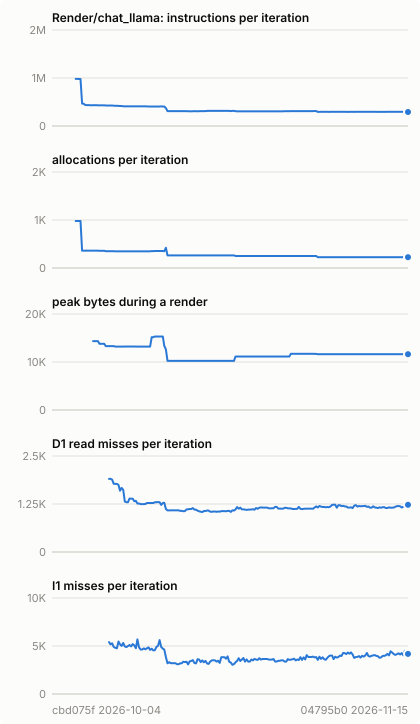
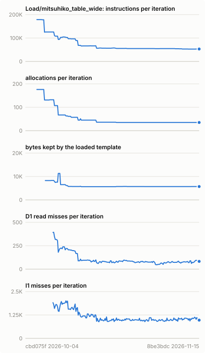

# Benchmark trend

Instruction and allocation counts per iteration on master, one record per commit (237 so far, latest [fb06c39](https://github.com/jinja2cpp/Jinja2Cpp/commit/fb06c39fb34cf8f08918e930ad2fc521d297284a) on 2026-11-17). Written by the `trend` job of `.github/workflows/benchmark.yml` with `bench/trend.py`; the data is `history.jsonl`.

Memory is the bytes a loaded template keeps for `Load/*` and the peak heap use of one render for `Render/*`; vs first compares with the first record that has it.

| Benchmark | Instructions | vs previous | vs first | Allocations | vs previous | vs first | Memory | vs previous | vs first |
|---|---:|---:|---:|---:|---:|---:|---:|---:|---:|
| [Load/chat_llama](#loadchat_llama) | 334,494 | -0.31% |  | 54 | 0% |  | 18,472 | 0% | -52.73% |
| [Render/chat_llama](#renderchat_llama) | 289,806 | +0.33% |  | 224 | 0% |  | 11,592 | 0% | -19.28% |
| [Load/chat_mistral](#loadchat_mistral) | 384,137 | -0.38% |  | 51 | 0% |  | 20,896 | 0% | -53.20% |
| [Render/chat_mistral](#renderchat_mistral) | 491,447 | +0.06% |  | 401 | 0% |  | 9,944 | -0.48% | -24.71% |
| [Load/chat_qwen](#loadchat_qwen) | 260,603 | -0.28% |  | 43 | 0% |  | 14,424 | 0% | -47.22% |
| [Render/chat_qwen](#renderchat_qwen) | 271,584 | -0.02% |  | 211 | 0% |  | 8,280 | 0% | -2.63% |
| [Load/config_file](#loadconfig_file) | 93,871 | -0.57% |  | 24 | 0% |  | 5,472 | 0% | -48.18% |
| [Render/config_file](#renderconfig_file) | 1,262,797 | +0.01% |  | 908 | 0% |  | 25,576 | 0% | +7.43% |
| [Load/dict_ops](#loaddict_ops) | 31,645 | -1.23% | -78.59% | 8 | 0% | -93.89% | 2,184 | 0% | -48.68% |
| [Render/dict_ops](#renderdict_ops) | 290,441 | 0% | -57.96% | 112 | 0% | -75.11% | 24,408 | 0% | -29.65% |
| [Load/expressions](#loadexpressions) | 43,590 | -0.97% | -78.85% | 15 | 0% | -89.73% | 2,736 | 0% | -55.41% |
| [Render/expressions](#renderexpressions) | 415,811 | 0% | -54.11% | 3 | 0% | -90.00% | 2,440 | 0% | -31.15% |
| [Load/filters](#loadfilters) | 66,674 | -0.73% | -75.71% | 26 | 0% | -88.60% | 3,856 | 0% | -66.22% |
| [Render/filters](#renderfilters) | 26,383 | 0% | -70.25% | 23 | 0% | -68.92% | 752 | 0% | -84.69% |
| [Load/for_filter_if](#loadfor_filter_if) | 28,486 | -1.35% | -78.96% | 6 | 0% | -95.12% | 1,912 | 0% | -44.55% |
| [Render/for_filter_if](#renderfor_filter_if) | 267,395 | 0% | -69.10% | 4 | 0% | -98.23% | 16,560 | 0% | +354.95% |
| [Load/for_loop_vars](#loadfor_loop_vars) | 38,323 | -1.05% | -78.79% | 9 | 0% | -94.27% | 2,376 | 0% | -47.43% |
| [Render/for_loop_vars](#renderfor_loop_vars) | 170,641 | 0% | -84.09% | 2 | 0% | -99.62% | 1,568 | 0% | -43.35% |
| [Load/for_range](#loadfor_range) | 12,407 | -4.05% | -78.11% | 6 | 0% | -89.29% | 1,096 | 0% | -45.20% |
| [Render/for_range](#renderfor_range) | 37,046 | 0% | -59.82% | 3 | 0% | -88.89% | 408 | 0% | -73.02% |
| [Load/hf_deepseek_v31](#loadhf_deepseek_v31) | 383,025 | -0.36% |  | 54 | 0% |  | 21,984 | 0% | +0.77% |
| [Render/hf_deepseek_v31](#renderhf_deepseek_v31) | 89,958 | 0% |  | 42 | 0% |  | 2,456 | 0% | -0.97% |
| [Load/hf_gpt_oss](#loadhf_gpt_oss) | 1,520,419 | -0.17% |  | 282 | 0% |  | 74,744 | -0.06% | +0.70% |
| [Render/hf_gpt_oss](#renderhf_gpt_oss) | 167,094 | -0.04% |  | 153 | 0% |  | 5,664 | 0% | +14.75% |
| [Load/hf_mistral_small](#loadhf_mistral_small) | 589,374 | -0.46% |  | 87 | 0% |  | 33,056 | -0.05% | +0.36% |
| [Render/hf_mistral_small](#renderhf_mistral_small) | 139,112 | +0.04% |  | 97 | 0% |  | 6,112 | +0.26% | -0.39% |
| [Load/hf_qwen3](#loadhf_qwen3) | 475,548 | -0.27% |  | 81 | 0% |  | 25,568 | 0% | +0.35% |
| [Render/hf_qwen3](#renderhf_qwen3) | 116,579 | -0.11% |  | 99 | 0% |  | 3,224 | 0% | -0.74% |
| [Load/html_autoescape](#loadhtml_autoescape) | 188,768 | -0.38% |  | 42 | 0% |  | 12,680 | 0% | -48.62% |
| [Render/html_autoescape](#renderhtml_autoescape) | 1,194,780 | -0.04% |  | 674 | 0% |  | 45,968 | 0% | +13.83% |
| [Load/inheritance](#loadinheritance) | 21,175 | -1.71% | -81.44% | 6 | 0% | -94.39% | 1,352 | 0% | -52.92% |
| [Render/inheritance](#renderinheritance) | 134,056 | 0% | -82.07% | 35 | 0% | -94.37% | 7,960 | 0% | +32.31% |
| [Load/int_arith](#loadint_arith) | 64,478 | -0.73% |  | 19 | 0% |  | 3,880 | 0% | +0.62% |
| [Render/int_arith](#renderint_arith) | 827,268 | 0% |  | 12 | 0% |  | 3,272 | 0% | -0.49% |
| [Module/keep](#modulekeep) | 6,880 | 0% |  | 6 | 0% |  |  |  |  |
| [Module/keep_written](#modulekeep_written) | 29,019 | 0% |  | 10 | 0% |  |  |  |  |
| [Load/large_static](#loadlarge_static) | 146,911 | -0.46% | -83.42% | 13 | 0% | -97.05% | 43,128 | 0% | -19.21% |
| [Render/large_static](#renderlarge_static) | 20,322 | 0% | -72.95% | 1 | 0% | -94.44% | 36,552 | 0% | -1.83% |
| [RenderSink/large_static](#rendersinklarge_static) | 12,310 | 0% |  | 0 |  |  | 0 |  |  |
| [RenderTo/large_static](#rendertolarge_static) | 19,885 | 0% |  | 0 |  |  | 0 |  |  |
| [Load/macros](#loadmacros) | 54,266 | -0.77% | -76.19% | 25 | 0% | -86.56% | 4,424 | 0% | -28.83% |
| [Render/macros](#rendermacros) | 640,833 | 0% | -75.00% | 308 | 0% | -88.71% | 20,576 | 0% | +39.78% |
| [Load/many_tags](#loadmany_tags) | 8,746,541 | -0.20% | -80.20% | 950 | 0% | -97.23% | 438,120 | 0% | -58.48% |
| [Render/many_tags](#rendermany_tags) | 730,181 | 0% | -64.95% | 2 | 0% | -90.48% | 5,648 | 0% | -10.52% |
| [Load/mitsuhiko_table](#loadmitsuhiko_table) | 44,443 | -0.95% | -81.29% | 18 | 0% | -90.22% | 3,368 | 0% | -44.46% |
| [Render/mitsuhiko_table](#rendermitsuhiko_table) | 5,068,134 | 0% | -58.98% | 33 | 0% | -99.19% | 381,536 | 0% | +9.95% |
| [RenderSink/mitsuhiko_table](#rendersinkmitsuhiko_table) | 4,995,275 | 0% |  | 32 | 0% |  | 37,064 | 0% | +28.59% |
| [RenderTo/mitsuhiko_table](#rendertomitsuhiko_table) | 5,067,640 | 0% |  | 32 | 0% |  | 37,064 | 0% | +28.59% |
| [Load/mitsuhiko_table_wide](#loadmitsuhiko_table_wide) | 52,183 | -0.77% |  | 34 | 0% |  | 5,696 | 0% | -31.07% |
| [Render/mitsuhiko_table_wide](#rendermitsuhiko_table_wide) | 5,414,086 | -0.01% |  | 33 | 0% |  | 1,414,928 | 0% | +2.46% |
| [RenderSink/mitsuhiko_table_wide](#rendersinkmitsuhiko_table_wide) | 5,237,306 | -0.01% |  | 32 | 0% |  | 37,064 | 0% | +28.59% |
| [RenderTo/mitsuhiko_table_wide](#rendertomitsuhiko_table_wide) | 5,413,553 | -0.01% |  | 32 | 0% |  | 37,064 | 0% | +28.59% |
| [Load/plain_text](#loadplain_text) | 2,919 | -12.55% | -69.83% | 3 | 0% | -83.33% | 680 | 0% | -39.29% |
| [Render/plain_text](#renderplain_text) | 951 | 0% | -86.00% | 1 | 0% | -91.67% | 40 | 0% | -94.44% |
| [RenderSink/plain_text](#rendersinkplain_text) | 651 | 0% |  | 0 |  |  | 0 |  |  |
| [RenderTo/plain_text](#rendertoplain_text) | 752 | 0% |  | 0 |  |  | 0 |  |  |
| [Load/prompt_budget](#loadprompt_budget) | 33,775 | -1.28% |  | 17 | 0% |  | 2,232 | 0% | +0.36% |
| [Render/prompt_budget](#renderprompt_budget) | 1,319,383 | +0.01% |  | 76 | 0% |  | 36,416 | 0% | 0% |
| [Load/strings](#loadstrings) | 68,545 | -0.66% | -76.51% | 29 | 0% | -87.05% | 4,352 | 0% | -51.86% |
| [Render/strings](#renderstrings) | 580,440 | 0% | -72.33% | 344 | 0% | -83.73% | 9,088 | 0% | -49.31% |
| [Load/substitute](#loadsubstitute) | 6,639 | -6.73% | -77.76% | 5 | 0% | -86.49% | 840 | 0% | -44.74% |
| [Render/substitute](#rendersubstitute) | 1,631 | 0% | -81.49% | 1 | 0% | -91.67% | 40 | 0% | -94.44% |
| [RenderSink/substitute](#rendersinksubstitute) | 1,335 | 0% |  | 0 |  |  | 0 |  |  |
| [RenderTo/substitute](#rendertosubstitute) | 1,436 | 0% |  | 0 |  |  | 0 |  |  |

## Cache misses

Misses per iteration in callgrind's cache model (`count.py --cache-sim`: 32 KB 8-way L1, 8 MB 16-way last level, no prefetcher); reported, not gated.

| Benchmark | D1 read misses | vs previous | D1 write misses | vs previous | LL data read misses | vs previous | I1 misses | vs previous |
|---|---:|---:|---:|---:|---:|---:|---:|---:|
| Load/chat_llama | 759 | +2.99% | 774 | +3.20% | 0 |  | 7,884 | -2.47% |
| Render/chat_llama | 1,160 | +0.87% | 525 | 0% | 0 |  | 4,156 | +1.76% |
| Load/chat_mistral | 1,095 | +0.83% | 1,093 | +1.77% | 0 |  | 9,282 | -1.46% |
| Render/chat_mistral | 1,982 | +3.07% | 624 | +3.83% | 0 |  | 10,275 | +5.34% |
| Load/chat_qwen | 543 | -4.57% | 644 | +2.71% | 0 |  | 4,867 | -3.20% |
| Render/chat_qwen | 1,031 | -6.10% | 414 | -3.72% | 0 |  | 3,577 | +4.87% |
| Load/config_file | 209 | -7.52% | 191 | +2.69% | 0 |  | 2,779 | -5.41% |
| Render/config_file | 5,988 | +1.89% | 1,465 | -7.04% | 0 |  | 43,071 | +3.27% |
| Load/dict_ops | 31 | -34.04% | 19 | -26.92% | 0 |  | 1,378 | -2.34% |
| Render/dict_ops | 663 | +0.45% | 419 | +0.24% | 0 |  | 799 | -2.08% |
| Load/expressions | 27 | -44.90% | 21 | -40.00% | 0 |  | 1,275 | -2.52% |
| Render/expressions | 9 | 0% | 4 | 0% | 0 |  | 335 | +26.42% |
| Load/filters | 83 | -20.95% | 40 | -14.89% | 0 |  | 1,520 | -6.63% |
| Render/filters | 6 | -25.00% | 0 |  | 0 |  | 755 | +1.62% |
| Load/for_filter_if | 21 | -38.24% | 11 | -35.29% | 0 |  | 1,090 | -4.47% |
| Render/for_filter_if | 1,698 | 0% | 85 | -1.16% | 0 |  | 156 | +19.08% |
| Load/for_loop_vars | 33 | -28.26% | 16 | -27.27% | 0 |  | 1,099 | -6.23% |
| Render/for_loop_vars | 12 | 0% | 2 | 0% | 0 |  | 157 | +63.54% |
| Load/for_range | 1 | -66.67% | 4 | -20.00% | 0 |  | 723 | -8.48% |
| Render/for_range | 1 | 0% | 0 |  | 0 |  | 126 | +4.13% |
| Load/hf_deepseek_v31 | 1,014 | -4.16% | 996 | -1.09% | 0 |  | 7,164 | -3.27% |
| Render/hf_deepseek_v31 | 356 | +5.95% | 77 | -4.94% | 0 |  | 1,512 | +0.87% |
| Load/hf_gpt_oss | 4,624 | +0.24% | 3,374 | +1.20% | 0 |  | 24,502 | -2.09% |
| Render/hf_gpt_oss | 1,252 | +0.56% | 392 | -1.51% | 0 |  | 4,650 | +0.45% |
| Load/hf_mistral_small | 1,821 | -4.91% | 1,629 | -1.75% | 0 |  | 12,072 | -1.69% |
| Render/hf_mistral_small | 940 | -3.69% | 291 | -1.02% | 0 |  | 3,790 | +2.43% |
| Load/hf_qwen3 | 1,535 | +0.59% | 1,336 | -0.74% | 0 |  | 9,624 | -1.00% |
| Render/hf_qwen3 | 684 | +0.29% | 226 | +0.89% | 0 |  | 2,651 | +0.30% |
| Load/html_autoescape | 501 | +4.59% | 534 | +0.38% | 0 |  | 4,128 | -1.55% |
| Render/html_autoescape | 3,935 | -27.48% | 1,288 | -27.03% | 0 |  | 36,210 | -0.86% |
| Load/inheritance | 2 | -75.00% | 3 | -25.00% | 0 |  | 698 | -3.59% |
| Render/inheritance | 596 | 0% | 109 | +0.93% | 0 |  | 874 | +0.23% |
| Load/int_arith | 74 | -21.28% | 51 | -22.73% | 0 |  | 2,025 | -6.68% |
| Render/int_arith | 9 | -18.18% | 3 | -25.00% | 0 |  | 2,953 | +296.38% |
| Module/keep | 2 | 0% | 2 | 0% | 0 |  | 410 | -1.20% |
| Module/keep_written | 1,132 | +0.09% | 563 | 0% | 0 |  | 737 | +3.22% |
| Load/large_static | 1,912 | -0.68% | 908 | 0% | 0 |  | 218 | -30.35% |
| Render/large_static | 701 | 0% | 568 | 0% | 0 |  | 3 | -25.00% |
| RenderSink/large_static | 1 | 0% | 0 |  | 0 |  | 3 | -25.00% |
| RenderTo/large_static | 678 | 0% | 571 | 0% | 0 |  | 3 | -25.00% |
| Load/macros | 72 | -16.28% | 58 | -18.31% | 0 |  | 1,769 | -1.78% |
| Render/macros | 746 | -0.40% | 244 | 0% | 0 |  | 1,445 | +6.09% |
| Load/many_tags | 27,767 | -0.31% | 22,617 | -0.05% | 0 |  | 235,278 | -2.06% |
| Render/many_tags | 6,089 | -0.03% | 783 | -0.25% | 0 |  | 104 | +23.81% |
| Load/mitsuhiko_table | 40 | -25.93% | 47 | -14.55% | 0 |  | 902 | -4.14% |
| Render/mitsuhiko_table | 10,012 | -0.01% | 6,299 | 0% | 0 |  | 321 | -0.31% |
| RenderSink/mitsuhiko_table | 9,957 | 0% | 1,207 | 0% | 0 |  | 253 | -1.56% |
| RenderTo/mitsuhiko_table | 10,026 | -0.01% | 6,311 | 0% | 0 |  | 301 | +3.79% |
| Load/mitsuhiko_table_wide | 98 | -1.01% | 92 | -1.08% | 0 |  | 1,018 | +4.20% |
| Render/mitsuhiko_table_wide | 10,215 | -0.30% | 22,688 | -0.19% | 0 |  | 324 | +3.18% |
| RenderSink/mitsuhiko_table_wide | 10,024 | -0.28% | 1,300 | -0.23% | 0 |  | 249 | -4.60% |
| RenderTo/mitsuhiko_table_wide | 10,213 | -0.37% | 22,721 | -0.03% | 0 |  | 304 | +2.70% |
| Load/plain_text | 0 |  | 1 | -50.00% | 0 |  | 18 | +28.57% |
| Render/plain_text | 1 | 0% | 0 |  | 0 |  | 7 | +16.67% |
| RenderSink/plain_text | 1 | 0% | 0 |  | 0 |  | 5 | 0% |
| RenderTo/plain_text | 1 | 0% | 0 |  | 0 |  | 7 | +40.00% |
| Load/prompt_budget | 68 | -15.00% | 47 | -7.84% | 0 |  | 1,370 | -3.11% |
| Render/prompt_budget | 4,809 | +0.48% | 543 | +0.37% | 0 |  | 878 | -0.23% |
| Load/strings | 131 | -17.61% | 106 | -17.19% | 0 |  | 2,769 | -3.62% |
| Render/strings | 401 | -0.25% | 462 | +0.43% | 0 |  | 2,727 | +12.87% |
| Load/substitute | 1 | -50.00% | 2 | -33.33% | 0 |  | 116 | -42.00% |
| Render/substitute | 1 | 0% | 0 |  | 0 |  | 3 | -25.00% |
| RenderSink/substitute | 0 |  | 0 |  | 0 |  | 3 | -25.00% |
| RenderTo/substitute | 1 | 0% | 0 |  | 0 |  | 3 | 0% |

## Charts

### Load/chat_llama

### Render/chat_llama

### Load/chat_mistral

### Render/chat_mistral

### Load/chat_qwen

### Render/chat_qwen

### Load/config_file

### Render/config_file

### Load/dict_ops

### Render/dict_ops

### Load/expressions

### Render/expressions

### Load/filters

### Render/filters

### Load/for_filter_if

### Render/for_filter_if

### Load/for_loop_vars

### Render/for_loop_vars

### Load/for_range

### Render/for_range

### Load/hf_deepseek_v31

### Render/hf_deepseek_v31

### Load/hf_gpt_oss

### Render/hf_gpt_oss

### Load/hf_mistral_small

### Render/hf_mistral_small

### Load/hf_qwen3

### Render/hf_qwen3

### Load/html_autoescape

### Render/html_autoescape

### Load/inheritance

### Render/inheritance

### Load/int_arith

### Render/int_arith

### Module/keep

### Module/keep_written

### Load/large_static

### Render/large_static

### RenderSink/large_static

### RenderTo/large_static

### Load/macros

### Render/macros

### Load/many_tags

### Render/many_tags

### Load/mitsuhiko_table

### Render/mitsuhiko_table

### RenderSink/mitsuhiko_table

### RenderTo/mitsuhiko_table

### Load/mitsuhiko_table_wide

### Render/mitsuhiko_table_wide

### RenderSink/mitsuhiko_table_wide

### RenderTo/mitsuhiko_table_wide

### Load/plain_text

### Render/plain_text

### RenderSink/plain_text

### RenderTo/plain_text

### Load/prompt_budget

### Render/prompt_budget

### Load/strings

### Render/strings

### Load/substitute

### Render/substitute

### RenderSink/substitute

### RenderTo/substitute

