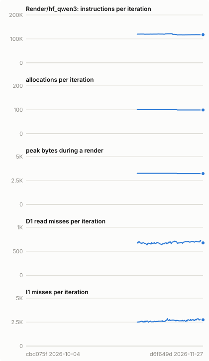

# Benchmark trend

Instruction and allocation counts per iteration on master, one record per commit (270 so far, latest [d6f649d](https://github.com/jinja2cpp/Jinja2Cpp/commit/d6f649de79907c4963bcb401a24d82bb403efd78) on 2026-11-27). Written by the `trend` job of `.github/workflows/benchmark.yml` with `bench/trend.py`; the data is `history.jsonl`.

Memory is the bytes a loaded template keeps for `Load/*` and the peak heap use of one render for `Render/*`; vs first compares with the first record that has it.

| Benchmark | Instructions | vs previous | vs first | Allocations | vs previous | vs first | Memory | vs previous | vs first |
|---|---:|---:|---:|---:|---:|---:|---:|---:|---:|
| [Load/big_int_radix](#loadbig_int_radix) | 43,280 | +0.03% |  | 14 | 0% |  | 2,688 | 0% | 0% |
| [Render/big_int_radix](#renderbig_int_radix) | 146,578,660 | 0% |  | 123 | 0% |  | 1,540,760 | 0% | -39.13% |
| [Load/chat_llama](#loadchat_llama) | 338,327 | +0.26% |  | 54 | 0% |  | 18,536 | 0% | -52.57% |
| [Render/chat_llama](#renderchat_llama) | 291,736 | +0.05% |  | 224 | 0% |  | 11,624 | +0.14% | -19.05% |
| [Load/chat_mistral](#loadchat_mistral) | 387,044 | +0.30% |  | 51 | 0% |  | 20,976 | 0% | -53.02% |
| [Render/chat_mistral](#renderchat_mistral) | 492,867 | +0.13% |  | 392 | 0% |  | 9,816 | +0.66% | -25.68% |
| [Load/chat_qwen](#loadchat_qwen) | 263,306 | +0.24% |  | 43 | 0% |  | 14,472 | 0% | -47.04% |
| [Render/chat_qwen](#renderchat_qwen) | 273,409 | 0% |  | 211 | 0% |  | 8,280 | 0% | -2.63% |
| [Load/config_file](#loadconfig_file) | 94,670 | +0.28% |  | 24 | 0% |  | 5,520 | 0% | -47.73% |
| [Render/config_file](#renderconfig_file) | 1,250,475 | +0.07% |  | 882 | 0% |  | 25,976 | +0.06% | +9.11% |
| [Load/dict_ops](#loaddict_ops) | 32,041 | +0.23% | -78.32% | 8 | 0% | -93.89% | 2,216 | 0% | -47.93% |
| [Render/dict_ops](#renderdict_ops) | 291,637 | +0.86% | -57.79% | 112 | 0% | -75.11% | 24,424 | +0.07% | -29.61% |
| [Load/expressions](#loadexpressions) | 44,211 | +0.08% | -78.55% | 15 | 0% | -89.73% | 2,752 | 0% | -55.15% |
| [Render/expressions](#renderexpressions) | 414,625 | 0% | -54.24% | 3 | 0% | -90.00% | 2,440 | 0% | -31.15% |
| [Load/filters](#loadfilters) | 67,503 | -0.02% | -75.40% | 26 | 0% | -88.60% | 3,856 | 0% | -66.22% |
| [Render/filters](#renderfilters) | 24,961 | +0.14% | -71.85% | 22 | 0% | -70.27% | 784 | +4.26% | -84.04% |
| [Load/for_filter_if](#loadfor_filter_if) | 28,667 | +0.34% | -78.83% | 6 | 0% | -95.12% | 1,928 | 0% | -44.08% |
| [Render/for_filter_if](#renderfor_filter_if) | 267,134 | 0% | -69.13% | 4 | 0% | -98.23% | 16,560 | 0% | +354.95% |
| [Load/for_loop_vars](#loadfor_loop_vars) | 38,324 | +0.24% | -78.79% | 9 | 0% | -94.27% | 2,392 | 0% | -47.08% |
| [Render/for_loop_vars](#renderfor_loop_vars) | 170,825 | 0% | -84.08% | 2 | 0% | -99.62% | 1,568 | 0% | -43.35% |
| [Load/for_range](#loadfor_range) | 12,562 | +0.29% | -77.84% | 6 | 0% | -89.29% | 1,128 | 0% | -43.60% |
| [Render/for_range](#renderfor_range) | 37,207 | 0% | -59.65% | 3 | 0% | -88.89% | 408 | 0% | -73.02% |
| [Load/hf_deepseek_v31](#loadhf_deepseek_v31) | 386,308 | +0.36% |  | 54 | 0% |  | 22,032 | 0% | +0.99% |
| [Render/hf_deepseek_v31](#renderhf_deepseek_v31) | 90,720 | +0.01% |  | 42 | 0% |  | 2,456 | 0% | -0.97% |
| [Load/hf_gpt_oss](#loadhf_gpt_oss) | 1,532,696 | +0.28% |  | 282 | 0% |  | 75,096 | +0.11% | +1.17% |
| [Render/hf_gpt_oss](#renderhf_gpt_oss) | 170,650 | +0.63% |  | 153 | 0% |  | 6,048 | +1.07% | +22.53% |
| [Load/hf_mistral_small](#loadhf_mistral_small) | 594,091 | +0.24% |  | 87 | 0% |  | 33,136 | 0% | +0.61% |
| [Render/hf_mistral_small](#renderhf_mistral_small) | 140,499 | +0.10% |  | 97 | 0% |  | 6,128 | +0.52% | -0.13% |
| [Load/hf_qwen3](#loadhf_qwen3) | 480,084 | +0.25% |  | 81 | 0% |  | 25,648 | 0% | +0.66% |
| [Render/hf_qwen3](#renderhf_qwen3) | 117,812 | +0.16% |  | 99 | 0% |  | 3,224 | 0% | -0.74% |
| [Load/html_autoescape](#loadhtml_autoescape) | 189,468 | +0.04% |  | 42 | 0% |  | 12,728 | 0% | -48.43% |
| [Render/html_autoescape](#renderhtml_autoescape) | 1,198,860 | +0.01% |  | 674 | 0% |  | 46,256 | 0% | +14.54% |
| [Load/inheritance](#loadinheritance) | 21,450 | +0.65% | -81.20% | 6 | 0% | -94.39% | 1,368 | 0% | -52.37% |
| [Render/inheritance](#renderinheritance) | 137,098 | -0.02% | -81.67% | 35 | 0% | -94.37% | 8,168 | 0% | +35.77% |
| [Load/int_arith](#loadint_arith) | 65,274 | +0.13% |  | 19 | 0% |  | 3,896 | 0% | +1.04% |
| [Render/int_arith](#renderint_arith) | 825,470 | 0% |  | 12 | 0% |  | 3,288 | +0.49% | 0% |
| [Module/keep](#modulekeep) | 7,153 | -0.14% |  | 6 | 0% |  |  |  |  |
| [Module/keep_written](#modulekeep_written) | 29,158 | 0% |  | 10 | 0% |  |  |  |  |
| [Load/large_static](#loadlarge_static) | 147,158 | 0% | -83.39% | 13 | 0% | -97.05% | 43,128 | 0% | -19.21% |
| [Render/large_static](#renderlarge_static) | 20,342 | 0% | -72.93% | 1 | 0% | -94.44% | 36,552 | 0% | -1.83% |
| [RenderSink/large_static](#rendersinklarge_static) | 12,631 | 0% |  | 0 |  |  | 0 |  |  |
| [RenderTo/large_static](#rendertolarge_static) | 19,845 | 0% |  | 0 |  |  | 0 |  |  |
| [Load/macros](#loadmacros) | 54,463 | +0.14% | -76.11% | 25 | 0% | -86.56% | 4,488 | +0.36% | -27.80% |
| [Render/macros](#rendermacros) | 648,008 | 0% | -74.72% | 308 | 0% | -88.71% | 20,608 | 0% | +40.00% |
| [Load/many_tags](#loadmany_tags) | 8,808,886 | +0.27% | -80.05% | 950 | 0% | -97.23% | 438,136 | 0% | -58.48% |
| [Render/many_tags](#rendermany_tags) | 732,457 | 0% | -64.84% | 2 | 0% | -90.48% | 5,648 | 0% | -10.52% |
| [Load/mitsuhiko_table](#loadmitsuhiko_table) | 44,801 | +0.24% | -81.14% | 18 | 0% | -90.22% | 3,416 | 0% | -43.67% |
| [Render/mitsuhiko_table](#rendermitsuhiko_table) | 5,129,119 | 0% | -58.49% | 33 | 0% | -99.19% | 381,536 | 0% | +9.95% |
| [RenderSink/mitsuhiko_table](#rendersinkmitsuhiko_table) | 5,058,848 | -0.01% |  | 32 | 0% |  | 37,064 | 0% | +28.59% |
| [RenderTo/mitsuhiko_table](#rendertomitsuhiko_table) | 5,128,674 | 0% |  | 32 | 0% |  | 37,064 | 0% | +28.59% |
| [Load/mitsuhiko_table_wide](#loadmitsuhiko_table_wide) | 52,286 | +0.21% |  | 34 | 0% |  | 5,744 | 0% | -30.49% |
| [Render/mitsuhiko_table_wide](#rendermitsuhiko_table_wide) | 5,474,953 | -0.01% |  | 33 | 0% |  | 1,414,928 | 0% | +2.46% |
| [RenderSink/mitsuhiko_table_wide](#rendersinkmitsuhiko_table_wide) | 5,300,880 | -0.01% |  | 32 | 0% |  | 37,064 | 0% | +28.59% |
| [RenderTo/mitsuhiko_table_wide](#rendertomitsuhiko_table_wide) | 5,474,369 | -0.01% |  | 32 | 0% |  | 37,064 | 0% | +28.59% |
| [Nested/new_template](#nestednew_template) | 453,513 | +0.19% |  | 323 | 0% |  |  |  |  |
| [Load/plain_text](#loadplain_text) | 2,932 | 0% | -69.70% | 3 | 0% | -83.33% | 680 | 0% | -39.29% |
| [Render/plain_text](#renderplain_text) | 972 | 0% | -85.69% | 1 | 0% | -91.67% | 40 | 0% | -94.44% |
| [RenderSink/plain_text](#rendersinkplain_text) | 677 | 0% |  | 0 |  |  | 0 |  |  |
| [RenderTo/plain_text](#rendertoplain_text) | 773 | 0% |  | 0 |  |  | 0 |  |  |
| [Load/prompt_budget](#loadprompt_budget) | 34,349 | +0.04% |  | 17 | 0% |  | 2,248 | 0% | +1.08% |
| [Render/prompt_budget](#renderprompt_budget) | 1,325,131 | 0% |  | 76 | 0% |  | 36,640 | 0% | +0.62% |
| [Nested/shared_globals](#nestedshared_globals) | 160,537 | +0.01% |  | 160 | 0% |  |  |  |  |
| [Load/strings](#loadstrings) | 69,246 | +0.20% | -76.27% | 29 | 0% | -87.05% | 4,384 | 0% | -51.50% |
| [Render/strings](#renderstrings) | 581,571 | +0.08% | -72.27% | 344 | 0% | -83.73% | 9,120 | +0.35% | -49.13% |
| [Load/substitute](#loadsubstitute) | 6,662 | 0% | -77.69% | 5 | 0% | -86.49% | 840 | 0% | -44.74% |
| [Render/substitute](#rendersubstitute) | 1,653 | 0% | -81.24% | 1 | 0% | -91.67% | 40 | 0% | -94.44% |
| [RenderSink/substitute](#rendersinksubstitute) | 1,362 | 0% |  | 0 |  |  | 0 |  |  |
| [RenderTo/substitute](#rendertosubstitute) | 1,458 | 0% |  | 0 |  |  | 0 |  |  |

## Cache misses

Misses per iteration in callgrind's cache model (`count.py --cache-sim`: 32 KB 8-way L1, 8 MB 16-way last level, no prefetcher); reported, not gated.

| Benchmark | D1 read misses | vs previous | D1 write misses | vs previous | LL data read misses | vs previous | I1 misses | vs previous |
|---|---:|---:|---:|---:|---:|---:|---:|---:|
| Load/big_int_radix | 102 | -0.97% | 58 | -4.92% | 0 |  | 2,042 | +1.24% |
| Render/big_int_radix | 364,243 | +0.01% | 350,996 | 0% | 0 |  | 4,505 | +24.79% |
| Load/chat_llama | 771 | -3.02% | 771 | -1.41% | 0 |  | 8,137 | +7.35% |
| Render/chat_llama | 1,156 | -1.03% | 548 | -1.08% | 0 |  | 4,285 | -1.70% |
| Load/chat_mistral | 1,068 | -2.38% | 1,093 | -0.55% | 0 |  | 9,198 | +6.21% |
| Render/chat_mistral | 1,965 | -1.40% | 633 | -1.56% | 0 |  | 10,395 | -3.88% |
| Load/chat_qwen | 548 | +0.18% | 645 | +0.16% | 0 |  | 5,069 | +9.22% |
| Render/chat_qwen | 1,050 | +0.19% | 412 | -0.72% | 0 |  | 3,733 | +2.08% |
| Load/config_file | 200 | -4.31% | 194 | -2.51% | 0 |  | 2,935 | +4.41% |
| Render/config_file | 7,052 | -2.07% | 1,935 | +1.57% | 0 |  | 47,838 | +7.22% |
| Load/dict_ops | 42 | +2.44% | 25 | +13.64% | 0 |  | 1,397 | +0.87% |
| Render/dict_ops | 713 | +3.33% | 392 | -7.33% | 0 |  | 765 | -0.65% |
| Load/expressions | 38 | -9.52% | 32 | +3.23% | 0 |  | 1,380 | +8.41% |
| Render/expressions | 3 | 0% | 1 |  | 0 |  | 287 | -15.59% |
| Load/filters | 84 | -9.68% | 49 | -3.92% | 0 |  | 1,645 | +0.55% |
| Render/filters | 20 | +25.00% | 7 | +133.33% | 0 |  | 727 | +3.56% |
| Load/for_filter_if | 13 | -40.91% | 6 | -25.00% | 0 |  | 1,109 | +5.12% |
| Render/for_filter_if | 1,710 | -0.52% | 87 | +1.16% | 0 |  | 137 | -23.46% |
| Load/for_loop_vars | 48 | 0% | 18 | -5.26% | 0 |  | 1,182 | +8.74% |
| Render/for_loop_vars | 4 | -50.00% | 0 | -100.00% | 0 |  | 97 | -4.90% |
| Load/for_range | 2 | -81.82% | 3 | -40.00% | 0 |  | 766 | +1.19% |
| Render/for_range | 2 | 0% | 1 | 0% | 0 |  | 150 | -5.66% |
| Load/hf_deepseek_v31 | 971 | -1.22% | 966 | 0% | 0 |  | 6,671 | +8.12% |
| Render/hf_deepseek_v31 | 359 | -6.99% | 86 | -2.27% | 0 |  | 1,448 | -5.73% |
| Load/hf_gpt_oss | 4,651 | -0.87% | 3,407 | +0.35% | 0 |  | 24,440 | +9.00% |
| Render/hf_gpt_oss | 1,315 | +0.84% | 412 | -2.37% | 0 |  | 5,043 | -0.22% |
| Load/hf_mistral_small | 1,865 | -0.59% | 1,643 | +0.37% | 0 |  | 11,882 | +4.48% |
| Render/hf_mistral_small | 972 | -3.09% | 307 | -2.54% | 0 |  | 3,770 | -5.51% |
| Load/hf_qwen3 | 1,464 | -2.59% | 1,293 | -0.61% | 0 |  | 9,849 | +7.55% |
| Render/hf_qwen3 | 676 | -1.02% | 228 | -1.30% | 0 |  | 2,745 | -2.03% |
| Load/html_autoescape | 471 | -4.85% | 538 | -0.37% | 0 |  | 4,356 | +4.56% |
| Render/html_autoescape | 4,034 | -10.83% | 1,471 | -7.13% | 0 |  | 39,061 | +10.44% |
| Load/inheritance | 5 | -44.44% | 3 | -40.00% | 0 |  | 682 | -2.43% |
| Render/inheritance | 595 | -0.67% | 118 | +0.85% | 0 |  | 1,047 | +1.75% |
| Load/int_arith | 85 | -4.49% | 75 | -3.85% | 0 |  | 2,178 | +3.86% |
| Render/int_arith | 34 | 0% | 17 | 0% | 0 |  | 790 | +3.67% |
| Module/keep | 3 | +50.00% | 2 | 0% | 0 |  | 476 | +4.39% |
| Module/keep_written | 1,156 | +0.78% | 572 | -1.21% | 0 |  | 749 | +4.90% |
| Load/large_static | 1,916 | -0.05% | 907 | -0.22% | 0 |  | 282 | +10.16% |
| Render/large_static | 699 | 0% | 571 | 0% | 0 |  | 5 | +25.00% |
| RenderSink/large_static | 1 | -50.00% | 0 |  | 0 |  | 3 | +50.00% |
| RenderTo/large_static | 678 | 0% | 582 | 0% | 0 |  | 3 | 0% |
| Load/macros | 80 | +2.56% | 64 | +12.28% | 0 |  | 1,777 | +2.19% |
| Render/macros | 759 | 0% | 245 | -8.58% | 0 |  | 642 | -50.00% |
| Load/many_tags | 27,893 | -0.68% | 22,549 | -0.06% | 0 |  | 252,028 | +6.28% |
| Render/many_tags | 6,100 | +0.16% | 804 | +1.64% | 0 |  | 94 | -29.85% |
| Load/mitsuhiko_table | 43 | -2.27% | 51 | +8.51% | 0 |  | 901 | -0.44% |
| Render/mitsuhiko_table | 10,049 | +0.09% | 6,296 | -0.63% | 0 |  | 302 | -10.39% |
| RenderSink/mitsuhiko_table | 9,942 | -0.09% | 1,203 | +0.08% | 0 |  | 225 | -14.12% |
| RenderTo/mitsuhiko_table | 10,054 | +0.14% | 6,253 | -0.54% | 0 |  | 290 | -3.97% |
| Load/mitsuhiko_table_wide | 76 | +10.14% | 81 | +10.96% | 0 |  | 1,031 | -4.98% |
| Render/mitsuhiko_table_wide | 10,202 | -1.18% | 22,592 | -0.03% | 0 |  | 326 | -1.21% |
| RenderSink/mitsuhiko_table_wide | 10,026 | -0.03% | 1,260 | -0.24% | 0 |  | 235 | -11.99% |
| RenderTo/mitsuhiko_table_wide | 10,182 | 0% | 22,666 | -0.04% | 0 |  | 285 | -10.66% |
| Nested/new_template | 2,186 | -3.74% | 1,675 | +1.82% | 0 |  | 24,568 | +0.03% |
| Load/plain_text | 0 |  | 1 | 0% | 0 |  | 11 | +10.00% |
| Render/plain_text | 1 | 0% | 0 |  | 0 |  | 6 | -14.29% |
| RenderSink/plain_text | 1 | 0% | 0 |  | 0 |  | 5 | 0% |
| RenderTo/plain_text | 1 | -50.00% | 0 |  | 0 |  | 6 | 0% |
| Load/prompt_budget | 70 | -2.78% | 53 | +12.77% | 0 |  | 1,414 | -0.42% |
| Render/prompt_budget | 4,772 | -0.27% | 541 | -1.28% | 0 |  | 1,004 | +9.01% |
| Nested/shared_globals | 209 | -13.64% | 73 | -34.82% | 0 |  | 9,426 | +2.28% |
| Load/strings | 144 | -9.43% | 81 | +2.53% | 0 |  | 2,854 | +2.26% |
| Render/strings | 416 | -2.12% | 482 | -0.21% | 0 |  | 1,577 | +0.06% |
| Load/substitute | 1 | -50.00% | 2 | 0% | 0 |  | 171 | +23.91% |
| Render/substitute | 1 | 0% | 0 |  | 0 |  | 4 | +33.33% |
| RenderSink/substitute | 1 | 0% | 0 |  | 0 |  | 3 | 0% |
| RenderTo/substitute | 1 | 0% | 0 |  | 0 |  | 3 | 0% |

## Charts

### Load/big_int_radix

### Render/big_int_radix

### Load/chat_llama

### Render/chat_llama

### Load/chat_mistral

### Render/chat_mistral

### Load/chat_qwen

### Render/chat_qwen

### Load/config_file

### Render/config_file

### Load/dict_ops

### Render/dict_ops

### Load/expressions

### Render/expressions

### Load/filters

### Render/filters

### Load/for_filter_if

### Render/for_filter_if

### Load/for_loop_vars

### Render/for_loop_vars

### Load/for_range

### Render/for_range

### Load/hf_deepseek_v31

### Render/hf_deepseek_v31

### Load/hf_gpt_oss

### Render/hf_gpt_oss

### Load/hf_mistral_small

### Render/hf_mistral_small

### Load/hf_qwen3

### Render/hf_qwen3

### Load/html_autoescape

### Render/html_autoescape

### Load/inheritance

### Render/inheritance

### Load/int_arith

### Render/int_arith

### Module/keep

### Module/keep_written

### Load/large_static

### Render/large_static

### RenderSink/large_static

### RenderTo/large_static

### Load/macros

### Render/macros

### Load/many_tags

### Render/many_tags

### Load/mitsuhiko_table

### Render/mitsuhiko_table

### RenderSink/mitsuhiko_table

### RenderTo/mitsuhiko_table

### Load/mitsuhiko_table_wide

### Render/mitsuhiko_table_wide

### RenderSink/mitsuhiko_table_wide

### RenderTo/mitsuhiko_table_wide

### Nested/new_template

### Load/plain_text

### Render/plain_text

### RenderSink/plain_text

### RenderTo/plain_text

### Load/prompt_budget

### Render/prompt_budget

### Nested/shared_globals

### Load/strings

### Render/strings

### Load/substitute

### Render/substitute

### RenderSink/substitute

### RenderTo/substitute

