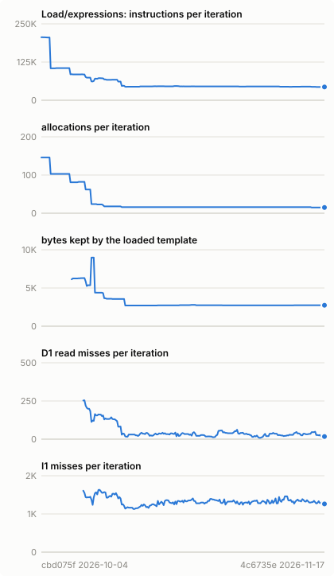
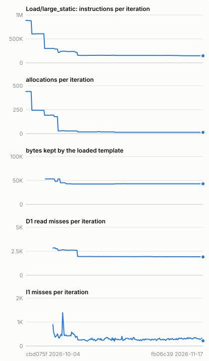

# Benchmark trend

Instruction and allocation counts per iteration on master, one record per commit (247 so far, latest [4015453](https://github.com/jinja2cpp/Jinja2Cpp/commit/40154534330c259f2ff9e485b9770d12b57e8834) on 2026-11-18). Written by the `trend` job of `.github/workflows/benchmark.yml` with `bench/trend.py`; the data is `history.jsonl`.

Memory is the bytes a loaded template keeps for `Load/*` and the peak heap use of one render for `Render/*`; vs first compares with the first record that has it.

| Benchmark | Instructions | vs previous | vs first | Allocations | vs previous | vs first | Memory | vs previous | vs first |
|---|---:|---:|---:|---:|---:|---:|---:|---:|---:|
| [Load/chat_llama](#loadchat_llama) | 334,958 | -0.01% |  | 54 | 0% |  | 18,520 | -0.09% | -52.61% |
| [Render/chat_llama](#renderchat_llama) | 291,306 | +0.54% |  | 224 | 0% |  | 11,592 | -0.14% | -19.28% |
| [Load/chat_mistral](#loadchat_mistral) | 384,155 | +0.06% |  | 51 | 0% |  | 20,976 | 0% | -53.02% |
| [Render/chat_mistral](#renderchat_mistral) | 491,246 | -0.09% |  | 392 | -2.24% |  | 9,816 | -2.08% | -25.68% |
| [Load/chat_qwen](#loadchat_qwen) | 261,049 | +0.10% |  | 43 | 0% |  | 14,472 | 0% | -47.04% |
| [Render/chat_qwen](#renderchat_qwen) | 271,661 | +0.07% |  | 211 | 0% |  | 8,280 | 0% | -2.63% |
| [Load/config_file](#loadconfig_file) | 94,076 | +0.16% |  | 24 | 0% |  | 5,520 | 0% | -47.73% |
| [Render/config_file](#renderconfig_file) | 1,272,205 | +0.38% |  | 908 | 0% |  | 25,720 | +0.06% | +8.03% |
| [Load/dict_ops](#loaddict_ops) | 31,819 | +0.19% | -78.47% | 8 | 0% | -93.89% | 2,216 | 0% | -47.93% |
| [Render/dict_ops](#renderdict_ops) | 290,349 | +0.01% | -57.97% | 112 | 0% | -75.11% | 24,408 | 0% | -29.65% |
| [Load/expressions](#loadexpressions) | 43,695 | +0.18% | -78.80% | 15 | 0% | -89.73% | 2,752 | 0% | -55.15% |
| [Render/expressions](#renderexpressions) | 414,361 | +0.01% | -54.27% | 3 | 0% | -90.00% | 2,440 | 0% | -31.15% |
| [Load/filters](#loadfilters) | 67,303 | +0.79% | -75.48% | 26 | 0% | -88.60% | 3,856 | 0% | -66.22% |
| [Render/filters](#renderfilters) | 26,489 | +0.48% | -70.13% | 23 | 0% | -68.92% | 752 | 0% | -84.69% |
| [Load/for_filter_if](#loadfor_filter_if) | 28,550 | +0.11% | -78.91% | 6 | 0% | -95.12% | 1,928 | 0% | -44.08% |
| [Render/for_filter_if](#renderfor_filter_if) | 267,127 | 0% | -69.14% | 4 | 0% | -98.23% | 16,560 | 0% | +354.95% |
| [Load/for_loop_vars](#loadfor_loop_vars) | 38,356 | +0.03% | -78.77% | 9 | 0% | -94.27% | 2,392 | 0% | -47.08% |
| [Render/for_loop_vars](#renderfor_loop_vars) | 170,756 | 0% | -84.08% | 2 | 0% | -99.62% | 1,568 | 0% | -43.35% |
| [Load/for_range](#loadfor_range) | 12,490 | +0.18% | -77.97% | 6 | 0% | -89.29% | 1,128 | 0% | -43.60% |
| [Render/for_range](#renderfor_range) | 37,143 | +0.11% | -59.72% | 3 | 0% | -88.89% | 408 | 0% | -73.02% |
| [Load/hf_deepseek_v31](#loadhf_deepseek_v31) | 383,271 | +0.03% |  | 54 | 0% |  | 22,032 | 0% | +0.99% |
| [Render/hf_deepseek_v31](#renderhf_deepseek_v31) | 90,147 | +0.16% |  | 42 | 0% |  | 2,456 | 0% | -0.97% |
| [Load/hf_gpt_oss](#loadhf_gpt_oss) | 1,522,440 | 0% |  | 282 | 0% |  | 75,000 | -0.06% | +1.05% |
| [Render/hf_gpt_oss](#renderhf_gpt_oss) | 169,220 | +0.80% |  | 153 | 0% |  | 5,760 | -0.41% | +16.69% |
| [Load/hf_mistral_small](#loadhf_mistral_small) | 589,818 | +0.03% |  | 87 | 0% |  | 33,136 | 0% | +0.61% |
| [Render/hf_mistral_small](#renderhf_mistral_small) | 139,405 | +0.22% |  | 97 | 0% |  | 6,096 | -0.26% | -0.65% |
| [Load/hf_qwen3](#loadhf_qwen3) | 476,014 | +0.05% |  | 81 | 0% |  | 25,632 | 0% | +0.60% |
| [Render/hf_qwen3](#renderhf_qwen3) | 116,873 | +0.23% |  | 99 | 0% |  | 3,224 | 0% | -0.74% |
| [Load/html_autoescape](#loadhtml_autoescape) | 188,694 | +0.17% |  | 42 | 0% |  | 12,728 | 0% | -48.43% |
| [Render/html_autoescape](#renderhtml_autoescape) | 1,196,869 | +0.11% |  | 674 | 0% |  | 46,080 | +0.03% | +14.10% |
| [Load/inheritance](#loadinheritance) | 21,304 | +0.10% | -81.33% | 6 | 0% | -94.39% | 1,368 | 0% | -52.37% |
| [Render/inheritance](#renderinheritance) | 135,123 | +0.24% | -81.93% | 35 | 0% | -94.37% | 8,072 | 0% | +34.18% |
| [Load/int_arith](#loadint_arith) | 64,597 | +0.21% |  | 19 | 0% |  | 3,896 | 0% | +1.04% |
| [Render/int_arith](#renderint_arith) | 825,682 | +0.01% |  | 12 | 0% |  | 3,272 | 0% | -0.49% |
| [Module/keep](#modulekeep) | 6,940 | +0.75% |  | 6 | 0% |  |  |  |  |
| [Module/keep_written](#modulekeep_written) | 29,005 | +0.19% |  | 10 | 0% |  |  |  |  |
| [Load/large_static](#loadlarge_static) | 146,667 | +0.10% | -83.45% | 13 | 0% | -97.05% | 43,128 | 0% | -19.21% |
| [Render/large_static](#renderlarge_static) | 20,254 | +0.03% | -73.04% | 1 | 0% | -94.44% | 36,552 | 0% | -1.83% |
| [RenderSink/large_static](#rendersinklarge_static) | 12,621 | +0.04% |  | 0 |  |  | 0 |  |  |
| [RenderTo/large_static](#rendertolarge_static) | 19,895 | +0.03% |  | 0 |  |  | 0 |  |  |
| [Load/macros](#loadmacros) | 53,998 | +0.16% | -76.31% | 25 | 0% | -86.56% | 4,472 | 0% | -28.06% |
| [Render/macros](#rendermacros) | 644,378 | +0.28% | -74.86% | 308 | 0% | -88.71% | 20,576 | 0% | +39.78% |
| [Load/many_tags](#loadmany_tags) | 8,770,326 | +0.30% | -80.14% | 950 | 0% | -97.23% | 438,120 | 0% | -58.48% |
| [Render/many_tags](#rendermany_tags) | 732,445 | 0% | -64.84% | 2 | 0% | -90.48% | 5,648 | 0% | -10.52% |
| [Load/mitsuhiko_table](#loadmitsuhiko_table) | 44,601 | +0.13% | -81.23% | 18 | 0% | -90.22% | 3,416 | 0% | -43.67% |
| [Render/mitsuhiko_table](#rendermitsuhiko_table) | 5,075,414 | +0.04% | -58.92% | 33 | 0% | -99.19% | 381,536 | 0% | +9.95% |
| [RenderSink/mitsuhiko_table](#rendersinkmitsuhiko_table) | 5,005,247 | +0.04% |  | 32 | 0% |  | 37,064 | 0% | +28.59% |
| [RenderTo/mitsuhiko_table](#rendertomitsuhiko_table) | 5,074,944 | +0.04% |  | 32 | 0% |  | 37,064 | 0% | +28.59% |
| [Load/mitsuhiko_table_wide](#loadmitsuhiko_table_wide) | 52,340 | +0.12% |  | 34 | 0% |  | 5,744 | 0% | -30.49% |
| [Render/mitsuhiko_table_wide](#rendermitsuhiko_table_wide) | 5,421,243 | +0.04% |  | 33 | 0% |  | 1,414,928 | 0% | +2.46% |
| [RenderSink/mitsuhiko_table_wide](#rendersinkmitsuhiko_table_wide) | 5,247,186 | +0.04% |  | 32 | 0% |  | 37,064 | 0% | +28.59% |
| [RenderTo/mitsuhiko_table_wide](#rendertomitsuhiko_table_wide) | 5,420,676 | +0.04% |  | 32 | 0% |  | 37,064 | 0% | +28.59% |
| [Nested/new_template](#nestednew_template) | 450,480 |  |  | 323 |  |  |  |  |  |
| [Load/plain_text](#loadplain_text) | 2,941 | +0.38% | -69.60% | 3 | 0% | -83.33% | 680 | 0% | -39.29% |
| [Render/plain_text](#renderplain_text) | 962 | +0.52% | -85.84% | 1 | 0% | -91.67% | 40 | 0% | -94.44% |
| [RenderSink/plain_text](#rendersinkplain_text) | 667 | +0.76% |  | 0 |  |  | 0 |  |  |
| [RenderTo/plain_text](#rendertoplain_text) | 763 | +0.66% |  | 0 |  |  | 0 |  |  |
| [Load/prompt_budget](#loadprompt_budget) | 34,179 | +0.39% |  | 17 | 0% |  | 2,248 | 0% | +1.08% |
| [Render/prompt_budget](#renderprompt_budget) | 1,321,656 | +0.15% |  | 76 | 0% |  | 36,416 | 0% | 0% |
| [Nested/shared_globals](#nestedshared_globals) | 158,692 |  |  | 160 |  |  |  |  |  |
| [Load/strings](#loadstrings) | 68,826 | +0.44% | -76.42% | 29 | 0% | -87.05% | 4,384 | 0% | -51.50% |
| [Render/strings](#renderstrings) | 582,157 | +0.13% | -72.25% | 344 | 0% | -83.73% | 9,088 | 0% | -49.31% |
| [Load/substitute](#loadsubstitute) | 6,651 | +0.26% | -77.72% | 5 | 0% | -86.49% | 840 | 0% | -44.74% |
| [Render/substitute](#rendersubstitute) | 1,643 | +0.43% | -81.36% | 1 | 0% | -91.67% | 40 | 0% | -94.44% |
| [RenderSink/substitute](#rendersinksubstitute) | 1,352 | +0.37% |  | 0 |  |  | 0 |  |  |
| [RenderTo/substitute](#rendertosubstitute) | 1,448 | +0.49% |  | 0 |  |  | 0 |  |  |

## Cache misses

Misses per iteration in callgrind's cache model (`count.py --cache-sim`: 32 KB 8-way L1, 8 MB 16-way last level, no prefetcher); reported, not gated.

| Benchmark | D1 read misses | vs previous | D1 write misses | vs previous | LL data read misses | vs previous | I1 misses | vs previous |
|---|---:|---:|---:|---:|---:|---:|---:|---:|
| Load/chat_llama | 743 | -0.80% | 768 | +0.79% | 0 |  | 8,209 | +6.96% |
| Render/chat_llama | 1,189 | -0.25% | 527 | -0.94% | 0 |  | 4,132 | -0.55% |
| Load/chat_mistral | 1,089 | -0.73% | 1,102 | +0.92% | 0 |  | 9,534 | +9.03% |
| Render/chat_mistral | 2,066 | +4.03% | 653 | -0.46% | 0 |  | 10,693 | +5.41% |
| Load/chat_qwen | 540 | -2.00% | 640 | -2.14% | 0 |  | 5,044 | +4.39% |
| Render/chat_qwen | 1,061 | -3.72% | 426 | -1.84% | 0 |  | 3,585 | +4.79% |
| Load/config_file | 204 | -7.69% | 194 | 0% | 0 |  | 2,827 | +1.14% |
| Render/config_file | 7,383 | +10.54% | 1,926 | +9.93% | 0 |  | 43,095 | +0.37% |
| Load/dict_ops | 33 | -19.51% | 22 | -4.35% | 0 |  | 1,430 | +4.69% |
| Render/dict_ops | 662 | -1.19% | 416 | -0.95% | 0 |  | 824 | -0.12% |
| Load/expressions | 21 | +23.53% | 16 | -5.88% | 0 |  | 1,349 | -0.15% |
| Render/expressions | 6 | 0% | 2 | -33.33% | 0 |  | 279 | -3.46% |
| Load/filters | 75 | -18.48% | 35 | -16.67% | 0 |  | 1,676 | +0.30% |
| Render/filters | 11 | +22.22% | 2 | -33.33% | 0 |  | 746 | +3.76% |
| Load/for_filter_if | 23 | -11.54% | 17 | +41.67% | 0 |  | 1,103 | +2.13% |
| Render/for_filter_if | 1,715 | +0.35% | 96 | 0% | 0 |  | 131 | +33.67% |
| Load/for_loop_vars | 35 | +34.62% | 25 | +56.25% | 0 |  | 1,118 | -3.04% |
| Render/for_loop_vars | 13 | -7.14% | 1 | -80.00% | 0 |  | 100 | -21.26% |
| Load/for_range | 1 | 0% | 3 | -25.00% | 0 |  | 775 | +2.65% |
| Render/for_range | 2 | -66.67% | 0 | -100.00% | 0 |  | 105 | -5.41% |
| Load/hf_deepseek_v31 | 963 | -4.27% | 985 | -1.01% | 0 |  | 7,463 | +10.88% |
| Render/hf_deepseek_v31 | 385 | +3.22% | 95 | +6.74% | 0 |  | 1,567 | +8.44% |
| Load/hf_gpt_oss | 4,608 | -2.06% | 3,401 | +0.98% | 0 |  | 24,323 | +4.13% |
| Render/hf_gpt_oss | 1,327 | +5.74% | 416 | +1.71% | 0 |  | 4,949 | +6.29% |
| Load/hf_mistral_small | 1,857 | +0.87% | 1,632 | -0.55% | 0 |  | 12,168 | +7.05% |
| Render/hf_mistral_small | 975 | +3.07% | 298 | -0.67% | 0 |  | 3,916 | +3.49% |
| Load/hf_qwen3 | 1,585 | +2.06% | 1,350 | 0% | 0 |  | 9,639 | +2.34% |
| Render/hf_qwen3 | 704 | +0.43% | 215 | -1.83% | 0 |  | 2,750 | +4.48% |
| Load/html_autoescape | 527 | +3.13% | 536 | +1.13% | 0 |  | 3,952 | -7.16% |
| Render/html_autoescape | 4,163 | -10.91% | 1,560 | +22.74% | 0 |  | 36,149 | -1.61% |
| Load/inheritance | 5 | +400.00% | 4 | +33.33% | 0 |  | 745 | +8.60% |
| Render/inheritance | 594 | -1.66% | 114 | +2.70% | 0 |  | 1,013 | +3.90% |
| Load/int_arith | 77 | -7.23% | 56 | -1.75% | 0 |  | 2,073 | +0.44% |
| Render/int_arith | 4 | -50.00% | 1 | -80.00% | 0 |  | 766 | +2.54% |
| Module/keep | 2 | 0% | 2 | -33.33% | 0 |  | 404 | +1.00% |
| Module/keep_written | 1,145 | -0.09% | 563 | 0% | 0 |  | 723 | -2.56% |
| Load/large_static | 1,913 | -0.36% | 909 | +0.78% | 0 |  | 279 | +3.33% |
| Render/large_static | 700 | -0.43% | 581 | +0.17% | 0 |  | 4 | +33.33% |
| RenderSink/large_static | 1 | 0% | 0 |  | 0 |  | 2 | -33.33% |
| RenderTo/large_static | 680 | 0% | 569 | +0.18% | 0 |  | 4 | +100.00% |
| Load/macros | 67 | -12.99% | 64 | +12.28% | 0 |  | 1,732 | -2.09% |
| Render/macros | 768 | +1.19% | 252 | +2.02% | 0 |  | 576 | -42.51% |
| Load/many_tags | 27,774 | -1.07% | 22,591 | -0.32% | 0 |  | 256,475 | +6.83% |
| Render/many_tags | 6,124 | +0.02% | 780 | -1.52% | 0 |  | 81 | +52.83% |
| Load/mitsuhiko_table | 29 | -23.68% | 38 | -26.92% | 0 |  | 984 | +11.69% |
| Render/mitsuhiko_table | 10,014 | -0.05% | 6,258 | -0.14% | 0 |  | 313 | -6.85% |
| RenderSink/mitsuhiko_table | 9,974 | +0.01% | 1,206 | +0.08% | 0 |  | 257 | -8.54% |
| RenderTo/mitsuhiko_table | 10,018 | -0.17% | 6,255 | -0.18% | 0 |  | 295 | -7.23% |
| Load/mitsuhiko_table_wide | 82 | -9.89% | 97 | -3.00% | 0 |  | 1,018 | +0.39% |
| Render/mitsuhiko_table_wide | 10,238 | +0.05% | 22,671 | -0.11% | 0 |  | 320 | -2.44% |
| RenderSink/mitsuhiko_table_wide | 10,053 | +0.02% | 1,296 | -0.77% | 0 |  | 263 | -2.59% |
| RenderTo/mitsuhiko_table_wide | 10,238 | -0.12% | 22,685 | -0.20% | 0 |  | 289 | -6.77% |
| Nested/new_template | 1,913 |  | 1,414 |  | 0 |  | 24,812 |  |
| Load/plain_text | 0 |  | 1 | 0% | 0 |  | 9 | -18.18% |
| Render/plain_text | 1 | 0% | 0 | -100.00% | 0 |  | 7 | +40.00% |
| RenderSink/plain_text | 1 | 0% | 0 |  | 0 |  | 4 | 0% |
| RenderTo/plain_text | 1 | 0% | 0 |  | 0 |  | 7 | +75.00% |
| Load/prompt_budget | 77 | 0% | 62 | -6.06% | 0 |  | 1,431 | +0.21% |
| Render/prompt_budget | 4,812 | -0.19% | 539 | +0.19% | 0 |  | 913 | +3.87% |
| Nested/shared_globals | 191 |  | 131 |  | 0 |  | 8,970 |  |
| Load/strings | 127 | -4.51% | 115 | +4.55% | 0 |  | 2,865 | +2.54% |
| Render/strings | 411 | -0.24% | 478 | -2.05% | 0 |  | 1,575 | +1.48% |
| Load/substitute | 1 | 0% | 2 | -33.33% | 0 |  | 125 | +5.04% |
| Render/substitute | 1 | 0% | 0 | -100.00% | 0 |  | 4 | +33.33% |
| RenderSink/substitute | 1 | 0% | 0 |  | 0 |  | 2 | -33.33% |
| RenderTo/substitute | 1 | 0% | 0 |  | 0 |  | 3 | +50.00% |

## Charts

### Load/chat_llama

### Render/chat_llama

### Load/chat_mistral

### Render/chat_mistral

### Load/chat_qwen

### Render/chat_qwen

### Load/config_file

### Render/config_file

### Load/dict_ops

### Render/dict_ops

### Load/expressions

### Render/expressions

### Load/filters

### Render/filters

### Load/for_filter_if

### Render/for_filter_if

### Load/for_loop_vars

### Render/for_loop_vars

### Load/for_range

### Render/for_range

### Load/hf_deepseek_v31

### Render/hf_deepseek_v31

### Load/hf_gpt_oss

### Render/hf_gpt_oss

### Load/hf_mistral_small

### Render/hf_mistral_small

### Load/hf_qwen3

### Render/hf_qwen3

### Load/html_autoescape

### Render/html_autoescape

### Load/inheritance

### Render/inheritance

### Load/int_arith

### Render/int_arith

### Module/keep

### Module/keep_written

### Load/large_static

### Render/large_static

### RenderSink/large_static

### RenderTo/large_static

### Load/macros

### Render/macros

### Load/many_tags

### Render/many_tags

### Load/mitsuhiko_table

### Render/mitsuhiko_table

### RenderSink/mitsuhiko_table

### RenderTo/mitsuhiko_table

### Load/mitsuhiko_table_wide

### Render/mitsuhiko_table_wide

### RenderSink/mitsuhiko_table_wide

### RenderTo/mitsuhiko_table_wide

### Nested/new_template

### Load/plain_text

### Render/plain_text

### RenderSink/plain_text

### RenderTo/plain_text

### Load/prompt_budget

### Render/prompt_budget

### Nested/shared_globals

### Load/strings

### Render/strings

### Load/substitute

### Render/substitute

### RenderSink/substitute

### RenderTo/substitute

