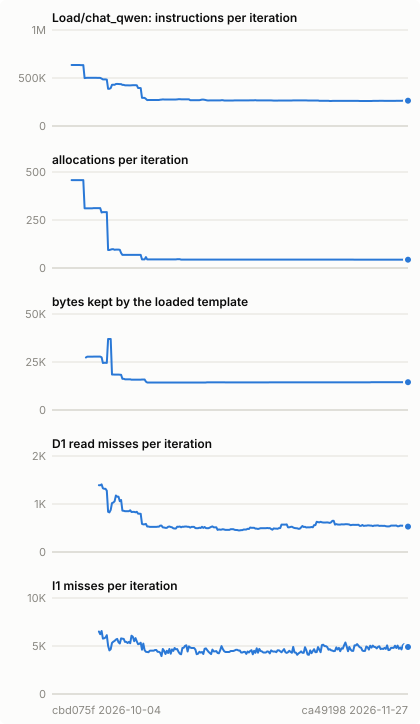
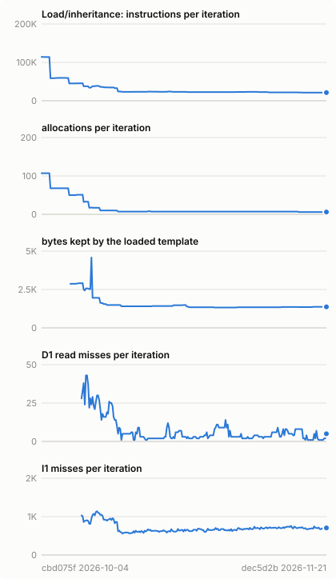
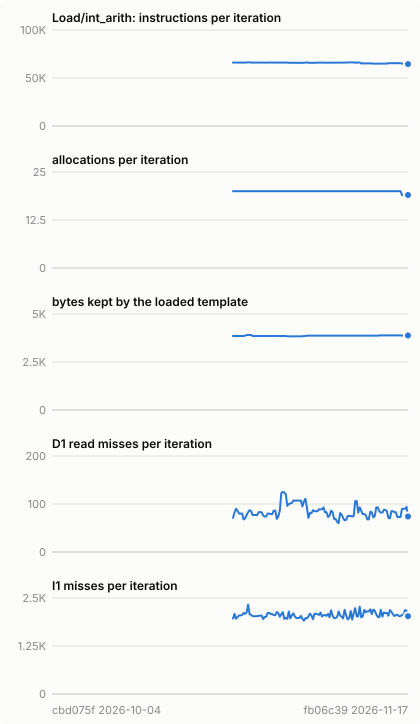
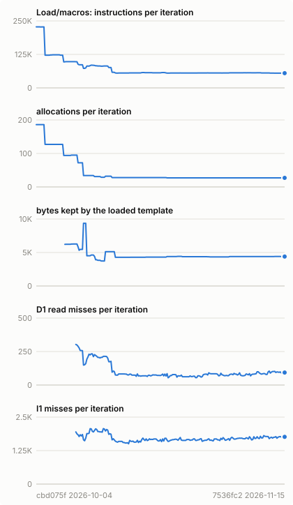

# Benchmark trend

Instruction and allocation counts per iteration on master, one record per commit (240 so far, latest [422ede3](https://github.com/jinja2cpp/Jinja2Cpp/commit/422ede3670d9c1dee59bd8fa692afa6f96c69f17) on 2026-11-17). Written by the `trend` job of `.github/workflows/benchmark.yml` with `bench/trend.py`; the data is `history.jsonl`.

Memory is the bytes a loaded template keeps for `Load/*` and the peak heap use of one render for `Render/*`; vs first compares with the first record that has it.

| Benchmark | Instructions | vs previous | vs first | Allocations | vs previous | vs first | Memory | vs previous | vs first |
|---|---:|---:|---:|---:|---:|---:|---:|---:|---:|
| [Load/chat_llama](#loadchat_llama) | 334,164 | 0% |  | 54 | 0% |  | 18,472 | 0% | -52.73% |
| [Render/chat_llama](#renderchat_llama) | 290,334 | +0.23% |  | 224 | 0% |  | 11,592 | 0% | -19.28% |
| [Load/chat_mistral](#loadchat_mistral) | 383,117 | 0% |  | 51 | 0% |  | 20,896 | 0% | -53.20% |
| [Render/chat_mistral](#renderchat_mistral) | 491,717 | 0% |  | 401 | 0% |  | 10,040 | +0.64% | -23.99% |
| [Load/chat_qwen](#loadchat_qwen) | 259,972 | 0% |  | 43 | 0% |  | 14,424 | 0% | -47.22% |
| [Render/chat_qwen](#renderchat_qwen) | 271,568 | +0.06% |  | 211 | 0% |  | 8,280 | 0% | -2.63% |
| [Load/config_file](#loadconfig_file) | 93,481 | 0% |  | 24 | 0% |  | 5,472 | 0% | -48.18% |
| [Render/config_file](#renderconfig_file) | 1,266,518 | +0.11% |  | 908 | 0% |  | 25,624 | +0.19% | +7.63% |
| [Load/dict_ops](#loaddict_ops) | 31,578 | 0% | -78.63% | 8 | 0% | -93.89% | 2,184 | 0% | -48.68% |
| [Render/dict_ops](#renderdict_ops) | 290,951 | +0.16% | -57.88% | 112 | 0% | -75.11% | 24,408 | 0% | -29.65% |
| [Load/expressions](#loadexpressions) | 43,520 | 0% | -78.89% | 15 | 0% | -89.73% | 2,736 | 0% | -55.41% |
| [Render/expressions](#renderexpressions) | 414,271 | 0% | -54.28% | 3 | 0% | -90.00% | 2,440 | 0% | -31.15% |
| [Load/filters](#loadfilters) | 66,752 | -0.02% | -75.68% | 26 | 0% | -88.60% | 3,856 | 0% | -66.22% |
| [Render/filters](#renderfilters) | 26,366 | +0.03% | -70.26% | 23 | 0% | -68.92% | 752 | 0% | -84.69% |
| [Load/for_filter_if](#loadfor_filter_if) | 28,363 | 0% | -79.05% | 6 | 0% | -95.12% | 1,912 | 0% | -44.55% |
| [Render/for_filter_if](#renderfor_filter_if) | 267,258 | 0% | -69.12% | 4 | 0% | -98.23% | 16,560 | 0% | +354.95% |
| [Load/for_loop_vars](#loadfor_loop_vars) | 38,170 | +0.03% | -78.87% | 9 | 0% | -94.27% | 2,376 | 0% | -47.43% |
| [Render/for_loop_vars](#renderfor_loop_vars) | 170,648 | 0% | -84.09% | 2 | 0% | -99.62% | 1,568 | 0% | -43.35% |
| [Load/for_range](#loadfor_range) | 12,368 | 0% | -78.18% | 6 | 0% | -89.29% | 1,096 | 0% | -45.20% |
| [Render/for_range](#renderfor_range) | 37,055 | +0.02% | -59.81% | 3 | 0% | -88.89% | 408 | 0% | -73.02% |
| [Load/hf_deepseek_v31](#loadhf_deepseek_v31) | 382,218 | +0.01% |  | 54 | 0% |  | 21,984 | 0% | +0.77% |
| [Render/hf_deepseek_v31](#renderhf_deepseek_v31) | 89,954 | +0.02% |  | 42 | 0% |  | 2,456 | 0% | -0.97% |
| [Load/hf_gpt_oss](#loadhf_gpt_oss) | 1,518,512 | 0% |  | 282 | 0% |  | 74,744 | 0% | +0.70% |
| [Render/hf_gpt_oss](#renderhf_gpt_oss) | 167,366 | +0.06% |  | 153 | 0% |  | 5,736 | 0% | +16.21% |
| [Load/hf_mistral_small](#loadhf_mistral_small) | 588,352 | 0% |  | 87 | 0% |  | 33,056 | 0% | +0.36% |
| [Render/hf_mistral_small](#renderhf_mistral_small) | 138,947 | -0.14% |  | 97 | 0% |  | 6,096 | -0.26% | -0.65% |
| [Load/hf_qwen3](#loadhf_qwen3) | 474,344 | +0.01% |  | 81 | 0% |  | 25,568 | 0% | +0.35% |
| [Render/hf_qwen3](#renderhf_qwen3) | 116,552 | +0.01% |  | 99 | 0% |  | 3,224 | 0% | -0.74% |
| [Load/html_autoescape](#loadhtml_autoescape) | 187,982 | +0.01% |  | 42 | 0% |  | 12,680 | 0% | -48.62% |
| [Render/html_autoescape](#renderhtml_autoescape) | 1,194,664 | 0% |  | 674 | 0% |  | 46,000 | +0.07% | +13.91% |
| [Load/inheritance](#loadinheritance) | 21,152 | 0% | -81.46% | 6 | 0% | -94.39% | 1,352 | 0% | -52.92% |
| [Render/inheritance](#renderinheritance) | 134,453 | +0.34% | -82.02% | 35 | 0% | -94.37% | 8,008 | +0.60% | +33.11% |
| [Load/int_arith](#loadint_arith) | 64,305 | 0% |  | 19 | 0% |  | 3,880 | 0% | +0.62% |
| [Render/int_arith](#renderint_arith) | 825,474 | 0% |  | 12 | 0% |  | 3,272 | 0% | -0.49% |
| [Module/keep](#modulekeep) | 6,870 | -0.15% |  | 6 | 0% |  |  |  |  |
| [Module/keep_written](#modulekeep_written) | 28,909 | -0.03% |  | 10 | 0% |  |  |  |  |
| [Load/large_static](#loadlarge_static) | 146,465 | 0% | -83.47% | 13 | 0% | -97.05% | 43,128 | 0% | -19.21% |
| [Render/large_static](#renderlarge_static) | 20,329 | +0.03% | -72.94% | 1 | 0% | -94.44% | 36,552 | 0% | -1.83% |
| [RenderSink/large_static](#rendersinklarge_static) | 12,319 | +0.07% |  | 0 |  |  | 0 |  |  |
| [RenderTo/large_static](#rendertolarge_static) | 19,892 | +0.04% |  | 0 |  |  | 0 |  |  |
| [Load/macros](#loadmacros) | 53,983 | 0% | -76.32% | 25 | 0% | -86.56% | 4,424 | 0% | -28.83% |
| [Render/macros](#rendermacros) | 640,740 | -0.01% | -75.00% | 308 | 0% | -88.71% | 20,576 | 0% | +39.78% |
| [Load/many_tags](#loadmany_tags) | 8,723,925 | 0% | -80.25% | 950 | 0% | -97.23% | 438,120 | 0% | -58.48% |
| [Render/many_tags](#rendermany_tags) | 731,835 | 0% | -64.87% | 2 | 0% | -90.48% | 5,648 | 0% | -10.52% |
| [Load/mitsuhiko_table](#loadmitsuhiko_table) | 44,307 | 0% | -81.35% | 18 | 0% | -90.22% | 3,368 | 0% | -44.46% |
| [Render/mitsuhiko_table](#rendermitsuhiko_table) | 5,068,144 | 0% | -58.98% | 33 | 0% | -99.19% | 381,536 | 0% | +9.95% |
| [RenderSink/mitsuhiko_table](#rendersinkmitsuhiko_table) | 4,995,288 | 0% |  | 32 | 0% |  | 37,064 | 0% | +28.59% |
| [RenderTo/mitsuhiko_table](#rendertomitsuhiko_table) | 5,067,650 | 0% |  | 32 | 0% |  | 37,064 | 0% | +28.59% |
| [Load/mitsuhiko_table_wide](#loadmitsuhiko_table_wide) | 52,047 | 0% |  | 34 | 0% |  | 5,696 | 0% | -31.07% |
| [Render/mitsuhiko_table_wide](#rendermitsuhiko_table_wide) | 5,414,096 | 0% |  | 33 | 0% |  | 1,414,928 | 0% | +2.46% |
| [RenderSink/mitsuhiko_table_wide](#rendersinkmitsuhiko_table_wide) | 5,237,319 | 0% |  | 32 | 0% |  | 37,064 | 0% | +28.59% |
| [RenderTo/mitsuhiko_table_wide](#rendertomitsuhiko_table_wide) | 5,413,563 | 0% |  | 32 | 0% |  | 37,064 | 0% | +28.59% |
| [Load/plain_text](#loadplain_text) | 2,923 | 0% | -69.79% | 3 | 0% | -83.33% | 680 | 0% | -39.29% |
| [Render/plain_text](#renderplain_text) | 960 | +0.95% | -85.87% | 1 | 0% | -91.67% | 40 | 0% | -94.44% |
| [RenderSink/plain_text](#rendersinkplain_text) | 661 | +1.54% |  | 0 |  |  | 0 |  |  |
| [RenderTo/plain_text](#rendertoplain_text) | 761 | +1.20% |  | 0 |  |  | 0 |  |  |
| [Load/prompt_budget](#loadprompt_budget) | 33,762 | 0% |  | 17 | 0% |  | 2,232 | 0% | +0.36% |
| [Render/prompt_budget](#renderprompt_budget) | 1,319,602 | -0.03% |  | 76 | 0% |  | 36,416 | 0% | 0% |
| [Load/strings](#loadstrings) | 68,387 | -0.01% | -76.57% | 29 | 0% | -87.05% | 4,352 | 0% | -51.86% |
| [Render/strings](#renderstrings) | 581,399 | 0% | -72.28% | 344 | 0% | -83.73% | 9,088 | 0% | -49.31% |
| [Load/substitute](#loadsubstitute) | 6,625 | 0% | -77.81% | 5 | 0% | -86.49% | 840 | 0% | -44.74% |
| [Render/substitute](#rendersubstitute) | 1,639 | +0.49% | -81.40% | 1 | 0% | -91.67% | 40 | 0% | -94.44% |
| [RenderSink/substitute](#rendersinksubstitute) | 1,346 | +0.82% |  | 0 |  |  | 0 |  |  |
| [RenderTo/substitute](#rendertosubstitute) | 1,444 | +0.56% |  | 0 |  |  | 0 |  |  |

## Cache misses

Misses per iteration in callgrind's cache model (`count.py --cache-sim`: 32 KB 8-way L1, 8 MB 16-way last level, no prefetcher); reported, not gated.

| Benchmark | D1 read misses | vs previous | D1 write misses | vs previous | LL data read misses | vs previous | I1 misses | vs previous |
|---|---:|---:|---:|---:|---:|---:|---:|---:|
| Load/chat_llama | 726 | -2.81% | 756 | -0.53% | 0 |  | 7,528 | -1.97% |
| Render/chat_llama | 1,182 | -1.01% | 511 | -3.04% | 0 |  | 4,095 | -0.53% |
| Load/chat_mistral | 1,082 | -0.82% | 1,085 | -0.37% | 0 |  | 8,455 | -2.69% |
| Render/chat_mistral | 2,025 | +4.11% | 618 | -1.75% | 0 |  | 10,498 | -1.53% |
| Load/chat_qwen | 543 | -3.38% | 634 | -0.78% | 0 |  | 4,483 | -0.80% |
| Render/chat_qwen | 1,036 | -2.17% | 432 | -0.23% | 0 |  | 3,356 | -3.15% |
| Load/config_file | 208 | -2.35% | 188 | +1.62% | 0 |  | 2,565 | -9.40% |
| Render/config_file | 6,033 | -7.04% | 1,627 | +1.06% | 0 |  | 43,648 | +1.03% |
| Load/dict_ops | 37 | 0% | 20 | -9.09% | 0 |  | 1,335 | -1.26% |
| Render/dict_ops | 661 | -0.30% | 423 | -0.70% | 0 |  | 820 | -0.85% |
| Load/expressions | 27 | +8.00% | 22 | 0% | 0 |  | 1,289 | -3.30% |
| Render/expressions | 9 | +125.00% | 4 | +300.00% | 0 |  | 307 | +5.50% |
| Load/filters | 89 | 0% | 43 | +2.38% | 0 |  | 1,618 | -5.32% |
| Render/filters | 17 | +54.55% | 1 | 0% | 0 |  | 743 | +2.48% |
| Load/for_filter_if | 23 | -17.86% | 9 | -18.18% | 0 |  | 1,041 | +0.39% |
| Render/for_filter_if | 1,705 | -0.53% | 97 | +6.59% | 0 |  | 110 | -23.08% |
| Load/for_loop_vars | 23 | -32.35% | 15 | -28.57% | 0 |  | 1,058 | -3.99% |
| Render/for_loop_vars | 14 | +7.69% | 1 | -66.67% | 0 |  | 102 | -12.82% |
| Load/for_range | 1 | 0% | 4 | 0% | 0 |  | 722 | -6.11% |
| Render/for_range | 7 | 0% | 1 | 0% | 0 |  | 156 | +28.93% |
| Load/hf_deepseek_v31 | 1,010 | -3.16% | 994 | -0.20% | 0 |  | 6,424 | -2.70% |
| Render/hf_deepseek_v31 | 366 | +2.52% | 88 | +11.39% | 0 |  | 1,455 | +0.41% |
| Load/hf_gpt_oss | 4,634 | -0.69% | 3,385 | +0.09% | 0 |  | 21,778 | -2.60% |
| Render/hf_gpt_oss | 1,239 | -0.72% | 400 | +1.52% | 0 | -100.00% | 4,671 | -4.34% |
| Load/hf_mistral_small | 1,853 | -2.11% | 1,638 | +0.31% | 0 |  | 10,937 | -4.55% |
| Render/hf_mistral_small | 952 | +0.11% | 291 | +1.04% | 0 |  | 3,706 | -2.11% |
| Load/hf_qwen3 | 1,536 | -1.54% | 1,337 | -0.37% | 0 |  | 8,743 | -4.81% |
| Render/hf_qwen3 | 686 | +2.85% | 216 | -2.70% | 0 |  | 2,626 | -2.20% |
| Load/html_autoescape | 507 | -2.31% | 535 | +0.94% | 0 |  | 3,744 | -9.61% |
| Render/html_autoescape | 4,539 | +2.93% | 1,237 | +5.46% | 0 |  | 35,857 | -2.69% |
| Load/inheritance | 4 | +300.00% | 3 | 0% | 0 |  | 672 | -4.14% |
| Render/inheritance | 606 | +0.83% | 107 | -0.93% | 0 |  | 956 | +8.76% |
| Load/int_arith | 79 | -5.95% | 52 | -5.45% | 0 |  | 1,975 | -11.67% |
| Render/int_arith | 8 | -50.00% | 4 | -33.33% | 0 |  | 743 | +0.13% |
| Module/keep | 1 | 0% | 2 | 0% | 0 |  | 415 | +3.23% |
| Module/keep_written | 1,140 | -0.61% | 561 | -0.18% | 0 |  | 703 | -3.43% |
| Load/large_static | 1,913 | -0.05% | 901 | 0% | 0 |  | 219 | -13.78% |
| Render/large_static | 703 | 0% | 569 | +0.18% | 0 |  | 4 | 0% |
| RenderSink/large_static | 1 | 0% | 0 |  | 0 |  | 3 | +50.00% |
| RenderTo/large_static | 679 | 0% | 572 | +0.18% | 0 |  | 4 | 0% |
| Load/macros | 69 | -6.76% | 54 | -1.82% | 0 |  | 1,691 | -3.32% |
| Render/macros | 747 | +0.54% | 223 | -9.72% | 0 |  | 628 | -11.42% |
| Load/many_tags | 27,661 | -0.57% | 22,586 | -0.04% | 0 |  | 229,401 | -8.13% |
| Render/many_tags | 6,132 | +0.52% | 786 | 0% | 0 |  | 59 | -32.95% |
| Load/mitsuhiko_table | 37 | -17.78% | 45 | -6.25% | 0 |  | 832 | -0.12% |
| Render/mitsuhiko_table | 10,018 | -0.12% | 6,295 | -0.02% | 0 |  | 316 | +9.72% |
| RenderSink/mitsuhiko_table | 9,980 | +0.07% | 1,220 | +0.41% | 0 |  | 230 | -2.54% |
| RenderTo/mitsuhiko_table | 10,048 | +0.02% | 6,304 | -0.08% | 0 |  | 294 | +8.49% |
| Load/mitsuhiko_table_wide | 93 | +4.49% | 103 | +7.29% | 0 |  | 991 | +0.71% |
| Render/mitsuhiko_table_wide | 10,259 | +0.23% | 22,687 | -0.01% | 0 |  | 325 | +11.30% |
| RenderSink/mitsuhiko_table_wide | 10,058 | +0.09% | 1,306 | -0.15% | 0 |  | 257 | +16.29% |
| RenderTo/mitsuhiko_table_wide | 10,240 | +0.10% | 22,712 | -0.04% | 0 |  | 307 | +13.70% |
| Load/plain_text | 0 |  | 1 | 0% | 0 |  | 3 | 0% |
| Render/plain_text | 1 | 0% | 0 |  | 0 |  | 5 | -16.67% |
| RenderSink/plain_text | 1 | 0% | 0 |  | 0 |  | 4 | 0% |
| RenderTo/plain_text | 1 | 0% | 0 |  | 0 |  | 5 | 0% |
| Load/prompt_budget | 72 | +7.46% | 41 | 0% | 0 |  | 1,358 | -4.63% |
| Render/prompt_budget | 4,815 | +0.08% | 545 | -0.73% | 0 |  | 1,232 | -6.45% |
| Load/strings | 140 | +1.45% | 110 | +11.11% | 0 |  | 2,702 | -5.33% |
| Render/strings | 412 | -1.90% | 473 | +0.42% | 0 |  | 1,566 | +0.51% |
| Load/substitute | 1 | 0% | 3 | 0% | 0 |  | 105 | -25.53% |
| Render/substitute | 1 | 0% | 0 |  | 0 |  | 4 | 0% |
| RenderSink/substitute | 1 |  | 0 |  | 0 |  | 3 | +50.00% |
| RenderTo/substitute | 1 | 0% | 0 |  | 0 |  | 4 | +33.33% |

## Charts

### Load/chat_llama

### Render/chat_llama

### Load/chat_mistral

### Render/chat_mistral

### Load/chat_qwen

### Render/chat_qwen

### Load/config_file

### Render/config_file

### Load/dict_ops

### Render/dict_ops

### Load/expressions

### Render/expressions

### Load/filters

### Render/filters

### Load/for_filter_if

### Render/for_filter_if

### Load/for_loop_vars

### Render/for_loop_vars

### Load/for_range

### Render/for_range

### Load/hf_deepseek_v31

### Render/hf_deepseek_v31

### Load/hf_gpt_oss

### Render/hf_gpt_oss

### Load/hf_mistral_small

### Render/hf_mistral_small

### Load/hf_qwen3

### Render/hf_qwen3

### Load/html_autoescape

### Render/html_autoescape

### Load/inheritance

### Render/inheritance

### Load/int_arith

### Render/int_arith

### Module/keep

### Module/keep_written

### Load/large_static

### Render/large_static

### RenderSink/large_static

### RenderTo/large_static

### Load/macros

### Render/macros

### Load/many_tags

### Render/many_tags

### Load/mitsuhiko_table

### Render/mitsuhiko_table

### RenderSink/mitsuhiko_table

### RenderTo/mitsuhiko_table

### Load/mitsuhiko_table_wide

### Render/mitsuhiko_table_wide

### RenderSink/mitsuhiko_table_wide

### RenderTo/mitsuhiko_table_wide

### Load/plain_text

### Render/plain_text

### RenderSink/plain_text

### RenderTo/plain_text

### Load/prompt_budget

### Render/prompt_budget

### Load/strings

### Render/strings

### Load/substitute

### Render/substitute

### RenderSink/substitute

### RenderTo/substitute

