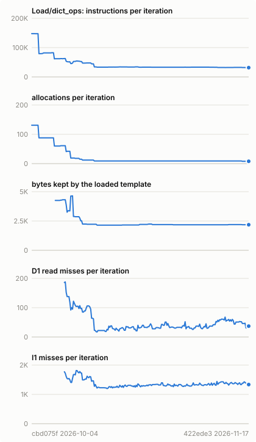

# Benchmark trend

Instruction and allocation counts per iteration on master, one record per commit (241 so far, latest [5673b2a](https://github.com/jinja2cpp/Jinja2Cpp/commit/5673b2a3be773b00352647bb829182658a014669) on 2026-11-17). Written by the `trend` job of `.github/workflows/benchmark.yml` with `bench/trend.py`; the data is `history.jsonl`.

Memory is the bytes a loaded template keeps for `Load/*` and the peak heap use of one render for `Render/*`; vs first compares with the first record that has it.

| Benchmark | Instructions | vs previous | vs first | Allocations | vs previous | vs first | Memory | vs previous | vs first |
|---|---:|---:|---:|---:|---:|---:|---:|---:|---:|
| [Load/chat_llama](#loadchat_llama) | 334,164 | 0% |  | 54 | 0% |  | 18,472 | 0% | -52.73% |
| [Render/chat_llama](#renderchat_llama) | 290,354 | +0.01% |  | 224 | 0% |  | 11,592 | 0% | -19.28% |
| [Load/chat_mistral](#loadchat_mistral) | 383,117 | 0% |  | 51 | 0% |  | 20,896 | 0% | -53.20% |
| [Render/chat_mistral](#renderchat_mistral) | 491,613 | -0.02% |  | 401 | 0% |  | 10,040 | 0% | -23.99% |
| [Load/chat_qwen](#loadchat_qwen) | 259,972 | 0% |  | 43 | 0% |  | 14,424 | 0% | -47.22% |
| [Render/chat_qwen](#renderchat_qwen) | 271,556 | 0% |  | 211 | 0% |  | 8,280 | 0% | -2.63% |
| [Load/config_file](#loadconfig_file) | 93,481 | 0% |  | 24 | 0% |  | 5,472 | 0% | -48.18% |
| [Render/config_file](#renderconfig_file) | 1,267,253 | +0.06% |  | 908 | 0% |  | 25,624 | 0% | +7.63% |
| [Load/dict_ops](#loaddict_ops) | 31,578 | 0% | -78.63% | 8 | 0% | -93.89% | 2,184 | 0% | -48.68% |
| [Render/dict_ops](#renderdict_ops) | 290,683 | -0.09% | -57.92% | 112 | 0% | -75.11% | 24,408 | 0% | -29.65% |
| [Load/expressions](#loadexpressions) | 43,520 | 0% | -78.89% | 15 | 0% | -89.73% | 2,736 | 0% | -55.41% |
| [Render/expressions](#renderexpressions) | 414,276 | 0% | -54.28% | 3 | 0% | -90.00% | 2,440 | 0% | -31.15% |
| [Load/filters](#loadfilters) | 66,752 | 0% | -75.68% | 26 | 0% | -88.60% | 3,856 | 0% | -66.22% |
| [Render/filters](#renderfilters) | 26,371 | +0.02% | -70.26% | 23 | 0% | -68.92% | 752 | 0% | -84.69% |
| [Load/for_filter_if](#loadfor_filter_if) | 28,363 | 0% | -79.05% | 6 | 0% | -95.12% | 1,912 | 0% | -44.55% |
| [Render/for_filter_if](#renderfor_filter_if) | 267,263 | 0% | -69.12% | 4 | 0% | -98.23% | 16,560 | 0% | +354.95% |
| [Load/for_loop_vars](#loadfor_loop_vars) | 38,170 | 0% | -78.87% | 9 | 0% | -94.27% | 2,376 | 0% | -47.43% |
| [Render/for_loop_vars](#renderfor_loop_vars) | 170,653 | 0% | -84.09% | 2 | 0% | -99.62% | 1,568 | 0% | -43.35% |
| [Load/for_range](#loadfor_range) | 12,368 | 0% | -78.18% | 6 | 0% | -89.29% | 1,096 | 0% | -45.20% |
| [Render/for_range](#renderfor_range) | 37,060 | +0.01% | -59.81% | 3 | 0% | -88.89% | 408 | 0% | -73.02% |
| [Load/hf_deepseek_v31](#loadhf_deepseek_v31) | 382,218 | 0% |  | 54 | 0% |  | 21,984 | 0% | +0.77% |
| [Render/hf_deepseek_v31](#renderhf_deepseek_v31) | 89,959 | +0.01% |  | 42 | 0% |  | 2,456 | 0% | -0.97% |
| [Load/hf_gpt_oss](#loadhf_gpt_oss) | 1,518,512 | 0% |  | 282 | 0% |  | 74,744 | 0% | +0.70% |
| [Render/hf_gpt_oss](#renderhf_gpt_oss) | 167,395 | +0.02% |  | 153 | 0% |  | 5,736 | 0% | +16.21% |
| [Load/hf_mistral_small](#loadhf_mistral_small) | 588,352 | 0% |  | 87 | 0% |  | 33,056 | 0% | +0.36% |
| [Render/hf_mistral_small](#renderhf_mistral_small) | 138,924 | -0.02% |  | 97 | 0% |  | 6,096 | 0% | -0.65% |
| [Load/hf_qwen3](#loadhf_qwen3) | 474,344 | 0% |  | 81 | 0% |  | 25,568 | 0% | +0.35% |
| [Render/hf_qwen3](#renderhf_qwen3) | 116,573 | +0.02% |  | 99 | 0% |  | 3,224 | 0% | -0.74% |
| [Load/html_autoescape](#loadhtml_autoescape) | 187,982 | 0% |  | 42 | 0% |  | 12,680 | 0% | -48.62% |
| [Render/html_autoescape](#renderhtml_autoescape) | 1,195,178 | +0.04% |  | 674 | 0% |  | 46,000 | 0% | +13.91% |
| [Load/inheritance](#loadinheritance) | 21,152 | 0% | -81.46% | 6 | 0% | -94.39% | 1,352 | 0% | -52.92% |
| [Render/inheritance](#renderinheritance) | 134,458 | 0% | -82.02% | 35 | 0% | -94.37% | 8,008 | 0% | +33.11% |
| [Load/int_arith](#loadint_arith) | 64,305 | 0% |  | 19 | 0% |  | 3,880 | 0% | +0.62% |
| [Render/int_arith](#renderint_arith) | 825,479 | 0% |  | 12 | 0% |  | 3,272 | 0% | -0.49% |
| [Module/keep](#modulekeep) | 6,878 | +0.12% |  | 6 | 0% |  |  |  |  |
| [Module/keep_written](#modulekeep_written) | 28,917 | +0.03% |  | 10 | 0% |  |  |  |  |
| [Load/large_static](#loadlarge_static) | 146,465 | 0% | -83.47% | 13 | 0% | -97.05% | 43,128 | 0% | -19.21% |
| [Render/large_static](#renderlarge_static) | 20,334 | +0.02% | -72.94% | 1 | 0% | -94.44% | 36,552 | 0% | -1.83% |
| [RenderSink/large_static](#rendersinklarge_static) | 12,625 | +2.48% |  | 0 |  |  | 0 |  |  |
| [RenderTo/large_static](#rendertolarge_static) | 19,897 | +0.03% |  | 0 |  |  | 0 |  |  |
| [Load/macros](#loadmacros) | 53,983 | 0% | -76.32% | 25 | 0% | -86.56% | 4,424 | 0% | -28.83% |
| [Render/macros](#rendermacros) | 642,445 | +0.27% | -74.93% | 308 | 0% | -88.71% | 20,576 | 0% | +39.78% |
| [Load/many_tags](#loadmany_tags) | 8,723,925 | 0% | -80.25% | 950 | 0% | -97.23% | 438,120 | 0% | -58.48% |
| [Render/many_tags](#rendermany_tags) | 731,840 | 0% | -64.87% | 2 | 0% | -90.48% | 5,648 | 0% | -10.52% |
| [Load/mitsuhiko_table](#loadmitsuhiko_table) | 44,307 | 0% | -81.35% | 18 | 0% | -90.22% | 3,368 | 0% | -44.46% |
| [Render/mitsuhiko_table](#rendermitsuhiko_table) | 5,068,149 | 0% | -58.98% | 33 | 0% | -99.19% | 381,536 | 0% | +9.95% |
| [RenderSink/mitsuhiko_table](#rendersinkmitsuhiko_table) | 4,998,050 | +0.06% |  | 32 | 0% |  | 37,064 | 0% | +28.59% |
| [RenderTo/mitsuhiko_table](#rendertomitsuhiko_table) | 5,067,655 | 0% |  | 32 | 0% |  | 37,064 | 0% | +28.59% |
| [Load/mitsuhiko_table_wide](#loadmitsuhiko_table_wide) | 52,047 | 0% |  | 34 | 0% |  | 5,696 | 0% | -31.07% |
| [Render/mitsuhiko_table_wide](#rendermitsuhiko_table_wide) | 5,414,084 | 0% |  | 33 | 0% |  | 1,414,928 | 0% | +2.46% |
| [RenderSink/mitsuhiko_table_wide](#rendersinkmitsuhiko_table_wide) | 5,240,081 | +0.05% |  | 32 | 0% |  | 37,064 | 0% | +28.59% |
| [RenderTo/mitsuhiko_table_wide](#rendertomitsuhiko_table_wide) | 5,413,583 | 0% |  | 32 | 0% |  | 37,064 | 0% | +28.59% |
| [Load/plain_text](#loadplain_text) | 2,923 | 0% | -69.79% | 3 | 0% | -83.33% | 680 | 0% | -39.29% |
| [Render/plain_text](#renderplain_text) | 965 | +0.52% | -85.80% | 1 | 0% | -91.67% | 40 | 0% | -94.44% |
| [RenderSink/plain_text](#rendersinkplain_text) | 671 | +1.51% |  | 0 |  |  | 0 |  |  |
| [RenderTo/plain_text](#rendertoplain_text) | 766 | +0.66% |  | 0 |  |  | 0 |  |  |
| [Load/prompt_budget](#loadprompt_budget) | 33,762 | 0% |  | 17 | 0% |  | 2,232 | 0% | +0.36% |
| [Render/prompt_budget](#renderprompt_budget) | 1,319,631 | 0% |  | 76 | 0% |  | 36,416 | 0% | 0% |
| [Load/strings](#loadstrings) | 68,387 | 0% | -76.57% | 29 | 0% | -87.05% | 4,352 | 0% | -51.86% |
| [Render/strings](#renderstrings) | 581,394 | 0% | -72.28% | 344 | 0% | -83.73% | 9,088 | 0% | -49.31% |
| [Load/substitute](#loadsubstitute) | 6,625 | 0% | -77.81% | 5 | 0% | -86.49% | 840 | 0% | -44.74% |
| [Render/substitute](#rendersubstitute) | 1,644 | +0.31% | -81.35% | 1 | 0% | -91.67% | 40 | 0% | -94.44% |
| [RenderSink/substitute](#rendersinksubstitute) | 1,356 | +0.74% |  | 0 |  |  | 0 |  |  |
| [RenderTo/substitute](#rendertosubstitute) | 1,449 | +0.35% |  | 0 |  |  | 0 |  |  |

## Cache misses

Misses per iteration in callgrind's cache model (`count.py --cache-sim`: 32 KB 8-way L1, 8 MB 16-way last level, no prefetcher); reported, not gated.

| Benchmark | D1 read misses | vs previous | D1 write misses | vs previous | LL data read misses | vs previous | I1 misses | vs previous |
|---|---:|---:|---:|---:|---:|---:|---:|---:|
| Load/chat_llama | 731 | +0.69% | 759 | +0.40% | 0 |  | 7,597 | +0.92% |
| Render/chat_llama | 1,195 | +1.10% | 515 | +0.78% | 0 |  | 3,996 | -2.42% |
| Load/chat_mistral | 1,099 | +1.57% | 1,089 | +0.37% | 0 |  | 8,636 | +2.14% |
| Render/chat_mistral | 2,034 | +0.44% | 625 | +1.13% | 0 |  | 10,453 | -0.43% |
| Load/chat_qwen | 547 | +0.74% | 637 | +0.47% | 0 |  | 4,490 | +0.16% |
| Render/chat_qwen | 1,066 | +2.90% | 429 | -0.69% | 0 |  | 3,346 | -0.30% |
| Load/config_file | 215 | +3.37% | 186 | -1.06% | 0 |  | 2,648 | +3.24% |
| Render/config_file | 6,273 | +3.98% | 1,748 | +7.44% | 0 |  | 43,057 | -1.35% |
| Load/dict_ops | 41 | +10.81% | 21 | +5.00% | 0 |  | 1,325 | -0.75% |
| Render/dict_ops | 666 | +0.76% | 422 | -0.24% | 0 |  | 831 | +1.34% |
| Load/expressions | 18 | -33.33% | 19 | -13.64% | 0 |  | 1,276 | -1.01% |
| Render/expressions | 12 | +33.33% | 5 | +25.00% | 0 |  | 302 | -1.63% |
| Load/filters | 95 | +6.74% | 42 | -2.33% | 0 |  | 1,947 | +20.33% |
| Render/filters | 19 | +11.76% | 2 | +100.00% | 0 |  | 746 | +0.40% |
| Load/for_filter_if | 27 | +17.39% | 10 | +11.11% | 0 |  | 1,044 | +0.29% |
| Render/for_filter_if | 1,708 | +0.18% | 103 | +6.19% | 0 |  | 148 | +34.55% |
| Load/for_loop_vars | 29 | +26.09% | 19 | +26.67% | 0 |  | 1,096 | +3.59% |
| Render/for_loop_vars | 12 | -14.29% | 1 | 0% | 0 |  | 142 | +39.22% |
| Load/for_range | 3 | +200.00% | 5 | +25.00% | 0 |  | 723 | +0.14% |
| Render/for_range | 7 | 0% | 1 | 0% | 0 |  | 134 | -14.10% |
| Load/hf_deepseek_v31 | 1,015 | +0.50% | 991 | -0.30% | 0 |  | 6,257 | -2.60% |
| Render/hf_deepseek_v31 | 363 | -0.82% | 92 | +4.55% | 0 |  | 1,489 | +2.34% |
| Load/hf_gpt_oss | 4,638 | +0.09% | 3,375 | -0.30% | 0 |  | 21,765 | -0.06% |
| Render/hf_gpt_oss | 1,233 | -0.48% | 394 | -1.50% | 0 |  | 4,806 | +2.89% |
| Load/hf_mistral_small | 1,853 | 0% | 1,635 | -0.18% | 0 |  | 11,021 | +0.77% |
| Render/hf_mistral_small | 956 | +0.42% | 289 | -0.69% | 0 |  | 3,727 | +0.57% |
| Load/hf_qwen3 | 1,542 | +0.39% | 1,341 | +0.30% | 0 |  | 8,736 | -0.08% |
| Render/hf_qwen3 | 695 | +1.31% | 219 | +1.39% | 0 |  | 2,638 | +0.46% |
| Load/html_autoescape | 503 | -0.79% | 537 | +0.37% | 0 |  | 4,038 | +7.85% |
| Render/html_autoescape | 4,517 | -0.48% | 1,230 | -0.57% | 0 |  | 38,583 | +7.60% |
| Load/inheritance | 1 | -75.00% | 3 | 0% | 0 |  | 669 | -0.45% |
| Render/inheritance | 602 | -0.66% | 109 | +1.87% | 0 |  | 983 | +2.82% |
| Load/int_arith | 85 | +7.59% | 61 | +17.31% | 0 |  | 1,958 | -0.86% |
| Render/int_arith | 13 | +62.50% | 7 | +75.00% | 0 |  | 764 | +2.83% |
| Module/keep | 1 | 0% | 2 | 0% | 0 |  | 378 | -8.92% |
| Module/keep_written | 1,137 | -0.26% | 567 | +1.07% | 0 |  | 739 | +5.12% |
| Load/large_static | 1,914 | +0.05% | 901 | 0% | 0 |  | 271 | +23.74% |
| Render/large_static | 704 | +0.14% | 569 | 0% | 0 |  | 12 | +200.00% |
| RenderSink/large_static | 1 | 0% | 0 |  | 0 |  | 2 | -33.33% |
| RenderTo/large_static | 680 | +0.15% | 571 | -0.17% | 0 |  | 4 | 0% |
| Load/macros | 77 | +11.59% | 57 | +5.56% | 0 |  | 1,679 | -0.71% |
| Render/macros | 749 | +0.27% | 225 | +0.90% | 0 |  | 724 | +15.29% |
| Load/many_tags | 27,730 | +0.25% | 22,583 | -0.01% | 0 |  | 246,458 | +7.44% |
| Render/many_tags | 6,127 | -0.08% | 791 | +0.64% | 0 |  | 108 | +83.05% |
| Load/mitsuhiko_table | 39 | +5.41% | 47 | +4.44% | 0 |  | 808 | -2.88% |
| Render/mitsuhiko_table | 10,011 | -0.07% | 6,300 | +0.08% | 0 |  | 330 | +4.43% |
| RenderSink/mitsuhiko_table | 9,979 | -0.01% | 1,220 | 0% | 0 |  | 259 | +12.61% |
| RenderTo/mitsuhiko_table | 10,040 | -0.08% | 6,310 | +0.10% | 0 |  | 303 | +3.06% |
| Load/mitsuhiko_table_wide | 97 | +4.30% | 100 | -2.91% | 0 |  | 976 | -1.51% |
| Render/mitsuhiko_table_wide | 10,258 | -0.01% | 22,699 | +0.05% | 0 |  | 308 | -5.23% |
| RenderSink/mitsuhiko_table_wide | 10,061 | +0.03% | 1,310 | +0.31% | 0 |  | 246 | -4.28% |
| RenderTo/mitsuhiko_table_wide | 10,244 | +0.04% | 22,720 | +0.04% | 0 |  | 288 | -6.19% |
| Load/plain_text | 0 |  | 1 | 0% | 0 |  | 2 | -33.33% |
| Render/plain_text | 1 | 0% | 1 |  | 0 |  | 6 | +20.00% |
| RenderSink/plain_text | 1 | 0% | 0 |  | 0 |  | 5 | +25.00% |
| RenderTo/plain_text | 1 | 0% | 0 |  | 0 |  | 6 | +20.00% |
| Load/prompt_budget | 67 | -6.94% | 39 | -4.88% | 0 |  | 1,393 | +2.58% |
| Render/prompt_budget | 4,822 | +0.15% | 545 | 0% | 0 |  | 869 | -29.46% |
| Load/strings | 131 | -6.43% | 104 | -5.45% | 0 |  | 2,709 | +0.26% |
| Render/strings | 411 | -0.24% | 479 | +1.27% | 0 |  | 1,578 | +0.77% |
| Load/substitute | 1 | 0% | 3 | 0% | 0 |  | 147 | +40.00% |
| Render/substitute | 1 | 0% | 1 |  | 0 |  | 5 | +25.00% |
| RenderSink/substitute | 0 | -100.00% | 0 |  | 0 |  | 3 | 0% |
| RenderTo/substitute | 1 | 0% | 0 |  | 0 |  | 4 | 0% |

## Charts

### Load/chat_llama

### Render/chat_llama

### Load/chat_mistral

### Render/chat_mistral

### Load/chat_qwen

### Render/chat_qwen

### Load/config_file

### Render/config_file

### Load/dict_ops

### Render/dict_ops

### Load/expressions

### Render/expressions

### Load/filters

### Render/filters

### Load/for_filter_if

### Render/for_filter_if

### Load/for_loop_vars

### Render/for_loop_vars

### Load/for_range

### Render/for_range

### Load/hf_deepseek_v31

### Render/hf_deepseek_v31

### Load/hf_gpt_oss

### Render/hf_gpt_oss

### Load/hf_mistral_small

### Render/hf_mistral_small

### Load/hf_qwen3

### Render/hf_qwen3

### Load/html_autoescape

### Render/html_autoescape

### Load/inheritance

### Render/inheritance

### Load/int_arith

### Render/int_arith

### Module/keep

### Module/keep_written

### Load/large_static

### Render/large_static

### RenderSink/large_static

### RenderTo/large_static

### Load/macros

### Render/macros

### Load/many_tags

### Render/many_tags

### Load/mitsuhiko_table

### Render/mitsuhiko_table

### RenderSink/mitsuhiko_table

### RenderTo/mitsuhiko_table

### Load/mitsuhiko_table_wide

### Render/mitsuhiko_table_wide

### RenderSink/mitsuhiko_table_wide

### RenderTo/mitsuhiko_table_wide

### Load/plain_text

### Render/plain_text

### RenderSink/plain_text

### RenderTo/plain_text

### Load/prompt_budget

### Render/prompt_budget

### Load/strings

### Render/strings

### Load/substitute

### Render/substitute

### RenderSink/substitute

### RenderTo/substitute

