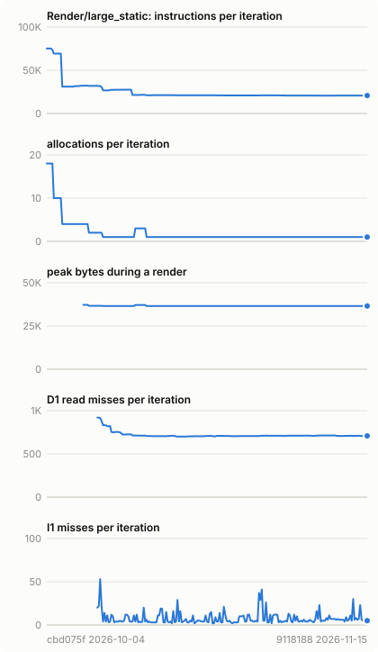

# Benchmark trend

Instruction and allocation counts per iteration on master, one record per commit (225 so far, latest [3265966](https://github.com/jinja2cpp/Jinja2Cpp/commit/326596646088bc072544de0d721e643d29b4d25a) on 2026-11-15). Written by the `trend` job of `.github/workflows/benchmark.yml` with `bench/trend.py`; the data is `history.jsonl`.

Memory is the bytes a loaded template keeps for `Load/*` and the peak heap use of one render for `Render/*`; vs first compares with the first record that has it.

| Benchmark | Instructions | vs previous | vs first | Allocations | vs previous | vs first | Memory | vs previous | vs first |
|---|---:|---:|---:|---:|---:|---:|---:|---:|---:|
| [Load/chat_llama](#loadchat_llama) | 335,983 | 0% |  | 55 | 0% |  | 18,480 | 0% | -52.71% |
| [Render/chat_llama](#renderchat_llama) | 292,217 | 0% |  | 225 | 0% |  | 11,616 | 0% | -19.11% |
| [Load/chat_mistral](#loadchat_mistral) | 386,163 | 0% |  | 52 | 0% |  | 20,904 | 0% | -53.18% |
| [Render/chat_mistral](#renderchat_mistral) | 494,944 | +0.02% |  | 402 | 0% |  | 9,952 | 0% | -24.65% |
| [Load/chat_qwen](#loadchat_qwen) | 261,847 | 0% |  | 44 | 0% |  | 14,432 | 0% | -47.19% |
| [Render/chat_qwen](#renderchat_qwen) | 273,717 | 0% |  | 212 | 0% |  | 8,304 | 0% | -2.35% |
| [Load/config_file](#loadconfig_file) | 94,907 | 0% |  | 25 | 0% |  | 5,480 | 0% | -48.11% |
| [Render/config_file](#renderconfig_file) | 1,279,189 | +0.02% |  | 910 | 0% |  | 25,560 | 0% | +7.36% |
| [Load/dict_ops](#loaddict_ops) | 32,522 | 0% | -77.99% | 9 | 0% | -93.13% | 2,192 | 0% | -48.50% |
| [Render/dict_ops](#renderdict_ops) | 292,336 | 0% | -57.68% | 112 | 0% | -75.11% | 24,408 | 0% | -29.65% |
| [Load/expressions](#loadexpressions) | 44,481 | 0% | -78.42% | 16 | 0% | -89.04% | 2,744 | 0% | -55.28% |
| [Render/expressions](#renderexpressions) | 417,531 | 0% | -53.92% | 3 | 0% | -90.00% | 2,440 | 0% | -31.15% |
| [Load/filters](#loadfilters) | 67,534 | 0% | -75.39% | 27 | 0% | -88.16% | 3,864 | 0% | -66.15% |
| [Render/filters](#renderfilters) | 27,013 | 0% | -69.53% | 23 | 0% | -68.92% | 752 | 0% | -84.69% |
| [Load/for_filter_if](#loadfor_filter_if) | 29,339 | 0% | -78.33% | 7 | 0% | -94.31% | 1,920 | 0% | -44.32% |
| [Render/for_filter_if](#renderfor_filter_if) | 268,877 | 0% | -68.93% | 4 | 0% | -98.23% | 16,560 | 0% | +354.95% |
| [Load/for_loop_vars](#loadfor_loop_vars) | 39,144 | 0% | -78.33% | 10 | 0% | -93.63% | 2,384 | 0% | -47.26% |
| [Render/for_loop_vars](#renderfor_loop_vars) | 172,280 | 0% | -83.94% | 2 | 0% | -99.62% | 1,568 | 0% | -43.35% |
| [Load/for_range](#loadfor_range) | 13,363 | 0% | -76.42% | 7 | 0% | -87.50% | 1,104 | 0% | -44.80% |
| [Render/for_range](#renderfor_range) | 37,468 | 0% | -59.37% | 3 | 0% | -88.89% | 408 | 0% | -73.02% |
| [Load/hf_deepseek_v31](#loadhf_deepseek_v31) | 384,051 | 0% |  | 55 | 0% |  | 21,992 | 0% | +0.81% |
| [Render/hf_deepseek_v31](#renderhf_deepseek_v31) | 92,100 | -0.13% |  | 43 | 0% |  | 2,480 | 0% | 0% |
| [Load/hf_gpt_oss](#loadhf_gpt_oss) | 1,525,342 | -0.01% |  | 287 | 0% |  | 74,576 | 0% | +0.47% |
| [Render/hf_gpt_oss](#renderhf_gpt_oss) | 169,821 | -0.09% |  | 156 | 0% |  | 5,664 | 0% | +14.75% |
| [Load/hf_mistral_small](#loadhf_mistral_small) | 592,181 | +0.01% |  | 88 | 0% |  | 33,064 | 0% | +0.39% |
| [Render/hf_mistral_small](#renderhf_mistral_small) | 141,414 | +0.04% |  | 99 | 0% |  | 6,120 | 0% | -0.26% |
| [Load/hf_qwen3](#loadhf_qwen3) | 477,185 | 0% |  | 82 | 0% |  | 25,576 | 0% | +0.38% |
| [Render/hf_qwen3](#renderhf_qwen3) | 118,980 | 0% |  | 100 | 0% |  | 3,248 | 0% | 0% |
| [Load/html_autoescape](#loadhtml_autoescape) | 190,045 | 0% |  | 43 | 0% |  | 12,688 | 0% | -48.59% |
| [Render/html_autoescape](#renderhtml_autoescape) | 1,200,011 | -0.01% |  | 675 | 0% |  | 45,992 | 0% | +13.89% |
| [Load/inheritance](#loadinheritance) | 21,973 | 0% | -80.75% | 7 | 0% | -93.46% | 1,360 | 0% | -52.65% |
| [Render/inheritance](#renderinheritance) | 138,236 | 0% | -81.52% | 38 | 0% | -93.89% | 7,920 | 0% | +31.65% |
| [Load/int_arith](#loadint_arith) | 65,435 | 0% |  | 20 | 0% |  | 3,888 | 0% | +0.83% |
| [Render/int_arith](#renderint_arith) | 831,747 | 0% |  | 12 | 0% |  | 3,272 | 0% | -0.49% |
| [Module/keep](#modulekeep) | 7,203 | 0% |  | 7 | 0% |  |  |  |  |
| [Module/keep_written](#modulekeep_written) | 29,263 | 0% |  | 11 | 0% |  |  |  |  |
| [Load/large_static](#loadlarge_static) | 147,992 | 0% | -83.30% | 14 | 0% | -96.82% | 43,136 | 0% | -19.20% |
| [Render/large_static](#renderlarge_static) | 20,750 | 0% | -72.38% | 1 | 0% | -94.44% | 36,552 | 0% | -1.83% |
| [RenderSink/large_static](#rendersinklarge_static) | 12,740 | 0% |  | 0 |  |  | 0 |  |  |
| [RenderTo/large_static](#rendertolarge_static) | 20,313 | 0% |  | 0 |  |  | 0 |  |  |
| [Load/macros](#loadmacros) | 55,024 | -0.02% | -75.86% | 27 | 0% | -85.48% | 4,392 | 0% | -29.34% |
| [Render/macros](#rendermacros) | 644,256 | 0% | -74.86% | 308 | 0% | -88.71% | 20,576 | 0% | +39.78% |
| [Load/many_tags](#loadmany_tags) | 8,765,372 | 0% | -80.15% | 951 | 0% | -97.22% | 438,176 | 0% | -58.48% |
| [Render/many_tags](#rendermany_tags) | 741,412 | +0.05% | -64.41% | 2 | 0% | -90.48% | 5,648 | 0% | -10.52% |
| [Load/mitsuhiko_table](#loadmitsuhiko_table) | 45,350 | 0% | -80.91% | 19 | 0% | -89.67% | 3,376 | 0% | -44.33% |
| [Render/mitsuhiko_table](#rendermitsuhiko_table) | 5,154,377 | 0% | -58.29% | 33 | 0% | -99.19% | 381,536 | 0% | +9.95% |
| [RenderSink/mitsuhiko_table](#rendersinkmitsuhiko_table) | 5,081,461 | 0% |  | 32 | 0% |  | 37,064 | 0% | +28.59% |
| [RenderTo/mitsuhiko_table](#rendertomitsuhiko_table) | 5,153,646 | 0% |  | 32 | 0% |  | 37,064 | 0% | +28.59% |
| [Load/mitsuhiko_table_wide](#loadmitsuhiko_table_wide) | 53,055 | 0% |  | 35 | 0% |  | 5,704 | 0% | -30.98% |
| [Render/mitsuhiko_table_wide](#rendermitsuhiko_table_wide) | 5,499,867 | 0% |  | 33 | 0% |  | 1,414,928 | 0% | +2.46% |
| [RenderSink/mitsuhiko_table_wide](#rendersinkmitsuhiko_table_wide) | 5,323,086 | 0% |  | 32 | 0% |  | 37,064 | 0% | +28.59% |
| [RenderTo/mitsuhiko_table_wide](#rendertomitsuhiko_table_wide) | 5,499,340 | 0% |  | 32 | 0% |  | 37,064 | 0% | +28.59% |
| [Load/plain_text](#loadplain_text) | 3,752 | 0% | -61.22% | 4 | 0% | -77.78% | 688 | 0% | -38.57% |
| [Render/plain_text](#renderplain_text) | 1,055 | 0% | -84.47% | 1 | 0% | -91.67% | 40 | 0% | -94.44% |
| [RenderSink/plain_text](#rendersinkplain_text) | 757 | 0% |  | 0 |  |  | 0 |  |  |
| [RenderTo/plain_text](#rendertoplain_text) | 856 | 0% |  | 0 |  |  | 0 |  |  |
| [Load/prompt_budget](#loadprompt_budget) | 34,642 | 0% |  | 18 | 0% |  | 2,240 | 0% | +0.72% |
| [Render/prompt_budget](#renderprompt_budget) | 1,319,824 | 0% |  | 76 | 0% |  | 36,416 | 0% | 0% |
| [Load/strings](#loadstrings) | 69,400 | 0% | -76.22% | 30 | 0% | -86.61% | 4,360 | 0% | -51.77% |
| [Render/strings](#renderstrings) | 582,927 | -0.02% | -72.21% | 344 | 0% | -83.73% | 9,088 | 0% | -49.31% |
| [Load/substitute](#loadsubstitute) | 7,532 | 0% | -74.77% | 6 | 0% | -83.78% | 848 | 0% | -44.21% |
| [Render/substitute](#rendersubstitute) | 2,254 | 0% | -74.43% | 1 | 0% | -91.67% | 40 | 0% | -94.44% |
| [RenderSink/substitute](#rendersinksubstitute) | 1,960 | 0% |  | 0 |  |  | 0 |  |  |
| [RenderTo/substitute](#rendertosubstitute) | 2,059 | 0% |  | 0 |  |  | 0 |  |  |

## Cache misses

Misses per iteration in callgrind's cache model (`count.py --cache-sim`: 32 KB 8-way L1, 8 MB 16-way last level, no prefetcher); reported, not gated.

| Benchmark | D1 read misses | vs previous | D1 write misses | vs previous | LL data read misses | vs previous | I1 misses | vs previous |
|---|---:|---:|---:|---:|---:|---:|---:|---:|
| Load/chat_llama | 755 | 0% | 757 | 0% | 0 |  | 7,875 | +0.51% |
| Render/chat_llama | 1,198 | -0.58% | 539 | -0.19% | 0 |  | 4,298 | -4.51% |
| Load/chat_mistral | 1,093 | -0.18% | 1,078 | 0% | 0 |  | 9,069 | +4.03% |
| Render/chat_mistral | 1,918 | -0.52% | 602 | -0.82% | 0 |  | 10,508 | -0.80% |
| Load/chat_qwen | 575 | 0% | 629 | 0% | 0 |  | 5,078 | +7.61% |
| Render/chat_qwen | 1,082 | +0.84% | 412 | -0.48% | 0 |  | 3,612 | +4.88% |
| Load/config_file | 221 | 0% | 180 | 0% | 0 |  | 2,831 | +0.32% |
| Render/config_file | 6,232 | +1.88% | 1,634 | +0.49% | 0 |  | 43,478 | -4.94% |
| Load/dict_ops | 44 | 0% | 25 | 0% | 0 |  | 1,405 | +2.63% |
| Render/dict_ops | 671 | -0.30% | 423 | -0.70% | 0 |  | 846 | -1.63% |
| Load/expressions | 25 | 0% | 23 | 0% | 0 |  | 1,387 | +4.44% |
| Render/expressions | 4 | -42.86% | 2 | -33.33% | 0 |  | 325 | +2.85% |
| Load/filters | 104 | -1.89% | 48 | -4.00% | 0 |  | 1,516 | -13.67% |
| Render/filters | 10 | 0% | 1 | 0% | 0 |  | 792 | -1.00% |
| Load/for_filter_if | 25 | 0% | 12 | 0% | 0 |  | 1,148 | +2.14% |
| Render/for_filter_if | 1,736 | 0% | 137 | 0% | 0 |  | 186 | -19.13% |
| Load/for_loop_vars | 46 | 0% | 21 | 0% | 0 |  | 1,169 | -0.51% |
| Render/for_loop_vars | 9 | 0% | 1 | 0% | 0 |  | 123 | -10.22% |
| Load/for_range | 5 | 0% | 4 | 0% | 0 |  | 789 | -1.13% |
| Render/for_range | 1 | 0% | 0 |  | 0 |  | 146 | -4.58% |
| Load/hf_deepseek_v31 | 1,015 | 0% | 987 | 0% | 0 |  | 6,867 | +7.68% |
| Render/hf_deepseek_v31 | 379 | -0.26% | 92 | +2.22% | 0 |  | 1,571 | -7.97% |
| Load/hf_gpt_oss | 4,651 | -0.06% | 3,369 | 0% | 0 |  | 23,823 | +2.84% |
| Render/hf_gpt_oss | 1,251 | -0.08% | 401 | +0.50% | 0 |  | 4,747 | +1.82% |
| Load/hf_mistral_small | 1,874 | +0.16% | 1,635 | 0% | 0 |  | 11,863 | +5.93% |
| Render/hf_mistral_small | 989 | +0.30% | 296 | +2.78% | 0 |  | 3,920 | +1.29% |
| Load/hf_qwen3 | 1,531 | -0.07% | 1,343 | +0.07% | 0 |  | 9,586 | +4.56% |
| Render/hf_qwen3 | 698 | +0.58% | 213 | -0.47% | 0 |  | 2,719 | -0.11% |
| Load/html_autoescape | 492 | 0% | 535 | -0.19% | 0 |  | 4,427 | +5.03% |
| Render/html_autoescape | 4,593 | -4.75% | 1,428 | +6.09% | 0 |  | 36,216 | +4.14% |
| Load/inheritance | 5 | 0% | 3 | 0% | 0 |  | 729 | -1.09% |
| Render/inheritance | 605 | -0.49% | 114 | +2.70% | 0 |  | 986 | -1.00% |
| Load/int_arith | 70 | -1.41% | 57 | 0% | 0 |  | 2,185 | +7.11% |
| Render/int_arith | 7 | -22.22% | 4 | -20.00% | 0 |  | 804 | -1.23% |
| Module/keep | 1 | 0% | 3 | 0% | 0 |  | 386 | -15.72% |
| Module/keep_written | 1,134 | 0% | 561 | 0% | 0 |  | 729 | -5.69% |
| Load/large_static | 1,928 | -0.05% | 904 | 0% | 0 |  | 349 | +7.06% |
| Render/large_static | 707 | 0% | 577 | 0% | 0 |  | 6 | -73.91% |
| RenderSink/large_static | 1 | 0% | 0 |  | 0 |  | 3 | -25.00% |
| RenderTo/large_static | 686 | 0% | 576 | 0% | 0 |  | 6 | -50.00% |
| Load/macros | 90 | 0% | 75 | -1.32% | 0 |  | 1,743 | -0.63% |
| Render/macros | 780 | -1.64% | 276 | -1.78% | 0 |  | 609 | -10.04% |
| Load/many_tags | 28,630 | -0.48% | 22,593 | -0.11% | 0 |  | 245,361 | -0.53% |
| Render/many_tags | 6,155 | +0.42% | 769 | -2.29% | 0 |  | 126 | -21.25% |
| Load/mitsuhiko_table | 42 | 0% | 51 | 0% | 0 |  | 926 | +4.75% |
| Render/mitsuhiko_table | 10,056 | +0.04% | 6,260 | 0% | 0 |  | 369 | -3.40% |
| RenderSink/mitsuhiko_table | 9,988 | -0.01% | 1,202 | +0.08% | 0 |  | 299 | -2.92% |
| RenderTo/mitsuhiko_table | 10,049 | -0.04% | 6,263 | +0.02% | 0 |  | 343 | +0.29% |
| Load/mitsuhiko_table_wide | 93 | -2.11% | 80 | -1.23% | 0 |  | 1,111 | +9.14% |
| Render/mitsuhiko_table_wide | 10,187 | -0.04% | 22,685 | +0.01% | 0 |  | 364 | -10.78% |
| RenderSink/mitsuhiko_table_wide | 10,020 | -0.05% | 1,291 | -0.46% | 0 |  | 300 | -1.96% |
| RenderTo/mitsuhiko_table_wide | 10,227 | +0.03% | 22,686 | +0.01% | 0 |  | 340 | -8.36% |
| Load/plain_text | 0 |  | 2 | 0% | 0 |  | 6 | -72.73% |
| Render/plain_text | 1 | 0% | 0 |  | 0 |  | 6 | -14.29% |
| RenderSink/plain_text | 1 | 0% | 0 |  | 0 |  | 5 | 0% |
| RenderTo/plain_text | 1 | 0% | 0 |  | 0 |  | 6 | 0% |
| Load/prompt_budget | 78 | 0% | 42 | 0% | 0 |  | 1,426 | +0.71% |
| Render/prompt_budget | 4,803 | 0% | 557 | -0.36% | 0 |  | 921 | -18.85% |
| Load/strings | 141 | +1.44% | 106 | +0.95% | 0 |  | 2,742 | -2.25% |
| Render/strings | 411 | +0.49% | 469 | +1.30% | 0 |  | 1,603 | -0.99% |
| Load/substitute | 4 | 0% | 4 | 0% | 0 |  | 178 | +6.59% |
| Render/substitute | 1 | 0% | 0 |  | 0 |  | 6 | -76.92% |
| RenderSink/substitute | 1 | 0% | 0 |  | 0 |  | 4 | 0% |
| RenderTo/substitute | 1 | 0% | 0 |  | 0 |  | 6 | -57.14% |

## Charts

### Load/chat_llama

### Render/chat_llama

### Load/chat_mistral

### Render/chat_mistral

### Load/chat_qwen

### Render/chat_qwen

### Load/config_file

### Render/config_file

### Load/dict_ops

### Render/dict_ops

### Load/expressions

### Render/expressions

### Load/filters

### Render/filters

### Load/for_filter_if

### Render/for_filter_if

### Load/for_loop_vars

### Render/for_loop_vars

### Load/for_range

### Render/for_range

### Load/hf_deepseek_v31

### Render/hf_deepseek_v31

### Load/hf_gpt_oss

### Render/hf_gpt_oss

### Load/hf_mistral_small

### Render/hf_mistral_small

### Load/hf_qwen3

### Render/hf_qwen3

### Load/html_autoescape

### Render/html_autoescape

### Load/inheritance

### Render/inheritance

### Load/int_arith

### Render/int_arith

### Module/keep

### Module/keep_written

### Load/large_static

### Render/large_static

### RenderSink/large_static

### RenderTo/large_static

### Load/macros

### Render/macros

### Load/many_tags

### Render/many_tags

### Load/mitsuhiko_table

### Render/mitsuhiko_table

### RenderSink/mitsuhiko_table

### RenderTo/mitsuhiko_table

### Load/mitsuhiko_table_wide

### Render/mitsuhiko_table_wide

### RenderSink/mitsuhiko_table_wide

### RenderTo/mitsuhiko_table_wide

### Load/plain_text

### Render/plain_text

### RenderSink/plain_text

### RenderTo/plain_text

### Load/prompt_budget

### Render/prompt_budget

### Load/strings

### Render/strings

### Load/substitute

### Render/substitute

### RenderSink/substitute

### RenderTo/substitute

