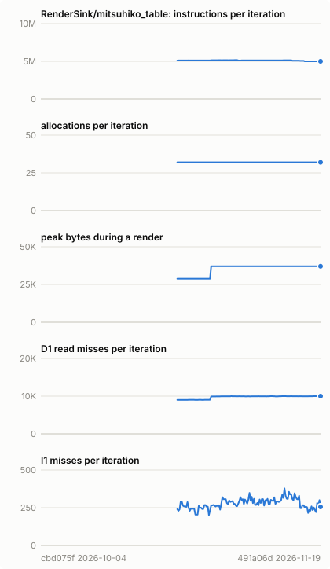
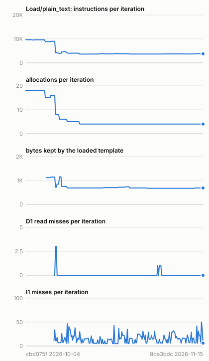
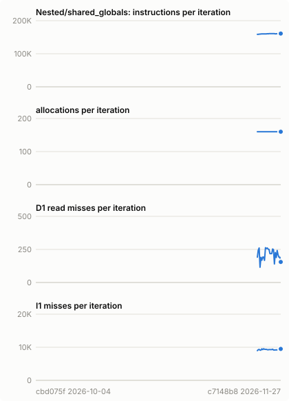

# Benchmark trend

Instruction and allocation counts per iteration on master, one record per commit (250 so far, latest [d1b0ff9](https://github.com/jinja2cpp/Jinja2Cpp/commit/d1b0ff983debcd7525d052791b012712a14a6561) on 2026-11-19). Written by the `trend` job of `.github/workflows/benchmark.yml` with `bench/trend.py`; the data is `history.jsonl`.

Memory is the bytes a loaded template keeps for `Load/*` and the peak heap use of one render for `Render/*`; vs first compares with the first record that has it.

| Benchmark | Instructions | vs previous | vs first | Allocations | vs previous | vs first | Memory | vs previous | vs first |
|---|---:|---:|---:|---:|---:|---:|---:|---:|---:|
| [Load/chat_llama](#loadchat_llama) | 334,947 | -0.01% |  | 54 | 0% |  | 18,520 | 0% | -52.61% |
| [Render/chat_llama](#renderchat_llama) | 289,984 | +0.02% |  | 224 | 0% |  | 11,592 | 0% | -19.28% |
| [Load/chat_mistral](#loadchat_mistral) | 384,158 | 0% |  | 51 | 0% |  | 20,976 | 0% | -53.02% |
| [Render/chat_mistral](#renderchat_mistral) | 489,913 | +0.03% |  | 392 | 0% |  | 9,784 | -0.16% | -25.92% |
| [Load/chat_qwen](#loadchat_qwen) | 261,035 | -0.01% |  | 43 | 0% |  | 14,472 | 0% | -47.04% |
| [Render/chat_qwen](#renderchat_qwen) | 272,223 | -0.02% |  | 211 | 0% |  | 8,280 | 0% | -2.63% |
| [Load/config_file](#loadconfig_file) | 94,060 | -0.01% |  | 24 | 0% |  | 5,520 | 0% | -47.73% |
| [Render/config_file](#renderconfig_file) | 1,273,281 | -0.02% |  | 908 | 0% |  | 25,880 | +0.12% | +8.70% |
| [Load/dict_ops](#loaddict_ops) | 31,809 | -0.03% | -78.47% | 8 | 0% | -93.89% | 2,216 | 0% | -47.93% |
| [Render/dict_ops](#renderdict_ops) | 290,433 | 0% | -57.96% | 112 | 0% | -75.11% | 24,408 | 0% | -29.65% |
| [Load/expressions](#loadexpressions) | 43,686 | -0.02% | -78.81% | 15 | 0% | -89.73% | 2,752 | 0% | -55.15% |
| [Render/expressions](#renderexpressions) | 414,361 | 0% | -54.27% | 3 | 0% | -90.00% | 2,440 | 0% | -31.15% |
| [Load/filters](#loadfilters) | 67,281 | -0.01% | -75.48% | 26 | 0% | -88.60% | 3,856 | 0% | -66.22% |
| [Render/filters](#renderfilters) | 26,455 | 0% | -70.16% | 23 | 0% | -68.92% | 752 | 0% | -84.69% |
| [Load/for_filter_if](#loadfor_filter_if) | 28,541 | -0.03% | -78.92% | 6 | 0% | -95.12% | 1,928 | 0% | -44.08% |
| [Render/for_filter_if](#renderfor_filter_if) | 267,119 | 0% | -69.14% | 4 | 0% | -98.23% | 16,560 | 0% | +354.95% |
| [Load/for_loop_vars](#loadfor_loop_vars) | 38,347 | -0.02% | -78.77% | 9 | 0% | -94.27% | 2,392 | 0% | -47.08% |
| [Render/for_loop_vars](#renderfor_loop_vars) | 170,758 | 0% | -84.08% | 2 | 0% | -99.62% | 1,568 | 0% | -43.35% |
| [Load/for_range](#loadfor_range) | 12,481 | -0.07% | -77.98% | 6 | 0% | -89.29% | 1,128 | 0% | -43.60% |
| [Render/for_range](#renderfor_range) | 37,143 | 0% | -59.72% | 3 | 0% | -88.89% | 408 | 0% | -73.02% |
| [Load/hf_deepseek_v31](#loadhf_deepseek_v31) | 383,007 | -0.07% |  | 54 | 0% |  | 22,032 | 0% | +0.99% |
| [Render/hf_deepseek_v31](#renderhf_deepseek_v31) | 90,212 | -0.01% |  | 42 | 0% |  | 2,456 | 0% | -0.97% |
| [Load/hf_gpt_oss](#loadhf_gpt_oss) | 1,522,219 | -0.01% |  | 282 | 0% |  | 75,000 | 0% | +1.05% |
| [Render/hf_gpt_oss](#renderhf_gpt_oss) | 168,364 | -0.09% |  | 153 | 0% |  | 5,856 | 0% | +18.64% |
| [Load/hf_mistral_small](#loadhf_mistral_small) | 590,968 | +0.20% |  | 87 | 0% |  | 33,136 | 0% | +0.61% |
| [Render/hf_mistral_small](#renderhf_mistral_small) | 139,255 | -0.08% |  | 97 | 0% |  | 6,096 | 0% | -0.65% |
| [Load/hf_qwen3](#loadhf_qwen3) | 475,695 | -0.07% |  | 81 | 0% |  | 25,632 | 0% | +0.60% |
| [Render/hf_qwen3](#renderhf_qwen3) | 116,818 | -0.01% |  | 99 | 0% |  | 3,224 | 0% | -0.74% |
| [Load/html_autoescape](#loadhtml_autoescape) | 188,672 | 0% |  | 42 | 0% |  | 12,728 | 0% | -48.43% |
| [Render/html_autoescape](#renderhtml_autoescape) | 1,197,326 | +0.04% |  | 674 | 0% |  | 46,176 | +0.07% | +14.34% |
| [Load/inheritance](#loadinheritance) | 21,295 | -0.04% | -81.34% | 6 | 0% | -94.39% | 1,368 | 0% | -52.37% |
| [Render/inheritance](#renderinheritance) | 135,953 | +0.48% | -81.82% | 35 | 0% | -94.37% | 8,136 | +0.39% | +35.24% |
| [Load/int_arith](#loadint_arith) | 64,588 | -0.01% |  | 19 | 0% |  | 3,896 | 0% | +1.04% |
| [Render/int_arith](#renderint_arith) | 825,280 | 0% |  | 12 | 0% |  | 3,272 | 0% | -0.49% |
| [Module/keep](#modulekeep) | 6,942 | 0% |  | 6 | 0% |  |  |  |  |
| [Module/keep_written](#modulekeep_written) | 29,006 | 0% |  | 10 | 0% |  |  |  |  |
| [Load/large_static](#loadlarge_static) | 146,658 | -0.01% | -83.45% | 13 | 0% | -97.05% | 43,128 | 0% | -19.21% |
| [Render/large_static](#renderlarge_static) | 20,332 | 0% | -72.94% | 1 | 0% | -94.44% | 36,552 | 0% | -1.83% |
| [RenderSink/large_static](#rendersinklarge_static) | 12,621 | 0% |  | 0 |  |  | 0 |  |  |
| [RenderTo/large_static](#rendertolarge_static) | 19,895 | 0% |  | 0 |  |  | 0 |  |  |
| [Load/macros](#loadmacros) | 53,988 | -0.02% | -76.32% | 25 | 0% | -86.56% | 4,472 | 0% | -28.06% |
| [Render/macros](#rendermacros) | 645,264 | +0.13% | -74.82% | 308 | 0% | -88.71% | 20,608 | 0% | +40.00% |
| [Load/many_tags](#loadmany_tags) | 8,768,145 | 0% | -80.15% | 950 | 0% | -97.23% | 438,120 | 0% | -58.48% |
| [Render/many_tags](#rendermany_tags) | 732,445 | 0% | -64.84% | 2 | 0% | -90.48% | 5,648 | 0% | -10.52% |
| [Load/mitsuhiko_table](#loadmitsuhiko_table) | 44,592 | -0.02% | -81.23% | 18 | 0% | -90.22% | 3,416 | 0% | -43.67% |
| [Render/mitsuhiko_table](#rendermitsuhiko_table) | 5,075,460 | 0% | -58.92% | 33 | 0% | -99.19% | 381,536 | 0% | +9.95% |
| [RenderSink/mitsuhiko_table](#rendersinkmitsuhiko_table) | 5,005,247 | 0% |  | 32 | 0% |  | 37,064 | 0% | +28.59% |
| [RenderTo/mitsuhiko_table](#rendertomitsuhiko_table) | 5,074,937 | 0% |  | 32 | 0% |  | 37,064 | 0% | +28.59% |
| [Load/mitsuhiko_table_wide](#loadmitsuhiko_table_wide) | 52,331 | -0.02% |  | 34 | 0% |  | 5,744 | 0% | -30.49% |
| [Render/mitsuhiko_table_wide](#rendermitsuhiko_table_wide) | 5,421,089 | 0% |  | 33 | 0% |  | 1,414,928 | 0% | +2.46% |
| [RenderSink/mitsuhiko_table_wide](#rendersinkmitsuhiko_table_wide) | 5,247,016 | 0% |  | 32 | 0% |  | 37,064 | 0% | +28.59% |
| [RenderTo/mitsuhiko_table_wide](#rendertomitsuhiko_table_wide) | 5,420,506 | 0% |  | 32 | 0% |  | 37,064 | 0% | +28.59% |
| [Nested/new_template](#nestednew_template) | 451,057 | -0.01% |  | 323 | 0% |  |  |  |  |
| [Load/plain_text](#loadplain_text) | 2,932 | -0.31% | -69.70% | 3 | 0% | -83.33% | 680 | 0% | -39.29% |
| [Render/plain_text](#renderplain_text) | 962 | 0% | -85.84% | 1 | 0% | -91.67% | 40 | 0% | -94.44% |
| [RenderSink/plain_text](#rendersinkplain_text) | 667 | 0% |  | 0 |  |  | 0 |  |  |
| [RenderTo/plain_text](#rendertoplain_text) | 763 | 0% |  | 0 |  |  | 0 |  |  |
| [Load/prompt_budget](#loadprompt_budget) | 34,154 | -0.03% |  | 17 | 0% |  | 2,248 | 0% | +1.08% |
| [Render/prompt_budget](#renderprompt_budget) | 1,321,793 | 0% |  | 76 | 0% |  | 36,416 | 0% | 0% |
| [Nested/shared_globals](#nestedshared_globals) | 159,396 | +0.04% |  | 160 | 0% |  |  |  |  |
| [Load/strings](#loadstrings) | 68,802 | -0.01% | -76.43% | 29 | 0% | -87.05% | 4,384 | 0% | -51.50% |
| [Render/strings](#renderstrings) | 581,161 | -0.01% | -72.29% | 344 | 0% | -83.73% | 9,088 | 0% | -49.31% |
| [Load/substitute](#loadsubstitute) | 6,642 | -0.14% | -77.75% | 5 | 0% | -86.49% | 840 | 0% | -44.74% |
| [Render/substitute](#rendersubstitute) | 1,643 | 0% | -81.36% | 1 | 0% | -91.67% | 40 | 0% | -94.44% |
| [RenderSink/substitute](#rendersinksubstitute) | 1,352 | 0% |  | 0 |  |  | 0 |  |  |
| [RenderTo/substitute](#rendertosubstitute) | 1,448 | 0% |  | 0 |  |  | 0 |  |  |

## Cache misses

Misses per iteration in callgrind's cache model (`count.py --cache-sim`: 32 KB 8-way L1, 8 MB 16-way last level, no prefetcher); reported, not gated.

| Benchmark | D1 read misses | vs previous | D1 write misses | vs previous | LL data read misses | vs previous | I1 misses | vs previous |
|---|---:|---:|---:|---:|---:|---:|---:|---:|
| Load/chat_llama | 758 | +3.13% | 758 | -0.26% | 0 |  | 7,806 | -1.93% |
| Render/chat_llama | 1,176 | -0.25% | 527 | +1.35% | 0 |  | 3,964 | -5.66% |
| Load/chat_mistral | 1,147 | +4.65% | 1,106 | +0.45% | 0 |  | 8,914 | -0.57% |
| Render/chat_mistral | 2,073 | 0% | 670 | -1.03% | 0 |  | 10,493 | +1.05% |
| Load/chat_qwen | 552 | +0.55% | 641 | -0.47% | 0 |  | 4,748 | -2.80% |
| Render/chat_qwen | 1,122 | +3.22% | 419 | +0.96% | 0 |  | 3,429 | -4.80% |
| Load/config_file | 201 | +3.08% | 189 | +0.53% | 0 |  | 2,806 | -3.71% |
| Render/config_file | 6,918 | -6.99% | 1,775 | -1.93% | 0 |  | 44,254 | +1.07% |
| Load/dict_ops | 40 | +5.26% | 28 | -3.45% | 0 |  | 1,410 | -0.35% |
| Render/dict_ops | 684 | -0.44% | 425 | +1.19% | 0 |  | 819 | -0.36% |
| Load/expressions | 22 | +29.41% | 14 | +7.69% | 0 |  | 1,383 | +6.30% |
| Render/expressions | 4 | -33.33% | 1 | -50.00% | 0 |  | 332 | +9.93% |
| Load/filters | 80 | 0% | 38 | +5.56% | 0 |  | 2,025 | +7.66% |
| Render/filters | 6 | -60.00% | 2 | +100.00% | 0 |  | 731 | -0.27% |
| Load/for_filter_if | 21 | +5.00% | 18 | 0% | 0 |  | 1,074 | -0.65% |
| Render/for_filter_if | 1,724 | +0.12% | 81 | -1.22% | 0 |  | 137 | -13.29% |
| Load/for_loop_vars | 27 | -12.90% | 25 | 0% | 0 |  | 1,123 | -2.26% |
| Render/for_loop_vars | 13 | -7.14% | 3 | 0% | 0 |  | 107 | +62.12% |
| Load/for_range | 3 | +200.00% | 5 | +66.67% | 0 |  | 740 | -5.13% |
| Render/for_range | 10 | +25.00% | 0 |  | 0 |  | 125 | -25.15% |
| Load/hf_deepseek_v31 | 975 | +0.31% | 988 | -0.40% | 0 |  | 6,956 | +0.29% |
| Render/hf_deepseek_v31 | 370 | -3.39% | 89 | -1.11% | 0 |  | 1,486 | +2.13% |
| Load/hf_gpt_oss | 4,717 | +1.62% | 3,383 | -0.79% | 0 |  | 23,648 | -0.32% |
| Render/hf_gpt_oss | 1,303 | -1.59% | 399 | +0.50% | 0 |  | 4,791 | -2.82% |
| Load/hf_mistral_small | 1,890 | +2.00% | 1,638 | +0.37% | 0 |  | 11,936 | +1.80% |
| Render/hf_mistral_small | 995 | +1.22% | 300 | -0.66% | 0 |  | 3,754 | -3.10% |
| Load/hf_qwen3 | 1,586 | -0.13% | 1,354 | +0.59% | 0 |  | 9,141 | -2.44% |
| Render/hf_qwen3 | 693 | +0.14% | 212 | -3.20% | 0 |  | 2,671 | -0.74% |
| Load/html_autoescape | 545 | +1.30% | 540 | -0.74% | 0 |  | 4,186 | -6.71% |
| Render/html_autoescape | 4,699 | +30.20% | 1,607 | +21.47% | 0 |  | 37,249 | +3.38% |
| Load/inheritance | 2 | -71.43% | 3 | -25.00% | 0 |  | 697 | -1.13% |
| Render/inheritance | 618 | -0.48% | 120 | +1.69% | 0 |  | 1,037 | -0.29% |
| Load/int_arith | 76 | -1.30% | 64 | +10.34% | 0 |  | 2,182 | +4.55% |
| Render/int_arith | 10 | +42.86% | 3 | +200.00% | 0 |  | 732 | -1.61% |
| Module/keep | 1 | 0% | 2 | 0% | 0 |  | 434 | +14.51% |
| Module/keep_written | 1,144 | 0% | 563 | -0.53% | 0 |  | 754 | +2.03% |
| Load/large_static | 1,918 | +0.16% | 909 | 0% | 0 |  | 251 | -15.49% |
| Render/large_static | 701 | +0.14% | 569 | +0.18% | 0 |  | 5 | +66.67% |
| RenderSink/large_static | 1 | 0% | 0 |  | 0 |  | 3 | 0% |
| RenderTo/large_static | 681 | +0.15% | 570 | +0.18% | 0 |  | 5 | +66.67% |
| Load/macros | 76 | -3.80% | 81 | +17.39% | 0 |  | 1,734 | -0.63% |
| Render/macros | 781 | -0.13% | 251 | +0.80% | 0 |  | 1,833 | +40.68% |
| Load/many_tags | 27,969 | +0.32% | 22,627 | -0.04% | 0 |  | 243,689 | -7.89% |
| Render/many_tags | 6,119 | +0.08% | 787 | +0.64% | 0 |  | 150 | +22.95% |
| Load/mitsuhiko_table | 25 | -10.71% | 38 | 0% | 0 |  | 856 | -6.14% |
| Render/mitsuhiko_table | 10,035 | +0.11% | 6,252 | +0.10% | 0 |  | 309 | +2.32% |
| RenderSink/mitsuhiko_table | 10,026 | +0.20% | 1,201 | -1.07% | 0 |  | 246 | -3.53% |
| RenderTo/mitsuhiko_table | 10,083 | +0.19% | 6,256 | -0.08% | 0 |  | 289 | +1.05% |
| Load/mitsuhiko_table_wide | 77 | -3.75% | 91 | -2.15% | 0 |  | 1,037 | +9.04% |
| Render/mitsuhiko_table_wide | 10,185 | +0.01% | 22,713 | +0.23% | 0 |  | 331 | +11.07% |
| RenderSink/mitsuhiko_table_wide | 10,018 | +0.17% | 1,297 | +1.01% | 0 |  | 261 | +8.75% |
| RenderTo/mitsuhiko_table_wide | 10,191 | +0.09% | 22,681 | +0.04% | 0 |  | 294 | +6.52% |
| Nested/new_template | 2,087 | +5.89% | 1,356 | -1.67% | 0 |  | 24,335 | -0.79% |
| Load/plain_text | 0 |  | 1 | 0% | 0 |  | 3 | -40.00% |
| Render/plain_text | 1 | 0% | 0 |  | 0 |  | 6 | 0% |
| RenderSink/plain_text | 1 | 0% | 0 |  | 0 |  | 5 | +25.00% |
| RenderTo/plain_text | 1 | -50.00% | 0 |  | 0 |  | 6 | +20.00% |
| Load/prompt_budget | 72 | -5.26% | 57 | -9.52% | 0 |  | 1,458 | -2.21% |
| Render/prompt_budget | 4,791 | -0.42% | 554 | +2.40% | 0 |  | 923 | -2.74% |
| Nested/shared_globals | 115 | -55.94% | 64 | -53.28% | 0 |  | 9,124 | -2.40% |
| Load/strings | 150 | +9.49% | 115 | +2.68% | 0 |  | 2,856 | -1.62% |
| Render/strings | 415 | 0% | 466 | 0% | 0 |  | 1,572 | -0.38% |
| Load/substitute | 1 | 0% | 2 | 0% | 0 |  | 146 | +43.14% |
| Render/substitute | 1 | 0% | 0 |  | 0 |  | 4 | +33.33% |
| RenderSink/substitute | 1 | 0% | 0 |  | 0 |  | 4 | +33.33% |
| RenderTo/substitute | 1 | 0% | 0 |  | 0 |  | 4 | +33.33% |

## Charts

### Load/chat_llama

### Render/chat_llama

### Load/chat_mistral

### Render/chat_mistral

### Load/chat_qwen

### Render/chat_qwen

### Load/config_file

### Render/config_file

### Load/dict_ops

### Render/dict_ops

### Load/expressions

### Render/expressions

### Load/filters

### Render/filters

### Load/for_filter_if

### Render/for_filter_if

### Load/for_loop_vars

### Render/for_loop_vars

### Load/for_range

### Render/for_range

### Load/hf_deepseek_v31

### Render/hf_deepseek_v31

### Load/hf_gpt_oss

### Render/hf_gpt_oss

### Load/hf_mistral_small

### Render/hf_mistral_small

### Load/hf_qwen3

### Render/hf_qwen3

### Load/html_autoescape

### Render/html_autoescape

### Load/inheritance

### Render/inheritance

### Load/int_arith

### Render/int_arith

### Module/keep

### Module/keep_written

### Load/large_static

### Render/large_static

### RenderSink/large_static

### RenderTo/large_static

### Load/macros

### Render/macros

### Load/many_tags

### Render/many_tags

### Load/mitsuhiko_table

### Render/mitsuhiko_table

### RenderSink/mitsuhiko_table

### RenderTo/mitsuhiko_table

### Load/mitsuhiko_table_wide

### Render/mitsuhiko_table_wide

### RenderSink/mitsuhiko_table_wide

### RenderTo/mitsuhiko_table_wide

### Nested/new_template

### Load/plain_text

### Render/plain_text

### RenderSink/plain_text

### RenderTo/plain_text

### Load/prompt_budget

### Render/prompt_budget

### Nested/shared_globals

### Load/strings

### Render/strings

### Load/substitute

### Render/substitute

### RenderSink/substitute

### RenderTo/substitute

